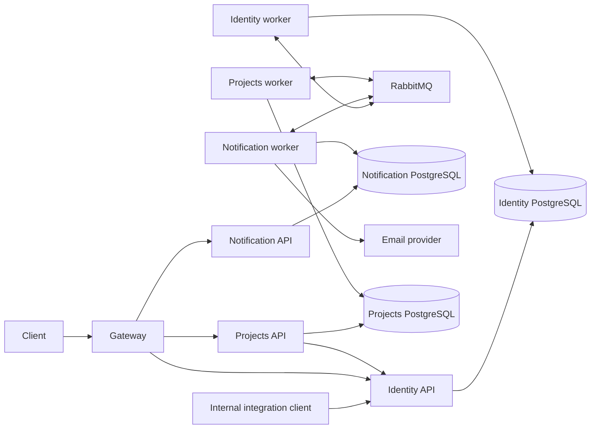

# DeliveryPilot — Current Backend Architecture

This document describes the **current backend**: runtime hosts, module boundaries, data ownership and cross-cutting invariants of the .NET 10 solution (Identity, Notification, a YARP Gateway, shared BuildingBlocks and cross-module Contracts). Code, tests, project files, migrations and deployment configuration remain authoritative; when this document disagrees with them, report and fix the drift.

Product direction lives in the [Product Blueprint](docs/product.md), [Roadmap](docs/roadmap.md) and [Cross-feature Requirements](docs/requirements.md); they are planned capabilities, not runtime evidence. The [Target Architecture Proposal](docs/architecture.md) (modular monolith) **must not override** the existing independently hosted modules. New business modules require an explicit architecture decision first. Feature progress is tracked in `docs/features/**/tasks/`, not here.

## Runtime topology

Each module has API, Application, Domain, Infrastructure, Worker and MigrationRunner projects. APIs, workers, migration runners and the Gateway are separate executable hosts. The local Docker deployment adds one PostgreSQL per module, RabbitMQ and Mailpit.

- **Identity worker** (`IdentityMessagingExtensions`): `OutboxRelay`, `IdentityOutboxMaintenanceWorker`, `EmailDeliveryRecordedConsumer` and `InvitationDeliveryStatusConsumer`.
- **Notification** owns email intake, delivery, provider outcomes and suppression. It delivers verification and organization-invitation emails; it does not verify accounts. Registration does not create verification tokens.
- **Projects** (`src/Modules/DeliveryPilot.Projects`, [ADR-001](docs/architecture/adr-001-delivery-module-placement.md)) implements `POST /api/v1/organizations/{organizationId}/engagements`, with Identity-authorized creation, duplicate-reference warnings, one append-only creation event and atomic receipts in `reliability.IdempotencyRecords`. Authorized retries return the original creation snapshot. Bearer tokens are validated locally (shared HS256 `Jwt` settings) and every session is confirmed through Identity's internal `session-checks`; workspace authority is rechecked uncached after advisory-lock waits. An unavailable Identity session check returns 503; a revoked session returns 401. `ProjectsDbContext` maps the existing reliability tables and six engagement tables from migration `20261110035531_AddEngagementPersistence`. Child composite foreign keys enforce vendor ownership; Identity IDs stay scalar references. The worker runs `OutboxRelay` with no business messages registered. Docker/host deployment wiring is provided by TASK-DP-025-012; local ports are 19093 (API) and 25433 (PostgreSQL). Server APIs remain internal; the Gateway publishes the engagement allowlist described below. Details (`PUT /api/v1/organizations/{organizationId}/engagements/{engagementId}`), contract value and effort, milestones, contacts and close/reopen have manage-authorized mutation routes; each uses a tenant-scoped parent row lock, an authority recheck and an atomic attributed event. Detail corrections require a reason for agreement changes and share the creation duplicate-reference lock; duplicate references remain allowed with a warning. Project-related closure checks are deferred to FEAT-DP-004. Client Owner/Admin routes at `POST /api/v1/organizations/{organizationId}/engagement-links/preview` and `/confirm` validate single-use codes with a durable per-user failure limit. Client list and removal and vendor removal are also implemented; removal is allowed while Closed and a confirmed link grants no access. Full-detail list, detail and history reads enforce tenant-scoped Identity authority without returning link-code verifiers. Project-participant summaries remain with TASK-DP-025-011, and project-related closure behavior remains with FEAT-DP-004.

## Identity module

One Identity-owned database (see [`IdentityDbContext`](src/Modules/DeliveryPilot.Identity/DeliveryPilot.Identity.Infrastructure/Persistence/DbContexts/IdentityDbContext.cs)) holds three internal areas:

| Area | Persisted models |
|---|---|
| Authentication | `User`, `PasswordCredential`, `AuthSession` |
| Organization Management | `Organization`, `OrganizationMembership`, `OrganizationRole`, `OrganizationRolePermission`, `OrganizationRoleAssignment`, `OrganizationInvitation`, `OrganizationInvitationRoleOffer`, `OrganizationInvitationDelivery`, `OrganizationCreationAttempt` |
| Audit | `IdentityAuditEvent` (written in the same command transaction as the change it records) |

`PlatformRoleAssignment` exists only as a Domain class: it has no table and no use case. The selected module design is in [Identity & Organization design](docs/architecture/modules/identity/README.md).

HTTP surface (all routes under `api/v1/`):

| Controller | Routes | Authentication |
|---|---|---|
| `AuthController` | `POST auth/register`, `POST auth/login`, `POST auth/refresh` (refresh cookie), `POST auth/logout` (optional bearer and/or refresh cookie; always 204) | Anonymous |
| `OrganizationsController` | `POST organizations` (requires `Idempotency-Key`) | Bearer |
| `MeOrganizationsController` | `GET me/organizations` | Bearer |
| `OrganizationMembersController` | `GET organizations/{id}/members`, `…/members/me`, `…/members/{membershipId}`, `POST …/members/{membershipId}/roles/{roleId}/grant\|revoke` | Bearer |
| `OrganizationRolesController` | `GET`, `POST organizations/{id}/roles`, `PUT …/roles/{roleId}` | Bearer |
| `OrganizationPermissionsController` | `GET organizations/{id}/permissions` | Bearer |
| `OrganizationInvitationsController` | `GET`, `POST organizations/{id}/invitations`, `GET …/{invitationId}`, `POST …/{invitationId}/resend\|reissue\|cancel` | Bearer |
| `InvitationResponsesController` | `POST organization-invitations/{invitationId}/preview\|accept\|decline` (proof in body) | Bearer |
| `UsersController` | `GET integrations/users/{userId}`, `POST integrations/users/lookup` (1–100 IDs; display data only, unknown users omitted) | Integration API key |
| `AuthorityController` | `POST integrations/authority/session-checks`, `POST integrations/authority/organization-checks` (internal session and workspace authority checks for other hosts; a denial is a 200 `denied` decision with no detail) | Integration API key |
| `InvitationDeliveryEligibilityController` | `GET integrations/organization-invitation-deliveries/{deliveryMessageId}/eligibility` | Invitation dispatch key |

## Gateway exposure

The Gateway ([`proxy.json`](src/Gateway/DeliveryPilot.Gateway/proxy.json)) publishes an explicit allowlist and removes the module prefix:

- `POST /notification/api/v1/webhooks/email/resend` (the raw signed request is verified before processing)
- `POST /identity/api/v1/auth/register`
- `POST /identity/api/v1/auth/login`
- `POST /identity/api/v1/auth/refresh`
- `POST /identity/api/v1/auth/logout`

The allowlist also publishes 30 Organization method/path pairs under `/identity/api/v1`: workspace creation/personal listing, permissions, role definitions/retirement, member reads and guarded role/membership actions, manager and recipient invitations, ownership nominations and permitted audit history. Exact routes and methods are defined in `proxy.json` and checked by the Gateway route tests. These routes remove only `/identity`, use GUID-constrained identifiers, a 30-second timeout and a 16,384-byte body ceiling. Private responses, including Gateway-generated errors, are no-store. The configured CORS policy permits GET/POST/PUT and the Idempotency-Key request header; Identity remains responsible for current bearer/session and workspace authorization. [TASK-DP-003-014](docs/features/FEAT-DP-003-organization/tasks/TASK-DP-003-014.md) records verification and external handoffs.

The Gateway also publishes 21 engagement method/path pairs under `/projects/api/v1/organizations/{organizationId:guid}`. These cover `GET/POST engagements`, `GET/PUT engagements/{engagementId}`, `GET …/history`, `PUT …/contract-value`, `POST …/close|reopen|link-codes|client-link/remove`, contact add/edit/remove, milestone add/edit/date/status, and `GET engagement-links` plus `POST engagement-links/preview|confirm|{engagementId}/remove`. `proxy.json` is the exact allowlist; Projects routes retain GUID constraints, a 30-second timeout, a 16,384-byte body ceiling and no-store responses. The Gateway removes `/projects`; its Compose destination uses the internal `projects-api` alias. Project content endpoints are not published by this change. Summary-tier visibility still depends on task 011.

Integration endpoints, including invitation delivery eligibility and Users integration, remain internal and must never be published. The Gateway applies forwarding, CORS, request-size and timeout rules. Its readiness endpoint validates proxy configuration only; module API readiness checks include their databases.

## Authentication and authorization model

- Identity API is the only host that validates bearer tokens (`AddConfiguredAuthentication`, `AddAuthSessions`). Validation pins `HS256`, issuer, audience and zero clock skew. Access and refresh lifetimes come from configuration (`Jwt` section).
- Access tokens carry only `sub`, `sid` and `jti`. They carry no tenant, role or permission claims.
- Every protected request checks, uncached, that the session exists, is not revoked and belongs to an active account (`IAuthenticatedContextValidator`), and fails closed.
- Login sets the refresh token as a `Secure`, `HttpOnly`, `SameSite=Strict` cookie (`dp_refresh_token`). Only a SHA-256 verifier is stored. Rotation and revocation lock the session row (`AuthSessionService`).
- Organization authority is recomputed from the database on every request by `OrganizationAuthorizationService`; tenant, role and permission claims are ignored. Stores always filter by `OrganizationId`.
- Workspace permission codes are code-defined in `OrganizationCapabilityCatalog`. Each grant row is pinned to the catalog policy version it was granted under (currently 3) and interpreted only by that version's frozen classification; unknown versions fail closed. Version 2 adds the delivery entry points `organization.engagements.create`, `organization.engagements.read-all` and `organization.projects.create` (held by built-in Owner/Admin, delegable to custom roles); they gate entry actions for the Projects module ([ADR-001](docs/architecture/adr-001-delivery-module-placement.md)) and grant no project access. Version 3 adds `organization.engagements.manage` (same holders and delegability) for engagement edit, close/reopen and client-link authority ([TASK-DP-003-022](docs/features/FEAT-DP-003-organization/tasks/TASK-DP-003-022.md)).
- Other hosts obtain session validity and workspace authority only through the internal `AuthorityController` checks, never Identity's database. No other host consumes them yet.
- Workspace security mutations serialize inside the command transaction through `OrganizationMutationGuard`, using the lock order documented on that class (workspace → users → session → memberships). This protects Owner continuity and revocation races.
- Any future host that needs bearer validation or organization authority must use a reviewed cross-host contract and never reference Identity's database. [ADR-001](docs/architecture/adr-001-delivery-module-placement.md) D-02 selects shared-key bearer validation plus the `AuthorityController` checks for the Projects host only. TASK-DP-025-012 stages the canonical key to its API and keeps it out of its worker and migration runner.

## Dependency direction

- Gateway depends on BuildingBlocks.
- API and Worker depend on their own Application and Infrastructure, Contracts and BuildingBlocks. MigrationRunner depends on its own Infrastructure and BuildingBlocks.
- Infrastructure depends inward on Application, Domain, Contracts and BuildingBlocks. Application depends on Domain, Contracts and BuildingBlocks. Domain depends on BuildingBlocks.
- Contracts depend on BuildingBlocks only when needed. BuildingBlocks depend on other BuildingBlocks without cycles.

Application does not reference Infrastructure or `DeliveryPilot.AspNetCore`. Modules integrate through Contracts or Application-owned abstractions, never through another module's Domain, Infrastructure or DbContext. Cross-module IDs are scalar references, not cross-database foreign keys.

## Requests, transactions and failures

Controllers translate HTTP input and send commands or queries through `DeliveryPilot.SharedKernel.Cqrs.ISender`. The pipeline order is validation, logging, performance, tracing, transaction, handler. The transaction behavior wraps **commands** in an `IUnitOfWork` transaction (Read Committed) and owns `SaveChangesAsync` and commit; queries do not open command transactions. Workers and operational paths outside the pipeline manage their own persistence. Failure-handling conventions are in the [module guidance](src/Modules/AGENTS.md).

## Messaging

The shared EntityFrameworkCore and Messaging building blocks provide the outbox, inbox, idempotency, relay and broker primitives. Message contracts live in `src/Contracts/`; change message types, broker topology and consumers together.

Invitation email flow: a command stages an encrypted `OrganizationInvitationEmailRequestedV1` (envelope encryption, Notification public key) into the Identity outbox in the same transaction. The Identity worker relays it to RabbitMQ, Notification delivers it, and delivery status flows back through `InvitationDeliveryStatusConsumer`. Notification may check `…/eligibility` with the dispatch key before sending.

## Persistence and migrations

- One PostgreSQL database and EF Core context per module. Identity business tables live in schema `shared`; operational messaging tables live in `reliability`. Tables are plural PascalCase, columns PascalCase, and custom identifiers are quoted.
- Email uniqueness is enforced by the case-insensitive index `UxUsersPrimaryEmailCi`, which is created in migration SQL and **not** modelled in EF configuration. Registration additionally takes a transaction-scoped advisory lock.
- Each MigrationRunner applies its own context's migrations; APIs never migrate on startup. `NotificationInboxDbContext` is registered but has no migration.
- Never rewrite existing migrations; add new ones. The historical `RetainUsersOnly` migration is destructive: its rollback recreates schema, not data.

## Deployment

The entry points under `scripts/` orchestrate local and server deployments. The local Docker flow creates networks and broker topology, stages secrets, bootstraps databases and roles, runs migration jobs, grants runtime access, and starts the APIs, workers and Gateway (defaults in `deploy/env/local.env.example`). Server mode uses prebuilt images, operator-provisioned secrets and an operator-provided TLS RabbitMQ cluster. The optional telemetry stack runs OpenTelemetry Collector, Prometheus, Loki, Tempo and Grafana. In server compose, Identity API publishes no host port and is reachable only through the Gateway and the internal network; local compose additionally binds it to `127.0.0.1:19091` for development. See [Deploy](docs/Deploy.md) and `deploy/`.

## Not implemented yet

Runtime facts at the last verification. The linked artifact owns each item.

- Membership removal and suspension: [TASK-DP-003-011](docs/features/FEAT-DP-003-organization/tasks/TASK-DP-003-011.md).
- Additional-Owner nomination: [TASK-DP-003-012](docs/features/FEAT-DP-003-organization/tasks/TASK-DP-003-012.md).
- Audit history query: [TASK-DP-003-013](docs/features/FEAT-DP-003-organization/tasks/TASK-DP-003-013.md).
- Organization backend journey/deployment verification and external handoffs: [TASK-DP-003-014](docs/features/FEAT-DP-003-organization/tasks/TASK-DP-003-014.md).
- Custom role retirement: [TASK-DP-003-015](docs/features/FEAT-DP-003-organization/tasks/TASK-DP-003-015.md).
- Rate limiting, lockout and email verification for the auth endpoints: deferred by [FR-DP-002-004](docs/features/FEAT-DP-002-user-initialization/fr/FR-DP-002-004.md) and [FR-DP-002-001](docs/features/FEAT-DP-002-user-initialization/fr/FR-DP-002-001.md).
- Migration for `NotificationInboxDbContext`.
- Project-participant engagement reads (TASK-DP-025-011) and the remaining delivery contexts. Projects creation and deployment wiring are tracked by TASK-DP-025-002/012; they do not deliver all of FEAT-DP-025 or FEAT-DP-004.

## Changes and verification

Implementation conventions are owned by the root [agent guidance](AGENTS.md) and the [module guidance](src/Modules/AGENTS.md); the documentation workflow is owned by [AGENTS.md](AGENTS.md) and the [Authoring Policy](docs/authoring.md). Run `powershell -File scripts/Test-Architecture.ps1` after changing project references or boundaries, and the relevant Identity, Notification, Gateway and deployment tests for behavior changes. PostgreSQL-backed Identity tests (concurrency, constraints, tenant isolation) need `DELIVERYPILOT_TEST_POSTGRES` and are **skipped** otherwise; report them as not run in that case. Record only verification actually performed, and update this file in the same change that alters a host, route, table or boundary.

---

Last verified against source: 2026-11-05, commit `54d6425`. Authority checks and catalog policy v2 (TASK-DP-003-019/020) verified against the working tree on 2026-11-09.
