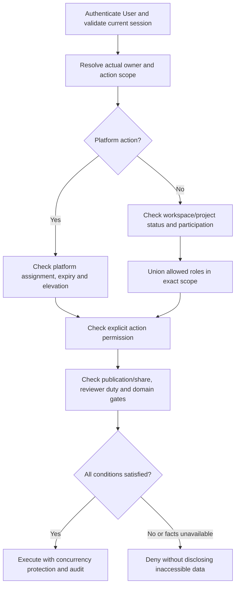
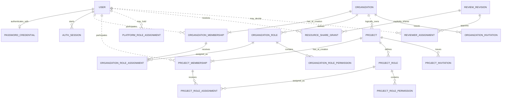
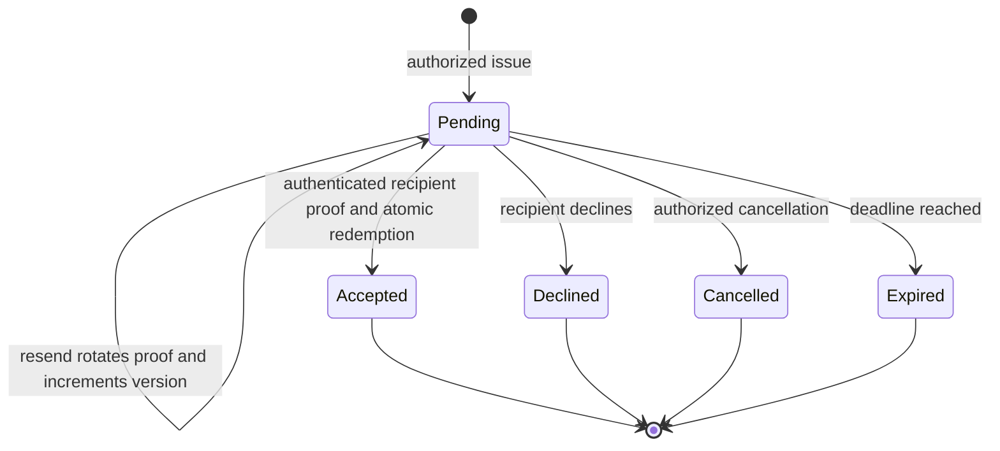
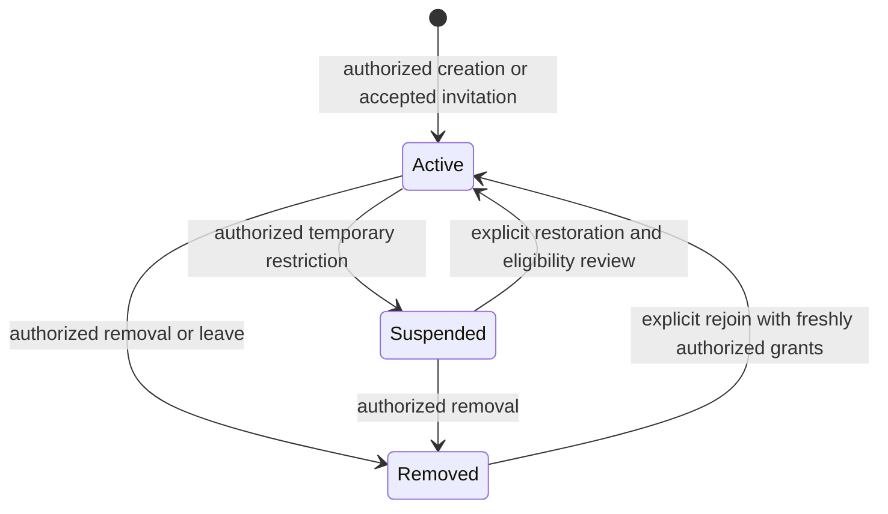

# Identity Domain Discovery

> **Historical reference — reviewed 2026-11-08:** Original alternatives/readiness are retained. Use the [Identity overview](modules/identity/README.md#verified-implementation-baseline) and [current schema](modules/identity/current-schema.md) for later evidence. Superseded module boundaries and unfinished-work statements below are not current instructions.

> Status: Draft architecture recommendation; not an accepted ADR, approved requirement, implementation task, or physical ERD.
> Recorded: 2026-11-03, Asia/Bangkok.
> Scope: Identity ERD prerequisites and its relationships with workspace, project, access, and future platform administration.
> Companion: [Identity ERD Readiness](identity-erd-readiness.md).

> **Design reconciliation — 2026-11-03:** The user subsequently selected one Identity module containing Authentication, Organization Management and a protected Platform Access area, with one owned database. The selected design is maintained in the [Identity module workspace](modules/identity/README.md), including user decisions and remaining proposals. This report retains the original separate-context alternatives for evidence; that ownership recommendation no longer governs this design. OrganizationMembership-to-User and platform-assignee-to-User references can now be local FKs; Project/Delivery references remain external. This choice does not consolidate runtime hosts or approve canonical requirements.

## 1. Executive Summary

**Recommend a narrow Identity context, with access relationships owned alongside the resources they govern.** Identity owns the person/account, authentication credentials, sessions, and authentication lifecycle. Organization owns workspaces, organization memberships, organization invitations, and organization roles. Project owns projects, project participation, project invitations, and project roles. Resource contexts own fine-grained sharing and business decision authority. A distinct logical Platform Access boundary owns system-controlled administrator assignments; future Platform Administration owns operational use cases, not customer delivery decisions.

These are logical boundaries, not instructions to introduce five services, databases, or hosts. The checked-out solution has independently hosted Identity, Notification, and Gateway components. The modular-monolith description in the request and target architecture remains an architectural option requiring an explicit decision. Preserve current deployment boundaries while reviewing this model.

Three consequences shape the ERD:

1. A person can belong to several workspaces and projects, with different roles and titles in each. Organization membership does not grant project visibility. Guests may access selected resources without organization membership.
2. System Administrator is a platform assignment, independent of tenant membership. It grants neither implicit customer-content access nor authority to approve requirements, apply plans, or release software.
3. Membership, role assignment, a business title, resource sharing, and a version-specific reviewer assignment are different facts. Collapsing them into one generic access row makes both integrity and auditability harder.

**Readiness:** sufficient for a reviewed conceptual model and bounded logical design exploration. Not ready to finalize the physical Identity or collaboration ERDs. Blocking choices include accepted module placement, guest participation semantics, delegated role management, privilege lifecycle, retention, recipient proof, and cross-host revocation guarantees. Proposed defaults below make those choices reviewable without claiming approval.

## 2. Domain Discovery Findings

### Evidence and authority

Labels apply throughout both documents:

| Label | Meaning |
|---|---|
| **Confirmed** | Behavior recorded as user-confirmed in workflow Q1–Q44/W1, or an explicit constraint in the current request. This does not approve downstream canonical artifacts. |
| **Implemented** | Supported by checked-out source/configuration. No assertion that a migration was applied to a live database. |
| **Existing proposal** | Draft requirement, feature, or target architecture guidance; its status is preserved. |
| **Proposed** | Recommendation made in this analysis, including all new fields, event names, policies, and permission codes. |
| **Open** | Needs an authorized product, architecture, security, or operations decision. |

Evidence register (references such as W/Q3 below are local citations, not new artifact IDs):

| Ref | Source inspected | Use and limits |
|---|---|---|
| W | [Workflow discovery v1.1](../deliverypilot-workflow-discovery.md), read completely, §§1–20 | Q1–Q44/W1 are recorded discovery evidence; §14 concepts and §19.3 clarifications are derived proposals. §18 explicitly defers field/security/architecture detail. |
| R | [Cross-feature requirements](../requirements.md), especially §§3, 5, 8–9 | BR-001–008, BR-018–023, BR-043 and NFR-001–004/008/011; file is a draft candidate contract. |
| P | [Product blueprint](../product.md), §§3–6 | Personas, single owning organization, client collaboration. |
| O | [Organization feature](../features/FEAT-DP-003-organization/feature.md), §§2–7, and its draft FRs | Project-specific permissions belong to FEAT-DP-004; ownership, removal, invitations and support policy need refinement. Stale implementation/dependency summaries are not runtime evidence. |
| I | [User initialization feature](../features/FEAT-DP-002-user-initialization/feature.md) and its FR/task records | Current registration/login decisions must not be replaced silently by invitation or privileged-access proposals. |
| A | [Current architecture](../../ARCHITECTURE.md), [solution](../../DeliveryPilot.slnx), [Identity host](../../src/Modules/DeliveryPilot.Identity/DeliveryPilot.Identity.API/Program.cs), [project references](../../src/Modules/DeliveryPilot.Identity/DeliveryPilot.Identity.API/DeliveryPilot.Identity.API.csproj), [deployment](../../deploy/compose/identity/compose.yaml) | Separate executable/module/database configuration; not evidence of a running deployment. |
| T | [Target architecture](../architecture.md), §§2, 4–6, 11–12 | ARCH-001/006/007 are proposals. Earlier combined Identity & Organization ownership is an alternative, not an accepted decision overriding current boundaries. |
| G | [Root guidance](../../AGENTS.md), [module guidance](../../src/Modules/AGENTS.md), [authoring policy](../authoring.md), [context map](../context-map.md) | No cross-module FKs; preserve approval status, scalar references, custom CQRS and transaction ownership. |
| C1 | [Identity context](../../src/Modules/DeliveryPilot.Identity/DeliveryPilot.Identity.Infrastructure/Persistence/DbContexts/IdentityDbContext.cs), [model inventory tests](../../tests/DeliveryPilot.Identity.Tests/Persistence/IdentityModelInventoryTests.cs), [migrations](../../src/Modules/DeliveryPilot.Identity/DeliveryPilot.Identity.Infrastructure/Persistence/Migrations/) | User, PasswordCredential, AuthSession plus operational reliability persistence. Tests were inspected, not executed for this documentation task. |
| C2 | [Auth controller](../../src/Modules/DeliveryPilot.Identity/DeliveryPilot.Identity.API/Controllers/AuthController.cs), [JWT issuer](../../src/Modules/DeliveryPilot.Identity/DeliveryPilot.Identity.Infrastructure/Security/JwtAccessTokenIssuer.cs), [context validator](../../src/Modules/DeliveryPilot.Identity/DeliveryPilot.Identity.Infrastructure/Security/AuthenticatedContextValidator.cs), [session service](../../src/Modules/DeliveryPilot.Identity/DeliveryPilot.Identity.Infrastructure/Security/AuthSessionService.cs) | Register/login exist; sessions and bearer validation exist; role/tenant grants are not issued in JWTs. Refresh/logout HTTP endpoints remain planned. |
| C3 | [Shared permission catalog](../../src/BuildingBlocks/DeliveryPilot.SharedKernel/Security/PermissionCatalog.cs) | Includes Branch/Cinema/Film vocabulary and an administrative permission-union helper. It is not a validated DeliveryPilot authorization model. |

### Findings and conflicts

- **Confirmed:** workspace creation is separate from registration; creator becomes Owner (W/Q1). Project creator initially administers that project (W/Q6). These are distinct atomic creation use cases.
- **Confirmed:** explicit project access, custom scoped roles, constrained delegation, restricted guests, and different roles across projects (W/§§2.2, 4; Q2–Q6). The exact role-combination policy is open.
- **Confirmed:** authoring, reviewing, accepting, baselining, planning, QA, UAT, and release carry separate authority and evidence (W/Q10–Q18, Q39–Q42). Identity must not own these decision aggregates.
- **Implemented:** Identity registration creates an active user without email verification; login/session issuance does not prove control of an invitation address. Recipient verification at acceptance is a proposed additional use-case requirement, not a change to registration.
- **Implemented:** `RetainUsersOnly` removed historical collaboration/security tables, but later migrations added credentials and sessions. Historical table names do not establish current organizations, RBAC, invitations, or platform administration.
- **Implemented:** Identity checks active account/session state per bearer request. This does not establish organization/project revocation or cross-host authorization. No live database or deployment was inspected.
- **Conflict:** target monolith/combined Identity & Organization and independently hosted current modules differ. This report recommends logical ownership only; acceptance and placement remain open.
- **Conflict:** older generic BR/feature questions lag specific W decisions (guest access, creator ownership). Preserve both sources and reconcile canonical requirements later; no statuses or approval references are changed here.

## 3. Ubiquitous Language

This report's glossary is a proposed refinement of W/§2.3 and R/§2; it does not replace repository-wide terminology by implication.

| Term | Meaning |
|---|---|
| User | A globally identified person/account; membership and privileges are separate relationships. |
| Authentication | Establishing who is acting and whether their session/account is valid. |
| Workspace / Organization | The same customer ownership boundary; Workspace is the user-facing term, Organization the proposed domain name. Tenant describes its isolation property. |
| Organization membership | A person's relationship to one workspace, including lifecycle and organization-scoped assignments. |
| Project | A delivery initiative owned by exactly one workspace. |
| Project membership / participation | A person's explicit relationship to one project, either internal or external under the proposed model. |
| Guest | A participation classification with restricted access, not a universal permission or a different species of User. |
| Role | A named, scoped collection of permissions; a role definition does not authorize anyone until assigned. |
| Permission | A stable action identifier defined by its owning capability, with allowed scope and constraints. |
| Delegation authority | Authority to grant specified permissions/roles to others; holding a permission does not automatically permit granting it. |
| Title | A project-specific descriptive label such as Lead QA; no access follows from it. |
| Responsibility | An attributable duty or area of accountability; authority still requires permission and applicable domain assignment. |
| Resource share | Explicit visibility/action limits for selected content, including version and publication boundaries. |
| Reviewer assignment | Authority and obligation to decide on a particular review target under its policy; distinct from project membership. |
| Owner | Protected workspace administrative responsibility; not unrestricted project-content access. |
| Project Admin / Project Manager | Access/configuration administrator versus delivery coordination role; they may be assigned to the same person. |
| System Administrator | Platform-scoped, system-controlled privilege held independently of any customer membership. |
| Support access grant | Exceptional, approved, purpose-bound and expiring access to named customer resources/actions. |
| Authorization decision | Allow/deny for this actor, action, resource, scope, current state, and policy version. |
| Revocation | Removal of future authority; historical attribution remains. |

## 4. Business Capability Inventory

Lifecycle words and ownership below are **Proposed**, unless the evidence column identifies confirmed behavior. Each row identifies a coherent business capability rather than mandating a table.

| Capability / purpose | Actors | Lifecycle and essential rules | Related capabilities | Owning candidate / evidence |
|---|---|---|---|---|
| Registration and profile: establish a person | Visitor, User | Register → active; change profile; deactivate; preserve stable identity. No automatic workspace. | Credentials, invitations | Identity; W/Q1, I, C1–C2 |
| Authentication and recovery: prove identity | User, security operator | Login → session → expiry/revocation; password change/reset and MFA need reviewed proof/recovery policy. | All access, platform elevation | Identity; C2 implemented subset; recovery/MFA proposed |
| Workspace creation/management: establish ownership | Registered creator, Owner/Admin | Create with initial Owner; active → suspended/archived → possible restoration; deletion separate. | Membership, projects, platform suspension | Organization; W/Q1, O |
| Organization membership: workforce relationship | Owner/Admin, delegated manager, member | Join → active/suspended/removed; one relationship per User/workspace; no universal project access. | Org roles, internal project eligibility | Organization; W/Q2/Q5, R/BR-002/003 |
| Organization invitation: offer membership | Authorized inviter, recipient | Issue → accept/decline/expire/cancel; recipient proof and current delegation checked. | Identity, Notification, membership | Organization; W/Q2; details W/§18.2 open |
| Project creation/lifecycle: delivery container | Owner/Admin or delegated creator; Project Admin | Draft → active → archived; name/purpose first, one owner workspace, creator initial admin. | Organization, Requirements, Planning/Execution | Project; W/Q6–Q8 |
| Project participation/invitation: explicit collaboration | Project Admin/delegated inviter, internal member, guest | Invite/join → active/suspended/removed; internal eligibility differs from external share path. | Org eligibility, roles, sharing | Project; W/Q2/Q3/Q6 |
| Role definition and assignment: controlled delegation | Authorized org/project administrators | System template → scoped role; edit/version, assign/revoke/expire; no cross-scope grants or self-escalation. | Permission catalog, membership | Organization/Project; W/Q5; combination details open |
| Titles and responsibilities: describe contribution | Project Admin/PM, participant | Assign/revise/retire descriptive duties with attribution; same User differs by project. | Capacity, work/reviewer assignments | Project; request, R/BR-005, W/Q20 |
| Resource sharing and review authority: client participation | Publisher, assigned reviewer, client | Explicit share/revoke; immutable target; review assignment/decision distinct from visibility. | Project eligibility, Requirements/Approval/Quality | Resource owner; W/Q11–Q16/Q41 |
| Ownership succession and delegation: prevent orphaning | Owner, successor; privileged operators | Offer/accept transfer; atomic protected-role changes; last-holder checks under concurrency. | Recovery, membership lifecycle | Organization; Project for project-admin continuity; W/§18.2 open |
| Platform privileged access: secure operator foundation | System Administrator, reviewed bootstrap custodian | Provision → elevate → expire/revoke; no customer self-service assignment. | Identity, audit, future operations | Platform Access; explicit request; O actor candidate |
| Platform operations: future SaaS administration | Authorized platform operator | Metadata, suspension/reactivation, policies, entitlements and audit review under separate permissions. | Organization commands, privileged access | Future Platform Administration; request candidates only |
| Context selection and isolation: act in correct workspace/project | Multi-workspace User, guest, worker | Select context → validate actual resource owner and access per action; selection grants nothing. | Every API/query/job/export/search | Each resource owner; W/Q27/Q38, R/BR-008/043 |
| Audit/history: explain consequential actions | Actor, authorized auditor | Append outcome/context → protect → retain/erase by reviewed policy; no secret values. | All state transitions | Producing context; consolidated read model later; W/Q13/Q20/Q39, NFR-003 |
| Access revocation: terminate authority | Member administrator, User, security operator | Disable source → deny new decisions → invalidate derived views/jobs; preserve past decisions. | Sessions, memberships, grants | Identity/Organization/Project/Platform respectively; W/§18.2 open |

Missing foundations exposed by the inventory: invitation recipient proof and address changes; credential recovery/MFA enrollment; owner/admin emergency succession; resource-specific sharing and stakeholder-to-User linking; role-definition change impact; privilege expiry; service principal/job identity; idempotent invitation delivery; privacy/retention; organization suspension propagation; and privileged audit durability. They are refinement items, not an authorization to build them all now. Enterprise SSO/SCIM, organization-to-organization co-ownership, complex approval delegation and a general-purpose policy language remain deferred unless validated need changes scope.

## 5. Bounded Context Alternatives

| Alternative | Ownership | Coupling and transactions | Security and extraction | Assessment |
|---|---|---|---|---|
| A. Broad Identity & Access | Identity owns User, OrganizationMembership, ProjectMembership, roles/invites and platform assignments; Project owns delivery container. | Simple central grant lookup; every resource lifecycle depends on Identity. Project creation still needs cross-owner coordination. Identity accumulates organization and project policy. | Central consistency is attractive, but platform/tenant privilege separation needs careful enforcement inside a large model. Extracting collaboration later moves substantial data and contracts. | Closest to earlier combined proposal; rejected as recommended direction because authentication is not the owner of collaboration lifecycle. |
| B. Resource-owned access, shared decision contract | Identity owns authentication; Organization owns org access; Project owns project access; resource contexts own publication/review conditions; Platform owns operator assignments. | Creation and local membership/role changes transact with their resource owner. Cross-owner eligibility/status checks are explicit and may fail closed; shared contract avoids policy drift. | Least privilege follows ownership. More decision inputs and revocation coordination; no single omniscient access database. Logical seams allow later extraction without speculative services now. | **Recommended.** Fits explicit project isolation, guest access and domain-owned gates. |
| C. Dedicated Access & Membership context | Separate central context owns all memberships, role assignments and invitations; resource owners retain business state. | Uniform administration but distributed create-and-grant, orphan grant cleanup, and central dependency on every scope lifecycle. | Useful if many resource types and central entitlement operations emerge; polymorphic keys and synchronous availability become major concerns. | Defer. Current evidence does not justify a policy service or generic scope registry. |

An access evaluation contract is useful in B; that does not require a new Access service or an access-data owner. Permission vocabulary can be composed from module-published catalogs without centralizing every resource fact.

## 6. Recommended Module Boundaries

```mermaid
flowchart LR
    Identity["Identity: accounts, credentials, sessions"]
    Org["Organization: workspace and organization access"]
    Project["Project: project and project access"]
    Platform["Platform Access: operator assignments"]
    Ops["Future Platform Administration"]
    Resource["Requirements, Approval, Planning, Execution, Quality"]
    Notify["Notification: delivery only"]
    Identity -->|identity and session contract| Org
    Identity -->|identity and session contract| Project
    Identity -->|identity and assurance| Platform
    Org -->|owner status and internal eligibility| Project
    Project -->|project participation and scoped grants| Resource
    Platform -->|explicit platform permission| Ops
    Ops -->|authorized lifecycle command| Org
    Org -->|delivery request| Notify
    Project -->|delivery request| Notify
```

Arrows denote public contracts/events, not database access or project-reference permission. The final enforcement point is the resource-owning use case. Requirements/Approval, Planning, Execution and Quality are future logical owners used to explain dependencies, not implemented modules. Notification delivers messages and owns provider outcomes; it neither accepts invitations nor decides membership.

**Placement recommendation:** retain current hosts. Design Organization and Project as cohesive future logical modules with their own models and application interfaces; choose host/schema placement in an accepted architecture decision before implementation. For the minimal future administrator foundation, Platform Access may be packaged as an isolated area within the existing Identity host, with explicit ownership and contracts; it must not become tenant RBAC inside User. This packaging option does not authorize a new table now. Platform operational use cases should later compose owner commands rather than reaching into customer databases.

## 7. Context Responsibility Matrix

| Question | Authoritative owner | Collaborators / forbidden shortcuts |
|---|---|---|
| Who authenticates and disables a User? | Identity | All callers consume identity/session status; no module reads Identity DbContext. |
| Who owns Organization and OrganizationMembership? | Organization | Identity supplies scalar UserId and validity contract. |
| Who owns Project and ProjectMembership? | Project | Organization supplies owning workspace status and internal-member eligibility. |
| Who defines permissions? | Capability owner defines stable code, scope, semantics and delegation category | Shared catalog is an assembled contract; customers compose allowed codes, never invent executable permissions. |
| Who defines/assigns org roles? | Organization | Organization authorization and protected Owner rules apply. |
| Who defines/assigns project roles? | Project | Project authorization; org role alone cannot assign project roles. |
| Who decides authorization? | Resource-owning application policy, using current Identity/Org/Project/Platform facts | Shared evaluator can combine inputs; Gateway, JWT and UI are insufficient final decision points. |
| Who shares revisions and appoints reviewers? | Relevant resource/Approval context | Project membership is eligibility, not revision visibility or decision authority. |
| Who owns platform administrator assignments? | Platform Access logical boundary | Identity authenticates; no Organization or Project assignment API can create these. |
| Who owns future platform operations? | Platform Administration use cases | Organization owns suspension state; settings/entitlements stay with their eventual owners. |
| Who owns history and audit? | Context executing the action | Central audit search is a projection, not the transaction owner or an authorization bypass. |

## 8. Business Rules and Invariants

The following local rule names are report references, not canonical BR IDs.

| Rule | Evidence / status | Required behavior and enforcement |
|---|---|---|
| Single tenant owner | Confirmed W/§2.2, R/BR-001 | Project has exactly one OrganizationId; application verifies owner; no cross-module FK. Cross-org project transfer is deferred. |
| Independent scopes | Confirmed W/Q2/Q5 | A role in A or X gives no authority in B or Y; org membership alone gives no project visibility. Security policy. |
| Guest path | Confirmed W/Q3 | Organization membership cannot be a universal prerequisite for selected guest access. Proposed Internal/External classification distinguishes eligibility. |
| Create-and-own | Creator authority Confirmed W/Q1/Q6; atomic enforcement Proposed | Workspace + creator membership + Owner assignment commit together; project + creator participation + Project Admin assignment commit together. |
| Delegation ceiling | Confirmed W/Q5; exact policy Proposed | Check explicit grant authority and role contents at definition edit, assignment and invite acceptance; no self-grant outside that ceiling. |
| Stable membership | Proposed | One durable membership per User/scope, with transition history; removal is a state, rejoin is an explicit transition with newly authorized grants. Unique constraint plus domain rules. |
| Protected ownership | Open, proposed default | At least one effective Owner per live workspace; serialize transfers/removals against a workspace guard. Count only active, eligible owners; normal APIs must not orphan it. |
| Removal without erasure | Existing proposal R/BR-007, Proposed detail | Deny future access; retain UserId and decision evidence. Do not delete accepted reviews because membership ends. |
| No privilege from description | Confirmed request, R/BR-005 | Title/responsibility/contact/email domain cannot grant permissions. |
| Exact decision target | Confirmed W/Q13–Q16 | Review/acceptance references immutable version; current access and assignment checked again when acting. Historical approval remains attributable after revocation. |
| Invitation is an offer | Proposed | No access before acceptance/proof; offered roles are bounded and revalidated; token consumption and local membership/grants atomic. |
| Isolation on every path | Confirmed request, existing NFR-001/002 | Resolve real resource ownership on commands, queries, references, attachments, exports, search, jobs, notifications and AI retrieval. |
| Platform separation | Confirmed request | System Admin has no tenant wildcard, customer-configurable definition, or default business decision permissions. |
| Lifecycle restrictions dominate grants | Proposed | Inactive User/session, suspended workspace, invalid membership, expired grant or resource policy veto denies despite additive roles. |

## 9. Platform, Organization and Project Authorization

### Resolution model

**Proposed default:** additive allow-only roles within the exact scope; no customer-authored deny rules or role hierarchy initially. Duplicate permissions collapse to a set. Mandatory lifecycle, visibility, separation-of-duty and domain gates override any allow. This avoids inventing precedence among configurable denies while preserving hard security constraints.

For an action on resource `r`, evaluate:

`Allow = ValidIdentitySession AND ActualScopeMatch AND ScopeEligibility AND PermissionGranted AND ResourceVisibility AND DomainGates AND AssuranceSatisfied`.

For tenant content, ScopeEligibility requires the owning organization/project lifecycle to permit the requested action plus the appropriate internal/external participation path. Draft projects permit authorized setup and reads; Active permits normal authorized operations; proposed Archived mode permits authorized reads; Suspended denies normal tenant operations. For platform actions, eligibility includes an active platform assignment and elevated-session policy, without requiring organization membership. An organization may be suspended while an authorized platform operator performs its explicitly allowed reactivation action; this is a platform action, not tenant-content access.

No implicit platform → organization → project inheritance. Organization Owner/Admin may receive `organization.project.create`, consistent with W/Q6; creating a project supplies its explicit initial Project Admin assignment. Organization operators can manage permitted workspace metadata, membership and configuration without reading private project artifacts. Any future portfolio listing must define its metadata disclosure policy separately.

### Scope policy

| Scope | Role candidates | Assignment / effective authority |
|---|---|---|
| Platform | System Administrator; smaller operator roles only when justified | System-controlled permission allowlist. Provision/revoke only through reviewed privileged procedures, never tenant role APIs. No tenant membership dependency. |
| Organization | Owner, Admin, Member, custom organization roles | Active OrganizationMembership required. Owner is protected; Admin and custom roles stay within delegation ceiling. Workspace management does not imply project-content access. |
| Project | Project Admin, Project Manager, Member, BA, Developer, QA, DevOps, Viewer, custom project roles | Active ProjectMembership or restricted guest participation plus resource policy. Project Manager is not automatically Project Admin; business titles do not control access. |

W/§4 names PM/BA/Developer/QA/DevOps/Viewer templates; Project Admin is confirmed as the creator's initial authority, while a general Member template and exact mappings are proposed. A person can hold multiple assignments within a scope. A Project Admin does not automatically become a required reviewer, release approver or authorized final acceptor. Separation-of-duty checks use actual authorship/assignments, regardless of how many roles a person holds.

### Active sessions and revocation

Keep JWTs identity-oriented; do not copy platform privileges into tenant claims. Current C2 already issues identity/session claims and performs uncached account/session checks in Identity. Proposed scoped grants are evaluated against current owner state, not trusted from a long-lived token.

Define revocation at an authorization-decision boundary: new decisions after authoritative revocation commits must deny; already admitted operations require an explicit policy. For ordinary operations, a documented admitted-request completion policy may be acceptable. Sensitive privilege changes and version-bound decisions should recheck authoritative state close to commit. A check in another process cannot promise atomic ordering with a local commit: a strict no-commit-after-revoke guarantee needs a reviewed lease/fence or coordinated protocol and is a blocker, not a property of an outbox.

Events invalidate projections and caches, but are not the sole revocation control. Baseline recommendation is authoritative reads for security decisions and fail closed when required facts are unavailable. Cache introduction requires a measured maximum-staleness/revocation contract. Long-running jobs, queued exports, streams, notification materialization and download links need reauthorization at execution/delivery and bounded access lifetimes. Global account/session disable affects all scopes; organization/project revocation only affects that scope. Role-definition changes increment an authorization version and invalidate all affected holders.

## 10. Membership, Roles, Permissions, Titles and Responsibilities

### Participation rules

**Proposed:** a ProjectMembership carries `ParticipationKind = Internal | External`. Internal participation requires an active OrganizationMembership in the project's owning workspace. External participation has an explicit sponsor/grant and no OrganizationMembership prerequisite. Both use the same global UserId; neither requires a second client-user table. Resource-only guests may have a restricted project participation envelope with no project-wide read permission; the resource owner supplies the actual ShareGrant. Whether that envelope is mandatory is blocking for the collaboration ERD.

Removing/suspending internal organization membership immediately makes dependent internal project access ineligible; asynchronous cleanup can mark local participation suspended later. Do not silently convert it to External to preserve access. Conversion requires an explicit authorized review of every retained grant. Likewise, an external invite must not circumvent an internal-member suspension; deny conversion during suspension unless a separate reviewed policy explicitly permits it. An unrelated workspace membership has no effect on this project's eligibility.

### Role model choices

| Design | Benefit | Risk | Recommendation |
|---|---|---|---|
| Shared `RoleAssignment(UserId, ScopeType, ScopeId, RoleId)` | Compact generic queries | Polymorphic references, null-scope semantics, platform leakage, weak local membership FK constraints, and a central lifecycle owner | Reject as default persistence model. A normalized read-only projection may use this shape. |
| Separate PlatformRoleAssignment, OrganizationRoleAssignment, ProjectRoleAssignment | Explicit eligibility, scope-specific FK/check rules, protected-role policies and module ownership | Repeats small structures; shared UI needs composition | **Recommend.** Share value-object concepts and contracts where useful, not mutable cross-owner tables. |

Organization and Project own separate role definitions and role-permission joins. System templates are immutable/versioned definitions instantiated as scoped roles or referenced by a reviewed template mechanism; recommend scoped role instances with `Origin = SystemTemplate | Custom`, avoiding nullable global/custom owner keys. Protected roles and permission categories cannot be broadened by customer edits. Custom roles may select only registered permission codes allowed for their context. Platform roles remain system-controlled, with no customer edit path.

Role assignment references the relevant membership, not just UserId, and carries grantor, grant time, optional expiry, revocation and reason. Proposed stable assignment rows use lifecycle/history rather than duplicate active grants. Editing a role can elevate all assignees, so apply the same delegation checks, show affected holders, audit a versioned before/after permission set and re-evaluate outstanding invitation offers. Direct per-user permission grants are deferred; roles and explicit resource shares cover demonstrated needs.

ProjectTitle is initially a descriptive value on participation or a small value collection; do not create a global title dictionary without reuse/search requirements. ProjectResponsibility may start as attributable descriptive duties on participation. Reviewer assignment, work ownership and accountable risk ownership remain records in their business contexts, with their own lifecycle; do not repurpose a free-text responsibility as legal approval authority. Whether multiple titles, structured responsibilities, or dated duty assignments need separate entities remains open.

## 11. Domain Entity Inventory

This inventory is **Proposed** except the three C1 entities marked Implemented. Root means aggregate root, not necessarily a separate persistence table. Cardinalities refer to logical relationships; only relationships within one owner may become database FKs. The companion gives key/index candidates. User, organization and project identifiers remain stable through suspension and removal.

### Identity and ownership concepts

| Candidate / owner / root | Purpose and key attributes | Relationships, uniqueness and integrity | Lifecycle, scope and retention |
|---|---|---|---|
| **User — Identity — User root; Implemented** | Person/account: UserId, PrimaryEmail, display name, locale/timezone, status, verification/login instants; proposed security version | One User to zero/one current password credential and zero/many sessions; many memberships through external scalar UserId. Current email uniqueness is case-insensitive. | Existing pending/active/suspended/deleted values; global identity, no tenant grants. Retain stable attribution/tombstone; erasure and email reuse need policy. |
| **UserCredential — Identity — User-associated; PasswordCredential Implemented** | Existing UserId and password verifier/hash metadata. A generic credential abstraction is unnecessary for password-only use. | Existing PasswordCredential uses UserId PK/local FK, at most one per User; no cross-module references. | Replace/rehash/revoke with authenticated recovery policy; never retain plaintext passwords or audit verifier contents. Secure purge schedule open. |
| **UserSession — Identity — independent root; AuthSession Implemented** | SessionId, UserId, refresh verifier, creation/deadline/revocation; proposed authentication assurance/elevation evidence | Many sessions per User; local restricted User FK. Refresh proof uniquely resolves eligible session according to service contract. | Issue/rotate/expire/revoke; identity scope. Proposed privilege elevation has separate expiry. Expired/revoked secret material can be purged under retention policy. |
| **IdentityChallenge / authenticator — Identity — conditional roots** | Purpose-bound email/recovery proof; factor/issuer linkage only if selected identity policy requires it | User reference, verifier/expiry/consumption/attempt limits; unique external issuer+subject if federation is selected | Short-lived single-use proof or enrolled/revoked factor. Candidate only; MFA/federation/recovery choice changes this model. |
| **Organization — Organization — root** | Workspace ownership: OrganizationId, name, status, security version, policy | One Organization to many local memberships/invitations/roles; logical one-to-many Projects via scalar OrganizationId | Create/active/suspend/archive; tenant scope. No cross-module cascade; deletion/retention workflow separate. |
| **OrganizationMembership — Organization — root** | Durable User/workspace relationship: MembershipId, OrganizationId, UserId, status, joined/changed timestamps, version | Unique OrganizationId+UserId across lifecycle. Local Organization FK; UserId scalar. Zero/many role assignments/history events. | Active/suspended/removed; reactivation explicit with fresh grants. Owner protection spans memberships. Retain history; removing access does not erase actor evidence. |
| **Project — Project — root** | Delivery container: ProjectId, OrganizationId, name/purpose, Draft/Active/Archived status, Scrum policy, security version | Exactly one logical owning Organization; local one-to-many participants/roles/invitations. OrganizationId scalar validated by contract. | Draft creation with initial admin; archive/read policy open. Project scope; tenant ownership immutable by default. Retain references from delivery history. |
| **ProjectMembership — Project — root** | Participation: MembershipId, ProjectId, UserId, Internal/External kind, status, eligibility provenance, version | Unique ProjectId+UserId; local Project FK; optional scalar originating OrganizationMembershipId. No universal org-membership FK. | Active/suspended/removed; internal eligibility checked externally. Explicit conversion/reactivation; no automatic restoration. Retain versioned roles/duties history. |

### Access and collaboration concepts

| Candidate / owner / root | Purpose and key attributes | Relationships, uniqueness and integrity | Lifecycle, scope and retention |
|---|---|---|---|
| **Role — Organization or Project — scoped Role root** | Separate OrganizationRole/ProjectRole: RoleId, owning scope, stable code/name, template origin, protected flag, permission-set version | Unique normalized name/code within its owning scope; many role-permission links and assignments. System template instances distinct from custom definitions. | Create/edit/retire; protected templates restricted. Retire blocks new assignment; effect on existing grants explicit. Preserve definition versions needed to explain access. |
| **Permission — defining capability — catalog value/definition** | Stable code, action meaning, allowed scope, delegation category, sensitivity | Many-to-many roles through RolePermission. Globally unique namespaced code by catalog convention; local projection optional, no central mandatory table. | Publish/deprecate; unknown codes deny. Removal requires impact review; preserve version references. No customer executable permission definitions. |
| **RolePermission — role owner — Role child** | Relationship between RoleId and PermissionCode | Unique pair; local FK to role. Catalog validation by owner; no FK to another module's code-defined catalog. | Added/removed atomically with role version; no independent authority or lifecycle. History through role/audit version. |
| **RoleAssignment — concept, not common mutable table** | Shared vocabulary for subject, role, scope, grantor, validity and revocation | Use distinct organization/project/platform representations; read projection may unify them | No universal scope hierarchy, direct permission override or separate generic root needed. |
| **OrganizationRoleAssignment — Organization — Membership child** | RoleId, MembershipId, OrganizationId, grantor, granted/expiry/revocation instants, reason | Same-organization composite local references to membership and role. Unique durable membership+role pair proposed; regrant recorded in history. | Grant/expire/revoke/reactivate explicitly; active membership and role required. Owner assignment protected. Retain grant provenance. |
| **ProjectRoleAssignment — Project — Membership child** | RoleId, MembershipId, ProjectId, grantor, validity, reason | Same-project composite references; unique durable membership+role pair. User derives from local membership. | Grant/expire/revoke; project restrictions and guest visibility dominate. Retain historical versions; no scope migration by editing ProjectId. |
| **PlatformRoleAssignment — Platform Access — privileged assignment root** | AssignmentId, UserId, system role code, grantor/approver, decision evidence, validity/revocation, version | UserId scalar; no organization/project membership relationship. Unique current User+role assignment or durable pair with history; choose one before schema. | Provision/activate/expire/revoke with elevated assurance. Protected last-usable-admin procedure; retain privileged audit. No customer customization. |
| **Invitation — concept; OrganizationInvitation / ProjectInvitation — owning scope root** | InvitationId, scope, normalized recipient address, verifier, sponsor, grant intent/version, expiry/status, accepted UserId/time, concurrency version | One target scope; zero/one accepting User; invitation may produce existing/reactivated membership, not necessarily a new row. Pending uniqueness per scope+recipient under selected purpose policy. | Pending → accepted/declined/cancelled/expired; token rotated on resend. No access until atomic acceptance. Retain minimal outcome; purge verifier/recipient PII by policy. |
| **InvitationRoleGrant — invitation owner — Invitation child, conditional** | Intended role and reviewed role version or permission snapshot | Invitation to zero/many offers; local role reference within same scope. Unique invite+role. | Frozen offer; current authorization rechecked on acceptance. No implied future privilege growth. Remove with retained/redacted invitation according to retention. |
| **ProjectTitle — Project — Membership value object initially** | Descriptive title text, optionally effective period | One participation to zero/one initial title; multiple titles optional. No global uniqueness or permission relationship. | Edit/remove with appropriate attribution; project scope; no separate table until validated need. |
| **ProjectResponsibility — Project — Membership value collection initially** | Description/category of duty and accountable participant | Zero/many duties per participation; structured resource accountability belongs to the resource context. No global uniqueness. | Assign/change/retire; historical duty relevant to decisions retained where needed. Never a substitute for permission. |
| **ResourceShareGrant — Requirements/Quality/other resource owner — grant root or resource child** | Recipient UserId/participation reference, exact resource/revision/publication, allowed actions, expiry/revocation, sponsor | Logical project reference; local FK to shared resource/version where same owner. Unique grant target+recipient+purpose under chosen policy. | Share/revoke/expire; no automatic next-revision publication, unrelated link access or reviewer authority. Retain minimal grant evidence. |
| **ReviewerAssignment — Approval/resource owner — review child** | Reviewer, immutable target, required/optional mode, policy, authority provenance | Many assignments per review revision; User/participation scalar. Distinct from ShareGrant and ReviewDecision. | Appoint/replace/remove with audit; removal does not silently pass gate. Preserve decisions and past assignments. |
| **AuditRecord — action owner — append-only record** | EventId, actor and supported subject if any, scope, action, target/version, outcome, time, reason, correlation, authorization version | Scalar references across owners; event identity unique. Central projection deduplicates by source+event. | Append/protect/retain/purge under policy; no raw token/password/sensitive payload. Platform and tenant visibility differ. |
| **MembershipHistory — Organization/Project — history record or audit projection** | MembershipId, prior/new state or grant version, actor, reason, effective time | One membership to many transitions, local reference; unique event/sequence | Append-only; independent table unnecessary if authoritative audit meets query/retention needs. No event-sourced rebuild requirement. |
| **SupportAccessGrant — future Platform Administration — deferred root** | Operator, exact tenant/resource/actions, justification, approving authority, time limit, revocation | User and resource scalar references; target owner verifies support authority | Approval/activation/expiry/revoke; not created by ordinary platform assignment. Necessary only if this future capability is approved. |

Other missing concepts are deliberately outside Identity: unauthenticated Stakeholder/ClientContact, review decisions, work assignments, capacity allocations and service principals. Stakeholders may exist before User linkage; contact matching must not grant access. Service principals require an explicit actor model if automation is introduced; do not create fake human Users or give AI a System Administrator session.

## 12. Aggregate Design

| Aggregate / consistency boundary | Atomic operations | Cross-boundary rules |
|---|---|---|
| User + password credential in Identity | Existing registration persists both through pipeline transaction | Workspace creation is a later separate transaction. All-session invalidation needs account security state plus session policy. |
| AuthSession in Identity | Refresh/revoke serialize on session; issuance/verification follow existing service | Tenant authority is not captured by session aggregate. Do not attach an unbounded sessions collection to User. |
| Organization and membership aggregates | Organization creation plus initial Owner; role/membership mutations with audit/outbox | Last-owner mutation locks/versions a common Organization guard as well as affected records. A transaction can involve several roots when the invariant requires it. |
| Project and membership aggregates | Project creation plus initial admin; membership/role changes; local invitation acceptance | Organization eligibility/status comes through an authoritative contract. No distributed ACID claim. |
| Scoped Role | Permission-set update + version + audit | Changed grants affect many memberships: versioning and authoritative evaluation avoid rewriting every session. No giant organization aggregate loading every member/role. |
| Scoped Invitation | Consume proof + transition + membership/role changes + audit/outbox in its owner | Identity proof and cross-owner eligibility must be valid under agreed admission/revocation semantics. Notification delivery outside transaction. |
| Platform assignment and administration guard | Grant/revoke plus durable audit; serialize protected-admin invariant | Identity supplies account/assurance state. Automatic expiry and compromise require recovery procedures, not just row counting. |
| Share/review aggregate | Share/reviewer state changes and exact-version decisions under local concurrency | Project grants permit eligibility; they cannot satisfy local publication or review gates. |

Optimistic concurrency detects stale updates to the same mutable aggregate. It does not by itself protect two different owner-membership rows removed concurrently. Normal ownership transfer/removal must serialize on one common guard or use a proven serializable transaction and retry policy. Security suspension of a compromised last Owner/Admin must remain possible: deny the compromised account and move the workspace/platform into restricted recovery rather than keeping an attacker active to satisfy a count.

## 13. Relationship and Cardinality Analysis

The diagram is conceptual. Cross-context edges are scalar references/contracts, **not physical foreign keys**; Identity, Organization, Project, Platform and Requirements remain separate owners.

Organization and Project create at least one membership with their creator. Later historical/archived states can have zero active participants; live-owner/admin continuity is a domain policy, not a one-to-many FK guarantee. One User has zero/many organizations and zero/many projects. Many Users share each, through distinct memberships. An invitation has at most one accepting User; many historical invitations may refer to one durable membership. A role has many assignees and many permissions; membership may have several roles. A permission code can occur in many local role definitions without a cross-owner Permission table.

A ProjectMembership's internal OrganizationMembership relationship is conditional and external: it is required for the Internal eligibility path, absent for an External-only participant, and never a cross-module FK. Resource-only participation remains a design blocker. PlatformRoleAssignment references User directly and has zero tenant-membership dependencies. Titles/responsibilities are project-local properties, not User-global authority.

## 14. Invitation and Membership Lifecycles

### Invitation proposal

The deadline is enforced when accepting, whether or not a cleanup worker has persisted Expired. Delivery state (queued/sent/failed) is separate from invitation state. Resend preserves the invitation intent and rotates its proof; changes to scope, recipient, participation or privilege require a new reviewed offer/version and invalidate the old proof. No token or membership is committed until issuance succeeds locally; notification is retriable afterward.

| Edge case | Proposed outcome / invariant |
|---|---|
| Existing User accepts | Require authenticated subject and independent verified proof of invited address; never infer proof from current active status. |
| New User accepts | Registration remains independent; retain invitation safely through onboarding, then authenticate/prove recipient and redeem. No automatic role from email string alone. |
| Forwarded link or changed email | Reject mismatched identity/address evidence; require verified intended-address binding or reissued invite. Decide address history/alias rules before ERD. |
| Duplicate issue | Serialize by scope+normalized recipient; return/reuse a matching pending offer, reject conflicting payload, or explicitly cancel/reissue. Recommended one pending offer per recipient/scope; different privilege offers do not stack silently. |
| Expired pending row blocks resend | Transition stale row under transaction before issuing replacement; do not rely on a clock-dependent index predicate. |
| Acceptance races cancel, resend or expiry | Conditional state/version update or lock ensures one winner; losing acceptance creates no membership/grants. |
| Same acceptance retried | Same authenticated subject and idempotency key returns previous outcome; another subject gets no grant or sensitive invitation details. |
| Membership already active | Return consistent join outcome; do not silently broaden roles. Any grant change needs current explicit authorization and audited intent. |
| Membership suspended/removed | Stale invitation cannot bypass suspension/removal; require a fresh authorized reactivation path. |
| Inviter loses authority or role grows | Revalidate sponsor/delegation and pinned offer version; recommend reject/reissue on material privilege change. |
| Workspace/project becomes suspended/archived | Normal acceptance denied; pending invitation remains non-authorizing until policy permits a reviewed reissue. |
| Notification unavailable | Local issue/acceptance remains committed; delivery retry uses stable event identity, backoff and deduplication. Never put raw proof in ordinary logs/outbox payloads without appropriate protection. |

Proof of email control is deliberately stronger than knowing the address. Exact proof mechanism, secure URL handling, token lifetime, attempt/rate limits, resend lifetime extension, normalization and address-change behavior are open; no numeric limits are invented.

### Membership proposal

Invitation Pending is not a membership status. Organization and project memberships have independent state machines; effective access additionally depends on User/session, ancestor lifecycle, assignments and resource policy. Rejoining a workspace must not silently reactivate all old project roles. An organization suspension denies internal and external tenant actions, including outstanding shares; restoration does not recreate expired/revoked grants. Proposed archive mode is read-only for otherwise authorized readers, with explicit unarchive authority; suspend denies normal tenant access. Exact archive read/export behavior remains open.

Ownership transfer proposal: current Owner nominates an eligible active member, successor accepts the responsibility, then the owner-role changes and audit commit atomically under Organization concurrency protection. Multiple Owners are recommended for continuity, not yet confirmed. If only one Owner is selected instead, the transfer cardinality and checks differ. Project admin succession uses Project governance; creators have an initial assignment, not an unrevokable personal backdoor.

## 15. Multi-Tenancy and Security

### Tenant and resource integrity

Resolve target resource → actual ProjectId → actual OrganizationId server-side. Check caller context agrees; a valid foreign resource ID does not make the caller's requested TenantId authoritative. Apply the same rules to joins and both ends of traceability links. Tenant-scoped uniqueness includes tenant/project keys. Composite local references bind a membership and role to the same scope; external User/Organization/Project IDs use contracts and reconciliation, not cross-module FKs.

Fail closed for inaccessible or unverifiable resources, with non-enumerating errors. Filter all derived views, attachments, exports, AI inputs, findings and notifications by recipient authority. Download/export artifacts need a revocation/lifetime policy; data already delivered to an authorized recipient cannot be recalled by revoking a database row. UI context selection and signed links are not blanket authorization.

PostgreSQL row-level security is an optional additional barrier, not the business permission model. If adopted, runtime role ownership and bypass privileges must be designed deliberately; owners normally bypass RLS, and superusers/BYPASSRLS roles bypass it. Connection-scoped tenant context must be set/reset safely for pooled connections. See [PostgreSQL row security](https://www.postgresql.org/docs/current/ddl-rowsecurity.html). No RLS implementation is proposed in this change.

### Common User versus administrator identity

| Choice | Benefit | Cost / risk | Recommendation |
|---|---|---|---|
| Common User with isolated platform assignment and elevated session | One stable accountable identity; independent tenant and platform grants; no duplicate person table | Compromise of the common credential could threaten both domains unless elevation and recovery are stronger | **Default foundation**, with dedicated privileged session/assurance checks and separate privileged grant administration. |
| Dedicated staff account or administrative identity provider/realm | Stronger credential/session separation and workforce policy | Linking, account lifecycle, recovery and operational overhead; duplicate accounts can weaken attribution | Evaluate for production risk. Can still map issuer/subject to the User identity model; does not inherently require a SystemAdmin table. |

No separate SystemAdmin user table is justified by current evidence. If an administrator is also a customer participant, actions record which authority path was used. A normal customer session is insufficient for a privileged operation merely because its User holds an assignment.

### Platform privilege procedures (Proposed; implementation deferred)

- **Bootstrap:** one-time operator-controlled, deployment-authorized procedure for a named verified person; enroll strong authentication and write durable evidence. No first-registered-user rule, email-domain privilege, default password, or ordinary invitation shortcut.
- **Provision:** system-controlled role allowlist, explicit grant-management permission, independent authorization for sensitive grants, reason/evidence and recipient eligibility. A recipient cannot approve their own elevation. Customers cannot create platform permission codes or edit system roles.
- **Elevate:** require fresh authentication/assurance and expiring privileged activation. Prefer phishing-resistant MFA and step-up for sensitive actions; exact methods/durations require risk review. [NIST SP 800-63B-4](https://pages.nist.gov/800-63-4/sp800-63b.html) supports phishing-resistant authentication and session/reauthentication controls; no NIST assurance-level certification is claimed here.
- **Revoke:** disable platform assignment and active elevated authority; ordinary tenant grants remain independently evaluated. Expiry is checked at decision time, not dependent on a cleanup job.
- **Last administrator:** protect normal changes with a shared concurrency guard and evaluate usable accounts, assurance and expiry, not just assignment-row count. Schedule succession before expiry and maintain a controlled emergency route. Never refuse compromise containment merely to preserve an active-admin count.
- **Recover:** independent identity verification, reviewed break-glass custodian process, temporary narrow authority, audit/notification, revoke compromised credentials/sessions, restore normal control, and perform post-event review. Workspace owner recovery never creates platform access.
- **Audit:** record actor, grantor/approver, target, scope, reason, before/after privilege version, outcome, time and correlation. Privileged mutations require a durable local audit record/outbox in their transaction; central search may lag. A logging outage must not silently produce unaudited privilege changes.

Future metadata management, suspension/reactivation, platform policies/settings, administrator management, operational/security audit review and feature entitlements require distinct platform permission codes. Listing organization metadata must define safe fields; it does not permit reading all projects. Organization remains authoritative for suspension state even when Platform Administration initiates it. Entitlements are product availability constraints, not user permission grants.

### Sensitive support and escalation risks

Sensitive support access requires explicit target actions/resources, named operator, justification, approved authority, bounded start/end and revocation, plus target-side enforcement/audit. Customer consent/emergency exceptions must be decided before enabling it. Exclude requirement approval, final acceptance, baseline establishment and release from support defaults. Record actual operator and any represented subject; never silently impersonate a customer. SupportAccessGrant remains a deferred candidate rather than a mandatory Identity table.

| Risk | Proposed defense |
|---|---|
| Org Owner promotes self to platform admin | Separate model, endpoints, catalog and grant authority; reject platform codes from all tenant role definitions. |
| Role editor adds power to a role they already hold | Check delegation ceiling on role edits and all affected assignees; protected permissions require appropriate approval. |
| Guest gets internal data through linked Story, export or AI summary | Authorize each source and target, explicitly publish revisions, filter projections/materialized output. |
| Invitation redeems after grantor loses power | Revalidate authoritative sponsor/grant intent at redemption, not just a signed token. |
| Revoked internal user re-enters as guest | Explicit conversion with review; no automatic fallback or alternate-path bypass. |
| Project Admin self-reviews authored requirement | Domain independence/reviewer gates override role union. |
| Stale membership claim/session | Current authoritative access check plus versioned invalidation; no permissive fallback on source outage. |
| Shared signing key expands future host trust | Review cross-host validation and key distribution before adding resource hosts; assess asymmetric verification separately. No key change here. |

The deny-by-default and per-resource/per-request approach is consistent with [OWASP authorization guidance](https://cheatsheetseries.owasp.org/cheatsheets/Authorization_Cheat_Sheet.html). Concrete DeliveryPilot defaults above remain proposals, not claims that these controls are implemented.

## 16. Cross-Module Integration

All contracts and event names in this section are **Proposed** except existing registration/authentication behavior identified in C2. A domain event is local to its owner; a published integration event is an intentionally limited contract, not a serialized domain entity. No new broker contracts are implemented.

Common transaction rule: local command persistence, material audit and outbox records commit under the owning command transaction. Handlers do not independently commit around the pipeline. Notification, remote status propagation and projections are outside that transaction. Consumers deduplicate by event ID and carry owner sequence/version. State projections must not overwrite newer state with stale events; audit/history consumers retain every distinct valid event even when delivered out of order. Sequence gaps trigger reconciliation. Retries use bounded backoff and observable terminal failure. Do not depend on notifications for correctness. Idempotency keys are scoped to actor+operation+target with payload fingerprint; mismatched reuse is rejected. Retention for replay protection remains open.

| Workflow | Owner and participants | Transaction / authorization | Events and consistency | Failure, retry and audit |
|---|---|---|---|---|
| 1. User registration | Identity; no Organization | Existing User+PasswordCredential atomic creation; anonymous registration policy; rate limiting remains deferred under I/D-005 | Optional future `UserRegistered`; registration does not create workspace, verification token or membership | Existing normalized-email conflict behavior; no plaintext secrets. Durable security audit expansion is proposed, currently deferred for initial auth. |
| 2. Organization creation | Organization; Identity | Validate active authenticated creator; create workspace, membership, protected Owner, audit/outbox locally | `OrganizationCreated`, `OrganizationMembershipActivated`; usable only after local commit | Stable create idempotency; rollback all local creation on failure; cross-owner status race follows chosen admission contract. |
| 3. Project creation | Project; Organization, Identity | Authoritative `organization.project.create` and owner-active check; local Project+creator participation+Project Admin+audit | `ProjectCreated`, `ProjectMembershipActivated`; no broad access for other org members | Organization unavailable denies; retry same key returns original result. Record owner and creator authorization evidence. |
| 4. Organization invitation | Organization; Identity proof on redemption, Notification | Relevant invite/delegation permission; persist offer/verifier/protected delivery request locally | `OrganizationInvitationIssued` → notification request; eventual delivery | Deduplicate issue/resend; delivery failure recorded/retried, not rollback; audit issuer, scope, intended grants, no raw token. |
| 5. Project invitation | Project; Organization for internal eligibility, Notification | Project invite authority; select Internal/External and exact permitted intent; local offer transaction | `ProjectInvitationIssued`; eventual delivery | No implicit organization invitation/membership. Invalid scope/role denied; same resend/cancel/version protections. |
| 6. Membership acceptance | Invitation owner; Identity, Organization if internal project member | Current subject/recipient proof, scope state and sponsor/delegation; atomic consume+membership+roles+audit | `MembershipActivated`, `InvitationAccepted`; strong local single-winner outcome | Lock/CAS plus membership uniqueness; same-subject retries safe. Role drift/removed membership needs explicit reissue/reactivation. |
| 7. Organization role assignment | Organization; Identity status as required | Scoped grant authority, role contents, protected-owner guard; assignment+version+audit/outbox local | `OrganizationAccessChanged`; current decisions use authoritative state | Retry conflicts by re-reading/re-authorizing, not blind overwrite. Revoke does not depend on event delivery. |
| 8. Project role assignment | Project; Organization eligibility | Project-scoped grant authority and local role/member scope match; assignment+version+audit local | `ProjectAccessChanged`; eventual invalidation | Guest visibility still applies. Role edits recheck delegation. Audit actor, recipient, role version and reason. |
| 9. System administrator provisioning | Platform Access; Identity, reviewed operator process | Explicit platform grant authority or authorized bootstrap; proof/MFA eligibility; serialized protected assignment+audit | `PlatformPrivilegeGranted`; no tenant grants emitted | Reject unaudited grant/self-approval; idempotent operator request, independent evidence. No first-user bootstrap. |
| 10. Platform administrator revocation | Platform Access; Identity elevated-session control | Explicit revoke authority or compromise response; protected-admin guard for normal operation | `PlatformPrivilegeRevoked`; authoritative denial after commit, session invalidation coordinated | Fail closed if elevated-state unavailable; reconcile retries; do not remove legitimate tenant memberships. Preserve incident/audit evidence. |
| 11. Organization suspension | Organization command initiated by future Platform Administration | Authenticate service/operator provenance and specific platform suspension authority; local state+security version+audit | `OrganizationSuspended`; downstream projections eventual; live checks deny both guest/internal access | No distributed transaction. Platform may show Pending until Organization acknowledges durable result. Retry operation ID; audit both request and effective outcome. |
| 12. Switch workspace/project context | Client/application surface; Organization/Project/Identity | Read accessible choices, validate chosen actual scope; optional preference write is non-authorizing | No authority event needed; context is a hint, never privilege | Guest can enter shared project without org membership; rejected selection leaks no private metadata. Recheck every resource request. |
| 13. Cross-module authorization | Resource owner; Identity, Organization, Project or Platform | Authenticated contract obtains current facts; resource owner checks target/publication/reviewer/domain gates | Read decision; no distributed write transaction or cached JWT grant assumption | Required authority unavailable → deny/retriable unavailable response, never allow. Record sensitive outcome/policy versions; minimize audit payload. |
| 14. Membership and access revocation | Owner of User/session/membership/role/share | Local disable/version+audit/outbox; current request and job checks consult authoritative state | Specific `UserDisabled`, `MembershipSuspended`, `RoleChanged`, `ShareRevoked` contracts as needed | Duplicate/out-of-order events safe; notify consumers and cancel eligible queued work. In-flight ordering is explicit, not an event-delivery guarantee. |

Cross-module references have no database cascading behavior. Creation validates foreign identity/ownership through contracts; reconciliation detects retired/deleted external references and restricts access rather than guessing replacement identities. Store only the minimal identity display projections necessary, with version/retention policy. Audit and delivery attribution must survive an unavailable identity lookup without granting the reader extra directory access.

## 17. Delivery Workflow Traceability

### Proposed permission matrix

Codes below are proposed catalog examples, not registered runtime permissions. **D** = separately delegated permission in the action's scope plus all domain gates; **S** = explicitly shared resource and designated authority; **—** = no authority from the column's role alone. Someone holding several roles may qualify through another explicit assignment. Project Admin is not a business-process superuser.

| Action / permission / owning context | Resource scope | System Admin | Org Admin | Project Admin | Project member | External client | Workflow evidence / extra authority |
|---|---|---|---|---|---|---|---|
| Create workspace / `organization.create` / Organization | New workspace | Registered person | Registered person | Registered person | Registered person | Registered person | Q1; identity eligibility, creator Owner |
| Create project / `organization.project.create` / Project | Owning workspace | — | Yes in own workspace | D at org scope | D at org scope | — | Q6; creator gets explicit initial Project Admin |
| Org invite / `organization.member.invite` / Organization | Organization | — | D | D at org scope | D at org scope | — | Q2/Q5; delegation ceiling |
| Project invite / `project.member.invite` / Project | Project | — | D at project scope | D | D | — | Q2/Q3; separate invitation powers |
| Draft brief / `project.brief.edit` / Project | Project | — | — | D | D | — | Q7; progressive draft, no implicit acceptance |
| Discover UR/Feature / `requirements.author`, `backlog.feature.edit` / Requirements, Backlog | Project artifacts | — | — | D | D, normally BA/product | — | W1; mapping/split/merge history |
| Submit revision / `requirements.submit` / Requirements | Exact proposal/revision | — | — | D | D | — | Q9/Q13; submitted content immutable |
| Publish/share / `requirements.publish` / Requirements | Exact revision and selected attachments | — | — | D | D | — | Q11–Q13; internal default, explicit client mode |
| Read/comment / `requirements.read`, `requirements.comment` / Requirements | Accessible revision/discussion | — | — | D | D | S | Q3/Q12; mentions/links grant nothing |
| Internal review / `reviews.decide` / Approval | Assigned revision | — | — | D + assignment | D + assignment | — | Q10/Q15/Q16; independent reviewer; required changes remain blocking |
| Client review decision / `reviews.client.decide` / Approval | Published assigned revision | — | — | No automatic client authority | No automatic client authority | S + reviewer assignment | Q11/Q15; feedback-only versus required decision |
| Replace reviewer / `reviews.manage` / Approval | Review request | — | — | D | D | — | Q15; attributable change cannot silently satisfy missing gate |
| Accept UR / `requirements.accept` / Requirements | Exact reviewed revision | — | — | D | D, normally BA/PM | — | Q14; all internal/client/CR gates, authorized solo exemption only |
| Establish scope baseline / `scope.baseline.establish` / Governance | Selected exact agreement versions | — | — | D | D, PM/delegate | — | Q18/Q39; distinct from acceptance |
| Refine Story/FR/AC and test scenarios / `specifications.edit`, `backlog.author` / Requirements, Backlog, Quality | Project specifications | — | — | D | D by contribution | — | Q17/Q20/W1; direct UR links/standalone work; applicable change gates |
| Record readiness/exception / `work.readiness.assess`, `work.readiness.override` / Backlog/Execution | Selected work | — | — | D | D | — | Q23/W1; recheck before commitment/pull; visible exception |
| Estimate / `work.estimate` / Planning/Backlog | Eligible work | — | — | D | D, actual contributor | — | Q20/Q26; attributable units; no silently reduced team estimates |
| Declare capacity / `capacity.edit` / Planning | Authorized person/workspace inputs | — | — | D | D, self/delegated | — | Q27; other workspace obligations remain private |
| Draft scenario / `plans.propose` / Planning | Project plan | — | — | D | D | — | Q29/Q31–Q33; AI has no apply authority |
| Apply plan / `plans.apply` / Planning | Current scenario/input versions | — | — | D | D, normally PM | — | Q29/Q34/Q42; team feasibility, freshness, applicable CR |
| Establish plan baseline / `plans.baseline.establish` / Planning | Applied plan revision | — | — | D | D | — | Q18; separate explicit action |
| Sprint select / `execution.select` / Execution | Project/work item | — | — | D | D + team policy | — | Q23/Q25; readiness, one active Scrum Sprint |
| State/rank/task assignment / `work.transition`, `work.rank`, `work.assign` / Execution | Work item | — | — | D | D | — | Q28/Q30; normal execution does not imply date/baseline/release changes |
| Material Sprint change/WIP exception / `sprint.change`, `flow.override` / Execution | Sprint/flow policy | — | — | D | D + PM/team policy | — | Q30/Q40; original selection, reason/delta, explicit exception |
| QA evidence / `quality.verify` / Quality | Work/specification versions | — | — | D | D, QA authority | — | Q41/W1; failed QA returns to correction; Done is not passed |
| UAT decision / `quality.uat.decide` / Quality | Designated delivery scope | — | — | D only if assigned | D only if assigned | S + UAT assignment | Q41; requirement approval not software acceptance |
| Release / `release.authorize` / Release | Identified release contents | — | — | D | D | — | Q41/W1; QA/UAT/release gates; no bypass on admin title |
| Decide CR / `changes.decide` / Governance | Impact-assessed agreement change | — | — | D | D | S only when designated by policy | Q22/Q39/W1; decision does not apply plan/accept spec/set baseline |
| Review finding / `findings.review` / Risk | Accessible evidence/finding | — | — | D | D, PM/designated reviewer | — unless separately shared | Q37/Q38; human confirm/link/dismiss; evidence access enforced |
| Suspend/reactivate organization / `platform.organization.suspend` / Organization via Platform | Explicit target metadata/state | Explicit platform power | — | — | — | — | Request future candidate; no customer-content authority |

### Scenario validation against the full journey

The model supports foundation → discovery → agreement → specifications/readiness → planning → Scrum execution → QA/UAT/release → controlled change, without putting delivery entities in Identity. Access inputs are necessary for each stage; business owners retain their version/gate decisions.

| Stress scenario | Required result / model implication |
|---|---|
| Alice owns workspace A and is BA in B | Independent assignments; no A privilege reaches B, and B capacity view cannot expose A commitments. |
| Guest sees one published UR and follows a linked internal Story | UR ShareGrant permits only explicit content; Story owner denies; summaries/exports do not leak it. |
| Solo creator has required client review | Solo internal exemption is recorded; client decision still required. Owner/Project Admin cannot bypass it. |
| Project Admin appoints self reviewer on authored proposal | Assignment cannot override independent-review gate. |
| Optional reviewer is silent, required reviewers approved | Optional nonresponse does not block; silence is never recorded as approval. |
| Membership ends after an approval was recorded | New actions denied; prior actor/version decision remains historical; current policy decides future acceptance eligibility. |
| Required reviewer is removed before deciding | Gate remains unsatisfied until authorized replacement/policy action, never auto-approval. |
| Role definition expands while invitation pending | Pinned grant intent plus current delegation check prevents silent escalation. |
| Two Owners remove themselves concurrently | Common organization guard prevents normal orphaning; security emergency uses restricted recovery. |
| Organization removed member while delayed project invite accepts | Internal eligibility fails; no automatic guest fallback or stale grant restoration. |
| System Admin requests private client UR | Deny without a separately approved support grant; platform role does not create project/reviewer authority. |
| Agreed Story AC changes but UR text stays unchanged | Governance handles specification-version review and CR/baseline changes; no invented UR mutation or Identity permission shortcut. |
| AI plan is stale or proposes an ineligible assignee | Planning rechecks inputs and participation; AI cannot assign or apply; historical plan retained. |
| QA fails / UAT pending | Execution completion does not authorize release; resource-owned gates block normal release. |

These are analysis scenarios, not executed tests or new approved acceptance criteria.

## 18. Architectural Decisions

Local decision references below are **Proposed**, not additions to the accepted ADR register. None changes ARCH-001 or canonical artifact approval state.

| Ref | Recommended decision and rationale | Alternative / trade-off | Review impact |
|---|---|---|---|
| D1 | Narrow Identity; Organization and Project own their memberships/invites/roles | Combined Identity gives simpler lookup but mixes lifecycle ownership | Architecture owner must accept logical and physical placement before schema work |
| D2 | Access & Membership is a shared policy/contract seam, not a new central data service | Central store uniformity versus distributed creation and resource coupling | Keep evaluator reuse small; no generic policy language |
| D3 | Separate platform/org/project assignments | More explicit types, fewer polymorphic integrity gaps | Drives local composite keys and admin isolation |
| D4 | Common User with privileged assignment/elevation | Dedicated staff realm stronger isolation but more account operations | Security review before platform foundation implementation |
| D5 | Durable memberships and explicit Internal/External participation | Episode memberships/direct resource-only recipients remain alternatives | Guest/removal/rejoin decision changes keys and references |
| D6 | Scoped role instances, code-defined permission vocabulary, additive allows with mandatory restrictions | Global custom roles/deny precedence add complexity | Confirm delegation and role-version semantics |
| D7 | Invitations belong to membership owner; proof consumption and grants atomic locally | Generic central invite service splits transactions | Decide address proof and pending uniqueness |
| D8 | Authoritative access checks; events support propagation, not sole revocation | Caching improves availability/latency but weakens freshness unless protocol proves otherwise | Define admitted-request and cross-host consistency contract |
| D9 | Audit at action owner; consolidated read model optional | Central synchronous audit dependency increases coupling | Retention, privilege-write durability and privacy policy required |
| D10 | Keep deployment as-is while selecting future placement | Monolith consolidation could reduce cross-host calls but is a separate architecture change | No new host/database/migration or project reference in this task |

Avoid unnecessary abstractions: no SystemAdmin user table, global AccessScope tree, policy microservice, per-user deny engine, generalized credential table, event-sourced membership system, title catalog, RACI engine, or support-impersonation platform without a demonstrated need. Review-assignment and sharing concepts are justified by confirmed workflow, even if persistence can be compact.

## 19. Open Questions and Assumptions

Questions are recorded for review in one pass, not silently answered as approved product policy. Severity describes readiness for the affected schema/capability; optional future scope need not block the existing minimal Identity model. Suggested decision owners are roles, not claims of assigned approvers.

| Ref / severity | Decision needed | Proposed default and trade-off | Owner / ERD impact |
|---|---|---|---|
| B1 / Blocking | Accept boundaries and host/schema placement, including Platform Access | Resource-owned access; no deployment consolidation now. More authoritative contracts, clearer data ownership. | Architecture; tables/FKs/module context |
| B2 / Blocking | Internal/external eligibility, resource-only guests, overlapping access and conversion on removal | One durable project participation envelope, restricted resource grants; no silent conversion/restoration. Direct User share without envelope remains viable. | Product + security; membership cardinality/nullability/share references |
| B3 / Blocking | Multiple Owners, last-owner/admin protection, succession and compromise recovery | Multiple eligible Owners; serialized ordinary changes; contain compromised last holder and enter recovery. | Product + security/operations; protected roles, guards and workflow evidence |
| B4 / Blocking | Role definition scope, combination, delegation and pending-role drift | Scoped instances, additive allow, hard restrictions, explicit delegation, reject/reissue material invitation drift. | Product + security; role/permission/assignment keys and versions |
| B5 / Blocking | Invitation proof, address normalization/changes, one pending offer, resend and redemption policy | Authenticated recipient with verified invited-address proof; rotated verifier and version; one pending per scope/recipient. | Product + Identity/security; challenge/address/grant-intent representation |
| B6 / Blocking | Durable membership versus episodes and rejoin grant behavior | Durable pair plus history; fresh grants on rejoin. Simpler stable references but requires explicit history. | Product + database; uniqueness/history/assignment references |
| B7 / Blocking | Revocation acknowledgement and cross-host/in-flight consistency contract | New decisions after revocation deny; fail closed, no positive cache initially; sensitive commit ordering needs reviewed protocol. | Security + architecture; versions/fences/cache contract and NFR |
| B8 / Blocking for privileged foundation | Admin identity/assurance, bootstrap, recovery, last usable admin and expiry | Common User, isolated privileged activation, reviewed independent grant/recovery procedures. | Security + operations; factor/challenge/elevation/assignment model |
| B9 / Blocking before physical deletion/retention design | Identity/email reuse, invitation PII, audit retention, erasure, legal holds and actor display | Stable pseudonymous attribution; purge secrets separately; no blanket soft-delete or cascade. No invented retention period. | Product/privacy + security/database; nullable keys/tombstones/indexes/partitions |
| B10 / Blocking for changed Identity auth schema | Password-only scope versus MFA/recovery/federation requirements | Preserve current password/session foundation; add only approved factor/proof concepts. | Identity + security; credential cardinalities and identifier binding |
| I1 / Important | Archive versus suspend reads/exports and project closure/reactivation | Archive read-only for already authorized readers; suspend denies normal tenant actions. | Product; lifecycle checks and restoration |
| I2 / Important | Project-admin continuity and creator rights | Initial assignment only; controlled successor, no permanent creator bypass. | Product/security; protected role policies |
| I3 / Important | Multiple titles, structured duties, stakeholder contacts without accounts | Start descriptive values and optional contact-to-User link; no implicit permissions. | Product; value object versus child entity |
| I4 / Important | Full permission matrix/default role bundles, reviewer revocation, capacity management authority | Explicit grants and domain gates; preserve past decisions, require authority for new ones. | Product/domain owners; catalog/policy versions |
| I5 / Important | Audit storage/history projection and event/idempotency retention | Local atomic audit, optional central projection, deduplicate safely. | Security/operations/database; retention/query access paths |
| I6 / Important | Measurable availability, latency and revocation targets | Authoritative correctness first; benchmark before selecting caches. | Architecture/operations; consistency and sizing, no invented SLA |
| F1 / Blocking only for future support access | Customer consent, emergency exception and permitted support actions | Explicit justified expiring grant, no business approvals; capability remains disabled until reviewed. | Product/security; future support grant and decision evidence |
| O1 / Optional/deferred | SSO/SCIM, delegated approval chains/quorum, generic policy engine | Defer absent validated demand; preserve contract seams. | Product/architecture |
| O2 / Optional/deferred | Platform entitlements, billing, broad support tooling and separate platform service | Keep capability candidates only; no implementation or release commitment. | Product/operations |
| O3 / Optional/deferred | Cross-org project ownership/transfer, multiple delivery teams | Single owner and Scrum-only per W and D7; revisit explicitly. | Product/architecture |

Working assumptions: identifiers remain stable; modules can obtain authenticated authoritative contracts; ordinary users are human subjects; permission definitions are versioned by their owning capability; no legal-signature or retention obligation is invented. If these assumptions fail, revise the affected recommendations before ERD finalization. The initial current-session behavior and unverified registration decisions are preserved, not overridden by this report's future privilege/invitation recommendations.

## 20. ERD Readiness Assessment

| Area | Assessment | Next evidence needed |
|---|---|---|
| Current Identity model inventory | Source-verified User/PasswordCredential/AuthSession and operational persistence | Fresh source/migration review when implementation begins; no live-schema assertion |
| Logical ownership | Recommended, alternatives compared; not accepted | B1 architecture decision, including platform placement |
| Relationships/cardinality | Conceptual model documented | B2/B3/B6 choices and scenario review |
| Scoped authorization | Resolution, delegation and isolation model proposed | B4/B7/B8 and domain permission bundles |
| Invitation/membership lifecycles | Edge cases and transaction boundaries documented | B5/B6 and restoration/removal agreement |
| PostgreSQL groundwork | Keys, local integrity, index/concurrency options in companion | Accepted model, deployed version review, workload/retention decisions |
| Security and future admin foundation | No tenant bypass; identity/elevation alternatives and recovery designed at proposal level | Named security/operations review; no enabling privilege before procedures exist |
| Physical ERD / implementation readiness | **Not ready to finalize** | Resolve relevant blockers and reconcile canonical requirements without fabricated approval |

Recommended next sequence: review B1–B10 by affected capability; reconcile FEAT-DP-002/003 and Project/client-sharing requirements with W; record accepted architectural choices; then design the bounded logical model and physical PostgreSQL ERD against actual migrations. Platform operations and support tooling remain separately scoped future work. Do not include Organization, Project, or delivery review entities in Identity merely because the overall discovery report is named Identity.

Documentation checks for this change are recorded in the companion. No application code, migration, EF mapping, permission registration, approved artifact, or deployment was changed; no runtime test result is claimed.
