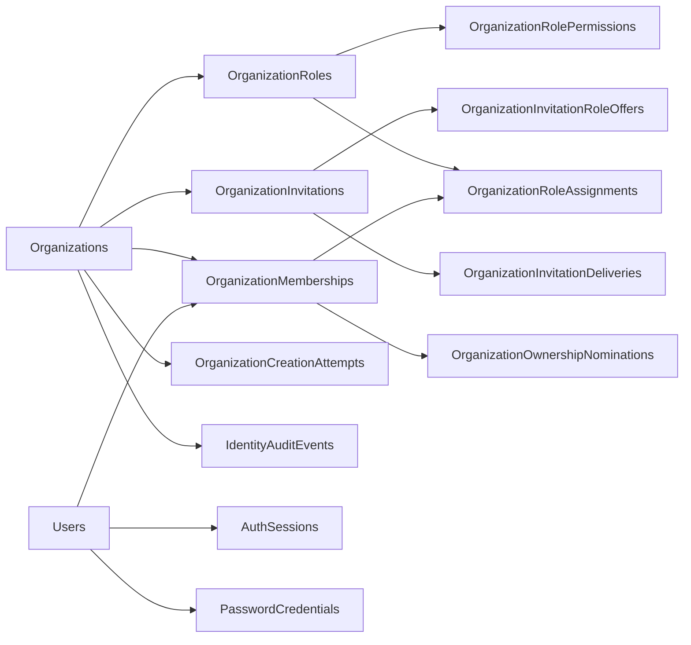

# Identity — Current mapped schema

> Status: Source-verified implementation reference, reviewed 2026-11-08.
> Authority: Checked-out EF model snapshot, configurations and migrations; no live database inspection or fresh application test run.
> Replaces the historical physical inventory in [ERD](erd.md) and [dictionary](data-dictionary.md) for implementation use. Selected business policy remains in [decisions](design-decisions.md) and feature contracts.

## Model and migration evidence

[IdentityDbContext](../../../../src/Modules/DeliveryPilot.Identity/DeliveryPilot.Identity.Infrastructure/Persistence/DbContexts/IdentityDbContext.cs) registers fourteen business entities. [Model snapshot](../../../../src/Modules/DeliveryPilot.Identity/DeliveryPilot.Identity.Infrastructure/Persistence/Migrations/IdentityDbContextModelSnapshot.cs) maps the fourteen shared-schema tables below. Operational outbox/reliability tables are separate and intentionally outside this business inventory. PlatformRoleAssignment remains a domain/design concept without a mapped table in this context.

Organization migrations add foundation, audit, creation replay, pinned permission policy, invitations/delivery and ownership nominations. These supersede the original nine-table proposal; existence in source does not establish application to an environment.

| Migration | Purpose |
|---|---|
| [20261103162203_AddOrganizationFoundation](../../../../src/Modules/DeliveryPilot.Identity/DeliveryPilot.Identity.Infrastructure/Persistence/Migrations/20261103162203_AddOrganizationFoundation.cs) | Add Organization Foundation |
| [20261103165502_AddIdentityAuditEvents](../../../../src/Modules/DeliveryPilot.Identity/DeliveryPilot.Identity.Infrastructure/Persistence/Migrations/20261103165502_AddIdentityAuditEvents.cs) | Add Identity Audit Events |
| [20261104025115_AddOrganizationCreationAttempts](../../../../src/Modules/DeliveryPilot.Identity/DeliveryPilot.Identity.Infrastructure/Persistence/Migrations/20261104025115_AddOrganizationCreationAttempts.cs) | Add Organization Creation Attempts |
| [20261104051215_PinOrganizationPermissionCatalogPolicy](../../../../src/Modules/DeliveryPilot.Identity/DeliveryPilot.Identity.Infrastructure/Persistence/Migrations/20261104051215_PinOrganizationPermissionCatalogPolicy.cs) | Pin Organization Permission Catalog Policy |
| [20261104071441_AddOrganizationInvitations](../../../../src/Modules/DeliveryPilot.Identity/DeliveryPilot.Identity.Infrastructure/Persistence/Migrations/20261104071441_AddOrganizationInvitations.cs) | Add Organization Invitations |
| [20261105074956_AddOrganizationOwnershipNominations](../../../../src/Modules/DeliveryPilot.Identity/DeliveryPilot.Identity.Infrastructure/Persistence/Migrations/20261105074956_AddOrganizationOwnershipNominations.cs) | Add Organization Ownership Nominations |
| [20261109074711_UpgradeBuiltInRolesToCatalogPolicyV2](../../../../src/Modules/DeliveryPilot.Identity/DeliveryPilot.Identity.Infrastructure/Persistence/Migrations/20261109074711_UpgradeBuiltInRolesToCatalogPolicyV2.cs) | Data-only: grant catalog policy v2 delivery entry-point codes to existing built-in Owner/Admin roles, advance their permission-set version and record system audit events (TASK-DP-003-020); no schema change |

## Current relationships

Arrows summarize references, not every FK or cascade. Exact keys, filtered indexes, constraints and deletion rules are owned by the linked configurations and snapshot. There are no Project/Delivery tables or cross-module FKs implied here.

## Columns from the current snapshot

SQL types below are snapshot types; nullable CLR value types or reference properties without IsRequired are shown as nullable. No values or secrets are reproduced. For defaults, generated values, unique/filter/check constraints and local composite FKs, use each mapping rather than the historical proposal.

### shared.AuthSessions

[Mapping](../../../../src/Modules/DeliveryPilot.Identity/DeliveryPilot.Identity.Infrastructure/Persistence/Configurations/AuthSessionConfiguration.cs)

| Column | SQL type | Nullable |
|---|---|---|
| Id | uuid | No |
| CreatedAt | timestamptz | No |
| RefreshExpiresAt | timestamptz | No |
| RefreshRotatedAt | timestamptz | Yes |
| RefreshTokenVerifier | bytea | No |
| RevokedAt | timestamptz | Yes |
| UserId | uuid | No |

### shared.IdentityAuditEvents

[Mapping](../../../../src/Modules/DeliveryPilot.Identity/DeliveryPilot.Identity.Infrastructure/Persistence/Configurations/IdentityAuditEventConfiguration.cs)

| Column | SQL type | Nullable |
|---|---|---|
| Id | uuid | No |
| ActorKind | character varying(16) | No |
| ActorReference | character varying(200) | Yes |
| ActorUserId | uuid | Yes |
| AggregateId | uuid | No |
| AggregateType | character varying(80) | No |
| AggregateVersion | bigint | No |
| CorrelationId | character varying(100) | No |
| Details | jsonb | No |
| DetailsSchemaVersion | smallint | No |
| EventOrdinal | integer | No |
| EventType | character varying(160) | No |
| MembershipId | uuid | Yes |
| MembershipVersion | bigint | Yes |
| OccurredAt | timestamp with time zone | No |
| OrganizationId | uuid | Yes |
| Outcome | character varying(16) | No |
| Reason | text | Yes |
| RecordedAt | timestamp with time zone | No |

### shared.Organizations

[Mapping](../../../../src/Modules/DeliveryPilot.Identity/DeliveryPilot.Identity.Infrastructure/Persistence/Configurations/OrganizationConfiguration.cs)

| Column | SQL type | Nullable |
|---|---|---|
| Id | uuid | No |
| CreatedAt | timestamp with time zone | No |
| CreatedByUserId | uuid | No |
| Name | character varying(160) | No |
| Status | character varying(16) | No |
| StatusChangedAt | timestamp with time zone | No |
| StatusChangedByUserId | uuid | Yes |
| StatusReason | text | Yes |
| UpdatedAt | timestamp with time zone | No |
| Version | bigint | No |

### shared.OrganizationCreationAttempts

[Mapping](../../../../src/Modules/DeliveryPilot.Identity/DeliveryPilot.Identity.Infrastructure/Persistence/Configurations/OrganizationCreationAttemptConfiguration.cs)

| Column | SQL type | Nullable |
|---|---|---|
| UserId | uuid | No |
| AttemptId | uuid | No |
| CreatedAt | timestamp with time zone | No |
| OrganizationId | uuid | No |
| ReplayUntil | timestamp with time zone | No |
| RequestFingerprint | bytea | No |
| ResponseSchemaVersion | smallint | No |
| ResultSnapshot | jsonb | No |

### shared.OrganizationInvitations

[Mapping](../../../../src/Modules/DeliveryPilot.Identity/DeliveryPilot.Identity.Infrastructure/Persistence/Configurations/OrganizationInvitationConfiguration.cs)

| Column | SQL type | Nullable |
|---|---|---|
| Id | uuid | No |
| CloseReason | character varying(1000) | Yes |
| ClosedAt | timestamp with time zone | Yes |
| ClosedByUserId | uuid | Yes |
| CreatedAt | timestamp with time zone | No |
| CurrentDeliveryMessageId | uuid | Yes |
| ExpiresAt | timestamp with time zone | No |
| IssuedByUserId | uuid | No |
| LastIssuedAt | timestamp with time zone | No |
| OrganizationId | uuid | No |
| RecipientEmail | character varying(320) | No |
| ReplacesInvitationId | uuid | Yes |
| Status | character varying(16) | No |
| TokenVerifier | bytea | No |
| UpdatedAt | timestamp with time zone | No |
| Version | bigint | No |

### shared.OrganizationInvitationDeliveries

[Mapping](../../../../src/Modules/DeliveryPilot.Identity/DeliveryPilot.Identity.Infrastructure/Persistence/Configurations/OrganizationInvitationDeliveryConfiguration.cs)

| Column | SQL type | Nullable |
|---|---|---|
| DeliveryMessageId | uuid | No |
| ExpiresAt | timestamp with time zone | No |
| FailureCode | character varying(100) | Yes |
| InvitationId | uuid | No |
| IssuedAt | timestamp with time zone | No |
| LastEventSequence | bigint | No |
| OrganizationId | uuid | No |
| Status | character varying(32) | No |
| UpdatedAt | timestamp with time zone | No |
| Version | bigint | No |

### shared.OrganizationInvitationRoleOffers

[Mapping](../../../../src/Modules/DeliveryPilot.Identity/DeliveryPilot.Identity.Infrastructure/Persistence/Configurations/OrganizationInvitationRoleOfferConfiguration.cs)

| Column | SQL type | Nullable |
|---|---|---|
| InvitationId | uuid | No |
| RoleId | uuid | No |
| OfferedPermissionCodes | jsonb | No |
| OfferedPermissionSetVersion | bigint | No |
| OfferedRoleName | character varying(160) | No |
| OrganizationId | uuid | No |

### shared.OrganizationMemberships

[Mapping](../../../../src/Modules/DeliveryPilot.Identity/DeliveryPilot.Identity.Infrastructure/Persistence/Configurations/OrganizationMembershipConfiguration.cs)

| Column | SQL type | Nullable |
|---|---|---|
| Id | uuid | No |
| CreatedAt | timestamp with time zone | No |
| OrganizationId | uuid | No |
| Status | character varying(16) | No |
| StatusChangedAt | timestamp with time zone | No |
| StatusChangedByUserId | uuid | Yes |
| StatusReason | text | Yes |
| UpdatedAt | timestamp with time zone | No |
| UserId | uuid | No |
| Version | bigint | No |

### shared.OrganizationOwnershipNominations

[Mapping](../../../../src/Modules/DeliveryPilot.Identity/DeliveryPilot.Identity.Infrastructure/Persistence/Configurations/OrganizationOwnershipNominationConfiguration.cs)

| Column | SQL type | Nullable |
|---|---|---|
| Id | uuid | No |
| ClosedAt | timestamp with time zone | Yes |
| ClosedByUserId | uuid | Yes |
| CreatedAt | timestamp with time zone | No |
| ExpiresAt | timestamp with time zone | No |
| MembershipId | uuid | No |
| NominatedByUserId | uuid | No |
| OrganizationId | uuid | No |
| Reason | character varying(1000) | Yes |
| Status | character varying(16) | No |
| UpdatedAt | timestamp with time zone | No |
| Version | bigint | No |

### shared.OrganizationRoles

[Mapping](../../../../src/Modules/DeliveryPilot.Identity/DeliveryPilot.Identity.Infrastructure/Persistence/Configurations/OrganizationRoleConfiguration.cs)

| Column | SQL type | Nullable |
|---|---|---|
| Id | uuid | No |
| Code | character varying(80) | No |
| CreatedAt | timestamp with time zone | No |
| CreatedByUserId | uuid | Yes |
| Description | text | Yes |
| Name | character varying(160) | No |
| OrganizationId | uuid | No |
| Origin | character varying(16) | No |
| PermissionSetVersion | bigint | No |
| RetiredAt | timestamp with time zone | Yes |
| TemplateVersion | integer | Yes |
| UpdatedAt | timestamp with time zone | No |
| Version | bigint | No |

### shared.OrganizationRoleAssignments

[Mapping](../../../../src/Modules/DeliveryPilot.Identity/DeliveryPilot.Identity.Infrastructure/Persistence/Configurations/OrganizationRoleAssignmentConfiguration.cs)

| Column | SQL type | Nullable |
|---|---|---|
| Id | uuid | No |
| CreatedAt | timestamp with time zone | No |
| ExpiresAt | timestamp with time zone | Yes |
| GrantReason | text | Yes |
| GrantVersion | bigint | No |
| GrantedAt | timestamp with time zone | No |
| GrantedByUserId | uuid | No |
| MembershipId | uuid | No |
| OrganizationId | uuid | No |
| RevocationReason | text | Yes |
| RevokedAt | timestamp with time zone | Yes |
| RevokedByUserId | uuid | Yes |
| RoleId | uuid | No |
| UpdatedAt | timestamp with time zone | No |
| Version | bigint | No |

### shared.OrganizationRolePermissions

[Mapping](../../../../src/Modules/DeliveryPilot.Identity/DeliveryPilot.Identity.Infrastructure/Persistence/Configurations/OrganizationRolePermissionConfiguration.cs)

| Column | SQL type | Nullable |
|---|---|---|
| RoleId | uuid | No |
| PermissionCode | character varying(160) | Yes |
| CatalogPolicyVersion | integer | No |
| OrganizationId | uuid | No |

### shared.PasswordCredentials

[Mapping](../../../../src/Modules/DeliveryPilot.Identity/DeliveryPilot.Identity.Infrastructure/Persistence/Configurations/PasswordCredentialConfiguration.cs)

| Column | SQL type | Nullable |
|---|---|---|
| UserId | uuid | No |
| CreatedAt | timestamptz | No |
| PasswordHash | text | No |

### shared.Users

[Mapping](../../../../src/Modules/DeliveryPilot.Identity/DeliveryPilot.Identity.Infrastructure/Persistence/Configurations/UserConfiguration.cs)

| Column | SQL type | Nullable |
|---|---|---|
| Id | uuid | No |
| AvatarUrl | text | Yes |
| CreatedAt | timestamptz | No |
| DisplayName | varchar(160) | No |
| EmailVerifiedAt | timestamptz | Yes |
| LastLoginAt | timestamptz | Yes |
| Locale | varchar(16) | No |
| PrimaryEmail | varchar(320) | No |
| Status | varchar(16) | No |
| TimeZone | varchar(64) | No |
| UpdatedAt | timestamptz | No |

## Operational and release boundaries

Organization APIs are described in the [Gateway contract](../../../features/FEAT-DP-003-organization/gateway-api-contract.md); acceptance results are historical evidence in the [backend matrix](../../../features/FEAT-DP-003-organization/backend-acceptance.md). Backend implementation does not imply frontend completion, Project guest admission, platform recovery, lifecycle deletion or production deployment.
