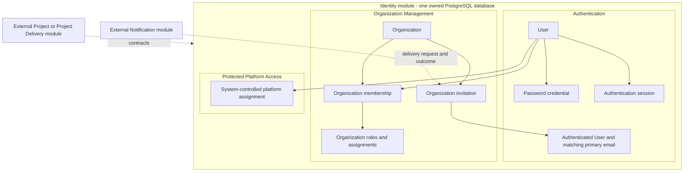
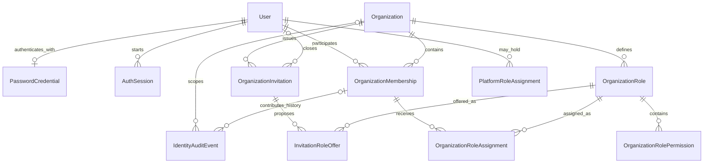
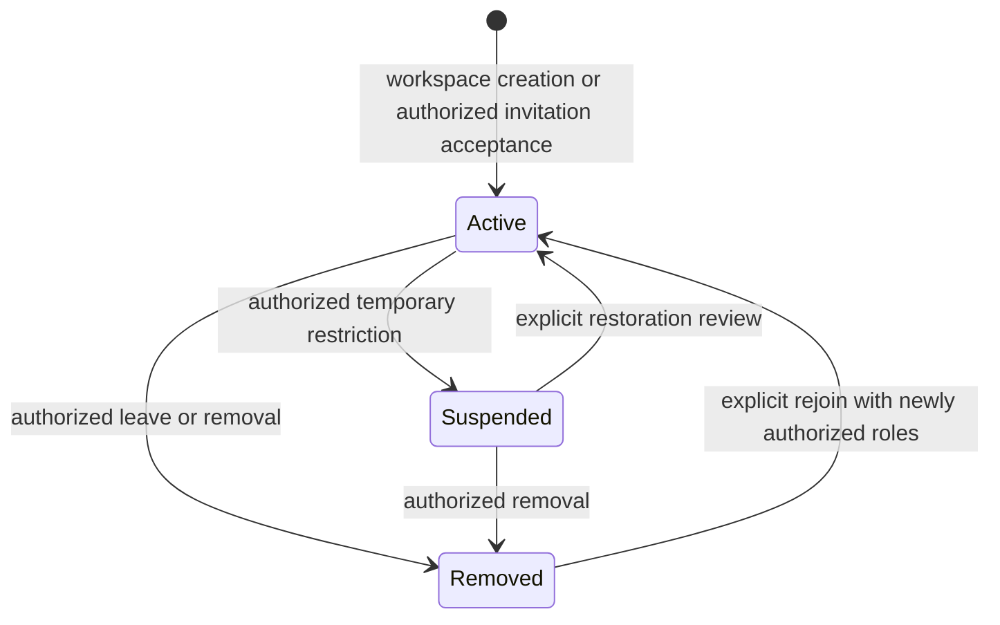
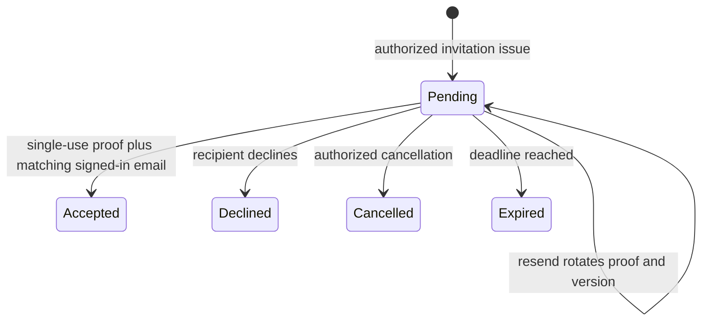
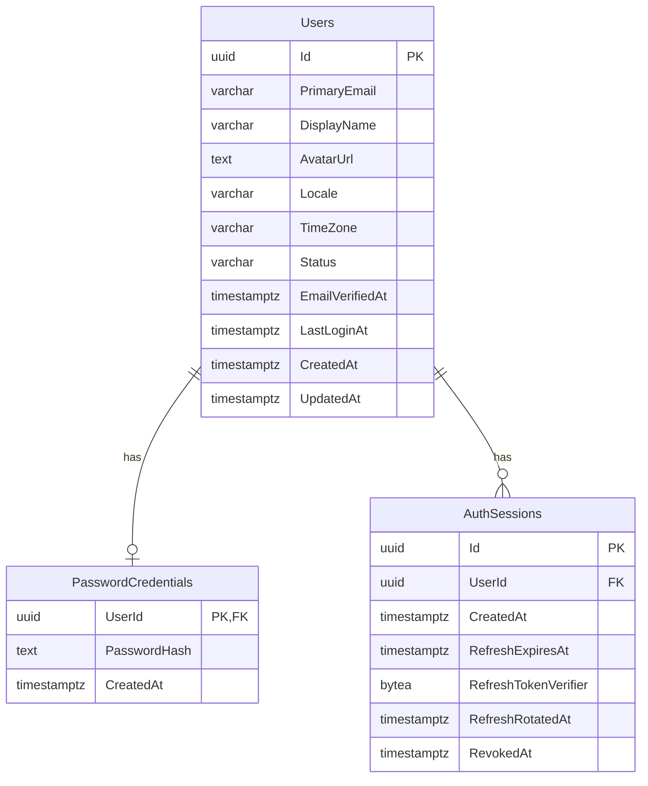
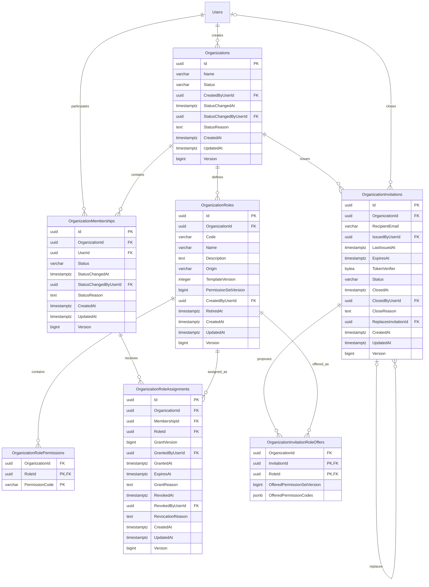
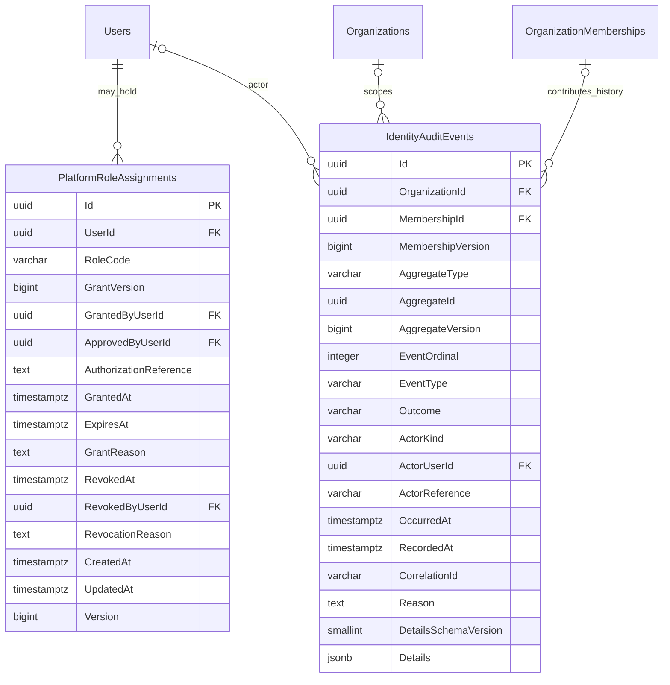

# Identity ERD

> Status: Existing authentication baseline plus candidate logical and nine-table proposed physical views. New schema remains a review draft, not implemented persistence.
> Decision authority: [Design decisions](design-decisions.md). Attributes and integrity: [Data dictionary](data-dictionary.md).
> Organization business behavior is selected for the bounded release. Physical organization/platform definitions still require technical review, mappings/migrations and runtime evidence; privileged platform/recovery operations remain separately scoped.

## Conceptual ownership

One Identity module owns one PostgreSQL database. Internal areas express business responsibility, not separate services or additional databases. Their entities can use local FKs where appropriate; external modules cannot query or FK Identity's tables.

Organization ownership does not grant project-content access. Project guest participation can reference User without creating OrganizationMembership. PlatformAssignment does not depend on Membership or grant a project wildcard. Notification delivers proof material through a protected delivery flow and never decides whether an invitation is accepted.

**Ownership clarification — U9:** additional ownership requires existing-Owner nomination and nominee acceptance. OWN-06/07 and U12/U15 now select seven-day in-app nomination, terminal/eligibility checks and explicit acceptance-then-step-down transfer. Nomination persistence remains task design; no nomination table/field/relationship is added here. CREATE-01 selects name-only creation, maximum 160 trimmed nonblank characters, duplicate names allowed and no slug. Diagrams remain physical proposals, not approved implementation.

## Candidate logical relationships

Solid edges below are candidate local relationships in the Identity database. Cardinalities describe stored relationships across lifecycle, not the number of currently active actors. The supported business rule is multiple Owners with at least one active Owner during normal administration; a one-to-many edge cannot enforce that rule.

The membership-to-role many-to-many relationship is selected by AUTHZ-01. AUTHZ-02 selects protected built-ins plus custom roles; the column draft records Origin, TemplateVersion and PermissionSetVersion; AUTHZ-12/U17 requires separately reviewed template upgrades. Other new entity names and relationships are candidates under the selected scope, and logical review is still required. ClosedByUserId is optional while pending and required for acceptance; it also identifies other human closures. Inviter/grantor/auditor relationships are omitted from the picture for readability; provenance is required in the dictionary, with exact system-versus-human representation still to decide.

DATA-03 selects code-defined permission identifiers with no Permission table. AUTHZ-06 selects stable assignment rows; GrantVersion identifies grant periods and Version detects every mutation. OrganizationInvitationRoleOffers stores OfferedPermissionSetVersion and immutable code snapshots in this draft; changed permissions require reissue under AUTHZ-04. Invitation owns TokenVerifier and terminal ClosedAt/ClosedByUserId, while Authentication supplies current User/email. No separate proof table is added. DATA-01 selects shared IdentityAuditEvents for membership/grant history, with actor provenance and ordered versions. No separate MembershipHistory or RoleVersion table is proposed.

| Relationship | Cardinality / optionality | Integrity and policy |
|---|---|---|
| User to PasswordCredential | 1 to 0..1 | Existing local FK and shared PK. Some preserved Users can lack password credentials. |
| User to AuthSession | 1 to 0..many | Existing local restricted FK; account validity checked independently. |
| User to OrganizationMembership | 1 to 0..many | New local User FK permitted. MEM-01 selects durable OrganizationId+UserId uniqueness. |
| Organization to Membership | 1 to 0..many stored rows | Creation must atomically establish initial Owner; ordinary live operations protect at least one active eligible Owner. Exact exceptional lifecycle OWN-03 remains open. |
| Membership to organization Role | Many-to-many, selected AUTHZ-01 | OrganizationRoleAssignment binds both ends to the same organization. Combine current allowed permissions within this organization. Built-ins are protected under AUTHZ-02; custom roles remain subject to delegation policy. |
| Role to permission codes | 1 to 0..many links | Unique role/code pair; validate registered organization-compatible semantics. |
| Organization to Invitation | 1 to 0..many historical offers | INV-02 selects at most one pending invitation per organization/normalized email, regardless of offered roles. INV-05/06/U10 select seven-day issue and restarted seven-day rotated resend; INV-07/08/09 and REPLAY-01/U14/U16/U21 select duplicate, replay and terminal-offer behavior. |
| Invitation to membership | Indirect, not a mandatory new-row relationship | Acceptance can concern an existing durable membership. Stale invitations cannot restore a removed/suspended relationship implicitly. No AcceptedMembershipId column is proposed; OrganizationId plus accepted ClosedByUserId resolves the durable membership. |
| Invitation to closing User | 0..1 closing User per invitation | ClosedByUserId is the acceptor when accepted, other actor for human closure, or NULL for pending/system expiry. INV-01 requires matching signed-in email on acceptance. INV-05/06/U10 select seven-day issue and restarted seven-day resend. |
| User to PlatformRoleAssignment | 1 to 0..many | Local User FK, system role and isolated platform authority. Zero organization memberships is valid. |

## Membership lifecycle proposal

Durable membership and fresh roles on rejoin are user-selected (MEM-01/02). U18 defers suspension/restoration commands, U11–U15 select normal removal/rejoin/ownership permissions, and U20 selects workspace-lifetime history. Diagram state values remain physical proposals; deferred transitions are not enabled operations. Invitation Pending is not a membership state.

All effective access also depends on User/session and organization lifecycle. Removed membership retains identity/history; previous assignments do not become effective merely because the membership is Active again. Account compromise containment must not be blocked solely by ordinary last-owner continuity policy.

## Invitation lifecycle proposal

Persisting Expired may lag time; redemption checks the actual deadline. Delivery failure is a delivery outcome, not automatic cancellation. AUTHZ-04 selects reissue after any offered role permission change, with old offer/proof invalidated. INV-01 selects link proof plus matching signed-in email; INV-02 selects one pending offer per organization/normalized email. INV-05/06/U10 select seven days after issue and a restarted seven days on rotated resend; INV-04/U10 requires current inviter authority at acceptance. Consumption is proposed through terminal status/closure fields, and reissue creates a new linked row; U14/U16/U21 select first-valid-transition, recipient eligibility, proof-protected decline, pending cancellation and fresh Issue for closed offers. Physical enforcement remains proposed.

## Existing physical baseline

The following diagram describes the three business tables mapped by current source and migration history, all in schema `shared`. It is not a live-database inspection or a physical proposal for the new areas. Mermaid labels are PostgreSQL types; dictionary entries provide nullability/defaults and actual constraint names.

`PrimaryEmail` has a case-insensitive expression unique index rather than ordinary column uniqueness. Current AuthSessions has a UserId index; neither its configuration nor its creation migration establishes a unique refresh-verifier index. IsRevoked is derived in the domain and is not a stored column. Reliability/outbox infrastructure remains outside this business diagram.

## Proposed physical column views

These nine new tables are a physical review draft in schema `shared`, not implemented persistence. Their types/column names mirror the dictionary; varchar lengths, nullability, defaults, checks and composite alternate keys are authoritative in the dictionary. Id/version conventions differ for mutable roots, relationship children and append-only events. Users is an existing reference in these views, not a proposed replacement.

Provenance FKs are marked on columns, but not every issuer/grantor edge is drawn to keep the diagrams readable. OrganizationId participates in same-organization composite references where specified; Mermaid FK labels do not replace those composite constraints. Audit AggregateId/AggregateVersion and offered permission versions intentionally have no polymorphic or mutable-version FK.

### Organization tables

### Platform assignments and shared audit

This diagram permits platform events with no organization/membership. ActorKind distinguishes a real User from a named system/operator authority. MembershipVersion/EventOrdinal orders member history; aggregate version/ordinal orders target evidence. Referencing events never means platform assignment grants customer-content access.

## Physical design gate

The proposed nine-table views now specify columns, with types/nullability/defaults and integrity in the dictionary. The Organization business lifecycle is selected under U11–U21. Remaining technical/operating gates include additional-Owner nomination persistence, actual interfaces/mappings/migrations and platform assurance/recovery. Suspension/restoration, lifecycle deletion and automated audit purge/erasure are explicitly deferred. Seven-day issue/resend and current sponsor authority are selected under U10. Review these drafts before production finalization or implementation. New mappings/migrations must preserve current history and source behavior; historical rollback tables are not an approved schema template.

Preserve the three existing mappings, email index and active/unverified registration behavior. SQL migrations, EF mappings, API contracts and host consolidation are not implemented by this documentation.
