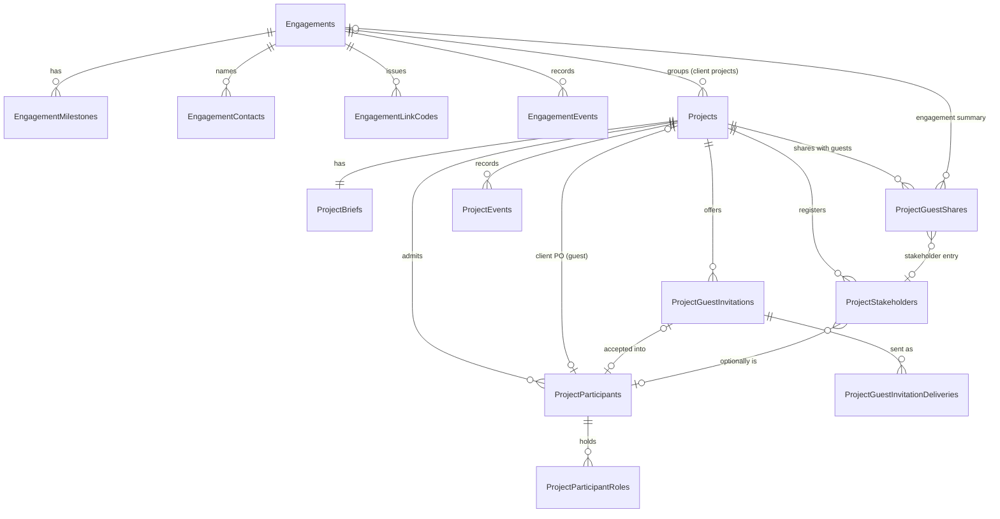
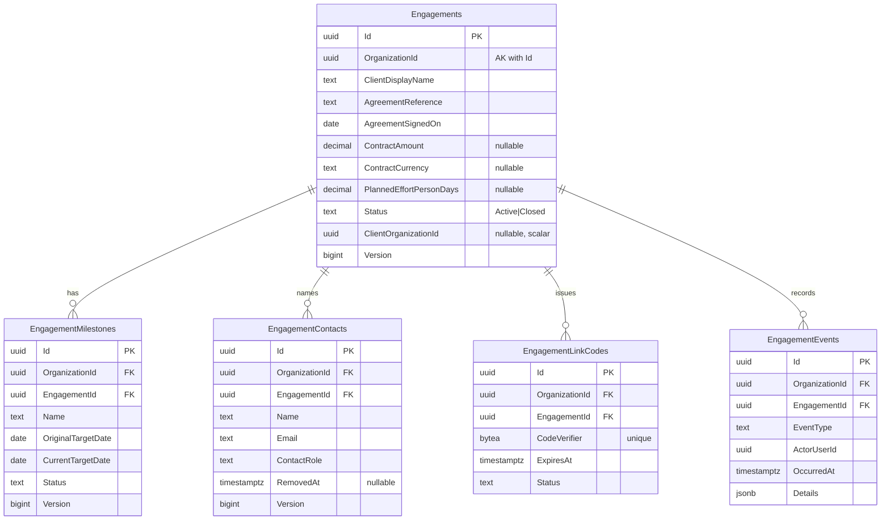
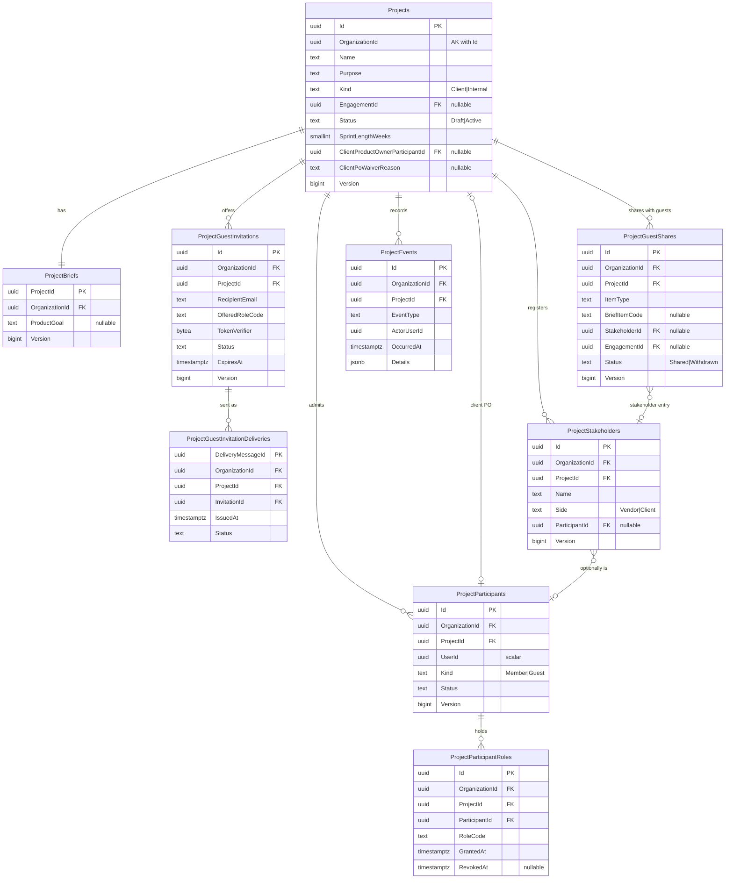
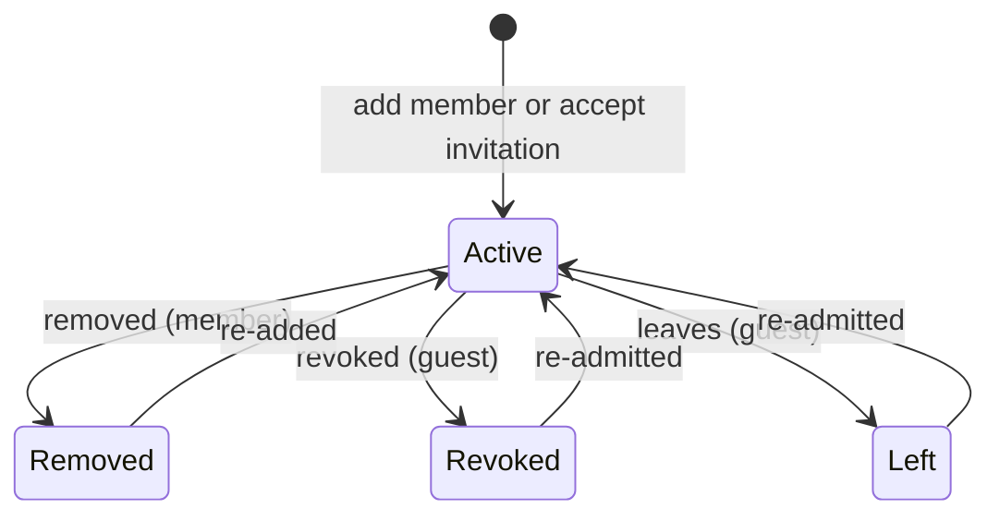

# Projects Module — Logical ERD

> Status: Accepted logical model (G3 passed 2026-11-10). Scope and conventions: [README](README.md). Decisions: [design-decisions.md](design-decisions.md).
> Attribute lists name every business attribute with its rule source. Physical types and index names are left to the persistence tasks; where a rule implies a constraint, the constraint is named here.

## Overview

External (scalar, no FK): `OrganizationId` (vendor workspace), every `…UserId`, `Engagements.ClientOrganizationId` — all Identity IDs.

## Engagement context

Schema `engagement`. Aggregate root: **Engagement**. Milestones, contacts and link codes are children changed only through the engagement (FR-DP-025-002…009).

### Engagements

| Attribute | Null | Rule / source |
|---|---|---|
| `Id`, `OrganizationId` | no | PK; AK `(OrganizationId, Id)`; owner from authorized context only (FR-025-001, BR-008) |
| `ClientDisplayName` | no | trimmed 1–200 (FR-025-001) |
| `ClientLegalName` | yes | ≤200 |
| `ClientCountryCode` | yes | ISO 3166-1 alpha-2, upper case |
| `EngagementName` | yes | ≤200 |
| `AgreementReference` | no | trimmed 1–100; duplicates allowed with warning (OQ-025-11) |
| `AgreementSignedOn` | no | calendar date |
| `DocumentUrl` | yes | absolute HTTPS, ≤2000 |
| `ContractAmount` | yes | ≥0, ≤2 decimals (FR-025-003) |
| `ContractCurrency` | yes | ISO 4217; set or changed only while the stored `ContractAmount` is null; clearing amount and currency together is allowed, while switching currency requires a subsequent request (domain, FR-025-003, user-selected clarification 2026-11-10); **check:** `ContractAmount IS NULL OR ContractCurrency IS NOT NULL` |
| `PlannedEffortPersonDays` | yes | ≥0, ≤1 decimal; empty means unknown, never zero |
| `Status` | no | `Active` \| `Closed`; starts `Active` (FR-025-007) |
| `ClosedAt`, `ClosedByUserId` | yes | both set iff `Status = Closed`; reasons live in events |
| `ClientOrganizationId` | yes | scalar Identity org; **check:** `<> OrganizationId` (FR-025-009) |
| `ClientLinkedAt`, `ClientLinkedByUserId` | yes | **check:** all three client-link columns null or all set |
| `CreatedByUserId`, `CreatedAt`, `UpdatedAt` | no | creator keeps full-detail visibility (FR-025-006) |
| `Version` | no | optimistic concurrency (FR-025-002) |

Indexes implied by use: `(OrganizationId, Status, CreatedAt, Id)` for paged lists; `(OrganizationId, lower(AgreementReference))` **non-unique**, filtered `Status = 'Active'`, for the duplicate warning; `(ClientOrganizationId)` filtered not null, for "engagements linked to my organization".

### EngagementMilestones

| Attribute | Null | Rule / source |
|---|---|---|
| `Id`, `OrganizationId`, `EngagementId` | no | FK `(OrganizationId, EngagementId)` → Engagements |
| `Name` | no | 1–200 (FR-025-004) |
| `Description` | yes | ≤2000 |
| `OriginalTargetDate` | no | set at creation, never updated |
| `CurrentTargetDate` | no | equals original at creation; change requires reason (event) |
| `Status` | no | `Planned` \| `Achieved` \| `Missed` \| `Retired` ([lifecycle](#lifecycles)) |
| `CreatedByUserId`, `CreatedAt`, `UpdatedAt`, `Version` | no | |

Not linked to projects, Sprints, releases or payments in MVP.

### EngagementContacts

| Attribute | Null | Rule / source |
|---|---|---|
| `Id`, `OrganizationId`, `EngagementId` | no | FK `(OrganizationId, EngagementId)` → Engagements |
| `Name` | no | 1–200 (FR-025-005) |
| `Email` | no | valid email, stored normalized (lower, trimmed) |
| `ContactRole` | no | `ClientProductOwner` \| `Sponsor` \| `Other` |
| `RemovedAt`, `RemovedByUserId` | yes | removal ends the contact; history in events |
| `CreatedByUserId`, `CreatedAt`, `UpdatedAt`, `Version` | no | |

**Partial unique:** `(OrganizationId, EngagementId)` where `ContactRole = 'ClientProductOwner' AND RemovedAt IS NULL` — at most one designated client PO ([PRJ-09](design-decisions.md#prj-09)). Grants no access (BR-003).

### EngagementLinkCodes

| Attribute | Null | Rule / source |
|---|---|---|
| `Id`, `OrganizationId`, `EngagementId` | no | FK `(OrganizationId, EngagementId)` → Engagements |
| `CodeVerifier` | no | SHA-256 of the code, 32 bytes; **globally unique** (looked up by the client side without knowing the engagement) ([PRJ-10](design-decisions.md#prj-10)) |
| `IssuedByUserId`, `IssuedAt` | no | |
| `ExpiresAt` | no | **check:** `= IssuedAt + 7 days` (OQ-025-10) |
| `Status` | no | `Outstanding` \| `Consumed` \| `Invalidated`; expiry is computed from `ExpiresAt` |
| `ConsumedAt`, `ConsumedByUserId`, `ConsumedForOrganizationId` | yes | set iff `Consumed` |
| `InvalidatedAt` | yes | set iff `Invalidated` (new code issued, engagement closed or linked) |
| `Version` | no | |

**Partial unique:** `(OrganizationId, EngagementId)` where `Status = 'Outstanding'` — issuing a new code invalidates the old one in the same transaction (FR-025-008).

### EngagementLinkAttempts (failed confirmations only)

| Attribute | Null | Rule / source |
|---|---|---|
| `Id` | no | UUIDv7 |
| `UserId` | no | scalar Identity user who submitted a code |
| `ActingOrganizationId` | no | the organization the user acted in |
| `AttemptedAt` | no | UTC |

One row per failed preview or confirmation ([PRJ-17](design-decisions.md#prj-17)); the limit and window are task configuration. The table never stores the submitted code, a verifier or an engagement reference, because the failure is generic. It is not tenant-owned: no `OrganizationId` and no foreign key (exception to README conventions 2 and 8). Rows older than the window are operational data and may be deleted (exception to convention 7). Index: `(UserId, AttemptedAt)`.

### EngagementEvents (append-only)

| Attribute | Null | Rule / source |
|---|---|---|
| `Id` | no | UUIDv7 (time-ordered) |
| `OrganizationId`, `EngagementId` | no | FK `(OrganizationId, EngagementId)` → Engagements |
| `EventType` | no | e.g. `engagement.created`, `engagement.details-changed`, `engagement.value-changed`, `milestone.added`, `milestone.date-changed`, `milestone.status-changed`, `contact.added`, `contact.designated-client-po`, `contact.removed`, `engagement.closed`, `engagement.reopened`, `link-code.issued`, `link.confirmed`, `link.removed` (FR-025-010) |
| `SubjectType`, `SubjectId` | no | `Engagement` \| `Milestone` \| `Contact` \| `LinkCode` and its ID |
| `ActorUserId` | no | |
| `ActorOrganizationId` | no | the workspace the actor acted in; differs from `OrganizationId` when a client Owner/Admin confirms or removes a link (FR-025-009) |
| `OccurredAt` | no | UTC |
| `Reason` | yes | required by the domain for agreement-reference/date changes, milestone date changes, close/reopen |
| `Details` | no | JSON object with previous/new values; never a link code |
| `EngagementVersion` | no | engagement `Version` after the change |

Index: `(OrganizationId, EngagementId, OccurredAt, Id)`. No update or delete grants for the API role.

## Project context

Schema `project`. Aggregate root: **Project**. Brief, participants, role grants, invitations, stakeholders and guest shares are children; rules spanning them lock the `Projects` row.

### Projects

| Attribute | Null | Rule / source |
|---|---|---|
| `Id`, `OrganizationId` | no | PK; AK `(OrganizationId, Id)` (FR-004-001, BR-001) |
| `Name` | no | trimmed 1–160, duplicates allowed (OQ-004-03) |
| `Purpose` | no | trimmed 1–500 |
| `Kind` | no | `Client` \| `Internal` ([PRJ-07](design-decisions.md#prj-07)); changeable only while `Draft`, and switching to `Internal` clears `EngagementId` in the same transaction (FR-004-002, OQ-004-16) |
| `EngagementId` | yes | FK `(OrganizationId, EngagementId)` → `engagement.Engagements` (D-08); **check:** `Kind = 'Client' OR EngagementId IS NULL`; changeable only while `Draft` (FR-004-002) |
| `Status` | no | `Draft` \| `Active` (FR-004-012); closure belongs to FEAT-DP-030 |
| `SprintLengthWeeks` | no | 1–4, default 2 (FR-004-004) |
| `ClientProductOwnerParticipantId` | yes | FK `(OrganizationId, Id, ClientProductOwnerParticipantId)` → ProjectParticipants `(OrganizationId, ProjectId, Id)` — same project guaranteed by the database; must be an active **guest** (domain) ([PRJ-08](design-decisions.md#prj-08)) |
| `ClientPoAssignedAt`, `ClientPoAssignedByUserId` | yes | set iff a client PO is assigned |
| `ActivatedAt`, `ActivatedByUserId` | yes | set iff `Status = Active` |
| `ClientPoWaiverReason` | yes | ≤2000; set only at activation of a client project without a client PO (FR-004-012) |
| `CreatedByUserId`, `CreatedAt`, `UpdatedAt` | no | |
| `Version` | no | |

Scrum is the only framework (BR-027) and is not stored. Indexes implied by use: `(OrganizationId, EngagementId)` for the engagement page; `(OrganizationId, Status, CreatedAt, Id)`.

### ProjectBriefs (1:1 with Projects)

| Attribute | Null | Rule / source |
|---|---|---|
| `ProjectId` | no | PK and FK `(OrganizationId, ProjectId)` → Projects; created in the same transaction as the project ([PRJ-06](design-decisions.md#prj-06)) |
| `OrganizationId` | no | |
| `Problem`, `ObjectivesAndSuccessCriteria`, `ScopeAndExclusions`, `Assumptions`, `ConstraintsAndDependencies`, `OpenQuestions`, `ProductGoal` | yes | each ≤4000; empty = "missing" (FR-004-003); previous Product Goal values are kept in ProjectEvents |
| `UpdatedAt`, `UpdatedByUserId` | yes | null until first edit |
| `Version` | no | separate from `Projects.Version` so brief edits do not conflict with status/team changes |

### ProjectParticipants

| Attribute | Null | Rule / source |
|---|---|---|
| `Id`, `OrganizationId`, `ProjectId` | no | FK `(OrganizationId, ProjectId)` → Projects; AK `(OrganizationId, ProjectId, Id)` |
| `UserId` | no | scalar Identity user; **unique** `(OrganizationId, ProjectId, UserId)` — one durable row per person ([PRJ-04](design-decisions.md#prj-04)) |
| `Kind` | no | `Member` (workspace member) \| `Guest` (no workspace membership) ([PRJ-02](design-decisions.md#prj-02)); may change only when an ended row is reactivated. A former workspace member whose member stint is still active is converted when they accept a guest invitation: the stint ends, its roles are revoked and the row is reactivated as `Guest` in one transaction (FR-004-008, OQ-004-15) |
| `Status` | no | `Active` \| `Removed` \| `Revoked` \| `Left` ([lifecycle](#lifecycles)) |
| `FirstJoinedAt` | no | |
| `ActiveSince` | no | start of the current stint |
| `EndedAt`, `EndedByUserId` | yes | set iff `Status <> Active` |
| `AdmittedViaInvitationId` | yes | last accepted guest invitation; FK `(OrganizationId, ProjectId, AdmittedViaInvitationId)` → ProjectGuestInvitations |
| `Version` | no | |

Index: `(OrganizationId, UserId, Status)` for "my projects" and the per-request access check. Workspace membership of members is checked with Identity, not stored.

### ProjectParticipantRoles (role grants with history)

| Attribute | Null | Rule / source |
|---|---|---|
| `Id`, `OrganizationId`, `ProjectId`, `ParticipantId` | no | FK `(OrganizationId, ProjectId, ParticipantId)` → ProjectParticipants |
| `RoleCode` | no | `ProjectAdministrator` \| `ProjectManager` \| `BusinessAnalyst` \| `Developer` \| `QualityAssurance` \| `DevOps` \| `Viewer` (FR-004-005); fixed catalog in code, no role table ([PRJ-14](design-decisions.md#prj-14)) |
| `GrantedAt`, `GrantedByUserId` | no | |
| `RevokedAt`, `RevokedByUserId` | yes | revoked grants stay as history |

**Partial unique:** `(OrganizationId, ParticipantId, RoleCode)` where `RevokedAt IS NULL`. `ProjectId` is denormalized so "active administrators of project P" is one indexed query: `(OrganizationId, ProjectId, RoleCode)` filtered `RevokedAt IS NULL`.

### ProjectGuestInvitations

Mirrors Identity's `OrganizationInvitations` ([PRJ-11](design-decisions.md#prj-11)).

| Attribute | Null | Rule / source |
|---|---|---|
| `Id`, `OrganizationId`, `ProjectId` | no | FK `(OrganizationId, ProjectId)` → Projects; AK `(OrganizationId, ProjectId, Id)` |
| `RecipientEmail` | no | normalized lower/trimmed, ≤320 |
| `OfferedRoleCode` | no | any role except `ProjectAdministrator` (**check**) (FR-004-008) |
| `TokenVerifier` | no | 32 bytes; rotated on resend |
| `Status` | no | `Pending` \| `Accepted` \| `Declined` \| `Cancelled` \| `Expired` |
| `IssuedByUserId`, `CreatedAt`, `LastIssuedAt` | no | inviter's guest permission is rechecked at acceptance |
| `ExpiresAt` | no | **check:** `= LastIssuedAt + 7 days` |
| `CurrentDeliveryMessageId` | yes | latest delivery |
| `ReplacesInvitationId` | yes | when a changed role required a new invitation |
| `ClosedAt`, `ClosedByUserId` | yes | `ClosedAt` set iff not `Pending`; `ClosedByUserId` is the accepting, declining or cancelling user and stays null for `Expired` |
| `Version` | no | |

**Partial unique:** `(OrganizationId, ProjectId, RecipientEmail)` where `Status = 'Pending'`.

### ProjectGuestInvitationDeliveries

| Attribute | Null | Rule / source |
|---|---|---|
| `DeliveryMessageId` | no | PK, UUIDv7; the outbox message ID |
| `OrganizationId`, `ProjectId`, `InvitationId` | no | FK `(OrganizationId, ProjectId, InvitationId)` → ProjectGuestInvitations |
| `IssuedAt`, `ExpiresAt` | no | |
| `Status`, `LastEventSequence`, `FailureCode`, `UpdatedAt`, `Version` | — | same shape as Identity's deliveries; drives issuance limits per project and per recipient |

Indexes: `(OrganizationId, ProjectId, IssuedAt)` and `(InvitationId, IssuedAt)` for rate limits.

### ProjectStakeholders

| Attribute | Null | Rule / source |
|---|---|---|
| `Id`, `OrganizationId`, `ProjectId` | no | FK `(OrganizationId, ProjectId)` → Projects |
| `Name` | no | 1–200 (FR-004-011) |
| `Side` | no | `Vendor` \| `Client` |
| `OrganizationName` | yes | ≤200 |
| `Responsibilities`, `DecisionAreas` | yes | ≤2000 each |
| `Email` | yes | normalized |
| `ParticipantId` | yes | FK `(OrganizationId, ProjectId, ParticipantId)` → ProjectParticipants; must be active when linked (domain); grants nothing (BR-004) |
| `RetiredAt`, `RetiredByUserId` | yes | |
| `CreatedByUserId`, `CreatedAt`, `UpdatedAt`, `Version` | no | |

### ProjectGuestShares (what guests may read beyond the default view)

FEAT-DP-015 ([PRJ-22](design-decisions.md#prj-22)). One durable row per shareable item; sharing again reactivates it, and every share and withdrawal is also a `ProjectEvents` row.

| Attribute | Null | Rule / source |
|---|---|---|
| `Id`, `OrganizationId`, `ProjectId` | no | FK `(OrganizationId, ProjectId)` → Projects |
| `ItemType` | no | `BriefItem` \| `Stakeholder` \| `EngagementSummary` (FR-015-003, FR-015-006); later features add types (FR-015-009) |
| `BriefItemCode` | yes | `Problem` \| `ObjectivesAndSuccessCriteria` \| `ScopeAndExclusions` \| `Assumptions` \| `ConstraintsAndDependencies` \| `OpenQuestions`; never `ProductGoal`, which every guest sees (OQ-015-02) |
| `StakeholderId` | yes | FK `(OrganizationId, ProjectId, StakeholderId)` → ProjectStakeholders `(OrganizationId, ProjectId, Id)`: same project guaranteed |
| `EngagementId` | yes | FK `(OrganizationId, EngagementId)` → `engagement.Engagements`; must equal `Projects.EngagementId` (domain, under the project row lock) |
| `Status` | no | `Shared` \| `Withdrawn` |
| `SharedAt`, `SharedByUserId` | no | latest share |
| `WithdrawnAt`, `WithdrawnByUserId` | yes | set iff `Withdrawn`; `WithdrawnByUserId` is null for an automatic withdrawal |
| `Version` | no | |

**Check:** exactly the target column of the type is set: `BriefItem` → only `BriefItemCode`; `Stakeholder` → only `StakeholderId`; `EngagementSummary` → only `EngagementId`.

**Unique (one durable row per item):** `(OrganizationId, ProjectId, BriefItemCode)` where `ItemType = 'BriefItem'`; `(OrganizationId, ProjectId, StakeholderId)` where `ItemType = 'Stakeholder'`; `(OrganizationId, ProjectId)` where `ItemType = 'EngagementSummary'`.

Index for the guest read and "what the client sees": `(OrganizationId, ProjectId, Status)`. ProjectStakeholders gains the alternate key `(OrganizationId, ProjectId, Id)` for the FK.

Sharing a brief item or stakeholder entry does not touch `ProjectBriefs.Version` or `ProjectStakeholders.Version`, so sharing never conflicts with editing. A share grants read visibility only; the shared content is read live from its own table (OQ-015-07).

### ProjectEvents (append-only)

Same shape as EngagementEvents with `ProjectId` instead of `EngagementId`, `SubjectType` ∈ `Project` \| `Brief` \| `Participant` \| `RoleGrant` \| `Invitation` \| `Stakeholder` \| `ClientPo` \| `GuestShare`, and `ProjectVersion`. Event types cover creation, engagement association and kind changes, brief and Product Goal changes, cadence, participant add/remove/reactivate, role grant/revoke, invitation issue/resend/cancel/accept/decline, guest revoke/leave, client-PO assign/clear, stakeholder changes, activation (with waiver), administrator recovery (FR-004-013), guest share and withdrawal including automatic withdrawals (FR-015-003/004). Index `(OrganizationId, ProjectId, OccurredAt, Id)`.

## Invariants and how they are enforced

| Invariant | Source | Enforcement |
|---|---|---|
| A child row belongs to the same tenant as its parent | D-07 | Composite FKs `(OrganizationId, …)` |
| Client PO, stakeholder link, invitation link point into the **same project** | FR-004-009/011 | Composite FKs including `ProjectId` |
| Internal project has no engagement | BR-046 | Check constraint on Projects |
| At most one engagement per project | BR-046 | Single nullable column |
| A project is created under, or moved to, only an **Active** engagement of the same workspace; closing races with both | FR-004-002, FR-025-007 | Composite FK + create-project and any set/change of a Draft project's engagement lock the engagement row `FOR SHARE`; close locks it `FOR UPDATE` |
| A Closed engagement rejects changes to details, values, milestones, contacts and link codes; removing a confirmed client link stays allowed (OQ-025-13) | FR-025-007/009 | Domain rule on the aggregate; commands that change a child lock the engagement row (README convention 6), so they cannot interleave with close |
| Contract currency is set or changed only while the amount is empty | FR-025-003 | Domain rule; the check constraint covers amount without currency |
| At most one designated client PO per engagement | OQ-025-06 | Partial unique on EngagementContacts |
| At most one outstanding link code per engagement; codes single-use | FR-025-008/009 | Partial unique + status transition under the engagement row lock |
| Engagement cannot be linked to its own workspace | FR-025-009 | Check constraint |
| Failed link-code attempts are rate limited per user | FR-025-009 | Count `EngagementLinkAttempts` rows in the window before verifying a code; a failure commits one row outside the rolled-back command ([PRJ-17](design-decisions.md#prj-17)) |
| One participant row per person per project | PRJ-04 | Unique `(OrganizationId, ProjectId, UserId)` |
| No duplicate active role grant | FR-004-005 | Partial unique on ProjectParticipantRoles |
| Guests never hold `ProjectAdministrator`; members join only as participants | FR-004-005/008 | Domain rule under the project row lock (`Kind` is on the parent row); invitation offered role has a check constraint |
| A participant has ≥1 active role, else the participation ends (`Removed` for a member, `Revoked` for a guest); guest roles are changed directly after admission (OQ-004-17) | FR-004-005 | Domain rule in the same transaction |
| At least one active Project Administrator | FR-004-006/013 | Lock `Projects` row `FOR UPDATE` for any admin grant/revoke, participant removal or recovery; count active admin grants before commit |
| At most one client PO per project, always an active guest; cleared when the guest is revoked or leaves; a client project is Active without one only through a recorded waiver | FR-004-009/010/012 | Single nullable column + domain rule in the guest-ending and activation transactions |
| One pending guest invitation per project and email | FR-004-008 | Partial unique on ProjectGuestInvitations |
| Draft → Active preconditions (Product Goal, Sprint length, a PM, engagement for client projects, client PO or waiver) | FR-004-012 | Domain check under the project row lock |
| Engagement and kind fixed once project is Active | FR-004-002 | Domain rule; `EngagementId` and `Kind` changes rejected unless `Draft` |
| Concurrent edits are detected | FR-025-002, FR-004-003 | `Version` tokens |
| Original milestone date never changes | FR-025-004 | Domain rule; column never mapped as updatable after insert |
| Every change is attributable | FR-025-010, NFR-003 | Event row in the same transaction |
| Every item is internal to guests until shared; a share targets exactly one item of the same project | FR-015-003/007, BR-004 | Check on `ProjectGuestShares` target columns + composite FKs; guest reads join on a `Shared` row |
| At most one share row per item | FR-015-003 | Partial unique indexes per `ItemType` |
| Only Administrators and member PMs share; the engagement summary also needs full engagement detail | OQ-015-06 | Domain rule; the engagement visibility check as in FR-025-006 |
| A shared engagement summary always names the project's current engagement | FR-015-004/006 | Domain rule: changing or removing `Projects.EngagementId` (TASK-DP-004-006) withdraws the summary share in the same transaction under the project row lock |
| A retired stakeholder entry is never shared | FR-015-003 | Domain rule: retiring a shared entry withdraws its share in the same transaction |

## Lifecycles

| Entity | Transitions | Terminal |
|---|---|---|
| Engagement | `Active` → `Closed` (reason); `Closed` → `Active` (reopen, reason) | none; no deletion |
| Milestone | `Planned` → `Achieved` \| `Missed` \| `Retired`; `Missed` → `Achieved` \| `Retired` | `Achieved`, `Retired` |
| Link code | `Outstanding` → `Consumed` \| `Invalidated`; expiry computed from `ExpiresAt` | `Consumed`, `Invalidated` |
| Project | `Draft` → `Active` (initialize) | `Active` in MVP (closure: FEAT-DP-030) |
| Participant | `Active` → `Removed` (member) \| `Revoked` (guest) \| `Left` (guest); any ended status → `Active` on re-add or re-admission; a former member's stint goes `Active` → `Removed` → `Active` as `Guest` within one acceptance | none |
| Guest invitation | `Pending` → `Accepted` \| `Declined` \| `Cancelled` \| `Expired`; resend keeps `Pending` and rotates the proof | all except `Pending` |

*Participant lifecycle, the only one with re-entry.* Reactivating a participant grants fresh roles; earlier grants stay revoked ([PRJ-04](design-decisions.md#prj-04)).

## Read models (no tables)

| Read | Built from |
|---|---|
| Engagement summary for project participants (FR-025-006) | Engagements + milestones, filtered to engagements of projects where the caller has an active **member** participation (`Kind = Member`). Guests share the participant table ([PRJ-02](design-decisions.md#prj-02)) but never see engagement records (OQ-025-07) |
| Engagements linked to my organization (FR-025-009) | Engagements where `ClientOrganizationId` is the organization the caller acts in, after the Identity Owner/Admin check; returns engagement name and client display name only. The only read not filtered by the owning `OrganizationId` |
| Projects on the engagement page: name, status, administrator names (OQ-004-08) | Projects + active `ProjectAdministrator` grants; names from Identity |
| "No active administrator" flag (FR-004-013) | Active administrator grants checked against Identity membership at read time ([PRJ-15](design-decisions.md#prj-15)) |
| Missing brief items (FR-004-003) | Null columns of ProjectBriefs |
| Guest project view and shared items (FR-015-002/005) | Projects + ProjectBriefs (Product Goal; other items only when shared or the guest holds PM/BA) + active participants + `Shared` rows of ProjectGuestShares; stakeholder entries without email and participant link; engagement summary fields from `engagement.Engagements` and milestones without date-change reasons |
| What the client sees (FR-015-008) | `Shared` rows of ProjectGuestShares with sharer and time; history from `GuestShare` events |

## Future contexts (boundary only)

Detailed only when their feature contracts are `ready`. What they will reference from this model:

| Context | Will reference | Notes |
|---|---|---|
| `backlog` (FEAT-DP-008) | `(OrganizationId, ProjectId)` → Projects | Backlog item types, ordering, acceptance criteria, blocked state (ADR-001 D-05) |
| `sprint` (FEAT-DP-009/011) | Projects.`SprintLengthWeeks`; backlog items | One active Sprint per project (BR-027), original selection and carry-over (BR-047, BR-060, BR-062), capacity (BR-033…036) |
| `approval` (FEAT-DP-006/007/017/019) | Projects.`ClientProductOwnerParticipantId` as decision authority; ProjectParticipants for reviewers | Requirement revisions, sign-off bound to exact versions (BR-011…023, BR-050) |
| Risk module (separate DB) | Engagement milestone and project events via outbox (D-10) | Never reads these tables |
