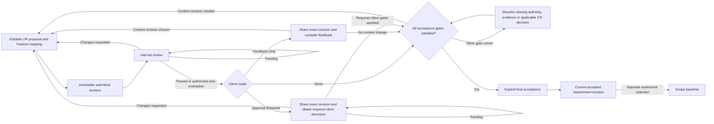

# DeliveryPilot Workflow Discovery Report

> Version: 1.1
> Recorded: 2026-11-03, Asia/Bangkok
> Status: User-confirmed workflow discovery; derived alignment guidance proposed for review
> Purpose: Foundation for subsequent User Requirements, Functional Requirements, user stories, acceptance scenarios, and ERD design.
> Evidence: The original report records product-owner confirmation of discovery questions Q1 through Q44. The user supplied the expanded seven-stage workflow on 2026-11-03 (W1); additional routing clarifications in this revision are derived guidance, not new approval evidence.

> **Documentation reconciliation — 2026-11-03:** A subsequent user-requested audit aligned the core product/requirements/roadmap/context/authoring documents with this report and the selected [Identity design](architecture/modules/identity/README.md). See the [alignment audit](architecture/documentation-alignment-audit.md) for corrections and remaining feature/release decisions. Q1–Q44/W1 retain their original meaning; this note does not approve derived A1–A4 guidance or downstream artifacts.

DeliveryPilot manages software delivery from project discovery and agreed requirements through planning, execution, verification, and release. AI assists people by explaining evidence, proposing feasible plans, and identifying potential delivery problems. People retain authority over agreements, assignments, plans, and releases.

The agreed model supports a solo practitioner and a team through the same workspace structure. User needs and candidate Features evolve together before a versioned, pull-request-style requirement proposal connects agreement to specifications, delivery work, and evidence. Scrum and Kanban share the governance model while retaining different execution policies.

## 1. Scope and authority

This report records the original discovery decisions and the user's expanded workflow. It is an input for further requirements work, rather than a set of formally approved, version-specific UR/FR/US contracts or a production database design. Proposed clarifications remain distinguishable from user-confirmed decisions.

Three evidence categories apply:

| Category | Meaning in this report |
|---|---|
| User-confirmed decision | A recommendation recorded as accepted during Q1 through Q44, or a stage/action supplied in the expanded workflow W1. |
| Derived handoff guidance | A proposed way to organize, clarify, or test those decisions. Additional diagram routes, candidate entities, capability groupings, and example scenarios belong here; they do not establish new approved policy. |
| Deferred detail | A decision deliberately left for feature refinement, architecture, security, or release prioritization. No default is silently assumed. |

The Q numbers and W1 are local discovery references, not repository artifact IDs. Q1 through Q44 retain their historical meaning; W1 records the later workflow expansion without retroactively attributing it to the interview. Existing feature IDs, requirement statuses, approval evidence, task statuses, and roadmap release assignments remain unchanged.

Existing context is available in the [Product Blueprint](product.md), [Cross-feature Requirements](requirements.md), [Roadmap](roadmap.md), and [Authoring Policy](authoring.md). These core summaries have now been reconciled; detailed feature contracts still require scoped refinement. Section 17 and the alignment audit distinguish applied corrections from outstanding work.

The report describes intended product behavior. It does not claim that workspace, project, requirement review, planning, AI, or release capabilities are implemented. Current implementation and hosting must be verified separately using [Current Backend Architecture](../ARCHITECTURE.md), source, tests, and deployment configuration.

## 2. Product objective and operating model

### 2.1 Desired outcome

A person or team should be able to:

1. Establish a secure workspace and project.
2. Explain the project purpose, desired outcomes, scope, and stakeholders.
3. Discover user needs, draft URs, and iteratively map them to candidate Epics and Features.
4. Propose, discuss, review, accept, and baseline exact requirement versions and agreed mappings.
5. Refine linked Stories, acceptance criteria, FRs, applicable NFRs, business rules, and test scenarios to explicit readiness.
6. Plan around real priorities, dependencies, calendars, and declared capacity.
7. Execute using Scrum or Kanban and see attributable progress and changes.
8. Identify and manage delivery risks, issues, blockers, and controlled changes.
9. Record verification, applicable client acceptance, and release evidence.
10. Use AI assistance without surrendering decision authority or exposing other workspaces.

The lifecycle is iterative. Discovery and refinement can continue while accepted work is delivered. The workflow does not require every project to finish all analysis before any implementation begins.

### 2.2 Workspace and project structure

Confirmed in Q1 through Q8:

- Workspace is the product term for the organization/tenant ownership boundary.
- A personal workspace and a team workspace use the same model.
- Any registered person can create a workspace and becomes its Owner.
- Registration and workspace creation are separate actions.
- A workspace may own multiple projects.
- A person may own a workspace and participate in other workspaces.
- Workspace and project roles are independently scoped.
- Project access is explicit; workspace membership does not grant visibility into every project.
- External guests can participate in selected projects or shared reviews without general workspace membership.
- A project has one owning workspace, consistent with the existing MVP ownership direction.

Example: Alice owns Workspace A and administers its projects. She is also a BA in Workspace B. Those assignments do not transfer permissions or data access between the workspaces.

### 2.3 Terms used in the workflow

| Term | Business meaning |
|---|---|
| Workspace | Ownership and isolation boundary for projects, membership, and configuration. |
| Workspace role | Permission template for workspace administration. |
| Project role | Permission template scoped to work within a particular project. |
| Guest | A person with intentionally limited project or resource access. |
| Stakeholder | A person or party with an interest in, responsibility for, or authority over project outcomes; detailed account/contact representation is a refinement item. |
| User Requirement, UR | A stakeholder need or desired outcome. |
| Epic | An optional grouping of related outcomes or Features; not a requirement approval or delivery commitment. |
| Feature | A candidate or refined capability linked to the URs it supports; its grouping and mapping may evolve during discovery. |
| Functional Requirement, FR | Required observable system behavior that refines a need. |
| Non-functional Requirement, NFR | A required quality or constraint with an eventual verification approach. |
| User Story | A user-valued delivery increment that can link directly to a UR or to more detailed specifications. |
| Acceptance Criteria, AC | Observable conditions for accepting a Story's outcome, traced to applicable requirements. |
| Business rule | A domain policy or constraint that applies to relevant requirements, Stories, and verification. |
| Change proposal | A proposed requirement change with review history; initially one active proposal per UR, including its relevant Feature mapping. |
| Review revision | An immutable submitted snapshot inside a proposal. |
| Reviewer approval | A decision by an authorized reviewer on an exact revision. |
| Final acceptance | An authorized action making the reviewed revision the current requirement. |
| Scope baseline | An explicit snapshot of selected versions that form an agreement. |
| Definition of Ready, DoR | The project's explicit readiness criteria for the selected work, rechecked before Sprint commitment or Kanban pull. |
| Definition of Done, DoD | The project's completion criteria; separate QA, applicable UAT, and release evidence still remain identifiable. |
| Delivery-plan baseline | An explicit reference plan containing agreed selections, timing, and planning assumptions. |
| Forecast | An estimate of an outcome based on declared inputs and uncertainty. |
| Change Request, CR | An impact-assessed decision process for changing baselined scope or an agreed delivery commitment. |
| Decision log | Attributable consequential choices, their reasons, and related evidence. |
| Work item | A Story, Task, Bug, Spike, Technical Work item, or optional grouping item. |
| Risk / Issue / Blocker | A potential future problem / an occurred problem / an obstacle preventing specific work. |

Acceptance, approval, publication, baselining, work completion, QA verification, UAT acceptance, and release have distinct meanings throughout the report.

## 3. Complete workflow

The seven stages come from the user-supplied workflow W1, expanding the journey recorded in Q43. The diagram incorporates the existing review, baseline, and execution rules. Pending-decision paths, feedback disposition, specification-only routing, and separate UAT/release steps are derived clarifications to keep those rules consistent.

```mermaid
flowchart TD
    subgraph FOUNDATION["1. PROJECT FOUNDATION"]
        A["Create workspace and establish access"]
        B["Create draft project and define project brief"]
        A --> B
    end

    subgraph DISCOVERY["2. PRODUCT AND REQUIREMENT DISCOVERY"]
        C["Discover user needs and draft URs"]
        D["Propose candidate Epics and Features"]
        E["Refine Features: add, split, merge, remove and link URs"]
        F{"Discovery sufficient for review?"}
        C --> E
        D --> E
        E --> F
        F -->|Refine needs| C
        F -->|Rework candidates| D
    end

    B --> C
    B --> D

    subgraph AGREEMENT["3. REQUIREMENT REVIEW AND AGREEMENT"]
        G["Draft UR change proposal with Feature mapping"]
        H["Submit immutable review revision"]
        I["Complete required internal review"]
        I1{"Internal review passed?"}
        J{"Client participation?"}
        K["Share exact revision and collect feedback"]
        K1{"Content revision chosen after feedback?"}
        L["Share exact revision and obtain required client decisions"]
        L1{"Required client approvals obtained?"}
        M["Check all acceptance gates, including applicable CR decision"]
        M1{"All gates passed?"}
        M2["Resolve unmet gates without changing submitted content"]
        N["Explicitly accept exact revision"]
        O["Select agreed scope into explicit scope baseline"]

        G --> H --> I --> I1
        I1 -->|Changes requested| G
        I1 -->|Pending| I
        I1 -->|Passed or authorized solo exemption| J
        J -->|None| M
        J -->|Feedback only| K --> K1
        K1 -->|Yes - new revision| G
        K1 -->|No content change| M
        J -->|Approval required| L --> L1
        L1 -->|Changes requested| G
        L1 -->|Pending| L
        L1 -->|Yes| M
        M --> M1
        M1 -->|Content revision needed| G
        M1 -->|Other gate unmet| M2
        M2 -->|Recheck| M
        M1 -->|Yes| N --> O
    end

    F -->|Yes| G

    subgraph SPECS["4. FEATURE AND SPECIFICATION REFINEMENT"]
        P["Confirm Features linked to baselined URs"]
        Q["Refine User Stories and Acceptance Criteria"]
        R["Define or reuse applicable FRs; apply NFRs and business rules"]
        S["Link UR, Feature, US and FR; draft test scenarios"]
        T{"Definition of Ready satisfied?"}
        SR["Complete applicable review and acceptance gates for exact changed specification"]
        SR1{"Specification explicitly accepted?"}

        P --> Q
        P --> R
        Q --> S
        R --> S
        S --> T
        T -->|Refine specifications within agreement| P
        T -->|Approved CR needs agreed specification revision| SR
        SR --> SR1
        SR1 -->|Pending| SR
        SR1 -->|Revise| P
        SR1 -->|Yes - explicitly update scope baseline| O
    end

    O --> P

    subgraph PLANNING["5. ESTIMATION AND DELIVERY PLANNING"]
        U["Prioritize US; estimate Story Points or selected units; assess dependencies and capacity"]
        V["Create manual or AI-assisted planning scenarios"]
        W["Review feasibility and reconcile changed inputs"]
        X{"Plan feasible and inputs current?"}
        Y["Apply reviewed plan and explicitly establish plan baseline"]

        U --> V --> W --> X
        X -->|Replan within agreement| U
        X -->|Specifications incomplete| P
        X -->|Yes| Y
    end

    T -->|Ready| U

    subgraph EXECUTION["6. EXECUTION, TESTING AND RELEASE"]
        Z{"Delivery method and work ready to start?"}
        AA["Scrum: plan sprint and break down US into Dev and QA Tasks"]
        AB["Kanban: pull ready US under WIP policy; create Dev and QA Tasks"]
        AC["Develop, code review and integrate"]
        AD["QA verifies AC and applicable FR, NFR and business rules"]
        AE{"Definition of Done and QA gates passed?"}
        AF["Perform applicable UAT and record decision evidence"]
        AF1{"Required UAT and release gates satisfied?"}
        AR["Release authorized contents and record delivery evidence"]
        AG["Review delivery outcomes, risks, blockers and problems"]
        AH{"Change required and agreement affected?"}
        AI["Review completed scope and remaining backlog"]

        Z -->|Scrum - ready| AA
        Z -->|Kanban - ready| AB
        Z -->|Readiness changed| P
        AA --> AC
        AB --> AC
        AC --> AD --> AE
        AE -->|No - fix within agreement| AC
        AE -->|Yes| AF --> AF1
        AF1 -->|Pending required decision or evidence| AF
        AF1 -->|Fix within agreement| AC
        AF1 -->|Yes or UAT not required; other gates passed| AR
        AR --> AG --> AH
        AH -->|No - next ready item| Z
        AH -->|No remaining item in selected scope| AI
        AH -->|Routine implementation within agreement| AC
        AH -->|Specification refinement within agreement| P
        AH -->|Plan adjustment within commitments| U
    end

    Y --> Z

    subgraph CHANGE["7. CONTROLLED CHANGE MANAGEMENT"]
        CI["Open or link CR; assess impact on scope, specs, tests and plan"]
        CJ{"Authorized change decision?"}
        CK{"Approved change impact category?"}
        CL["Reject or defer; retain current baselines and record work disposition"]

        CI --> CJ
        CJ -->|Pending| CI
        CJ -->|Rejected or deferred| CL
        CJ -->|Approved| CK
    end

    T -->|Agreement change needs CR decision| CI
    X -->|Scope or commitment change proposed| CI
    AE -->|Agreement change needed| CI
    AF1 -->|Agreement change requested| CI
    AH -->|Baselined scope or commitment affected| CI
    CK -->|UR or Feature agreement scope| C
    CK -->|Agreed specification only| P
    CK -->|Plan only| U
    CK -->|Routine implementation only| AC
```

### 3.1 Stage outputs and gates

| Stage | Main output | Gate before proceeding |
|---|---|---|
| 1. Project foundation | Workspace access, draft project, brief, and delivery context. | Relevant participants and authority are identified; missing context remains visible. |
| 2. Product and requirement discovery | Draft URs and candidate Epic/Feature mappings, with assumptions and exclusions. | Selected needs and mappings are sufficiently clear for review; this is not approval or DoR. |
| 3. Requirement review and agreement | Immutable review evidence, explicit acceptance, and selected scope baseline. | All required internal/client/change decisions and acceptance conditions apply to the exact revision; baseline establishment is a separate action. |
| 4. Feature and specification refinement | Stories/AC, defined or reused FRs, applicable NFRs/rules, traceability, and draft test scenarios. | DoR is satisfied for the selected work; agreement changes follow change control and the applicable review/baseline process. |
| 5. Estimation and delivery planning | Team estimates, current capacity/dependencies, reviewed scenario, applied plan, and explicit plan baseline. | Feasibility, input freshness, authority, and any commitment-change approval are satisfied. |
| 6. Execution, testing and release | Scrum/Kanban work, Dev/QA Tasks, verification outcomes, applicable UAT, release evidence, and problem follow-up. | Recheck readiness at selection/pull, then DoD, QA, applicable UAT, and release gates at their respective boundaries. |
| 7. Controlled change management | Impact assessment, authorized decision, affected-work disposition, and routes back to the relevant stages. | Approval permits the specified change path; required review, feasibility, and explicit baseline updates still apply. Rejection/deferment retains current baselines. |

### 3.2 Reading the loops

The stages describe the main journey for a selected scope increment. Draft specifications and estimates may be explored earlier, and discovery of future work may continue during delivery. A Feature mapping does not accept a UR or commit every linked Story. No formal CR is needed merely to refine unagreed drafts.

The client branch does not waive internal review. Solo internal-review exemptions do not waive required client approval. Feedback-only participation creates no approval gate: the team considers the feedback and decides whether to revise content; nonresponse is not approval and does not itself block this mode. Missing required decisions remain pending rather than forcing a content rewrite. A content change creates a new immutable revision and requires the applicable reviews again.

The acceptance gate requires all applicable conditions together. Drafting, review, and impact analysis may proceed while a required CR decision is pending, but neither final acceptance of an agreement change nor changed commitments may bypass that decision. Acceptance, scope-baseline establishment, plan application, and plan-baseline establishment remain separate authorized actions even where the diagram places them together.

Change routing follows impact. An approved specification-only change returns to refinement; if it changes selected agreement content, the changed specifications still need their applicable review, acceptance, and explicit baseline update before readiness can pass (Section 8.5). Approval of a CR does not itself satisfy those gates. A change affecting several areas follows every relevant route, not only the easiest one.

Routine implementation, specification refinement, and plan adjustments within the agreement use their normal permissions and review rules. They do not require a formal CR for every edit. The routine branch from an already assessed CR supports work found to have no baseline impact. Rejected/deferred changes retain the current baselines; authorized owners decide whether affected work can continue, must pause, or needs a different proposal.

Risks, blockers, and change requests can be raised throughout discovery, planning, and execution; the post-release review is not the first opportunity to report them. Failed QA/UAT returns to correction and reverification when the agreement is unchanged; changed expectations require impact assessment. Completion of the selected scope leads to a backlog/outcome review, not an endless execution loop or automatic project closure.

## 4. Access, roles, and collaboration

### 4.1 Two scopes of authority

Confirmed in Q2, Q3, Q5, and Q6.

Workspace templates begin with Owner, Admin, and Member. Project templates begin with PM, BA, Developer, QA, DevOps, and Viewer.

Administrators can create custom roles and configure permissions within their permitted delegation scope. Effective permission depends on the assignment, scope, resource, and applicable policy. A job title or template name alone is not authority.

Being PM for Project X does not automatically permit administration of Project Y or workspace membership. A PM can invite workspace members when granted that workspace permission. Project invitations and workspace invitations are separate powers.

Role customization must preserve the distinction between workspace and project assignments. Subsequent [Identity decisions](architecture/modules/identity/design-decisions.md) select multiple additive organization roles, protected built-ins/custom roles, code-defined permissions and the organization delegation ceiling. Those choices do not settle project-role combination policy. Complete permission codes and default matrices remain feature refinement details.

### 4.2 Action authorities

This table records the existing authority pattern and its application to W1's Feature refinement and change-decision steps. It is not a complete permission matrix.

| Action | Authority pattern |
|---|---|
| Create a workspace | Registered person; creator becomes Owner. |
| Create a project | Workspace Owner/Admin or a member explicitly granted Create Project. |
| Initial project administration | Project creator initially becomes project administrator and may delegate it. |
| Invite workspace/project participants | Explicit permission in the relevant scope. |
| Author requirements and Stories | BA by default, with configurable permissions. |
| Refine candidate Features and UR mappings | Authorized product/BA contributors; scope-changing edits still follow the agreement gates. |
| Contribute implementation work and estimates | Developers, QA, DevOps, and the people doing the work. |
| Record required review decisions | Assigned, authorized reviewers for the relevant revision. |
| Accept a requirement | Authorized BA or PM after applicable gates are satisfied. |
| Establish a scope baseline | Authorized PM or delegated decision-maker. |
| Decide a baseline-affecting change | Authorized change decision-maker under project policy; CR approval does not replace requirement review or baseline establishment. |
| Apply a planning scenario | Authorized PM after team feasibility review and required change approval. |
| Change work status | Authorized participant following the configured transition policy. |
| Review AI findings | Authorized PM or designated reviewer. |
| Perform QA, UAT, or release actions | Explicit authority under project policy; detailed default mappings are refinement items. |

### 4.3 Client and guest visibility

A client may see the published revision, explicitly shared attachments, and client-visible discussions within the grant they received.

Internal estimates, unrelated projects, private discussions, and other unshared context remain inaccessible. Mentioning a person in a comment does not create access.

Visibility and approval authority are separate. Access to read a requirement does not automatically assign a required approval decision.

The same access discipline applies to boards, traceability, exports, planning inputs, AI retrieval, explanations, and notifications. A derived summary must not reveal information that the recipient is not authorized to see.

## 5. Project initiation

Confirmed in Q7, Q8, Q24, and Q25.

### 5.1 Draft project brief

A project can start as Draft with a name and short purpose. It progressively captures:

- Problem or opportunity.
- Objectives and success criteria.
- Scope and explicit exclusions.
- Stakeholders and their responsibilities.
- Assumptions and unresolved questions.
- Constraints and known dependencies.
- Delivery method.

Missing information remains visible. Relevant information must be established before a delivery plan is presented as an agreed commitment. This is a readiness policy rather than a mandatory waterfall phase.

### 5.2 Delivery modes

The initial modes are Scrum and Kanban. Agile is the broader approach, rather than a third execution mode with undefined behavior.

Each initial Scrum project has one delivery team, one Sprint calendar, and at most one active Sprint. Future Sprints may be planned while the current Sprint runs.

Kanban supports continuous flow without mandatory Sprint enrollment. Hybrid execution and multiple independently scheduled teams inside one project are deferred.

### 5.3 Planning objects

| Object | Purpose | Relationship |
|---|---|---|
| Roadmap | Outcomes and broad sequencing. | Can guide multiple milestones and work groupings. |
| Milestone | Meaningful checkpoint with scope/evidence and a target or committed date. | Can span several Sprints; can receive contributions from multiple work items. |
| Sprint | Scrum timebox with a Sprint Goal and selected work. | Can contribute to several milestones. |
| Release | Identified software delivery with its contents and evidence. | Has an independent lifecycle from Sprint completion. |

The objects do not form a compulsory Roadmap > Milestone > Sprint > Release hierarchy.

### 5.4 Product and requirement discovery

W1 adds explicit discovery between the project brief and formal requirement review. User needs and candidate Epics/Features can be explored in parallel and refined together. A candidate Feature is a hypothesis about useful capability, not accepted scope.

Discovery includes drafting URs, proposing candidate groupings, and adding, splitting, merging, removing, or remapping Features as understanding improves. UR-to-Feature mapping can be many-to-many: one need may require several Features, and one Feature may support several needs. Removing a candidate from consideration does not erase accepted requirement history or silently remove baselined scope.

As derived review guidance, the selected increment should explain the stakeholder need, expected outcome, candidate Feature contribution, exclusions, assumptions, and unresolved questions well enough for reviewers to assess it. This discovery checkpoint is distinct from acceptance and from readiness for implementation. Exact discovery-checklist fields and authority remain refinement items.

The updated journey uses Features to organize discovery and specification refinement. Epics remain optional; a compulsory Epic > Feature > Story hierarchy is not implied. Standalone technical/security work remains possible with an explicit rationale.

## 6. Requirement proposals and review

Confirmed review behavior is recorded in Q4 and Q9 through Q17. W1 adds the preceding discovery stage and explicit Feature mapping in the proposal.

### 6.1 Proposal and revision model

Each UR initially permits one active change proposal. Multiple authorized contributors can collaborate on it, with named authorship, change history, and protection against silently overwriting another person's changes.

The proposal identifies the requirement and, when applicable, the accepted revision it proposes to replace. The previously accepted revision remains available while the replacement is developed.

The proposal also explains the candidate/refined Features supporting the UR and the scope contribution under review. Derived guidance: retain the reviewed mapping with the submitted revision, through a snapshot or stable version references, so later Feature restructuring cannot change what reviewers saw. A Feature link alone does not approve all its content or include every linked work item in the agreement.

Submission creates an immutable review revision. Further content changes produce another review revision. Existing comments and decisions retain their original revision association; they do not become approvals of changed content.

A client continues seeing the explicitly published revision until another revision is deliberately shared. Submitting a new internal revision must not silently replace the client's review target.

Competing proposals and branching/merge-conflict workflows are deferred.

### 6.2 Review modes and gates

| Concern | Rule or derived application |
|---|---|
| Team internal review | Default requires an authorized reviewer other than the author. |
| Solo internal review | Owner can use direct acceptance under project policy; it is not represented as independent review. |
| Required reviewers | Every named required reviewer must approve the current revision. |
| Optional reviewers | May comment without blocking completion through nonresponse. |
| Client Feedback Only | Feedback is nonbinding and does not itself create an approval gate. |
| Feedback disposition | Consider the feedback and record whether content will change; choosing a content change creates a new review revision. |
| Client Approval Required | The applicable required client decisions must be recorded before acceptance. |
| Missing response | Silence or expiry is not approval. |
| Pending required decision | Remain pending; a missing response does not itself require rewriting unchanged content. |
| Reviewer replacement/removal | Requires authorized action and an attributable record. |
| New content revision | Requires review of the changed revision; old approvals remain historical evidence. |
| Final acceptance | Explicit authorized action after all applicable gates, with no last-minute content edit. |

Client-review mode is explicitly selected at publication, subject to project policy. Internal and client gates are independently evaluated.

A person who authored a proposal may perform final acceptance when authorized, but cannot use that action to substitute for a required independent review.

### 6.3 Discussion behavior

Discussions are threaded and revision-associated, with internal and client-visible scopes. Internal comments default to internal visibility.

An ordinary unresolved comment does not automatically block acceptance. An explicit Changes Requested decision by a required reviewer blocks the gate.

The author may respond and mark feedback addressed. The responsible reviewer must clear or withdraw the blocking decision against the relevant revision. Closing a thread as its author does not satisfy the review gate.

Previous discussions remain accessible according to their scope and the viewer's current permissions. Fine-grained inline anchors, edit/delete policies, notification channels, and attachment limits remain refinement items.

### 6.4 Lifecycle representation

The following is a derived representation of the confirmed behavior, not a mandated set of database enums or UI labels.

The solo policy provides the authorized exemption from independent internal review. A baseline-affecting proposal also needs the applicable Change Request decision before final acceptance.

A new review iteration remains inside the same active proposal; its previous submitted revisions are preserved.

## 7. Specifications and traceability

Confirmed in Q17, Q19, and Q21; W1 expands Feature mapping, parallel Story/FR refinement, and test-scenario preparation.

URs, Features, FRs, NFRs, Stories, and acceptance criteria remain distinct concepts. The product permits:

- Many-to-many UR-to-Feature mappings, with optional Epic grouping.
- Direct UR-to-Story links.
- UR refinement into FRs and NFRs where useful.
- Several Stories satisfying a requirement.
- One Story satisfying several requirements.
- Project-wide NFR applicability across multiple Stories.
- Independent technical/security work without an artificial Story parent.

For the selected scope increment, confirm which Feature contributions link to baselined UR versions. Refine Stories and AC alongside the definition or reuse of applicable FRs; apply relevant NFRs and business rules across both. This is iterative rather than a mandatory Story-before-FR authoring order. Reuse an existing FR when it describes the same required behavior rather than duplicating it for each Story.

Bring the two refinement paths together through traceability and draft test scenarios. Each scenario identifies the observable outcome or constraint it will verify and the relevant AC/FR/NFR/rule. Preparing scenarios does not claim tests have run. FR detail is used where applicable; direct UR-to-Story runtime links and justified standalone work remain valid.

Creating or accepting one artifact does not approve its related artifacts. Stories do not automatically require client approval.

Implementation links identify the specific requirement revision the work implements. New accepted requirement revisions flag potentially affected specifications, work, tests, and plans for impact review.

The team explicitly decides whether affected work continues against the old agreement, is updated, paused, or supplemented. Descriptions, estimates, assignments, Sprint selections, and dates are not rewritten automatically.

Navigation and coverage must respect access at both ends of a relationship. Traceability is not a route around guest visibility.

The runtime relationship model in this section is distinct from repository frontmatter conventions. Repository FRs declare `ur_refs`, USs declare `fr_refs`, and Tasks declare relevant `us_refs` / `fr_refs` / `nfr_refs`; reverse views are derived. The diagram does not authorize new reverse-reference fields or bypass those authoring rules. The direct runtime UR-to-Story path still needs the separate reconciliation discussed in Section 17.

## 8. Agreements, baselines, and change control

Confirmed in Q18, Q21, Q22, Q30, and Q39.

### 8.1 Scope baseline

Accepting a requirement makes that revision current. It does not automatically establish or replace a baseline.

An authorized PM or delegated decision-maker explicitly establishes a scope baseline. It identifies selected accepted requirement revisions and any FRs, NFRs, Story criteria, or other specifications that form part of the agreement.

Baseline contents are explicit version snapshots, rather than a live traversal of whatever happens to be linked later. The selected agreement remains reproducible even as current documents evolve.

The initial baseline can cover the selected accepted URs and reviewed Feature contribution before detailed Stories and FRs are complete. Any Feature mapping that defines the agreement must be reproducible with that baseline. Later specification refinement does not automatically add all related artifacts to it. Explicitly decide which specification versions become agreement content and apply the relevant review and change policy.

### 8.2 Delivery-plan baseline

The delivery-plan baseline is distinct from the scope baseline. It records the agreed plan and relevant selections, milestone targets/commitments, Sprint allocations, estimates, and planning assumptions at that point.

The scope baseline and plan baseline can reference one another. A new forecast does not silently alter either.

Three views remain distinguishable:

1. The reference plan/baseline.
2. Current execution and subsequent attributable changes.
3. Draft planning scenarios under consideration.

### 8.3 Change Request trigger

A proposal changing baselined scope or an agreed delivery commitment requires impact assessment and an authorized Change Request decision.

Impact considers relevant URs and Feature mappings, specifications and AC, test scenarios/evidence, linked Dev/QA work, effort, dependencies, dates, capacity, risks, and cost where tracked. One Change Request may coordinate multiple individual UR proposals.

The trigger depends on the agreement's meaning, not the record type. Materially expanding baselined Story criteria requires change control even when the parent UR text is unchanged.

Ordinary draft refinement and routine implementation details remain lightweight when they do not alter the agreement.

Approval of a change does not prove that its revised delivery plan is feasible. Affected owners must reconcile specifications, work, and plans. New baselines or plan revisions are explicit; old references remain inspectable.

### 8.4 Decision log

The original overview requests a project decision log. The confirmed workflow supplies decisions that must remain attributable: acceptance, baseline establishment, reviewer changes, scope decisions, material Sprint changes, plan application, and finding review.

For those consequential choices, retain the responsible actor, time, reason where required, related artifacts/revisions, and resulting action. A comment or AI suggestion is not itself an authorized decision.

The exact fields, visibility, and lifecycle of additional standalone decision entries remain feature refinement details.

### 8.5 Change disposition and return paths

W1 explicitly adds authorized approval versus rejection/deferment and routing by impact. The following routing details are derived guidance for applying that flow consistently.

| Impact | Return path | Conditions before changed work or commitments proceed |
|---|---|---|
| UR or Feature mapping changes agreed scope | Discovery, requirement proposal, review, acceptance, and explicit scope-baseline selection; then affected specifications/plans. | CR decision and all applicable revision-specific review/acceptance gates; recheck downstream readiness and feasibility. |
| Only agreed FR/NFR/Story criteria change | Specification refinement, applicable review/acceptance of the exact changed specification, and explicit scope-baseline update; then planning if affected. | CR approval alone is insufficient. Preserve unchanged UR versions; do not invent a UR text change merely to route the decision. |
| Agreed plan/commitment only | Estimation and planning. | Authorized change decision, current inputs, feasibility review, explicit plan application, and any new plan baseline; scope baseline stays unchanged if scope is unchanged. |
| Specifications or plan change within the existing agreement | Relevant specification or planning stage under normal authority. | Recheck readiness/feasibility and retain attributable changes; no formal CR solely because an unagreed draft or noncommitted plan detail changes. |
| Routine implementation detail | Dev/QA work and verification under normal authority. | Existing agreement and completion gates still apply; no CR for every task edit or correction. |
| Rejected, deferred, or pending baseline change | Retain current scope and plan baselines. | Record the decision or pending gate; explicitly assess whether affected work can continue, must pause, or needs another option. |

A change can affect several categories. Returning to specification refinement cannot bypass replanning when estimates, dependencies, or capacity change; returning to planning cannot bypass agreement review when scope changes. Keep the CR linked through these activities and distinguish approval of the proposed change from completion of its implementation and evidence.

## 9. Work preparation and readiness

Confirmed in Q19, Q20, Q23, and Q26; W1 makes DoR and the Dev/QA execution breakdown explicit.

### 9.1 Work types

Stories, Tasks, Bugs, Spikes, and Technical Work are distinct backlog work-item types. W1 uses candidate/refined Features in the main discovery-to-delivery path. Epics and a rigid parent hierarchy remain optional; independent technical work need not be forced into a Feature or Story.

Parent/child relationships do not replace blocking dependencies. A task can have no Story parent when its purpose is independently justified.

Dev Tasks and QA Tasks describe the work needed to deliver and verify the selected Story. They may use task categories rather than new entity types; that design remains open. High-level breakdown and test scenarios can be prepared before planning, with detailed Tasks created or refined during Sprint planning or Kanban pull. Testing work and capacity must be considered before commitment even when the final Task breakdown follows later.

### 9.2 Collaboration

| Participant | Default contribution |
|---|---|
| BA | Needs, UR/Feature mapping, requirement detail, Stories, and acceptance criteria. |
| Developers | Implementation breakdown, technical dependencies, estimates, and feasibility. |
| QA | Draft test scenarios, verification of AC/FR/NFR/rules, testing work, estimates, and evidence needs. |
| DevOps | Delivery/operational work, dependencies, estimates, and feasibility. |
| PM | Priority coordination, dependencies, capacity, and delivery scenarios. |
| People doing the work | Validate estimates and feasibility. |

Permissions are configurable. PM coordination does not authorize silently replacing team estimates to fit a deadline.

### 9.3 Readiness for commitment or pull

Draft work can be discussed, refined, and estimated. W1 places DoR before delivery planning for the selected increment; recheck it before Sprint commitment or Kanban pull because requirements, dependencies, and inputs may have changed. Use an explicit readiness check:

- Clear outcome and acceptance criteria.
- Traceability to applicable accepted/baselined requirement versions and relevant Feature contribution, or a recorded authorized exception.
- Defined or reused applicable FRs, NFRs, and business rules, with draft test scenarios.
- Estimates appropriate to the readiness stage and chosen method, refined with capacity and dependency analysis during planning.
- Known dependencies and unresolved questions.
- Necessary development, QA, and other work.
- Resolution of any proposed agreement change through the required CR, review/acceptance, and explicit baseline actions.

Known dependencies must be understood; they need not all be completed before planning. Dependencies that prevent starting the selected work remain visible at commitment/pull. Standalone work uses its own purpose and expected outcome rather than an invented UR or Story.

Readiness is not client approval, a complete delivery plan, or evidence of DoD. Failed readiness within the agreement returns to refinement; an agreement-affecting change follows Section 8.5. Exceptions are visible and authorized. Precise project configuration, exception permissions, and evidence fields remain refinement items.

### 9.4 Estimate integrity

W1 shows Story Points for Story estimation. The team still explicitly selects estimation methods under Q26: Story Points are the illustrated method, not a compulsory unit for every project or work type. Time estimates may be used for Tasks where useful.

Retain estimate unit, attribution, and history. A universal points-to-hours conversion is not permitted.

Do not add a Story estimate and its child-task estimates as though they represented separate work. A planning calculation must identify its selected estimation level and method.

Effort estimates, calendar duration, available capacity, forecasts, and agreed dates remain separate concepts.

## 10. Planning and visual boards

Confirmed in Q24 through Q34; W1 places manual/AI scenario planning after specification readiness and before Scrum/Kanban execution.

For the selected ready scope, prioritize Stories, refine estimates, assess dependencies and declared capacity, and compare draft scenarios. A feasible scenario must also use current inputs. If feasibility fails within the agreement, replan; if specifications are incomplete, return to refinement; if the response changes agreed scope or a commitment, follow change control.

An authorized person applies the reviewed scenario. Establishing a plan baseline is a separate explicit action. An applied plan does not itself prove that a Sprint has been selected or that Kanban work has been pulled: those execution decisions retain their readiness, authority, and method-specific policies.

### 10.1 Capacity inputs

Use explicitly maintained availability:

- Working calendars and relevant nonworking periods.
- Leave.
- Allocations to other projects.
- Other declared obligations.
- Capacity for the relevant work, including QA.

Initial inputs may be maintained manually by members or authorized managers. Planning must account for allocations across projects in the workspace without double counting.

Membership in another workspace does not grant access to that workspace's projects, calendars, or allocations. A person may declare capacity available to this workspace without disclosing private work elsewhere. The system cannot claim knowledge of undisclosed obligations.

Missing or stale availability remains visible.

### 10.2 Board actions

| Surface/action | Meaning | Independent consequences |
|---|---|---|
| Sprint execution board: move across columns | Change workflow state under permissions and transition rules. | Does not itself change dates, imply client acceptance, or record release. |
| Sprint execution board: reorder within a column | Change rank. | Does not itself change deadline or commitment. |
| Schedule board: move work between future Sprints | Edit a draft planning scenario. | Does not immediately change the agreed plan. |
| Apply a schedule scenario | Explicitly apply its reviewed changes after freshness and authority checks. | Produces an attributable plan revision; baseline establishment remains explicit. |
| Active Sprint: routine task breakdown/assignment/progress | Team's permitted daily execution work. | Does not require a formal approval request for every movement. |
| Active Sprint: material selection change | Explicit PM/team decision. | Record reason and additions/removals while retaining original selection. |

Material changes to the Sprint Goal require explicit review. Baseline-affecting changes also follow the applicable Change Request process.

### 10.3 Kanban WIP

Kanban limits are configurable and advisory by default.

- Advisory mode warns when exceeded.
- Explicit enforced mode prevents the relevant move unless an authorized exception is recorded.
- The active policy is visible.
- Kanban work does not require Sprint assignment.

Exact limits and default workflow columns remain project configuration and feature refinement details.

### 10.4 Scrum and Kanban execution handoff

For Scrum, the team plans the Sprint, confirms its goal and selected ready Stories, and creates or refines Dev and QA Tasks. Future Sprint placement in a scenario is a planning proposal; actual Sprint selection follows the team's decision process and preserves original selection/change history.

For Kanban, the team pulls ready work under the visible WIP policy and creates or refines the necessary Dev and QA Tasks without requiring Sprint enrollment. Both modes proceed through development, code review, integration, and verification against the selected requirement/specification versions.

If readiness or planning inputs change before work starts, revisit the affected specification/plan checks. Further task breakdown during execution stays lightweight unless it changes the agreement, a material Sprint selection, or another governed commitment.

## 11. AI planning assistant

Confirmed in Q29 and Q31 through Q34 and Q42.

### 11.1 Permitted assistance

The assistant may propose:

- Work selection from the relevant scope/backlog.
- Sequencing.
- Future Sprint placement.
- Tentative assignments to actual eligible people.
- Alternatives involving scope, timing, sequencing, or suitable available capacity.

The output is a draft scenario. It explains what accepting it would change and the evidence and assumptions behind the proposal.

The assistant cannot directly accept requirements, publish client commitments, apply plans, or change assignments. An authorized PM applies a plan after team feasibility review and any required change approval.

### 11.2 Minimum evidence for a usable schedule

| Input | Required understanding |
|---|---|
| Scope and priorities | Selected scope-baseline versions and Feature/Story coverage, readiness, and ordering/value. |
| Milestones | Targets and which constraints are negotiable or committed. |
| Sprint/calendar | Relevant dates and working periods. |
| Estimates | Units, method, selected aggregation level, and uncertainty. |
| Availability | Declared capacity, allocations, and role-relevant availability including QA. |
| Dependencies | Blocking relationships, sequencing, and external waits. |
| Historical delivery evidence | Representative history when a method depends on throughput or velocity. |

When essential information is missing, return a missing-information checklist or an explicitly conditional scenario. Do not label unsupported output a feasible commitment.

### 11.3 Calculation and explanation

Capacity and dependency checks use explicit, inspectable rules. AI assists interpretation and explanation.

A Story-point method needs representative delivery history before claiming calendar forecasting capability. The assistant must not invent velocity or translate points into hours using a universal ratio.

A forecast exposes its assumptions and suitable uncertainty. It is not a guaranteed completion date. Numerical confidence or calibrated probability requires later evidence and evaluation.

### 11.4 Infeasible targets

If declared scope cannot fit the milestone under the declared constraints, present explained alternatives:

- Reduce or defer scope.
- Move a negotiable target.
- Change sequencing.
- Add suitable capacity when it is actually available.

Do not silently assume overtime, invent staff, reduce estimates, or move agreed commitments. PM and team select the response; applicable governance still controls commitment changes.

### 11.5 Freshness before application

Store enough input references to identify relevant changes to scope-baseline entries, Feature/Story mappings, specifications, estimates, dependencies, and capacity.

Before applying a proposal, recheck those inputs. A materially affected proposal is stale and requires reconciliation or recalculation. Preserve the earlier proposal for comparison and show what changed.

Example: a proposal created before the QA engineer's availability changed cannot be applied as though the original capacity still existed.

## 12. Risks, issues, blockers, and AI findings

Confirmed in Q35 through Q38.

### 12.1 Distinct records and interpretations

| Concept | Meaning | Example |
|---|---|---|
| Risk | Potential negative future effect. | A pending decision may threaten a milestone. |
| Issue | Problem that has occurred. | A required environment is unavailable. |
| Blocker | Obstacle currently preventing specific work. | The unavailable environment prevents a named test task. |
| Dependency | Relationship between work or deliverables. | A test depends on an environment being available. |
| Candidate finding | Evidence-backed concern awaiting human interpretation. | The system detects the unavailable dependency and identifies affected work. |

One underlying issue may block multiple work items. A dependency is not automatically a blocker.

AI distinguishes observed facts from inference. Candidate findings do not silently become confirmed risks, issues, or blockers.

### 12.2 Initial signal families

- Overdue required approvals.
- Allocation exceeding declared availability.
- Explicit blocking dependencies preventing work.
- Work needing a status update.
- Forecasts threatening a milestone.

Each detector needs defined inputs and configurable criteria. Exact thresholds remain feature/project configuration; the report does not invent them.

Missing updates are a reason to request verification, not proof that someone is blocked. Unavailable or stale evidence remains visible.

### 12.3 Human control and follow-up

An authorized PM or designated reviewer can confirm a finding, link it to an existing problem, dismiss it with a reason, or request information.

Confirmed problems have an accountable owner, affected project, milestone, or work where applicable, actions, and review/resolution history. A Blocker identifies the specific work it obstructs; project-level risks and issues can be recorded before work is broken down. Team members can manually report actual blockers without waiting for AI. Review and follow-up continue throughout the seven-stage journey, including during development and QA.

Preserve original evidence and the human decision. Dismissing a finding does not modify source work. Resolution is attributable.

Findings are reevaluated as relevant information changes. Group duplicates and retain history and last-check information. Notify responsible people about meaningful new or worsening conditions rather than repeating unchanged warnings.

A dismissed finding does not repeatedly reappear without new evidence. Every explanation and notification respects the recipient's underlying resource access.

If a response requires an agreement change, link the problem and evidence to the CR and follow its disposition. Confirming a risk or blocker does not authorize that change. A routine corrective action within the agreement can proceed under normal work permissions and verification gates.

## 13. Verification, acceptance, and release

Confirmed in Q28 and Q41; W1 adds the explicit development, QA, DoD, UAT/release, and outcome-review loop.

Record separately:

1. Work completion.
2. QA verification and supporting evidence.
3. Client/UAT acceptance when required.
4. Release contents and delivery evidence.

The initial target is lightweight outcomes and evidence links. A comprehensive test-management suite and automated deployment orchestration are deferred.

Project policies determine required gates. Definition of Done may require QA, but QA remains a separately recorded fact. Client approval of a requirement is not UAT acceptance of software.

QA verifies the Story's AC and applicable FRs, NFRs, and business rules using the prepared test scenarios and relevant specification versions. Record actual verification outcomes and evidence; a Task marked complete or a drafted scenario does not establish that the relevant check passed.

If DoD or a required QA gate fails, return affected work for correction, then repeat the relevant review, integration, and verification. Required UAT decisions remain pending until obtained. UAT that exposes nonconformance returns to correction and reverification; a request for different agreed behavior follows change control. A policy that does not require UAT must not fabricate an acceptance decision.

A release identifies its contents and delivery evidence independently from Sprint completion. Detailed build/version references, evidence formats, authority defaults, and exceptional release policies remain feature refinement.

Work marked Done does not fabricate passed tests, client acceptance, or a release record. Release follows the applicable QA/UAT and release authorization gates; failed or missing required evidence prevents the normal path from proceeding. Any exceptional policy needs explicit definition and authority rather than an inferred override.

After delivery, review outcomes, remaining work, risks, issues, and blockers. Continue with the next ready item, refine/replan within the agreement, or open/link a CR when scope or commitments would change. Finishing the selected scope calls for an outcome/backlog review; project-closure policy remains a later detail.

## 14. Conceptual model for later ERD work

This section is derived handoff guidance. These are candidate business concepts and relationships, not finalized tables, aggregate boundaries, physical schemas, or migrations.

### 14.1 Concept groups

| Capability | Candidate concepts |
|---|---|
| Identity and workspace access | User, Workspace, Membership, Role, Permission, Assignment, Invitation. |
| Project collaboration | Project, ProjectParticipant, GuestGrant, Stakeholder, ProjectBrief, ProjectPolicy. |
| Product discovery and mapping | UserNeed, Epic, Feature, FeatureRequirementLink, DiscoveryAssumption; reviewed mapping snapshots or version references. |
| Requirement review | UserRequirement, ChangeProposal, ReviewRevision, ReviewRequest, ReviewerAssignment, ReviewDecision, DiscussionThread, Comment, SharedAttachment. |
| Detailed specifications | FunctionalRequirement, NonFunctionalRequirement, BusinessRule, SpecificationRevision, AcceptanceCriteria, ApplicabilityLink, TestScenario. |
| Agreements and change | ScopeBaseline, BaselineEntry, ChangeRequest, ImpactAssessment, DecisionEntry. |
| Backlog and execution | WorkItem, Dev/QA task categorization, WorkRelationship, ReadinessAssessment, DefinitionOfReady, DefinitionOfDone, EstimateRevision, WorkflowState, Transition, Sprint, SprintSelection, Milestone, RoadmapItem. |
| Planning | WorkingCalendar, Availability, Allocation, PlanningScenario, ScenarioInput, ProposedChange, PlanRevision, PlanBaseline. |
| Delivery problems | Finding, FindingEvidence, ReviewOutcome, Risk, Issue, Blocker, Action, ProblemWorkLink. |
| Delivery evidence | VerificationOutcome, EvidenceReference, UatDecision, Release, ReleaseEntry. |

A release name or work-item title alone is not a reproducible version reference. Later design must make agreement, Feature mapping, and evidence references stable. These concept names do not require a separate entity/table for every noun; for example, a user need may be captured in a UR and Dev/QA may be Task categories.

### 14.2 Core conceptual relationships

```mermaid
flowchart LR
    U[User] -->|scoped membership| W[Workspace]
    W -->|owns| P[Project]
    U -->|project role or restricted guest grant| P
    P --> R[User Requirement]
    P --> EP[Optional Epic grouping]
    EP --> FT[Candidate or refined Feature]
    R <-->|many-to-many mapping| FT
    R --> CP[One active Change Proposal]
    CP --> RR[Immutable Review Revisions]
    FT -->|reviewed mapping snapshot or version reference| RR
    RR --> RD[Revision-bound Reviews and Discussions]
    RR -->|explicit acceptance| AR[Accepted Requirement Revision]
    AR -->|explicit selection| SB[Scope Baseline]
    SP[Selected FR, NFR and Story criteria versions] --> SB
    FT -->|organizes| US[User Stories and AC]
    US <-->|applicable behavior and constraints| SPEC[FRs, NFRs and Business Rules]
    US --> TS[Draft Test Scenarios]
    SPEC --> TS
    AR <-->|version-pinned traceability| WI[Work Items]
    US -->|delivery breakdown| WI
    WI --> DR[Readiness Assessment]
    DR --> PS[Draft Planning Scenario]
    SB -->|selected agreed scope| PS
    AV[Calendars, Capacity and Dependencies] --> PS
    PS -->|authorized application| PR[Plan Revision]
    PR -->|explicit establishment| PB[Plan Baseline]
    WI --> EX[Scrum or Kanban Execution]
    EX --> VE[Verification, UAT and Release Evidence]
    TS -->|verified against relevant versions| VE
    EX --> FI[Evidence-backed Findings]
    FI -->|human review| PI[Risks, Issues, Blockers and Actions]
    SB -->|proposed agreement change| CR[Change Request and Impact Assessment]
    PB -->|proposed commitment change| CR
    PI -->|response affects agreement| CR
    CR --> CD[Authorized Change Decision]
    CD -->|approved scope change requires review| CP
    CD -->|approved specification change requires review| SPEC
    CD -->|approved plan change requires feasibility review| PS
```

### 14.3 Relationships and invariants to preserve

- Workspace membership and project participation are different scoped relationships.
- External participation must not require broad workspace membership.
- Reviewer assignments, review decisions, final acceptance, and baseline entries are different facts.
- Each submitted revision is immutable and decisions identify it.
- One UR can have many historical proposals/revisions while initially allowing one active proposal.
- UR/Feature mapping is many-to-many; grouping and mapping do not confer approval or include all linked work in scope.
- Split/merge/removal of candidate Features must not erase reviewed mappings or historical baseline content.
- Requirement-to-work traceability is many-to-many and version-aware.
- Stories/AC and applicable FR/NFR/rules connect to test scenarios and actual verification evidence without making those concepts interchangeable.
- Readiness, completion, QA, UAT, and release decisions remain separate facts; Dev/QA task categories do not replace verification outcomes.
- Work hierarchy and blocking dependency relationships have different semantics.
- Sprint selection history must preserve original and changed selections.
- Milestones, Sprints, and releases do not require one-to-one ownership relationships.
- Baseline entries identify explicit selected versions rather than current mutable records.
- Plan scenarios, applied revisions, baselines, and current execution are distinct.
- A CR decision does not itself accept revised specifications, apply a plan, or establish a baseline; one change can require several downstream reviews.
- Findings retain evidence without gaining authority to change source records.
- Scope/permission checks apply when traversing references.

Later ERD design must settle cardinalities, identity/version keys, uniqueness, concurrency, retention, and ownership. Existing architecture guidance prohibits cross-module database foreign keys; module placement must be decided before proposing physical relationships.

## 15. Acceptance scenario seeds

These examples translate the decisions into observable behavior. They are inputs to later feature stories, not claims that tests exist or have passed.

| Scenario | Given | When | Then |
|---|---|---|---|
| Iterative Feature discovery | Draft URs and candidate Features exist before agreement. | The BA splits, merges, removes, or remaps a candidate Feature. | Needs/mappings can be refined without implying approval; reviewed history and existing baselines are preserved. |
| Discovery versus readiness | Selected needs and mappings are clear enough for review. | Discovery is marked sufficient. | Requirement review may begin; acceptance, baselining, and implementation readiness are not implied. |
| Scoped roles | Alice is PM in one project and BA in another workspace. | She attempts a workspace invitation or unrelated project read. | Only effective permissions in the relevant scope govern the action. |
| Restricted client review | A guest receives access to one published UR revision. | They open its discussion or try unrelated resources. | Shared content is accessible; internal/unrelated information remains inaccessible; a mention grants no access. |
| Immutable review | A submitted revision has comments and approval. | The BA changes its content. | A new review revision is created; old decisions remain attached to the old revision and do not approve the new content. |
| Reviewed Feature mapping | A submitted UR revision includes Feature mapping. | Candidate Features are reorganized later. | The mapping reviewed with that revision stays reproducible; changed review content requires a new revision. |
| Feedback-only revision | A client has feedback-only participation. | Feedback suggests a content change. | The team records its disposition; choosing a revision repeats applicable review, while feedback/nonresponse alone creates no client approval gate. |
| Pending required approval | A required internal or client reviewer has not decided on unchanged content. | Acceptance is attempted. | It remains blocked/pending without treating silence as approval or forcing a content rewrite. |
| Solo client gate | Solo internal direct acceptance is permitted and client approval is required. | The author attempts acceptance without that client decision. | The client gate still prevents acceptance. |
| Optional reviewer | Required reviewers approved; an optional reviewer has not responded. | An authorized person accepts the revision. | Optional nonresponse does not block acceptance. |
| Blocking review | A required reviewer requested changes. | The author marks the feedback addressed. | Acceptance remains blocked until the required reviewer clears or withdraws the blocking decision for the relevant revision. |
| Explicit baseline | A requirement is accepted. | No baseline-establishment action has occurred. | Acceptance does not silently add it to or replace a scope baseline. |
| Material derived change | A baseline includes selected Story criteria. | Those criteria materially expand the agreement. | Impact assessment/change control applies even if the UR text is unchanged. |
| Specification-only approved change | An authorized CR affects agreed Story criteria but leaves the UR unchanged. | The criteria are refined. | The exact changed specification still needs applicable review/acceptance and explicit baseline update before readiness; no artificial UR text revision is required. |
| Rejected or deferred change | A proposed scope or commitment change has impact evidence. | The authorized decision rejects or defers it. | Current baselines remain; affected-work continuation/pause is explicitly assessed rather than applying the proposal. |
| Multiple change impacts | An approved change affects specifications, tests, and dates. | Work is routed back for refinement. | All affected areas are reconciled; approval does not bypass test updates, feasibility review, or explicit baseline actions. |
| Historical implementation | Work implements an accepted UR revision. | A later revision is accepted. | Existing links and commitments remain visible; potentially affected work is flagged for explicit reconciliation. |
| FR reuse and verification | A Story uses existing behavior and project-wide quality rules. | Specifications are refined for readiness. | Existing FRs are reused, relevant NFR/rules are applied, and test scenarios trace to the expected outcomes without claiming execution evidence. |
| Readiness recheck | A Story was ready during planning but relevant inputs changed. | The team attempts Sprint selection or Kanban pull. | Readiness is rechecked; unresolved criteria return to refinement or an authorized visible exception, not automatic execution. |
| Dev and QA preparation | A ready Story is selected under Scrum or pulled under Kanban. | Its detailed Tasks are created or refined. | Necessary Dev/QA work is visible; Kanban requires no Sprint and previously considered QA capacity is not omitted. |
| Estimate integrity | Stories and child tasks have estimates in explicit units. | Planning totals are calculated. | The same work is not counted twice and no universal points-to-hours conversion is applied. |
| Capacity privacy | A person participates in two workspaces. | One workspace calculates its plan. | It uses authorized declared capacity without exposing the other workspace's private data. |
| Execution movement | A permitted participant moves or reorders a board card. | The action succeeds. | State or rank changes as appropriate; dates, release status, and commitments do not change implicitly. |
| Active Sprint change | A Sprint has an original selection. | A material change is explicitly agreed and applied. | The reason and delta are recorded while the original selection remains visible. |
| Insufficient planning evidence | Material inputs such as capacity or estimates are missing. | AI planning is requested. | Missing inputs and assumptions are shown; a conditional scenario or checklist replaces unsupported feasibility claims. |
| Infeasible milestone | Declared scope cannot fit available capacity by the target. | Alternatives are evaluated. | Scope/date/sequence/capacity trade-offs are explained without invented staff or assumed overtime. |
| Stale proposal | A draft scenario exists and relevant capacity changes. | The PM attempts to apply it. | Current inputs are checked and affected changes require reconciliation/recalculation. |
| Human finding review | A signal produces a candidate concern. | A reviewer confirms, links, or dismisses it. | Evidence, interpretation, decision, reason where required, and follow-up remain attributable. |
| Notification relevance | A finding was dismissed and its evidence is unchanged. | Evaluation runs again. | It does not repeatedly notify as a new unchanged problem. |
| Kanban WIP | A visible WIP policy is configured. | A move exceeds its limit. | Advisory mode warns; enforced mode prevents the move unless an authorized exception is recorded. |
| Independent delivery evidence | Work is Done while a required QA gate fails. | Release readiness is assessed. | Done does not supply QA, UAT, or release evidence; configured gates determine eligibility. |
| QA rework | Verification fails an agreed AC or applicable FR/NFR/rule. | The implementation is corrected without changing the agreement. | Relevant review/integration/verification repeat; a routine fix needs no formal scope CR. |
| UAT disposition | Required UAT is pending or reports a problem. | Release is considered. | Pending approval blocks the normal release path; nonconformance returns to correction, while different agreed behavior follows change control. |

## 16. Feature and artifact handoff

### 16.1 Existing feature registry mapping

This mapping is derived navigation. It does not create features, change priorities, or allocate new IDs.

| Existing feature | Relevant report material |
|---|---|
| FEAT-DP-002 User Initialization | Identity remains separate from workspace creation and resource grants. |
| FEAT-DP-003 Organization and Membership | Workspace model, membership, roles, invitations, and delegation. |
| FEAT-DP-004 Project Initialization | Project brief, ownership, participants, delivery mode, and policy. |
| FEAT-DP-005 Product Discovery | Brief-to-need discovery, candidate Epics/Features, iterative UR mapping, assumptions, and discovery sufficiency. |
| FEAT-DP-006 Requirements Management | UR proposals with reviewed Feature mapping, immutable revisions, specification refinement/reuse, discussion, and history. |
| FEAT-DP-007 Approval Workflow | Required/optional review, client modes, independent gates, and final acceptance. |
| FEAT-DP-008 Backlog Management | Feature refinement, Stories/AC, flexible work types, Dev/QA Tasks, specification relationships, estimates, and DoR. |
| FEAT-DP-009 Agile Delivery | Scrum planning versus Kanban pull, readiness rechecks, boards, Sprint changes, DoD, and WIP. |
| FEAT-DP-010 Basic Risk and Issue Tracking | Manual problems, ownership, actions, and history. |
| FEAT-DP-011 Team Capacity and Estimation | Estimate units, calendars, availability, allocations, and double-count prevention. |
| FEAT-DP-015 Client Portal | Restricted guests, publication, visible discussions, and scoped review authority. |
| FEAT-DP-017 Requirement Traceability | Version-pinned UR/Feature/Story/specification/test links and affected-work reconciliation. |
| FEAT-DP-019 Change Request Management | Scope/specification/commitment impact, authorized decisions, rejection/deferment, and routing without implicit baseline replacement. |
| FEAT-DP-001 Blocker Detection | Explainable signals, candidate findings, human review, and reevaluation. |
| FEAT-DP-013 AI Planning Assistant | Draft proposals for selection, sequence, Sprint placement, and assignments. |
| FEAT-DP-018 Delivery Forecasting | Evidence-backed forecasts, uncertainty, infeasible alternatives, and freshness. |
| FEAT-DP-012 QA Management | Draft test scenarios, Dev/QA coordination, verification of AC/FR/NFR/rules, failure/rework, and later detailed test management. |
| FEAT-DP-016 Release Management | Applicable UAT, release gates, authorized contents, delivery evidence, and outcome review. |

### 16.2 Suggested refinement sequence

This is a dependency sequence, not an agreed release schedule:

1. Workspace/project authority and restricted guests.
2. Product/need discovery, candidate Epic/Feature refinement, UR mapping, and discovery sufficiency.
3. Requirement proposals, revisions, discussions, internal/client gates, acceptance, and scope baselines.
4. Stories/AC, FR reuse, NFR/rule applicability, test scenarios, traceability, and DoR.
5. Estimates, dependencies, declared capacity, manual/AI scenarios, feasibility/freshness, application, and plan baselines.
6. Scrum/Kanban selection, Dev/QA Tasks, execution boards, DoD, verification, applicable UAT, and release evidence.
7. Exercise change control and manual problem handling across those stages, then expand explainable detection and conditional AI planning.

The complete journey should be exercised through vertical examples rather than implemented as isolated feature silos.

### 16.3 Deriving canonical artifacts

For each capability:

1. Locate its existing feature and related artifacts before creating anything.
2. Use Q decisions and W1 as distinct provenance; label derived routing details and any new policy proposed.
3. Write URs around actor needs and outcomes.
4. Write FRs around observable behavior, gates, authority, exceptions, and failure paths.
5. Group user-valued stories and add concrete Given/When/Then scenarios.
6. Preserve stable IDs and existing lifecycle/approval evidence.
7. Resolve relevant feature-level details before deriving implementation-ready tasks or a production ERD.

This report does not grant blanket permission to implement blocked tasks or mark artifacts approved.

## 17. Reconciliation with existing documentation

The original workflow revision changed only this report. The subsequent [core documentation audit](architecture/documentation-alignment-audit.md) applies the summary/routing corrections below; detailed artifacts, release allocation and unresolved policy still need their own review. The table retains the originating differences as evidence, with current handling made explicit.

| Topic | Existing context | Confirmed workflow / required handling |
|---|---|---|
| Workspace naming and solo use | Product previously used Tenant / Organization without the explicit product-facing synonym. | Core terminology now uses Workspace as the user-facing Organization/tenant boundary and the same solo/team model. |
| Early discovery and Feature mapping | Earlier journey moved directly from project brief to UR proposal; Q19 allowed optional groupings. | W1 explicitly explores URs and candidate Epics/Features before review and uses Feature mapping through refinement. Epics/a rigid hierarchy remain optional; exact mapping/version representation is proposed follow-up design. |
| Runtime direct UR-to-Story links | Runtime direction supports separate artifacts and many-to-many traceability. Repository authoring requires FR-to-UR and US-to-FR frontmatter. | The product permits direct UR-to-Story links. Do not assume current templates/validator already encode that product path. Resolve any tooling/governance change separately rather than inventing FRs. |
| Requirements/review detail | Global rules establish version-bound approval; most detailed feature artifacts are absent. | This report supplies confirmed proposal, revision, discussion, reviewer, and acceptance behavior for subsequent drafts. |
| Readiness, estimation, and quality | Q23/Q26 permit early draft estimates and selected estimation methods; Q41 separates completion, QA, UAT, and release. | W1 adds a DoR checkpoint before planning, Story Points in the illustrated path, Dev/QA Tasks, and explicit DoD/QA rework. Recheck readiness at selection/pull; keep method choice and evidence distinctions. |
| Controlled change routes | Q22/Q39 require control for material agreement changes regardless of artifact type. | W1 adds explicit decisions and return paths. Proposed clarification covers specification-only and multiple impacts, pending gates, and routine changes without a formal CR for every edit. Detailed approval policy still needs refinement. |
| Roadmap release assignments | Existing roadmap assigns capacities, forecasting, AI, QA, and releases to particular proposed stages. | The interview confirms the target workflow, not new release assignments. Lightweight outcomes and later expansions still require prioritization. |
| Architecture/topology | Current backend has independent Identity/Notification/Gateway hosts; target architecture is a proposal. | Workflow decisions do not consolidate hosts, select schemas, or create an accepted architecture decision. |
| Identity and workspace module placement | Earlier discussion favored combining authentication and organization-access responsibilities. | Subsequent selected design combines Authentication, Organization Management and protected Platform Access in Identity with one owned database. Project/resource decisions remain outside; physical finalization and host consolidation are separate. See the module decision log. |
| Approval status | Existing artifacts distinguish ready from formally approved. | User confirmation of discovery does not automatically change any canonical artifact status or approval_ref. |
| Authentication feature summaries | Earlier review found some implementation summaries lagging source/task records. | Use source/tests for implementation claims; do not derive runtime inventory from this target workflow. |

The [Authoring Policy](authoring.md) remains in force for repository artifact generation. The [Context Map](context-map.md) remains the navigation entry point.

## 18. Deferred decisions and limits

Confirmed deferrals in Q44 and earlier questions remain. W1 and the proposed alignment guidance also expose the follow-up policies listed below.

### 18.1 Deliberately deferred capabilities

- Competing requirement proposals and branch/merge workflows.
- Approval quorum voting, elaborate chains, and advanced delegation.
- Several independently scheduled teams inside one project.
- Hybrid delivery mode.
- Comprehensive test-management suites.
- Automated deployment integrations.
- Statistically calibrated predictive forecasting.

### 18.2 Named follow-up policies

Organization’s subsequent joint review U9–U21 resolves the selected first-release workspace business scope; remaining technical design and operating assurance are distinct from open product policy:

- Ownership: seven-day in-app nomination and acceptance, active sponsor/nominee checks, first-valid-transition and explicit acceptance-then-step-down. Normal reductions preserve an eligible Owner. Containment is selected; operator recovery/lifecycle commands are separately scoped.
- Membership: durable identity, fresh-role rejoin, original join time, scoped readers/fields and active/default historical-list behavior. Suspension/restoration commands are deferred with denied suspended states.
- Roles: protected built-ins, additive constrained grants, selected defaults/target ceilings, bounded unique custom names/descriptions, guarded retirement and rejected stale edits; future built-in upgrades separately reviewed.
- Invitations: seven-day issue/resend, current-address proof/current sponsor, explicit duplicate conflict/Resend/Reissue, closed-offer/replay/delivery policies and configurable abuse limits are selected. No alias/history override; account address-change operations deferred.
- Audit/revocation: selected projections/reasons, workspace-lifetime history and required success-audit consistency; post-commit/new-decision denial with explicit admitted-read/write/job boundaries. Automated erasure/purge and durable denied-attempt history are deferred.
- Data residency, external AI-processing policy, production operator recovery/assurance and other feature policies below still need their owning scope review.

- Exact required project fields and constraints.
- Discovery-sufficiency criteria, Feature mapping/version representation, and split/merge/removal history.
- Material-change criteria and decision authority details.
- Review withdrawal/rejection/expiry, comment editing/deletion, attachment rules, and detailed concurrency outcomes.
- Readiness exception configuration and final baseline-entry eligibility rules.
- Exact review/acceptance policy for agreed FR/NFR/Story-criteria revisions and their coordination with CRs and scope baselines.
- Dev/QA Task categorization, DoR/DoD configuration, and test-scenario/evidence granularity.
- Specific workflow states, transition gates, WIP values, and exception permissions.
- Estimate-method configuration, calendars, allocation granularity, and freshness criteria.
- Detector thresholds, severity handling, notification channels, and delivery preferences.
- Specific QA/UAT/release gate policies and evidence formats.
- End-of-scope outcome review and project-closure policy.
- Standalone decision-log fields and lifecycle.
- Measurable operational/security NFRs.
- Remaining architecture/module/database decisions and migration plans. Selected combined Identity ownership is recorded separately; it does not consolidate current hosts or select other module boundaries.
- Release prioritization, effort estimates, and delivery dates.

These details do not prevent the agreed workflow from being used to derive draft requirements and conceptual models. They must be resolved for the affected feature before claiming its contract, implementation tasks, or production schema are complete.

## 19. Discovery decision record

### 19.1 Original discovery decisions

The original report records the following recommendations as explicitly accepted by the product owner, ending with Q43 and Q44. These entries preserve that historical record; they are not new approval evidence for the expanded diagram or independent customer sign-off.

| Question | Confirmed decision |
|---|---|
| Q1 | One Workspace model for personal/team use; registered creator becomes Owner; creation is separate from registration. |
| Q2 | Workspace administration and project roles are separately assigned; invitations require relevant scoped permission. |
| Q3 | Restricted external guests can review selected projects/resources without general workspace membership. |
| Q4 | Initially one UR per change proposal, with comparison, discussion, internal review, and optional client participation. |
| Q5 | Built-in workspace/project role templates plus custom roles and configurable permission assignments within delegation authority. |
| Q6 | Owner/Admin or delegated Create Project can create; creator initially administers the project and may delegate. |
| Q7 | Draft project begins with name/purpose and progressively captures objectives, scope, stakeholders, assumptions, constraints, and readiness. |
| Q8 | Initially Scrum or Kanban per project; hybrid deferred; Kanban does not require Sprints. |
| Q9 | One active proposal per UR; collaborative authorship/history and protection against silent overwrites; competing branches deferred. |
| Q10 | Team internal review defaults to independent review; solo direct acceptance is explicitly recorded without pretending independent review occurred. |
| Q11 | Explicit Feedback Only versus Approval Required client mode, subject to policy; silence/expiry is not approval. |
| Q12 | Internal/client-visible revision discussions and explicitly shared content; internal default; mentions do not grant access. |
| Q13 | Submitted revisions are frozen; changes create new revisions; prior comments/decisions stay attached; clients do not silently switch revisions. |
| Q14 | Authorized BA/PM explicitly accepts exact reviewed content after gates; author acceptance cannot replace required independent review. |
| Q15 | All required reviewers approve; optional reviewers do not block; required reviewer replacement/removal is authorized and recorded. |
| Q16 | Ordinary comments differ from Changes Requested; required blocking feedback is cleared/withdrawn by the reviewer, not satisfied by author thread closure. |
| Q17 | Direct UR-to-Story links, optional FR/NFR refinement, many-to-many traceability, and independent technical work; related artifacts are not automatically approved. |
| Q18 | Scope and delivery-plan baselines are separate versioned agreements; forecasts do not silently change them. |
| Q19 | Distinct Story/Task/Bug/Spike/Technical types, optional Epic/Feature grouping, and separate hierarchy/dependency semantics. |
| Q20 | BA defines needs/criteria; delivery specialists contribute work/estimates; PM coordinates; team validates estimates/feasibility; estimate changes are attributable. |
| Q21 | Work pins implemented requirement revisions; new revisions trigger impact review rather than automatic work/plan edits. |
| Q22 | Baseline-affecting scope/commitment changes require impact assessment and authorized Change Request decision before applicable final acceptance. |
| Q23 | Draft refinement/estimation permitted; explicit readiness before Sprint commitment or Kanban pull, with visible authorized exceptions and standalone-work rationale. |
| Q24 | Roadmap, milestone, Sprint, and release are distinct; milestones/Sprints can overlap without a forced hierarchy. |
| Q25 | One delivery team/calendar and at most one active Sprint per initial Scrum project; future Sprints may be planned. |
| Q26 | Explicit estimate methods/units/history; no universal points-to-hours conversion or parent/child double counting. |
| Q27 | Declared calendars, leave, allocations, and obligations drive capacity; initial manual maintenance; other workspaces remain private. |
| Q28 | Execution-board column moves change permitted workflow state; within-column moves change rank; neither implies date/acceptance/release changes. |
| Q29 | Visual scheduling edits draft scenarios; application is explicit, attributable, and separate from AI suggestion generation. |
| Q30 | Routine daily task flexibility; material active-Sprint changes require explicit PM/team decision, reason, original selection and delta; goal changes reviewed. |
| Q31 | Usable AI schedules need scope/priorities, milestone flexibility, calendar, estimates, capacity, dependencies/waits; missing evidence yields checklist/conditional output. |
| Q32 | Inspectable capacity/dependency checks with AI interpretation; point-based calendar forecasts need representative history; no invented velocity/guarantees. |
| Q33 | Infeasible milestones produce scope/date/sequence/capacity alternatives; no silent overtime, invented staff, reduced estimates, or moved commitments. |
| Q34 | Recheck relevant inputs before application; reconcile/recalculate stale scenarios and preserve comparison history. |
| Q35 | Risk, issue, blocker, dependency, and candidate finding differ; AI distinguishes observation from interpretation; manual reporting remains possible. |
| Q36 | Initial explainable signal families; defined inputs/configurable criteria; stale updates alone do not prove blockage. |
| Q37 | Authorized human finding review; confirm/link/dismiss/request information; confirmed problems have owners/actions/history; manual blockers need not wait for AI. |
| Q38 | Reevaluate relevant changes, deduplicate, retain last-check/history, notify meaningful changes, and respect evidence access; unchanged dismissed findings do not repeatedly notify. |
| Q39 | Explicit baseline establishment selects exact agreed specification versions; material agreement changes require control regardless of edited artifact type. |
| Q40 | Kanban WIP advisory by default; optional enforced mode with recorded authorized exceptions and visible policy. |
| Q41 | Distinct completion, QA, applicable UAT, and release evidence; lightweight initial outcomes; full test/deployment suites deferred. |
| Q42 | AI may propose selection/sequence/Sprint placement/tentative eligible assignments and alternatives; authorized PM/team process applies; no autonomous commitments or assignments. |
| Q43 | Complete nine-step journey and stress cases match intent, including solo client gates, optional-review nonresponse, Story criteria changes, QA failure, infeasible AI dates, and workspace privacy. |
| Q44 | Report is the agreed workflow input for draft UR/FR/US/acceptance/ERD derivation; field details and release prioritization remain refinement; only this report is added. |

### 19.2 Expanded workflow and evidence

| Reference | Evidence class | Source and scope | Limitation |
|---|---|---|---|
| W1 | User-provided | User-supplied seven-stage flow, 2026-11-03: foundation; UR and Epic/Feature discovery; requirement agreement; Story/FR/NFR refinement and DoR; estimation/planning; Dev/QA execution and release; controlled change decisions and return paths. | Authorizes alignment of this report only; it is not formal approval of downstream artifacts or of every derived clarification. |
| Repository context | Repository-verified documentation | [Cross-feature Requirements](requirements.md), [Product Blueprint](product.md), [Authoring Policy](authoring.md), and [Roadmap](roadmap.md), read for this revision on 2026-11-03. | Establishes documented direction, governance, and registry entries, not implemented runtime behavior. |
| Alignment guidance | AI-inference | Stage-output table, pending/feedback paths, specification-only routing, revised conceptual model, and additional scenario seeds in this report. | Proposed interpretation to reconcile W1 with the recorded decisions; affected policies need owner review during feature refinement. |

No external market or vendor claims were added; this revision uses the user's workflow and local documentation, without external research.

### 19.3 Proposed clarifications to validate

These local references are handoff notes, not new requirement IDs or blockers to revising this report. Suggested decision owners must be assigned to actual authorized people during feature refinement.

| Reference | Proposed interpretation and impact | Validation step | Suggested decision owner |
|---|---|---|---|
| A1 | Reviewed Feature mappings remain reproducible; adding/splitting/merging/removing candidates cannot change historical agreement. | Walk through a Feature split before and after review/baselining and choose snapshot/version semantics. | Product owner/BA, with the architecture owner for representation. |
| A2 | W1's Story Points illustrate the existing selectable estimation policy; DoR is checked before planning and again before selection/pull. | Exercise a Story-point team, a time-estimating team, and a readiness change between planning and execution. | Product owner, PM, and delivery team. |
| A3 | A specification-only agreement change preserves unchanged UR text while requiring the relevant CR, exact-specification review/acceptance, and baseline update. | Walk through a baselined AC change and assign review/acceptance authority without inventing another UR. | Product owner/BA and authorized change decision-maker. |
| A4 | Pending approvals, QA/UAT rework, and rejected/deferred changes have explicit dispositions; routine corrections remain lightweight. | Exercise feedback-only nonresponse, a required reviewer delay, failed UAT, and a rejected CR affecting blocked work. | PM, QA, and designated client/change decision-makers. |

### 19.4 Subsequent Organization refinement choices

On 2026-11-03, Asia/Saigon, the user explicitly answered the FEAT-DP-003 review questions in this conversation. These later choices are not retroactively attributed to Q1–Q44/W1 and do not approve canonical artifacts:

- U9/CREATE-01: only a trimmed nonblank workspace name of at most 160 characters; duplicates allowed, no slug.
- U9/OWN-05: existing Owner nominates an existing member; nominee must accept additional ownership. Transfer/demotion and nomination lifecycle remain separate.
- U10/INV-05/06: seven-day invitation lifetime; resend rotates proof, invalidates the old link and restarts seven days.
- U10/INV-04: current inviter authority is required at acceptance; if lost, a currently authorized inviter must reissue.

[Identity decisions](architecture/modules/identity/design-decisions.md) owns the detailed provenance and remaining design choices. [Organization draft contracts](features/FEAT-DP-003-organization/feature.md) derive observable behavior and explicitly retain blockers. This is documentation alignment, not a schema/API implementation.

### 19.5 Joint Organization coding-readiness decisions

U11–U21 are explicit user answers in this conversation, 2026-11-03, Asia/Saigon, subsequently recorded in [Identity decisions](architecture/modules/identity/design-decisions.md). They settle reader/default/target policy, member/audit fields, creation replay, invitation and nomination lifecycle/races, role retirement/upgrades, membership/navigation, revocation, history/evidence, abuse limits and explicit lifecycle/recovery deferrals. Original Q1–Q44/W1 are unchanged. The [Organization contracts](features/FEAT-DP-003-organization/feature.md) now use these choices as reviewed inputs for task planning; internal readiness is not customer approval or implemented behavior.

## 20. Handoff conclusion

The seven-stage workflow provides a basis for draft User Requirements, Functional Requirements, user stories, acceptance scenarios, and a conceptual ERD for the selected capabilities. The proposed clarifications in Section 19.3 remain visible for feature-level review.

The next activity is scoped feature refinement using this report's decisions and the existing feature registry. A production logical/physical model and coding-ready tasks require the relevant follow-up policies, exact contracts, architecture decisions, and readiness evidence.

The revised journey preserves a traceable chain:

**Project foundation → user needs and candidate Features → versioned requirement review and agreement → Stories, specifications, test scenarios, and readiness → estimation and baselined planning → Scrum/Kanban Dev/QA execution → verification, applicable UAT, release, and outcome review.**

**Controlled change management returns affected scope, specifications, tests, and plans to the necessary stages; authorized decisions and explicit baseline updates preserve the agreement history.**
