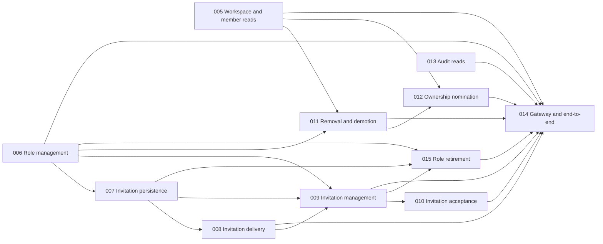

# FEAT-DP-003 implementation sequence

## Reconciliation — 2026-11-04

The diagram and table below capture the original audit snapshot. [Task 017](../tasks/TASK-DP-003-017.md) and [task 018](../tasks/TASK-DP-003-018.md) were added as prerequisites of 006 and are complete. Tasks 005 and 006 are complete within their scopes. Task 013 is pending after its contract review. The [resolution reconciliation](blocker-resolution-plan.md#implementation-reconciliation--2026-11-04) records current evidence, and the [session policy](audit-decisions-needed.md#reconciliation--2026-11-04) records the user's decision. Downstream tasks continue to require their declared gates; frontend and Project/guest work remain external handoffs.

Audited 2026-11-04, Asia/Bangkok. This is a dependency-aware recommendation, not authorization to bypass task status, review or approval gates. Full findings are in the [audit](unfinished-task-audit.md) and [blocker plan](blocker-resolution-plan.md). Complexity and risk are relative judgments; no duration is implied.

## Dependency graph

Arrows represent declared hard `depends_on` edges among unfinished tasks; completed prerequisites 001/002/003/004/016 are omitted from the diagram and listed in the table. F-01/F-02 are review gates, not new task IDs. 008 also depends on external test infrastructure, not a nonexistent module.

The graph is acyclic. Existing 009 and 015 plans already require 007 and 006 directly even where another transitive edge exists; do not remove declared edges merely for visual simplification. Changes to 005 and 006 overlap `OrganizationMembersController`, so their logical independence does not imply concurrent edits to that file are safe.

## Waves and prerequisites

| Wave / order | Task and reason | Hard prerequisites (done / unfinished) | AC and area | Complexity / risk | Completion and verification |
|---|---|---|---|---|---|
| 1A | [005](../tasks/TASK-DP-003-005.md) — finish partial reads first | 004 done | US-003/008; Identity API, CQRS and query store | M / High | Real HTTP + PostgreSQL authorization, filters, scoped pagination and failure tests; all task checks and evidence. |
| 1B | [006](../tasks/TASK-DP-003-006.md) — enables all invitation/role mutation branches | 003, 004, 016 done | US-006 except AC-009; roles/assignments, authorization and audit | L / High | Scoped grant/ceiling/no-op/stale, built-in stability, rollback and real race/uniqueness tests. Retirement remains unavailable. |
| 1C | [013](../tasks/TASK-DP-003-013.md) — independently exposes existing audit store | 003, 004 done; review F-02/F-03 | US-009; Identity audit API | M / High | Current audit permission per page, safe projection and both ordering modes with deterministic cursors, tests and evidence. |
| 2A | [007](../tasks/TASK-DP-003-007.md) — foundation for proof and generation state | 003/004 done; 006 | FR-002/003/012/014; Identity persistence/migration | L / High | Resolve F-01; scoped offer/ledger schema, proof lifecycle, uniqueness/rate/concurrency/rollback tests in PostgreSQL. |
| 2B | [011](../tasks/TASK-DP-003-011.md) — removal once member reads and role policy exist | 003/004 done; 005/006 | US-004 and reduction part of US-007; Identity mutations | L / High | Protected targets, last-Owner races, fresh authorization, reason and audit rollback; actual PostgreSQL. |
| 3A | [008](../tasks/TASK-DP-003-008.md) — delivery foundation | 007 | US-002 delivery; Identity/Notification/Contracts, Worker and deployment wiring | L / High | V1 compatibility, encrypted/redacted V2, proof recheck, duplicate/reordered events, provider/secret-failure tests; isolated PostgreSQL and broker/fakes. |
| 3B | [012](../tasks/TASK-DP-003-012.md) — nomination after demotion is available | 003/004 done; 005/011 | US-007; Identity nomination mapping/API | L / High | Real nomination terminal races, sponsor/nominee checks, owner continuity, explicit step-down and audit rollback. |
| 4 | [009](../tasks/TASK-DP-003-009.md) — manager API after state and delivery | 006/007/008 | US-002; Identity invitation commands/API | L / High | F-01, delegated authorization, first-valid-transition, rate limits, no secret disclosure, outbox atomicity and real races. |
| 5A | [010](../tasks/TASK-DP-003-010.md) — recipient workflow | 009 | US-005; Identity proof/accept/rejoin | L / High | Proof/current sponsor/version checks, rejoin history, races, unauthorized replay and transactional audit tests. |
| 5B | [015](../tasks/TASK-DP-003-015.md) — retirement after actual issuance path | 006/007/009 | US-006 AC-009; Identity role/invitation writers | M / High | No active assignments/pending offers, actual grant/issue races under same guard, reason, nonleak and audit rollback. |
| 6 | [014](../tasks/TASK-DP-003-014.md) — publish and prove integrated journeys | 001 done; 005/006/008–013/015 | US-001–009, all 88 ACs; Gateway/hosts/tests | L / High | Exact public method allowlist/private exclusions, full backend journeys, actual dependencies and explicit frontend/Project handoffs. |

Wave 1 tasks can be reviewed in parallel. 013 has no unfinished declared prerequisite but must first be revised/unblocked; 005 and 006 may implement separate query/domain work in parallel only with coordinated controller integration. In wave 2, 007 and 011 can progress after their prerequisites, but both touch Identity transaction/DI/tests; avoid concurrent migration/snapshot changes. In wave 3, 008 and 012 can progress independently only with coordinated Identity configuration and migrations. In wave 5, 010 and 015 are logically independent after 009 but share invitation and security tests/guards; agree ownership and integrate serially if touching the same files.

## Critical path and optimization

By **number of unfinished tasks**, not elapsed time, the longest declared paths are `006 → 007 → 008 → 009 → 010 → 014` and `006 → 007 → 008 → 009 → 015 → 014`. Each contains six unfinished tasks. The parallel Owner branch `005/006 → 011 → 012 → 014` is shorter by task count but may still determine actual finish time; there are no duration data to establish a time-based critical path. 008 is the cross-host messaging/secret/contract risk; 009–010 and 015 are security/transaction races.

Reduce elapsed work without changing gates by reviewing F-01 and preparing isolated environments during 006, developing 013 independently, and implementing 011/012 along the Owner branch as prerequisites complete. Do not ship 015 before its offer guard exists or treat 008's provider acceptance as delivery. No task on the declared completion path may be silently deferred while claiming all selected ACs; frontend selector and Project/guest implementations remain explicitly separate handoffs.

## Validation checkpoints

1. Before each task: run its `check-task` command, re-open source/dependency evidence, review statuses and actual approval policy. Structural success alone is not authorization or business correctness.
2. For each behavior change: focused .NET tests, real PostgreSQL for constraints/races, error/authorization/tenant tests, and docs validation when artifacts change. Run architecture checks when project references/boundaries change.
3. For 008/009: verify independently owned hosts, encrypted payload, outbox/inbox deduplication, dispatch reauthorization, retries/status ordering, broker configuration and key separation with isolated fixtures; do not send production messages.
4. For 014: run Identity, Notification and Gateway suites, migration upgrade/rollback review, Gateway allowlist/negative tests, cross-feature acceptance traceability and explicit skipped-test/handoff reporting.

Recommended next action: complete the verification gaps in **005**, while a separate developer prepares **006** and a planner reviews **013** and F-01. Treat 006 as the start of the longest dependency chains, with shared-controller coordination.
