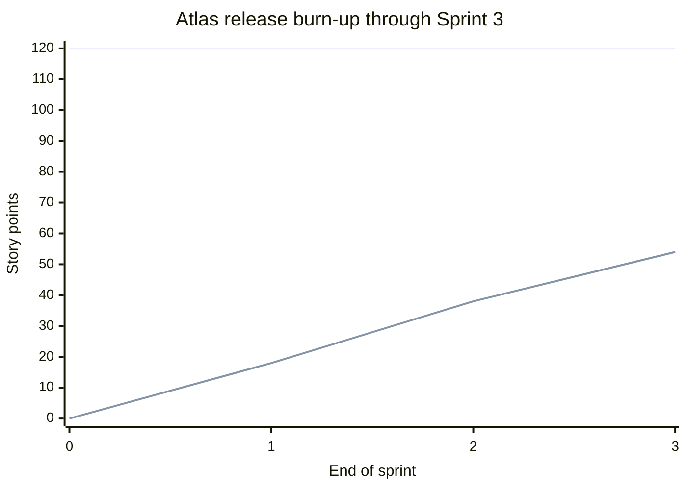

# 05 — Scope and change management

[Research index](README.md) · [Previous: Scrum operating model](04-scrum-operating-model.md) · [Next: risk, quality, and governance](06-risk-quality-and-governance.md)

**Research-supported guidance; operating rules and numbers below are illustrative practitioner proposals.** Source access date: 2026-11-07.

The PM's job is to make the consequence of a request visible early enough for someone with authority to choose. A backlog can change every day while the contractual baseline remains identifiable. Trouble starts when the current backlog becomes the only surviving record of what the parties agreed to buy and deliver.

## Keep four related records

| Record | Contents | Owner and control |
|---|---|---|
| Contractual baseline | Versioned outcomes, deliverables, acceptance criteria, exclusions, dependencies, price, and milestones | Authorized client and vendor commercial representatives approve amendments. |
| Current Product Backlog | Ordered work, estimates, discovery findings, defects, and candidate enhancements | Client PO orders it; vendor BA maintains details within delegated authority. Candidate work is visibly marked. |
| Change and decision register | Requested changes, classifications, alternatives, impact, approval version, and effective date | Vendor PM coordinates; named decision owners approve or reject. |
| Delivery and cost forecast | Latest credible view of completion, expenditure, unresolved dependencies, and assumptions | Team provides estimates; vendor PM reconciles the forecast with the baseline. |

Maintain item IDs across these records. A story refinement can clarify an agreed requirement without changing the contract; it cannot silently remove a mandatory outcome or add a new deliverable. A forecast revision records what is likely to happen. It does not itself authorize a new price or date.

PMI's published earned-value guidance ties meaningful measurement to controlled work-package budgets and approved changes. The operating records above are a proposed way to apply that discipline to an outsourcing engagement. [Lukas, PMI](https://www.pmi.org/learning/library/make-earned-value-work-project-6001)

## Classify the request before pricing it

| Classification | Atlas portal example | Proposed treatment |
|---|---|---|
| Clarification | Confirm the wording of an already agreed validation message | Record the answer and affected criteria; assess impact if the original assumption changes. |
| Defect | Users can submit a request without a field explicitly required by the baseline | Track correction against the existing obligation; apply the agreed defect/warranty terms. |
| Enhancement | Add an SMS channel where the baseline specifies email | Estimate alternatives and seek a swap or paid change. |
| Scope substitution | Replace an optional export with a higher-value search feature | Assess both sides of the trade and obtain the required baseline amendment. |
| Dependency or assumption change | The promised client API is unavailable | Record the event, mitigation options, contractual notification, and impact; do not assume either party automatically owes compensation. |

The client PO and vendor BA first compare the request with the referenced baseline version and acceptance examples. Developers and QA explain the technical effect. If the parties disagree, record both interpretations and escalate to the named commercial authorities. Continue unaffected work where feasible; do not hide the dispute in a story estimate.

## Use a short, complete change workflow

1. **Capture:** Give the request an ID, requester, reason, required decision date, affected baseline, and evidence. A chat message can initiate a request; link it to the durable record.
2. **Triage:** Classify it and identify the decision owner. Mark unapproved additions as candidates so they do not appear as committed scope.
3. **Analyze:** Ask Developers, QA, operations, and the client PO to assess effort, dependencies, regression, security, migration, acceptance, schedule, cost, and warranty effects. State estimate confidence.
4. **Offer choices:** Retain the baseline, defer the idea, substitute scope, reduce the requested capability, or approve additional funding/time. Show the business consequence of each.
5. **Decide:** Record approve/reject/defer, exact version, conditions, effective date, and authorized signatories. PO prioritization alone cannot amend a contract unless that authority was expressly delegated.
6. **Apply and verify:** Update affected baseline documents, backlog links, milestones, test scope, and forecast. Notify the team. Later link completion and acceptance evidence to the approved change.

Set a decision deadline from the delivery dependency: “Decision needed before Sprint 4 planning to preserve the integration slot” is more useful than “ASAP.” If the deadline passes, show the forecast effect and escalate under [the governance model](06-risk-quality-and-governance.md). Silence is handled according to the agreed contract; the team should not invent approval.

## Compare a swap with a paid change

The shared Atlas baseline is **$180,000**, six development sprints within a sixteen-week delivery engagement, and an illustrative backlog of **120 story points**. Separate discovery costs $15,000. See [contracting](02-pre-sales-and-contracting.md) for the full commercial example.

**Proposed swap:** Remove an unstarted eight-point CSV export and add an eight-point saved-search feature. Equal points prompt investigation; they do not establish commercial equivalence. The vendor checks whether the export is a contractual obligation, whether its design work has already been spent, and whether search adds indexing, access-control, performance, or regression work. If the net impact fits the agreed substitution rules, the parties record the removed and added criteria, dependencies, and unchanged price/date. Otherwise they negotiate a different trade. Removed work remains in history and is excluded from completion claims.

**Separate, unapproved paid-change scenario:** CR-02 requests an SMS capability estimated at twelve points, a **$12,000** additional price, and **one extra two-week sprint**. This is a commercial estimate based on the affected work and risk, not a price per point. Only if authorized would this branch become a $192,000 delivery contract, a 132-point backlog, and an eighteen-week delivery plan, with UAT/release and milestone dates revised accordingly. It is excluded from the baseline measurements below. Any existing forecast delay must also be reconciled; a priced extra sprint does not automatically solve unrelated slippage.

## Make scope movement visible

A burn-up chart plots completed work against total scope, making added scope visible as a separate change to the scope line. Atlassian's official documentation describes these two measures and the gap between them. [Atlassian](https://confluence.atlassian.com/jirasoftwarecloud/burnupchart-945124716.html)

For Atlas, use the table below as a small release burn-up dataset. “Done” uses the team's agreed DoD; contractual acceptance is tracked separately. Maintain the original 120-point baseline as a reference and a second current authorized-scope line if changes are approved.

| End of sprint | Original baseline | Current authorized scope | Cumulative Done | Remaining authorized work |
|---|---:|---:|---:|---:|
| 0 | 120 | 120 | 0 | 120 |
| 1 | 120 | 120 | 18 | 102 |
| 2 | 120 | 120 | 38 | 82 |
| 3 | 120 | 120 | 54 | 66 |

The flat line is authorized scope, currently identical to the original baseline; the rising line is cumulative Done work. The table provides the same data for readers whose Markdown viewer does not render the chart.

At the observed average of 18 points per sprint, 66 remaining points imply approximately **3.67 additional sprints**. Only three were planned. This is an early schedule warning, not a guaranteed completion date: inspect item size, dependencies, capacity, and the remaining integration work. Present a range where the data supports it. Do not increase estimates merely to improve apparent velocity or compare points across teams.

Annotate approved additions, removals, and estimate corrections distinctly. Splitting an unchanged story should preserve its prior total until the team explicitly records a re-estimation. Keep requested but unapproved work out of the authorized line.

## Keep client money and vendor costs distinct

| View | Atlas values and interpretation |
|---|---|
| Client commitment | $180,000 delivery price; separate $15,000 discovery; proposed CR-02 excluded. |
| Invoice position | Track approved milestone entitlement, invoices issued, cash received, and overdue balances separately. After the first two milestones, entitlement can total $72,000; that does not prove payment. |
| Vendor cost budget | $120,000 base costs plus $18,000 contingency = $138,000 approved cost budget. |
| Vendor forecast | $63,000 incurred plus $69,000 estimated remaining = $132,000 expected total cost. |
| Forecast consequence | $12,000 above base costs; $6,000 headroom within the $138,000 budget; $48,000 projected contribution before excluded overhead/taxes. |

The original price allowed $42,000 contribution if the whole contingency was used. A $132,000 forecast produces a different projected contribution. Neither contribution nor unspent contingency is automatically a client credit. Conversely, the vendor's internal overspend does not automatically justify a client change charge.

## Earned value: a bounded worked example

EVM compares scheduled and accomplished work in budget units with actual cost. **PV** is budgeted work scheduled by the measurement date; **EV** is the budget value earned by objectively completed work; **AC** is incurred cost. **CPI = EV/AC** measures cost efficiency and **SPI = EV/PV** measures progress against the budgeted schedule. [PMI EVM guide](https://www.pmi.org/blog/earned-value-management)

For this illustration, vendor **BAC = $138,000**, including contingency, rather than the $180,000 selling price. Budget weights are assigned to deliverable packages independently of story points. A $6,000 package earns its agreed credit when its evidence rule is met; “54 points Done” is not converted to $54,000. The coincident numbers below describe different measures.

| End of Sprint 3 measure | Calculation | Result |
|---|---|---:|
| PV / EV / AC | Assumed package plan, verified completion credit, and incurred costs | $60,000 / $54,000 / $63,000 |
| Cost variance | EV − AC | −$9,000 |
| Schedule variance | EV − PV | −$6,000 |
| CPI / SPI | 54/63 and 54/60 | 0.857 / 0.900 |
| Trend EAC | BAC/CPI = 138,000/(54/63) | $161,000 |
| Bottom-up EAC | AC + revised ETC = 63,000 + 69,000 | $132,000 |
| Bottom-up budget headroom | BAC − EAC | $6,000 |

The **$161,000** projection assumes the observed efficiency continues. The **$132,000** forecast requires evidence supporting a cheaper remaining work mix or improved performance, such as a completed one-time integration setup and a reviewed package-by-package estimate. Show both until the assumptions are demonstrated. Include remaining QA, UAT support, release, and warranty allowance in ETC.

Contingency is included in BAC but earns no credit merely for being held. Record its allocation to authorized response work and changes to affected budgets and time-phased PV; preserve the earlier reporting snapshots. Management reserve is separate, and none is added in this example. SPI is not a calendar forecast and can conceal critical-path problems. These distinctions follow Lukas's discussion of contingencies, progress methods, and forecasting limits. [Lukas, PMI](https://www.pmi.org/learning/library/make-earned-value-work-project-6001)

For a small engagement without reliable cost collection or objective package credit, use scope, milestone evidence, incurred cost, and a documented remaining-cost forecast first. Adding an EVM percentage to weak data makes the report harder to challenge without making it more accurate.

## Sources

1. Project Management Institute. [Earned Value Management: A Guide to Reading the Numbers](https://www.pmi.org/blog/earned-value-management), 31 August 2026. Used for EVM definitions and basic indices; Atlas amounts and calculations are original illustrations.
2. Joseph A. Lukas. [How to make earned value work on your project](https://www.pmi.org/learning/library/make-earned-value-work-project-6001), PMI Global Congress, 23 October 2012. Used for budget/change control, contingency treatment, objective progress, and forecasting limitations.
3. Atlassian. [Burnup Chart](https://confluence.atlassian.com/jirasoftwarecloud/burnupchart-945124716.html), last modified 18 June 2021. Used for the chart's completed-work/total-scope interpretation, not as a recommendation of a particular tool configuration.

All sources accessed 2026-11-07. Classification examples, decision workflow, numerical scenarios, and operating thresholds are practitioner synthesis for this fictional engagement.
