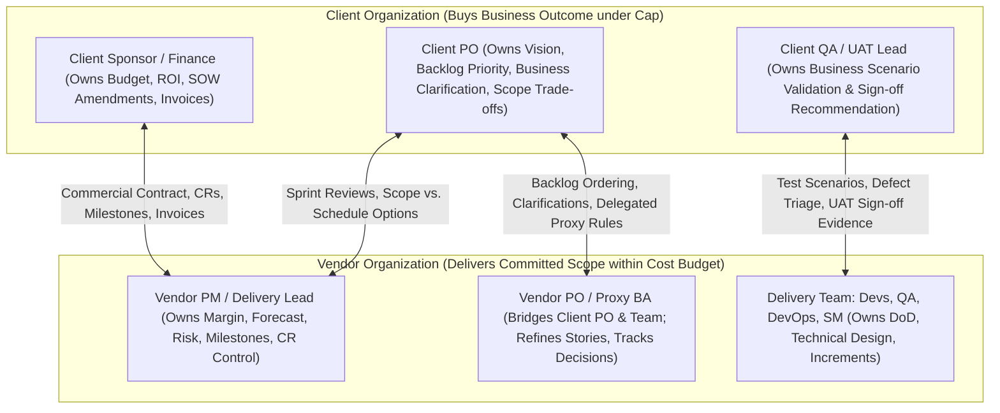

# 01 — Stakeholders and Personas in Fixed-Price Agile Outsourcing

[Analysis Index](README.md) · Next: [02 — User Needs by SDLC Phase](02-user-needs-by-sdlc-phase.md)

**Provenance Summary:** Role definitions synthesize [`docs/research/04-scrum-operating-model.md`](../04-scrum-operating-model.md) `[Evidence: Existing Research]`, Scrum.org and Martin Fowler commentary on split/proxy ownership `[Evidence: External Source]`, and UX/product discovery synthesis of commercial vs. delivery incentives `[PM/UX Inference]`.

---

## 1. The Structural Split: Why Outsourcing Personas Differ from In-House Scrum

In single-company Scrum, the Product Owner, Scrum Master, and Developers share one employer, one P&L, and one organizational hierarchy (`[Evidence: External Source]` — [Scrum Guide, 2020](https://scrumguides.org/scrum-guide.html)). In fixed-price outsourcing (`[User Assumption]`), **product accountability and commercial execution are split across two legal entities with opposing risk exposures**:

* **The Vendor Organization** absorbs cost-overrun risk once a fixed price is signed (`[Evidence: Existing Research]` — [`01-overview.md`](../01-overview.md); `[Evidence: External Source]` — [Lowden & Thornton, PMI 2015](https://www.pmi.org/learning/library/challenges-fixed-price-contracts-9640)). Every unpriced hour of rework, unrecorded scope addition, or uncompensated client delay directly erodes the vendor's gross margin (`$42,000` planned contribution in the *Atlas* baseline).
* **The Client Organization** carries business-outcome risk and internal budget-cap exposure (`[Evidence: Existing Research]` — [`01-overview.md`](../01-overview.md); `[Evidence: External Source]` — [Fowler, *Fixed Scope Mirage*](https://martinfowler.com/bliki/FixedScopeMirage.html)). Because the client locked in a fixed price (`$180,000` in *Atlas*), client stakeholders naturally seek to maximize the functional richness delivered within that ceiling and resist paying extra for requirements they believed were "obviously implied."

---

## 2. Detailed Persona Profiles

### 2.1 Vendor PM (Engagement / Delivery Manager)

> *"My job is to deliver a referenceable client release on time without letting 'quick favors' in Slack silently burn through our $18,000 contingency and wipe out our margin."*

| Dimension | Analysis |
|---|---|
| **Primary Goals** | 1. Deliver all contracted milestones on schedule to unlock timely cash flow (`[Evidence: Existing Research]` — [`02-pre-sales-and-contracting.md`](../02-pre-sales-and-contracting.md)). 2. Protect vendor gross margin (`EAC <= $138,000` cost baseline in *Atlas*) by keeping scope aligned with the signed baseline (`B1.0`) `[Evidence: Existing Research]`. 3. Maintain client trust so the engagement leads to Phase 2 or a maintenance retainer `[PM/UX Inference]`. |
| **Core Responsibilities** | • Reconcile the 4 core records: Contractual Baseline, Product Backlog, Change/Decision Register, and Cost/Delivery Forecast (`[Evidence: Existing Research]` — [`05-scope-and-change-management.md`](../05-scope-and-change-management.md)). • Track internal burn (`AC`), remaining effort (`ETC`), contingency drawdown, and resource utilization. • Coordinate Change Requests (CRs), scope swaps, milestone evidence packages, and client escalations. • Shield the engineering team from commercial confrontation during daily Scrum events (`[Evidence: Existing Research]` — [`04-scrum-operating-model.md`](../04-scrum-operating-model.md)). |
| **What Success Means (KPIs)** | • **Gross Margin variance:** Actual contribution vs. planned contribution (`$42,000` target). • **Milestone on-time acceptance rate** and **Days Sales Outstanding (DSO)** from delivery to invoice payment. • **Zero uncompensated scope creep** or disputed UAT rejections. • **Client CSAT / NPS** at project closure. |
| **Daily Frustrations & Fears** | • Developers or Proxy BAs agreeing to extra requirements in refinement calls without logging a CR (`[Evidence: Existing Research]` — [`09-lessons-learned-and-pitfalls.md`](../09-lessons-learned-and-pitfalls.md)). • Spending 4–6 hours every Friday copying Jira story points and timesheets into Excel to figure out true burn (`[Evidence: External Source]` — [`r/projectmanagement`](https://www.reddit.com/r/projectmanagement/)). • Client blocking an integration or UAT sign-off for weeks, then blaming the vendor for the slipped release date. |
| **Visibility & Access Boundary** | Needs **full internal + external visibility**: sees internal hourly rates, cost burn, margin, contingency ledger, and internal risk notes, as well as the client-facing portal view (`[Evidence: Existing Research]` — [`06-risk-quality-and-governance.md`](../06-risk-quality-and-governance.md), [`docs/product.md`](../../product.md)). |

---

### 2.2 Vendor PO / Business Analyst (Proxy PO)

> *"I'm caught between a client PO who only gives me two hours a week and eight developers who need edge-case answers by 10 AM Vietnam time so the sprint doesn't stall."*

| Dimension | Analysis |
|---|---|
| **Primary Goals** | 1. Keep the backlog 1–2 sprints ahead of the team, meeting the Definition of Ready (`DoR`) (`[Evidence: Existing Research]` — [`04-scrum-operating-model.md`](../04-scrum-operating-model.md)). 2. Translate high-level client business goals and SOW bullets into unambiguous User Requirements (`UR`), Functional Requirements (`FR`), User Stories (`US`), and Given/When/Then Acceptance Criteria (`AC`) (`[Evidence: Existing Research]` — [`docs/product.md`](../../product.md)). 3. Stay strictly inside delegated proxy authority so they are never blamed for giving away free scope (`[Evidence: Existing Research]` — [`04-scrum-operating-model.md`](../04-scrum-operating-model.md)). |
| **Core Responsibilities** | • Facilitate discovery workshops, story mapping, and weekly refinement. • Maintain the written **Decision Queue** for the daily offshore overlap window (`[Evidence: Existing Research]` — [`07-offshore-communication.md`](../07-offshore-communication.md)). • Perform first-line **Request Classification**: is a client comment a *Clarification* within baseline `B1.0`, a *Defect*, an *Enhancement*, or a *Scope Swap* candidate? (`[Evidence: Existing Research]` — [`05-scope-and-change-management.md`](../05-scope-and-change-management.md)). • Trace every Story and AC back to an approved UR/FR version. |
| **What Success Means (KPIs)** | • **Sprint Readiness coverage:** % of upcoming sprint capacity backed by `DoR`-compliant, baseline-linked stories. • **Decision turnaround time:** % of client clarifications resolved within the 2-business-day SLA (`[Evidence: Existing Research]` — [`02-pre-sales-and-contracting.md`](../02-pre-sales-and-contracting.md)). • **Low requirement-rework rate:** Minimal stories rejected in Sprint Review or UAT due to misunderstood specs. |
| **Daily Frustrations & Fears** | • **The "Carrier Pigeon / Proxy Trap":** Having tactical responsibility to unblock developers without strategic authority to approve trade-offs (`[Evidence: External Source]` — [Overeem, Scrum.org](https://www.scrum.org/resources/blog/product-owner-proxy)). • Guessing an answer when the Client PO is unresponsive, only to have the Client PO reject the built feature two sprints later. • Losing track of subtle requirement changes buried in Zoom transcripts, Slack threads, or email chains. |
| **Visibility & Access Boundary** | Sees full requirement, backlog, traceability, decision log, and effort/point estimates; typically does **not** manage commercial invoicing or company-level profit accounting `[PM/UX Inference]`. |

---

### 2.3 Delivery Team (Developers, QA Engineers, DevOps, Scrum Master)

> *"We just want clear acceptance criteria, working sandbox credentials, and protection from mid-sprint scope thrashing—don't cut our testing time just because sales under-estimated the SOW."*

| Dimension | Analysis |
|---|---|
| **Primary Goals** | 1. Build, verify, and integrate clean, working software increments that satisfy the Sprint Goal and `DoD` (`[Evidence: Existing Research]` — [`04-scrum-operating-model.md`](../04-scrum-operating-model.md)). 2. Surface technical constraints, integration unknowns, and effort impacts honestly without being pressured to fake estimates (`[Evidence: Existing Research]` — [`02-pre-sales-and-contracting.md`](../02-pre-sales-and-contracting.md)). 3. Avoid late-stage "death marches" during Stabilization/UAT caused by deferred testing or unvetted scope additions (`[Evidence: Existing Research]` — [`06-risk-quality-and-governance.md`](../06-risk-quality-and-governance.md)). |
| **Core Responsibilities** | • **Developers / Tech Lead:** Run technical feasibility spikes in Presales/Discovery; size stories; implement code and automated tests; provide technical impact assessments for CRs and swaps. • **Vendor QA:** Define the test strategy; write and execute sprint test cases linked to Story `AC`; log defects; prepare versioned test evidence packages for Milestone and UAT submissions (`[Evidence: Existing Research]` — [`06-risk-quality-and-governance.md`](../06-risk-quality-and-governance.md)). • **DevOps / Release Lead:** Provision environments, CI/CD, deployment runbooks, rollback procedures, and handover exercises (`[Evidence: Existing Research]` — [`03-sdlc-phases.md`](../03-sdlc-phases.md)). • **Scrum Master:** Facilitate Scrum events, protect the Sprint from unapproved injections, and escalate external impediments to the Vendor PM (`[Evidence: Existing Research]` — [`04-scrum-operating-model.md`](../04-scrum-operating-model.md)). |
| **What Success Means (KPIs)** | • **Sprint Goal attainment** and **First-time DoD / QA pass rate**. • **Low defect escape rate** into UAT and Production. • **Predictable flow / low blocked time** waiting on client APIs, test data, or ambiguous AC. |
| **Daily Frustrations & Fears** | • Starting a sprint on a story whose external dependency (e.g., client Identity Provider sandbox) is still broken (`[Evidence: Existing Research]` — [`06-risk-quality-and-governance.md`](../06-risk-quality-and-governance.md)). • Being told *"the client says this new workflow is a bug, not a CR, so fix it tonight for free"* (`[Evidence: External Source]` — [`r/scrum`](https://www.reddit.com/r/scrum/)). • Story points being weaponized by management as a fixed hours-per-point quota (`[Evidence: Existing Research]` — [`02-pre-sales-and-contracting.md`](../02-pre-sales-and-contracting.md); `[Evidence: External Source]` — [Cohn, 2024](https://www.mountaingoatsoftware.com/agile/dont-equate-story-points-to-hours)). |
| **Visibility & Access Boundary** | Needs deep execution context (UR/FR/US/AC, architecture, test cases, build artifacts, blockers, sprint capacity); shielded from raw commercial contract negotiations and client billing disputes `[PM/UX Inference]`. |

---

### 2.4 Client Product Owner (Client PO)

> *"I have a full-time operational job in my company plus this software project. I need the vendor to guide me through decisions clearly, show me working software, and not nickel-and-dime me with a Change Request every time we refine a detail."*

| Dimension | Analysis |
|---|---|
| **Primary Goals** | 1. Launch a product that solves real business problems for internal staff and end-customers before the business deadline (`[Evidence: Existing Research]` — [`01-overview.md`](../01-overview.md)). 2. Maximize value delivered within the approved `$180,000` budget without having to go back to the Client Sponsor/Finance to beg for extra budget (`[Evidence: External Source]` — [`r/projectmanagement`](https://www.reddit.com/r/projectmanagement/)). 3. Have clear, defensible progress and scope visibility to report upward to executives `[PM/UX Inference]`. |
| **Core Responsibilities** | • Own the product vision, business outcomes, and Product Backlog ordering (`[Evidence: Existing Research]` — [`04-scrum-operating-model.md`](../04-scrum-operating-model.md)). • Review and approve User Requirements (`UR`) and baseline scope packages. • Answer escalated decision requests within the agreed SLA (e.g., 2 business days) during overlap hours (`[Evidence: Existing Research]` — [`07-offshore-communication.md`](../07-offshore-communication.md)). • Evaluate trade-offs (e.g., initiating a **Scope Swap** when a newly discovered feature is more valuable than an unstarted baseline item) (`[Evidence: Existing Research]` — [`05-scope-and-change-management.md`](../05-scope-and-change-management.md)). |
| **What Success Means (KPIs)** | • **Business outcome adoption:** End-users can complete the target workflows at launch. • **On-time, on-budget delivery:** Finishing within the contracted `$180,000` and 16-week schedule. • **Low cognitive overhead:** Making high-leverage product decisions in <5 hours/week rather than drowning in 200 granular Jira tickets `[PM/UX Inference]`. |
| **Daily Frustrations & Fears** | • Feeling "trapped" by an early SOW specification written before seeing working software (`[Evidence: External Source]` — [Fowler, *Fixed Scope Mirage*](https://martinfowler.com/bliki/FixedScopeMirage.html)). • Opening the vendor's Jira board and seeing 150 technical subtasks ("Refactor DTO", "Setup migration") with no idea whether the business feature is actually ready `[Evidence: External Source]`. • Discovering in Sprint 5 that the project is 3 weeks behind schedule after four sprints of "Green" status reports (`[Evidence: Existing Research]` — [`09-lessons-learned-and-pitfalls.md`](../09-lessons-learned-and-pitfalls.md)). |
| **Visibility & Access Boundary** | **Scoped Client Portal access** (`[Evidence: Existing Research]` — [`docs/product.md`](../../product.md)): sees shared requirements, baseline scope, story-level progress, burn-up vs. baseline, decision queue, CR options, test/demo evidence, and milestone statuses. **Must NOT see** vendor internal hourly costs, margin (`$42,000`), internal contingency (`$18,000`), or private vendor team notes (`[Evidence: Existing Research]` — [`05-scope-and-change-management.md`](../05-scope-and-change-management.md)). |

---

### 2.5 Client Sponsor / Finance (Commercial & Budget Owner)

> *"When I sign a $180,000 fixed-price contract, I expect predictability. Before I authorize a $36,000 milestone invoice or a $12,000 Change Request, show me objective proof of what was delivered and why the change wasn't in the original scope."*

| Dimension | Analysis |
|---|---|
| **Primary Goals** | 1. Ensure the capital investment (`$15k` discovery + `$180k` build) delivers the promised ROI and business capability (`[Evidence: Existing Research]` — [`02-pre-sales-and-contracting.md`](../02-pre-sales-and-contracting.md)). 2. Prevent post-signature value leakage, unauthorized budget overruns, and paying ahead of actual delivery value (`[Evidence: External Source]` — [WorldCC, 2026](https://www.worldcc.com)). 3. Maintain clean, auditable governance records connecting SOW baselines, approved CRs, signed acceptance certificates, and paid invoices `[Evidence: Existing Research]`. |
| **Core Responsibilities** | • Fund the engagement and sign the SOW and Baseline `B1.0` (`[Evidence: Existing Research]` — [`03-sdlc-phases.md`](../03-sdlc-phases.md)). • Act as the **Commercial Approver** for any Change Request that alters contract price, milestone dates, or mandatory obligations (`[Evidence: Existing Research]` — [`04-scrum-operating-model.md`](../04-scrum-operating-model.md)). • Participate in monthly Steering Committee reviews or exception escalations (`[Evidence: Existing Research]` — [`06-risk-quality-and-governance.md`](../06-risk-quality-and-governance.md)). • Verify milestone acceptance evidence before authorizing Accounts Payable to release invoice payment (`[Evidence: Existing Research]` — [`04-scrum-operating-model.md`](../04-scrum-operating-model.md)). |
| **What Success Means (KPIs)** | • **Budget variance (`<= 0%` unapproved overrun)** against the authorized commitment. • **100% audit trail** linking every paid invoice (`M1–M5`) to a signed deliverable acceptance certificate. • **Predictable forecast:** Early warning (at least 4–6 weeks out) if business dependencies or scope changes threaten the launch window. |
| **Daily Frustrations & Fears** | • Receiving a `$45,000` milestone invoice when the Client PO or UAT Lead says *"half the features don't work in our environment yet."* • Being ambushed late in the project with a large paid CR (`CR-02: +$12,000, +2 weeks`) without clear visibility into why a scope swap wasn't used (`[Evidence: Existing Research]` — [`05-scope-and-change-management.md`](../05-scope-and-change-management.md)). • Having to reconstruct contract amendments across scattered PDFs and email attachments (`[Evidence: External Source]` — [WorldCC, 2026](https://www.worldcc.com)). |
| **Visibility & Access Boundary** | **Executive & Commercial Portal View** `[PM/UX Inference]`: sees high-level milestone roadmap, baseline vs. approved CR ledger, commercial financial summary (`$180,000` contracted, `$72,000` accepted/invoiced, `$108,000` remaining), formal acceptance certificates, and escalated steering decisions. |

---

### 2.6 Client QA / UAT Lead (Business Acceptance & Operations Representative)

> *"Don't throw a release candidate over the wall in Week 14 with no test data and give me five days to rubber-stamp it. I need to know exactly what scenarios I'm testing and that fixing bugs won't disappear once the final invoice is paid."*

| Dimension | Analysis |
|---|---|
| **Primary Goals** | 1. Verify that the delivered software works for real business users with realistic data across end-to-end workflows before signing off UAT (`[Evidence: Existing Research]` — [`03-sdlc-phases.md`](../03-sdlc-phases.md)). 2. Ensure all critical/major defects are fixed (or explicitly documented as binding conditions) before production release (`[Evidence: Existing Research]` — [`06-risk-quality-and-governance.md`](../06-risk-quality-and-governance.md)). 3. Receive a supportable, operable system with complete runbooks, access credentials, and warranty protection (`[Evidence: Existing Research]` — [`03-sdlc-phases.md`](../03-sdlc-phases.md)). |
| **Core Responsibilities** | • Review acceptance test scenarios during Discovery/Inception and Sprint Reviews (`[Evidence: Existing Research]` — [`06-risk-quality-and-governance.md`](../06-risk-quality-and-governance.md)). • Coordinate client business testers and realistic test data for Milestone slices and the Stabilization/UAT phase (`[Evidence: Existing Research]` — [`03-sdlc-phases.md`](../03-sdlc-phases.md)). • Log UAT findings, assign business severity, and participate in daily defect vs. enhancement triage (`[Evidence: Existing Research]` — [`06-risk-quality-and-governance.md`](../06-risk-quality-and-governance.md)). • Execute or recommend formal **UAT Sign-off** (`Accepted`, `Conditionally Accepted`, or `Rejected`) (`[Evidence: Existing Research]` — [`08-templates-and-checklists.md`](../08-templates-and-checklists.md)). |
| **What Success Means (KPIs)** | • **Zero P1/Critical production incidents** during the 30-day warranty window. • **Clear traceability** from every agreed business requirement to a passed UAT scenario. • **Smooth operational handover:** Internal IT/Ops can deploy, monitor, and restore backups without vendor heroics (`[Evidence: Existing Research]` — [`09-lessons-learned-and-pitfalls.md`](../09-lessons-learned-and-pitfalls.md)). |
| **Daily Frustrations & Fears** | • Being pulled into UAT at Week 14 with zero context on what changed during Sprints 1–6 (`[Evidence: External Source]` — [`r/businessanalysis`](https://www.reddit.com/r/businessanalysis/)). • Having legitimate usability or workflow failures dismissed by the vendor as *"working as designed per Story AC, please raise a paid CR"* (`[Evidence: External Source]` — [`r/projectmanagement`](https://www.reddit.com/r/projectmanagement/)). • Losing leverage once the UAT milestone (`$45,000`) is signed off and the vendor re-allocates senior developers to another client during Warranty. |
| **Visibility & Access Boundary** | **UAT & Acceptance Portal View** `[PM/UX Inference]`: sees baselined requirements/AC, UAT test scenarios, release-candidate build notes, vendor QA test evidence, shared defect log, UAT sign-off checklists, and handover/warranty trackers. |

---

## 3. Cross-Persona Incentive & Tension Matrix

A core product discovery insight (`[PM/UX Inference]`) is that **fixed-price outsourcing tools fail when they assume all users share the same goal**. The product must explicitly mediate five structural tensions between personas:

| Structural Tension | Vendor Side Position | Client Side Position | How the Product Must Mediate It (`[PM/UX Inference]`) |
|---|---|---|---|
| **1. Granularity of Scope Baseline** | **Vendor PM & BA** want specific exclusions and bounded AC so estimates remain valid (`[Evidence: Existing Research]` — [`02-pre-sales-and-contracting.md`](../02-pre-sales-and-contracting.md)). | **Client PO** wants high-level outcome flexibility so details can evolve during sprints without triggering CRs (`[Evidence: External Source]` — [Fowler](https://martinfowler.com/bliki/FixedPrice.html)). | Two-tier baseline: lock **Outcome/UR + Envelope Constraints** at contract baseline, while allowing lightweight **Story-level refinement** inside delegated boundaries and frictionless **Scope Swaps** for equal-impact trade-offs. |
| **2. Defect vs. Enhancement Classification** | **Vendor PM & Devs** classify anything outside the literal Story AC as a *New Enhancement (CR)* to protect burn (`[Evidence: Existing Research]` — [`05-scope-and-change-management.md`](../05-scope-and-change-management.md)). | **Client QA/UAT & PO** classify anything that hinders the business workflow as a *Defect* covered by the fixed price (`[Evidence: External Source]` — [`r/projectmanagement`](https://www.reddit.com/r/projectmanagement/)). | Mandatory **Baseline Version + Example Scenario linking** before a story enters a sprint (`DoR`), plus a structured **Disputed Classification workflow** that separates technical delivery from commercial resolution. |
| **3. Proxy Velocity vs. Client Authority** | **Vendor BA & Team** need answers within 24–48 hours to avoid mid-sprint blockers (`[Evidence: Existing Research]` — [`07-offshore-communication.md`](../07-offshore-communication.md)). | **Client PO & Sponsor** have limited daily bandwidth and fear signing off hastily without stakeholder alignment (`[Evidence: External Source]` — [Scrum.org](https://www.scrum.org/resources/blog/product-owner-proxy)). | Explicit **Proxy Authority Matrix** + **Timeboxed Decision Queue** showing exact schedule/milestone impact of unanswered questions and automatic deputy routing before a sprint blocks. |
| **4. Internal Cost Burn vs. External Progress** | **Vendor PM** tracks internal hours, `$138k` cost budget, and `$18k` contingency privately (`[Evidence: Existing Research]` — [`05-scope-and-change-management.md`](../05-scope-and-change-management.md)). | **Client Sponsor & PO** want honest schedule/scope forecasts and proof of earned value before paying milestones (`[Evidence: Existing Research]` — [`02-pre-sales-and-contracting.md`](../02-pre-sales-and-contracting.md)). | **Dual-Ledger Architecture:** One underlying delivery graph drives both an **Internal Vendor Margin/Burn View** and a **Client-Facing Scope Burn-up & Milestone Evidence View** without leaking vendor cost rates. |
| **5. Sprint Review Demo vs. Milestone Billing** | **Vendor PM** wants a successful Sprint Review to immediately unlock the `$36k`/`$45k` milestone invoice (`[Evidence: Existing Research]` — [`09-lessons-learned-and-pitfalls.md`](../09-lessons-learned-and-pitfalls.md)). | **Client PO & Sponsor** want to give candid product feedback in Sprint Review without inadvertently authorizing an invoice (`[Evidence: Existing Research]` — [`04-scrum-operating-model.md`](../04-scrum-operating-model.md)). | Strictly separate states: `DoD Passed` → `Sprint Reviewed (Feedback)` → `Milestone Acceptance Package Submitted` → `Client Accepted (5-day SLA)` → `Invoice Eligible`. |

---

## Sources for Chapter 01

1. Ken Schwaber & Jeff Sutherland, [*The Scrum Guide*](https://scrumguides.org/scrum-guide.html), November 2020 — Scrum accountabilities and single-PO principle. Accessed 2026-11-07.
2. Barry Overeem, [*The Product Owner Proxy*](https://www.scrum.org/resources/blog/product-owner-proxy), Scrum.org — risks of the Proxy PO stance when authority and execution are separated. Accessed 2026-11-07.
3. Martin Fowler, [*Fixed Scope Mirage*](https://martinfowler.com/bliki/FixedScopeMirage.html) and [*Fixed Price*](https://martinfowler.com/bliki/FixedPrice.html) — opposing commercial incentives in fixed-scope/fixed-price outsourcing. Accessed 2026-11-07.
4. George Lowden & John Thornton, [*The special challenges of project management under fixed-price contracts*](https://www.pmi.org/learning/library/challenges-fixed-price-contracts-9640), PMI Global Congress, 2015 — vendor cost-overrun exposure and buyer scope expectations. Accessed 2026-11-07.
5. World Commerce & Contracting (WorldCC), [*Poor Contract Management Costs Companies 9% — Bottom Line*](https://www.worldcc.com) — sponsor/finance perspective on post-signature value erosion. Accessed 2026-11-07.
6. Repository Research: [`04-scrum-operating-model.md`](../04-scrum-operating-model.md), [`05-scope-and-change-management.md`](../05-scope-and-change-management.md), [`06-risk-quality-and-governance.md`](../06-risk-quality-and-governance.md), and [`docs/product.md`](../../product.md).
