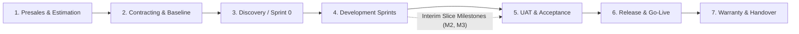

# 02 — User Needs Across the 7 SDLC Phases

[Analysis Index](README.md) · Previous: [01 — Stakeholders and Personas](01-stakeholders-and-personas.md) · Next: [03 — Pain Points and Information Gaps](03-pain-points-and-information-gaps.md)

**Provenance Summary:** This chapter maps the seven requested outsourcing SDLC phases (**1. Presales/Estimation, 2. Contracting, 3. Discovery/Sprint 0, 4. Sprints, 5. UAT/Acceptance, 6. Release, 7. Warranty/Handover**) `[User Assumption]` against the six personas defined in [Chapter 01](01-stakeholders-and-personas.md). It combines the operational gates in [`docs/research/02-pre-sales-and-contracting.md`](../02-pre-sales-and-contracting.md) and [`03-sdlc-phases.md`](../03-sdlc-phases.md) `[Evidence: Existing Research]` with WorldCC handover benchmarks and practitioner evidence `[Evidence: External Source]` to define what each role must **Do**, **Decide**, and **Know** `[PM/UX Inference]`.

---

## 1. End-to-End Persona Journey Overview

Note how [`docs/research/03-sdlc-phases.md`](../03-sdlc-phases.md) models a pre-build paid Discovery phase followed by Inception/Sprint 0, Sprints, Stabilization/UAT, Release, Warranty/Handover, and Maintenance, while [`02-pre-sales-and-contracting.md`](../02-pre-sales-and-contracting.md) covers Presales estimation and Contracting `[Evidence: Existing Research]`. To support the full agency-client lifecycle requested for the product (`[User Assumption]`), we explicitly model **Presales/Estimation** and **Contracting** as the first two phases leading into **Discovery/Sprint 0** through **Warranty/Handover**:

---

## 2. Phase-by-Phase Persona Needs (`Do`, `Decide`, `Know`)

### Phase 1: Presales & Estimation

**Phase Context:** Before signing a fixed-price build commitment (or during a paid pre-contract Discovery spike like *Atlas*'s $15k / 2-week engagement), both sides try to bound uncertainty, size the candidate scope, and separate planning velocity from commercial cost (`[Evidence: Existing Research]` — [`02-pre-sales-and-contracting.md`](../02-pre-sales-and-contracting.md); `[Evidence: External Source]` — [Cohn, 2024](https://www.mountaingoatsoftware.com/agile/dont-equate-story-points-to-hours)).

| Persona | Needs to DO (Actions) | Needs to DECIDE (Decisions) | Needs to KNOW (Information) |
|---|---|---|---|
| **Vendor PM** | • Build the bottom-up role effort & cost model (`2,400 hrs @ $45 + $12k = $120k base`) and risk contingency (`+$18k`) (`[Evidence: Existing Research]` — [`02-pre-sales-and-contracting.md`](../02-pre-sales-and-contracting.md)). • Reconcile team sprint forecast (5–7 sprints) with calendar capacity. • Document explicit assumptions and exclusions. | • Whether uncertainty is low enough for a fixed price, or requires a paid Discovery spike / capped T&M first (`[Evidence: Existing Research]` — [`01-overview.md`](../01-overview.md)). • How much risk contingency (`15%` in *Atlas*) is required. | • Historical velocity/throughput of the proposed team on comparable stacks. • Staff availability, holiday calendars, and third-party license/environment pass-through costs. |
| **Vendor PO / BA** | • Facilitate outcome & user-journey workshops. • Decompose high-level RFP wishes into candidate Epics, Features, and User Requirements (`UR`). • Flag ambiguous phrases (e.g., *"standard reporting"*) (`[Evidence: Existing Research]` — [`02-pre-sales-and-contracting.md`](../02-pre-sales-and-contracting.md)). | • Which requirements are clear enough to estimate vs. which must be logged as priced assumptions or exclusions. | • Who the real end-users are, what legacy workflows exist, and where business stakeholders disagree internally. |
| **Delivery Team** | • Review candidate architecture and NFRs. • Run timeboxed feasibility spikes on risky integrations. • Provide three-point / range estimates and dependency maps (`[Evidence: Existing Research]` — [`02-pre-sales-and-contracting.md`](../02-pre-sales-and-contracting.md)). | • Technical feasibility of the proposed stack and integrations. • Whether QA, CI/CD, migration, and security effort are adequately included in the base estimate. | • Availability of external API docs, sample data volumes, security/compliance targets, and hosting constraints. |
| **Client PO** | • Articulate business objectives, target user roles, and launch deadline. • Walk through existing workflows and pain points. | • What belongs in the **Minimum Viable Launch (Must-Have)** vs. optional/swappable scope (`[Evidence: Existing Research]` — [`01-overview.md`](../01-overview.md)). | • Which features drive the highest cost/risk so they can de-scope low-value complexity early `[PM/UX Inference]`. |
| **Client Sponsor / Finance** | • Define the budget ceiling, target ROI, and procurement timeline. • Authorize a paid Discovery spike (`$15,000`) if build scope is not yet priceable. | • Proceed with full build quote, fund a paid Discovery phase, narrow scope, or stop (`[Evidence: Existing Research]` — [`03-sdlc-phases.md`](../03-sdlc-phases.md)). | • Total cost of ownership (build fee + pass-through licenses + internal UAT effort + post-launch maintenance) and confidence range. |
| **Client QA / UAT** | • Identify regulatory, operational, and business-acceptance constraints early (`[Evidence: Existing Research]` — [`02-pre-sales-and-contracting.md`](../02-pre-sales-and-contracting.md)). | • What level of UAT evidence and environment isolation will be required before go-live. | • How much time client SMEs will need to allocate for sprint demos and UAT cycles (`[Evidence: Existing Research]` — [`08-templates-and-checklists.md`](../08-templates-and-checklists.md)). |

---

### Phase 2: Contracting & Baseline Establishment

**Phase Context:** Turning the estimate and discovery outputs into a binding Statement of Work (SOW), an immutable **Scope Baseline (`B1.0`)**, a **Milestone Payment Schedule (`M1–M5`)**, and an explicit **Governance / Change Control clause**. WorldCC research shows ~40% of disputes stem from unclear scope at this gate and poor handover from sales/legal to delivery (`[Evidence: External Source]` — [WorldCC, 2026](https://www.worldcc.com)).

| Persona | Needs to DO (Actions) | Needs to DECIDE (Decisions) | Needs to KNOW (Information) |
|---|---|---|---|
| **Vendor PM** | • Map every SOW deliverable and UR version into **Scope Baseline `B1.0`**. • Link each payment milestone (`M1–M5`) to verifiable acceptance criteria (`[Evidence: Existing Research]` — [`02-pre-sales-and-contracting.md`](../02-pre-sales-and-contracting.md)). • Walk through the 4 stress scenarios (missed estimate, new feature, late client dependency, disputed UAT) with the client before signature. | • Final commercial schedule, acceptance review window (`5 business days`), invoice due terms (`15 calendar days`), and escalation rules (`[Evidence: Existing Research]` — [`02-pre-sales-and-contracting.md`](../02-pre-sales-and-contracting.md)). | • Exact wording of SOW assumptions, exclusions, and relief clauses if client dependencies slip. |
| **Vendor PO / BA** | • Snapshot the agreed URs, Feature mappings, and initial acceptance criteria into versioned annex `B1.0` / `AC1.0` (`[Evidence: Existing Research]` — [`08-templates-and-checklists.md`](../08-templates-and-checklists.md)). • Document the **Proxy Delegation Matrix** (`[Evidence: Existing Research]` — [`04-scrum-operating-model.md`](../04-scrum-operating-model.md)). | • Which clarifications the Proxy BA can record autonomously vs. what requires Client PO or Commercial Owner sign-off. | • Which baseline items are mandatory contractual obligations vs. flexible/swappable candidates (`[Evidence: Existing Research]` — [`05-scope-and-change-management.md`](../05-scope-and-change-management.md)). |
| **Delivery Team** | • Verify that the final negotiated SOW didn't cut QA/stabilization time or add unestimated scope during sales closing (`[Evidence: Existing Research]` — [`02-pre-sales-and-contracting.md`](../02-pre-sales-and-contracting.md)). | • Sign off internally on the technical delivery plan and `DoD` baseline. | • What was actually promised in the signed SOW vs. what was discussed informally in presales calls (`[Evidence: External Source]` — [WorldCC](https://www.worldcc.com)). |
| **Client PO** | • Review and confirm the baseline feature list (`B1.0`), acceptance matrix (`AC1.0`), and response-time commitments (`2 business days`). | • Nominate a backup/deputy PO and agree to the daily/weekly overlap calendar (`[Evidence: Existing Research]` — [`07-offshore-communication.md`](../07-offshore-communication.md)). | • How the **Scope Swap** and **Change Request** mechanisms work so they know how to adapt scope during sprints without friction. |
| **Client Sponsor / Finance** | • Review commercial terms, milestone payment triggers, IP/access transfer clauses, and warranty scope (`30 calendar days`). | • Sign the SOW and authorize the `$180,000` purchase order / milestone schedule. | • Exact conditions required to release each milestone payment (`$36k, $36k, $45k, $45k, $18k`) and who holds signature authority. |
| **Client QA / UAT** | • Review the SOW quality thresholds, defect severity definitions (`Critical/Major/Minor`), and UAT review window (`5 business days`) (`[Evidence: Existing Research]` — [`06-risk-quality-and-governance.md`](../06-risk-quality-and-governance.md)). | • Confirm the UAT exit gate criteria (e.g., *0 Critical, 0 Major defects; agreed disposition for Minor defects*). | • Scheduled dates for interim slice acceptances (`Week 5`, `Week 9`) and final UAT (`Weeks 14–15`) so testers can be booked. |

---

### Phase 3: Discovery / Sprint 0 (Inception)

**Phase Context:** Making the signed commitment executable (`Week 1` in *Atlas*, tied to Milestone `M1: $36,000`). Note that "Sprint 0" is an optional operational preparation period, not an official Scrum Guide event (`[Evidence: Existing Research]` — [`03-sdlc-phases.md`](../03-sdlc-phases.md); `[Evidence: External Source]` — [Davidson, Scrum.org 2021](https://www.scrum.org/resources/blog/truth-about-sprint-zero-and-why-ken-hates-it)). It reconciles the backlog to `B1.0`, establishes environments/access, refines Sprint 1–2 stories to `DoR`, and locks the **Delivery-Plan Baseline** (`[Evidence: Existing Research]` — [`docs/product.md`](../../product.md)).

| Persona | Needs to DO (Actions) | Needs to DECIDE (Decisions) | Needs to KNOW (Information) |
|---|---|---|---|
| **Vendor PM** | • Run the [Kickoff Checklist](../08-templates-and-checklists.md#5-project-kickoff-checklist) (`[Evidence: Existing Research]`). • Establish the Risk Register (`R-01` to `R-05`), Governance Calendar, and Milestone `M1` evidence package. • Log any missing client access immediately with impact dates. | • Whether Sprint 1 can start as planned or whether a delayed client dependency (e.g., missing API sandbox) requires re-sequencing (`[Evidence: Existing Research]` — [`08-templates-and-checklists.md`](../08-templates-and-checklists.md)). | • Real status of every client dependency (sandbox credentials, sample data, named deputies) vs. SOW assumptions. |
| **Vendor PO / BA** | • Refine Sprint 1–2 stories with concrete Given/When/Then `AC` and link them to `B1.0` URs/FRs. • Verify `DoR` across the initial slice (`[Evidence: Existing Research]` — [`04-scrum-operating-model.md`](../04-scrum-operating-model.md)). | • How to split large features into vertical, demonstrable slices that align with Milestone `M2` (`Sprint 2`). | • Glossary terms, role permission matrices, and edge-case business rules for the first two sprints. |
| **Delivery Team** | • Provision Git repos, CI/CD pipelines, test environments, and automated test harnesses. • Verify client API sandbox connectivity (`[Evidence: Existing Research]` — [`03-sdlc-phases.md`](../03-sdlc-phases.md)). | • Confirm technical architecture decisions, branching/deployment strategy, and team `DoD` checklist. | • Whether the minimal deployment path ("walking skeleton") works end-to-end before Sprint 1 starts. |
| **Client PO** | • Participate in inception refinement workshops. • Order the initial slices and approve the refined requirements for Sprints 1–2 (`[Evidence: Existing Research]` — [`docs/deliverypilot-workflow-discovery.md`](../../deliverypilot-workflow-discovery.md)). | • Sign off on the **Inception Baseline / Delivery Plan (`M1`)** within product authority. | • Exactly what will be demonstrated at the end of Sprint 1 and Sprint 2 (`M2`). |
| **Client Sponsor / Finance** | • Confirm the governance & escalation matrix (who can sign CRs, who signs UAT, who approves invoices). • Review and accept Milestone `M1` (`$36,000`) (`[Evidence: Existing Research]` — [`03-sdlc-phases.md`](../03-sdlc-phases.md)). | • Authorize Milestone `M1` acceptance and release the `$36,000` inception invoice for payment. | • Whether all kickoff prerequisites (team staffing, security controls, client IT dependencies) are green. |
| **Client QA / UAT** | • Co-author the UAT Plan, test data preparation plan, and defect triage workflow with Vendor QA (`[Evidence: Existing Research]` — [`03-sdlc-phases.md`](../03-sdlc-phases.md)). | • Agree on test environments, synthetic vs. masked data rules (`R-05`), and scenario templates. | • Which business users are assigned to test Slice 1 (`Week 5`), Slice 2 (`Week 9`), and final UAT (`Weeks 14–15`). |

---

### Phase 4: Development Sprints (Iterative Execution & Interim Milestones)

**Phase Context:** Delivering working increments across Sprints 1–6 (`Weeks 2–13` in *Atlas*), inspecting progress in Sprint Reviews, managing ongoing refinement, handling clarifications/swaps/CRs, and submitting interim payment slices (`M2: $36,000` after Sprint 2; `M3: $45,000` after Sprint 4) (`[Evidence: Existing Research]` — [`03-sdlc-phases.md`](../03-sdlc-phases.md), [`04-scrum-operating-model.md`](../04-scrum-operating-model.md), [`05-scope-and-change-management.md`](../05-scope-and-change-management.md)).

| Persona | Needs to DO (Actions) | Needs to DECIDE (Decisions) | Needs to KNOW (Information) |
|---|---|---|---|
| **Vendor PM** | • Publish weekly status & Sprint Reports (`[Evidence: Existing Research]` — [`08-templates-and-checklists.md`](../08-templates-and-checklists.md)). • Track burn-up (`54/120 pts Done` at Sprint 3), internal EVM (`PV=$60k, EV=$54k, AC=$63k, EAC=$132k–$161k`), and contingency. • Package Milestone `M2` and `M3` acceptance submissions. | • When to trigger an early schedule/cost escalation (e.g., Sprint 3 throughput warning showing 3.67 sprints left vs. 3 planned) (`[Evidence: Existing Research]` — [`05-scope-and-change-management.md`](../05-scope-and-change-management.md)). • Whether to allocate internal contingency (`$18k`) to a triggered risk. | • Real-time gap between `DoD Done` stories, `Client Accepted` slices, and `Invoiced / Paid` cash. • Aging client blockers (>48h) threatening the active or next sprint. |
| **Vendor PO / BA** | • Run 2× weekly refinement sessions (`[Evidence: Existing Research]` — [`07-offshore-communication.md`](../07-offshore-communication.md)). • Classify every new client request (*Clarification, Defect, Enhancement, Swap*). • Maintain the daily **Asynchronous Decision Queue** (`[Evidence: Existing Research]` — [`07-offshore-communication.md`](../07-offshore-communication.md)). | • Whether a refinement adjustment stays within `B1.0` proxy bounds or must be routed to the CR/Swap workflow (`[Evidence: Existing Research]` — [`04-scrum-operating-model.md`](../04-scrum-operating-model.md)). | • Exact diff between the original baselined requirement version and any newly proposed change. • Which stories are blocked by unanswered client questions. |
| **Delivery Team** | • Pull `DoR`-ready work in Sprint Planning; execute Daily Scrum; build, test, and integrate increments to `DoD`. • Estimate technical/regression impact of proposed CRs (`CR-02`) and Swaps (`CSV Export ↔ Saved Search`). | • How much work fits into the Sprint without compromising `DoD` quality (`[Evidence: Existing Research]` — [`04-scrum-operating-model.md`](../04-scrum-operating-model.md)). • Whether a proposed "equal point" swap introduces hidden architectural or regression cost (`[Evidence: Existing Research]` — [`05-scope-and-change-management.md`](../05-scope-and-change-management.md)). | • Clear acceptance criteria, linked test cases, environment health, and immediate visibility when a requirement is under a pending CR (so they don't build unapproved scope). |
| **Client PO** | • Attend Sprint Reviews, inspect increments, and provide product feedback. • Answer items in the Decision Queue within the overlap window. • Propose Scope Swaps or CRs when business priorities shift. | • Reprioritize remaining backlog items. • Choose between options when a new need arises: *Keep Baseline*, *Swap equal-impact unstarted scope*, *Request Paid CR*, or *Defer to Phase 2* (`[Evidence: Existing Research]` — [`05-scope-and-change-management.md`](../05-scope-and-change-management.md)). | • **Release Burn-up:** How much baseline scope is Done vs. Remaining, how approved changes moved the finish line, and whether the release date is at risk (`[Evidence: Existing Research]` — [`05-scope-and-change-management.md`](../05-scope-and-change-management.md)). |
| **Client Sponsor / Finance** | • Review monthly Steering reports and exception escalations. • Evaluate commercial CRs (`CR-02: +$12,000, +1 sprint`) and Milestone `M2`/`M3` acceptance packages. | • Approve, reject, or defer paid CRs and contractual scope swaps. • Authorize payment of undisputed Milestone `M2` (`$36,000`) and `M3` (`$45,000`) invoices within 15 days (`[Evidence: Existing Research]` — [`02-pre-sales-and-contracting.md`](../02-pre-sales-and-contracting.md)). | • Commercial ledger: Original contract (`$180k`), approved CR delta, milestones accepted vs. pending, and forecast completion date. |
| **Client QA / UAT** | • Witness interim slice demonstrations and verify `M2` (`Sprint 2`) and `M3` (`Sprint 4`) acceptance criteria in staging. • Prepare test data and refine end-to-end UAT scripts as features mature. | • Recommend acceptance or rejection of interim deliverable slices (`M2`, `M3`) within the 5-business-day review window (`[Evidence: Existing Research]` — [`02-pre-sales-and-contracting.md`](../02-pre-sales-and-contracting.md)). | • Which build version is deployed to staging, what automated/manual QA checks the vendor already passed, and any known limitations. |

---

### Phase 5: Stabilization & UAT (User Acceptance Testing)

**Phase Context:** Validating the integrated release candidate across end-to-end business workflows (`Weeks 14–15` in *Atlas*, tied to Milestone `M4: $45,000`). In fixed-price outsourcing, this is the highest-friction phase: clients frequently log new feature wishes as "UAT bugs" or delay testing due to staff unavailability (`[Evidence: Existing Research]` — [`03-sdlc-phases.md`](../03-sdlc-phases.md), [`09-lessons-learned-and-pitfalls.md`](../09-lessons-learned-and-pitfalls.md); `[Evidence: External Source]` — [`r/projectmanagement`](https://www.reddit.com/r/projectmanagement/)).

| Persona | Needs to DO (Actions) | Needs to DECIDE (Decisions) | Needs to KNOW (Information) |
|---|---|---|---|
| **Vendor PM** | • Lock the UAT Release Candidate version and submit the formal UAT readiness package. • Track the **5-business-day review/acceptance clock**. • Manage disputed findings (Defect vs. CR) and coordinate conditional acceptance terms if minor defects remain (`[Evidence: Existing Research]` — [`08-templates-and-checklists.md`](../08-templates-and-checklists.md)). | • Whether to escalate stalled client UAT execution or disputed defect classifications to the Steering Committee (`[Evidence: Existing Research]` — [`06-risk-quality-and-governance.md`](../06-risk-quality-and-governance.md)). | • Daily UAT execution burn-down (`Passed / Failed / Blocked / Not Run` out of 40 scenarios) and exact blocker ownership (`[Evidence: Existing Research]` — [`08-templates-and-checklists.md`](../08-templates-and-checklists.md)). |
| **Vendor PO / BA** | • Triage every UAT finding against the signed **Baseline `B1.0` / `AC1.0`** and approved CRs. • Provide side-by-side evidence showing what was specified vs. what the client tester reported (`[Evidence: Existing Research]` — [`09-lessons-learned-and-pitfalls.md`](../09-lessons-learned-and-pitfalls.md)). | • Initial classification recommendation (*Contractual Defect* vs. *Late Enhancement CR* vs. *Test Data/Config Issue*). | • Exact requirement revision and acceptance scenario linked to every UAT test case. |
| **Delivery Team** | • Reproduce confirmed defects, deploy hotfix builds to the UAT environment, and attach retest verification evidence. • Rehearse data migration, rollback, and performance/security checks (`[Evidence: Existing Research]` — [`03-sdlc-phases.md`](../03-sdlc-phases.md)). | • Technical root cause, fix effort, and regression risk of patching a defect before release vs. proposing a workaround. | • Exact steps to reproduce, environment/build hash, and priority order of confirmed UAT defects. |
| **Client PO** | • Prioritize business severity of UAT findings. • Arbitrate when client testers request UI/workflow tweaks that were not in the baseline (`[Evidence: External Source]` — [`r/businessanalysis`](https://www.reddit.com/r/businessanalysis/)). | • Whether a late enhancement request discovered in UAT should be deferred to post-launch maintenance or funded via an urgent CR (recognizing schedule impact) (`[Evidence: Existing Research]` — [`09-lessons-learned-and-pitfalls.md`](../09-lessons-learned-and-pitfalls.md)). | • Impact of any open defect or late change request on the target Week 16 Go-Live date. |
| **Client Sponsor / Finance** | • Review the signed [UAT Sign-off Form](../08-templates-and-checklists.md#4-uat-sign-off-form) (`[Evidence: Existing Research]`). • Intervene if internal business testers fail to show up for scheduled UAT windows (`R-04`). | • Authorize **UAT Acceptance (`M4: $45,000`)**—including whether **Conditional Acceptance** is permitted for minor defects (e.g., 38/40 passed, 2 minor UI defects with committed fix dates) (`[Evidence: Existing Research]` — [`08-templates-and-checklists.md`](../08-templates-and-checklists.md)). | • Whether all mandatory contractual obligations are met and that signing UAT (`M4`) preserves the vendor's obligation to fix listed conditional defects. |
| **Client QA / UAT** | • Execute the 40 agreed end-to-end UAT scenarios. • Log defects with screenshots/reproduction evidence. • Retest fixed builds and complete the UAT Sign-off record (`[Evidence: Existing Research]` — [`03-sdlc-phases.md`](../03-sdlc-phases.md)). | • Issue the formal UAT recommendation: `Accepted`, `Conditionally Accepted (with binding defect list & dates)`, or `Rejected (citing unmet baseline criteria)`. | • Requirement-to-test coverage (`100%` of baseline URs tested), open defect dispositions, and retest turnaround SLAs. |

---

### Phase 6: Release & Go-Live

**Phase Context:** Deploying the accepted release candidate to production (`Week 16` in *Atlas*), executing live data migration, verifying service health, and starting the 30-calendar-day warranty clock (`[Evidence: Existing Research]` — [`03-sdlc-phases.md`](../03-sdlc-phases.md); `[Evidence: External Source]` — [GOV.UK Live Phase](https://www.gov.uk/service-manual/agile-delivery/how-the-live-phase-works)). Remember: **UAT Acceptance (`M4`) does not automatically authorize Production Release** (`[Evidence: Existing Research]` — [`04-scrum-operating-model.md`](../04-scrum-operating-model.md)).

| Persona | Needs to DO (Actions) | Needs to DECIDE (Decisions) | Needs to KNOW (Information) |
|---|---|---|---|
| **Vendor PM** | • Chair the joint **Go / No-Go Review**. • Record the official production release timestamp (which starts the 30-day warranty clock) (`[Evidence: Existing Research]` — [`03-sdlc-phases.md`](../03-sdlc-phases.md)). | • Confirm vendor readiness for deployment and support transition. | • Status of all pre-release gates: UAT signed, rollback rehearsed, monitoring active, and client operations on standby. |
| **Vendor PO / BA** | • Finalize release notes, known-issue notices, and end-user/admin guides (`[Evidence: Existing Research]` — [`03-sdlc-phases.md`](../03-sdlc-phases.md)). | • Confirm that conditional UAT workarounds are clearly communicated to business users. | • Final list of included features, deferred items, and known minor exceptions in the release build. |
| **Delivery Team** | • Execute the production deployment runbook and data migration. • Run post-deployment smoke tests and monitor live telemetry (`[Evidence: Existing Research]` — [`03-sdlc-phases.md`](../03-sdlc-phases.md)). | • Whether any live deployment anomaly crosses the pre-agreed **Rollback Trigger** (`[Evidence: Existing Research]` — [`03-sdlc-phases.md`](../03-sdlc-phases.md)). | • Production credentials/permissions, migration reconciliation counts, and live error/latency metrics. |
| **Client PO** | • Coordinate business launch communications and verify critical live customer workflows post-cutover (`[Evidence: Existing Research]` — [`03-sdlc-phases.md`](../03-sdlc-phases.md)). | • Business go-live readiness confirmation. | • Exact maintenance/cutover window, user impact, and immediate post-launch verification results. |
| **Client Sponsor / Finance** | • Approve business service impact / cutover window if required by enterprise governance. | • Final executive go-live authorization (or delegate to Client Service/Release Owner) (`[Evidence: Existing Research]` — [`06-risk-quality-and-governance.md`](../06-risk-quality-and-governance.md)). | • Confirmation that live cutover succeeded and the warranty clock has officially started. |
| **Client QA / UAT (and Ops)** | • Witness production smoke tests and data migration reconciliation. • Verify monitoring alerts and support routing (`[Evidence: Existing Research]` — [`03-sdlc-phases.md`](../03-sdlc-phases.md)). | • Sign off on **Production Verification** and operational readiness. | • Exact artifact/version deployed in production and how to raise a P1/P2 warranty incident if a live issue occurs. |

---

### Phase 7: Warranty & Handover

**Phase Context:** Transferring operational ownership (source code, CI/CD, runbooks, credentials, training) to unlock the final Milestone (`M5: $18,000 / 10%`) and remedying covered defects during the **30-calendar-day warranty window** while keeping post-launch enhancements routed to a separate Maintenance contract (`[Evidence: Existing Research]` — [`03-sdlc-phases.md`](../03-sdlc-phases.md), [`09-lessons-learned-and-pitfalls.md`](../09-lessons-learned-and-pitfalls.md)).

| Persona | Needs to DO (Actions) | Needs to DECIDE (Decisions) | Needs to KNOW (Information) |
|---|---|---|---|
| **Vendor PM** | • Submit the **Handover Evidence Package** for Milestone `M5` (`$18,000`). • Track warranty claims against the 30-day clock (ensuring timely claims remain open until resolved even if day 30 passes) (`[Evidence: Existing Research]` — [`03-sdlc-phases.md`](../03-sdlc-phases.md)). • Run the internal & joint lessons-learned review (`[Evidence: Existing Research]` — [`09-lessons-learned-and-pitfalls.md`](../09-lessons-learned-and-pitfalls.md)). | • Close the delivery project once `M5` is paid and all covered warranty claims are resolved. • Propose a separate Maintenance / Phase 2 agreement. | • Which post-launch tickets are covered warranty defects vs. out-of-scope enhancements or client config errors. • Final project financial reconciliation (actual cost vs. `$138k` budget, final realized margin). |
| **Vendor PO / BA** | • Triage incoming post-launch tickets against the accepted baseline `B1.0` (`[Evidence: Existing Research]` — [`09-lessons-learned-and-pitfalls.md`](../09-lessons-learned-and-pitfalls.md)). • Hand over the living product backlog and requirement traceability archive. | • Classify warranty submissions (*Covered Defect* vs. *Paid Enhancement / Maintenance Backlog*). | • Exact baseline behavior accepted at UAT so post-launch scope creep is stopped politely with evidence. |
| **Delivery Team** | • Conduct recorded knowledge-transfer sessions and observe client staff performing a live redeploy/backup restore (`[Evidence: Existing Research]` — [`09-lessons-learned-and-pitfalls.md`](../09-lessons-learned-and-pitfalls.md)). • Fix covered warranty defects; revoke temporary vendor access at closure (`[Evidence: Existing Research]` — [`03-sdlc-phases.md`](../03-sdlc-phases.md)). | • Confirm technical closure of warranty defects and completion of access revocation. | • Which engineers are allocated to warranty support vs. rolled off to new engagements. |
| **Client PO** | • Capture post-launch user feedback and build the Phase 2 / Maintenance enhancement backlog (`[Evidence: Existing Research]` — [`03-sdlc-phases.md`](../03-sdlc-phases.md)). | • Prioritize post-launch enhancements for a separate Maintenance or Phase 2 SOW. | • Clear visibility into remaining warranty days, open warranty defects, and deferred conditional items from UAT. |
| **Client Sponsor / Finance** | • Verify that both Production Release and Operational Handover are complete before approving final Milestone `M5` (`$18,000`) (`[Evidence: Existing Research]` — [`03-sdlc-phases.md`](../03-sdlc-phases.md)). | • Authorize final payment (`M5: $18,000`), sign formal **Project Closure**, and decide on a Maintenance retainer. | • Total final contract spend, warranty closure certificate, and confirmation that IP, source code, and admin keys are fully owned by the client. |
| **Client QA / UAT (and Ops)** | • Perform the hands-on operational rehearsal (build, deploy, restore backup) (`[Evidence: Existing Research]` — [`09-lessons-learned-and-pitfalls.md`](../09-lessons-learned-and-pitfalls.md)). • Verify warranty defect fixes and confirm temporary vendor access removal. | • Sign off the **Handover Checklist** (`M5` prerequisite) and **Warranty Closure** record. | • Location of all runbooks, license inventories, secret vaults, and support escalation contacts. |

---

## Sources for Chapter 02

1. Government Digital Service (GOV.UK), [*How the discovery phase works*](https://www.gov.uk/service-manual/agile-delivery/how-the-discovery-phase-works) and [*How the live phase works*](https://www.gov.uk/service-manual/agile-delivery/how-the-live-phase-works) — phase entry/exit logic and operational readiness. Accessed 2026-11-07.
2. Derek Davidson, [*The Truth About Sprint Zero (and why Ken hates it)*](https://www.scrum.org/resources/blog/truth-about-sprint-zero-and-why-ken-hates-it), Scrum.org, 20 September 2021 — Inception/Sprint 0 framing. Accessed 2026-11-07.
3. Mike Cohn, [*Don't Equate Story Points to Hours*](https://www.mountaingoatsoftware.com/agile/dont-equate-story-points-to-hours), Mountain Goat Software, updated 6 December 2024 — separating team planning velocity from commercial hour/cost estimation in Presales. Accessed 2026-11-07.
4. World Commerce & Contracting (WorldCC), [*Poor Contract Management Costs Companies 9% — Bottom Line*](https://www.worldcc.com) — contracting-to-delivery handover gap. Accessed 2026-11-07.
5. Repository Research: [`02-pre-sales-and-contracting.md`](../02-pre-sales-and-contracting.md), [`03-sdlc-phases.md`](../03-sdlc-phases.md), [`04-scrum-operating-model.md`](../04-scrum-operating-model.md), [`07-offshore-communication.md`](../07-offshore-communication.md), [`08-templates-and-checklists.md`](../08-templates-and-checklists.md), and [`09-lessons-learned-and-pitfalls.md`](../09-lessons-learned-and-pitfalls.md).
