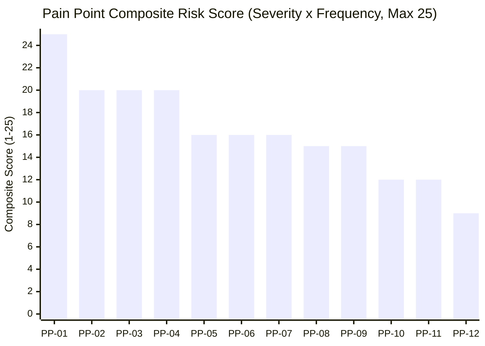
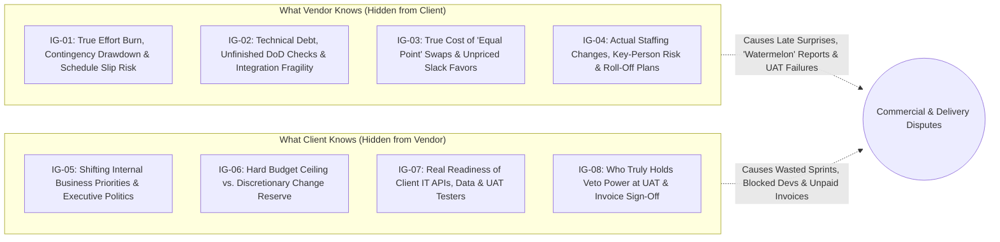

# 03 — Pain Points and Information Gaps

[Analysis Index](README.md) · Previous: [02 — User Needs by SDLC Phase](02-user-needs-by-sdlc-phase.md) · Next: [04 — Workarounds, Tools, and Opportunities](04-workarounds-tools-and-opportunities.md)

**Provenance Summary:** Pain points synthesize the 16 failure patterns in [`docs/research/09-lessons-learned-and-pitfalls.md`](../09-lessons-learned-and-pitfalls.md) `[Evidence: Existing Research]`, empirical benchmarks from WorldCC/IACCM (`~9%` contract value erosion; `40%` of disputes from unclear scope) and PMI *Pulse of the Profession* (`34%–52%` of projects hit by scope creep) `[Evidence: External Source]`, and practitioner discussions on `r/projectmanagement`, `r/scrum`, and InfoQ `[Evidence: External Source]`. The Severity × Frequency rankings (`1–5` scale) and Information Asymmetry Map are structured analytical syntheses `[PM/UX Inference]`.

---

## 1. Pain Points Ranked by Severity and Frequency

### Scoring Methodology (`[PM/UX Inference]`)

* **Severity (`1–5`):** Commercial, schedule, and relationship damage when the pain point occurs (`5 = Severe margin loss >10%, payment freeze, or contract dispute`; `3 = Multi-day rework and sprint slip`; `1 = Minor administrative annoyance`).
* **Frequency (`1–5`):** How often the issue occurs across fixed-price Agile outsourcing engagements based on industry studies and practitioner reports (`5 = Nearly universal / >50% of projects`; `3 = Common / 25–50%`; `1 = Rare`).
* **Priority Score:** $\text{Score} = \text{Severity} \times \text{Frequency}$ (Max = `25`).

### Master Ranked Pain-Point Table

| Rank & ID | Pain Point | Sev (1–5) | Freq (1–5) | Score | Primary Phases | Who Hurts Most | Evidence & Root Cause |
|---|---|---:|---:|---:|---|---|---|
| **#1 (`PP-01`)** | **Micro-Scope Creep vs. Fixed Budget ("Death by 1,000 Clarifications")** | 5 | 5 | **25** | Sprints, UAT | Vendor PM, Vendor BA, Delivery Team | PMI *Pulse* reports **34%–52%** of projects suffer scope creep (`[Evidence: External Source]` — [PMI](https://www.pmi.org/learning/thought-leadership/pulse)); WorldCC attributes **2%–3% of total contract value leakage** directly to unrecorded scope changes (`[Evidence: External Source]` — [WorldCC](https://www.worldcc.com)). In Scrum, scope creeps invisibly during refinement and Sprint Reviews when small additions enter Jira stories without updating the baseline (`[Evidence: Existing Research]` — [`05-scope-and-change-management.md`](../05-scope-and-change-management.md)). |
| **#2 (`PP-02`)** | **Ambiguous Baseline & Unclear Acceptance Criteria (Defect vs. CR Battles)** | 5 | 4 | **20** | Contracting, Sprints, UAT | Both Sides (Vendor PM/BA, Client PO/UAT) | WorldCC identifies unclear scope/goals as the **#1 cause of contract disputes (~40% of projects)** (`[Evidence: External Source]` — [WorldCC](https://www.worldcc.com)). During UAT, clients log missing workflows as "bugs" while vendors reject them as "paid enhancements" because baseline `B1.0` lacked concrete Given/When/Then examples (`[Evidence: Existing Research]` — [`09-lessons-learned-and-pitfalls.md`](../09-lessons-learned-and-pitfalls.md); `[Evidence: External Source]` — [`r/projectmanagement`](https://www.reddit.com/r/projectmanagement/)). |
| **#3 (`PP-03`)** | **Change Request (CR) Friction & Adversarial Scope-Swap Negotiation** | 4 | 5 | **20** | Sprints, UAT | Client PO, Vendor PM | Clients feel betrayed by heavy CR paperwork in an "Agile" project (*"Why are you charging me for changing my mind?"*), while vendors fear free swaps where an "equal 8-point story" hides massive integration/regression cost (`[Evidence: Existing Research]` — [`01-overview.md`](../01-overview.md), [`05-scope-and-change-management.md`](../05-scope-and-change-management.md); `[Evidence: External Source]` — [Fowler, *Fixed Scope Mirage*](https://martinfowler.com/bliki/FixedScopeMirage.html)). |
| **#4 (`PP-04`)** | **Estimate vs. Actual Burn Gap (Presales Optimism & Jira-to-Finance Disconnect)** | 5 | 4 | **20** | Presales, Sprints | Vendor PM, Delivery Team | Sales quotes a fixed price before testing integration assumptions or equates story points to a fixed hourly tariff (`[Evidence: Existing Research]` — [`02-pre-sales-and-contracting.md`](../02-pre-sales-and-contracting.md); `[Evidence: External Source]` — [Cohn, 2024](https://www.mountaingoatsoftware.com/agile/dont-equate-story-points-to-hours)). Because Jira tracks points/tasks while finance tracks money in Excel, overruns (`CPI = 0.857`, `EAC = $161k vs. $138k BAC` in *Atlas*) are discovered too late (`[Evidence: External Source]` — [`r/projectmanagement`](https://www.reddit.com/r/projectmanagement/)). |
| **#5 (`PP-05`)** | **Client PO Unavailability & The "Proxy PO" Decision Bottleneck** | 4 | 4 | **16** | Discovery/Sprint 0, Sprints | Vendor BA, Delivery Team | Offshore time zones (`2–3h` London–Vietnam overlap) and busy Client POs leave questions unanswered for days (`[Evidence: Existing Research]` — [`07-offshore-communication.md`](../07-offshore-communication.md)). The Vendor Proxy BA lacks authority to change scope (`[Evidence: External Source]` — [Overeem, Scrum.org](https://www.scrum.org/resources/blog/product-owner-proxy)), so the team either stalls or guesses—causing rework (`R-02: up to $6,000 exposure` in *Atlas*). |
| **#6 (`PP-06`)** | **UAT Bottlenecks, Late Redesigns & Sign-Off Delays** | 4 | 4 | **16** | UAT/Acceptance | Vendor PM, Client QA/UAT, Client Sponsor | Senior client stakeholders often inspect the software seriously for the first time in Week 14 UAT (`[Evidence: External Source]` — [`r/scrum`](https://www.reddit.com/r/scrum/)). Untrained or unavailable UAT testers (`R-04`), missing production-like data, and silent review windows stall the `$45,000` UAT milestone while the vendor team continues burning payroll (`[Evidence: Existing Research]` — [`03-sdlc-phases.md`](../03-sdlc-phases.md)). |
| **#7 (`PP-07`)** | **Milestone & Invoice Disputes ("Great Demo $\neq$ Approved Invoice")** | 4 | 4 | **16** | Sprints, UAT, Release | Vendor PM, Client Sponsor/Finance | Vendors treat an enthusiastic Sprint Review demo as milestone acceptance and issue an invoice; Client Finance rejects the invoice because formal acceptance criteria or conditional defect dispositions were never signed (`[Evidence: Existing Research]` — [`04-scrum-operating-model.md`](../04-scrum-operating-model.md), [`09-lessons-learned-and-pitfalls.md`](../09-lessons-learned-and-pitfalls.md)). |
| **#8 (`PP-08`)** | **Low Client Visibility into Real Progress ("Watermelon Status Reports")** | 5 | 3 | **15** | Sprints, UAT | Client PO, Client Sponsor | Reports show "80% of stories Done" (Green on the outside) while unintegrated APIs, deferred QA/security checks, and rising scope lines hide a 3-week schedule slip (Red on the inside) (`[Evidence: Existing Research]` — [`05-scope-and-change-management.md`](../05-scope-and-change-management.md), [`09-lessons-learned-and-pitfalls.md`](../09-lessons-learned-and-pitfalls.md)). |
| **#9 (`PP-09`)** | **Late Client Dependencies & Blocked-Team Cost Absorption** | 5 | 3 | **15** | Discovery/Sprint 0, Sprints | Vendor PM, Delivery Team | Client IT delivers API credentials or test data 2 weeks late (`R-01` in *Atlas*). The vendor's fixed-price team still costs `$7,500+/week` in payroll, yet SOW assumption clauses are rarely linked to operational blocker timestamps—forcing the vendor to eat the idle/re-sequencing cost (`[Evidence: Existing Research]` — [`02-pre-sales-and-contracting.md`](../02-pre-sales-and-contracting.md), [`06-risk-quality-and-governance.md`](../06-risk-quality-and-governance.md)). |
| **#10 (`PP-10`)** | **Presales-to-Delivery Handover Amnesia** | 4 | 3 | **12** | Contracting, Discovery/Sprint 0 | Vendor PM, Delivery Team, Client PO | Sales/Account executives promise verbal inclusions or aggressive timelines to win the bid, then hand over a thin SOW PDF to a delivery team that wasn't in the room (`[Evidence: External Source]` — [WorldCC](https://www.worldcc.com); `[Evidence: Existing Research]` — [`09-lessons-learned-and-pitfalls.md`](../09-lessons-learned-and-pitfalls.md)). |
| **#11 (`PP-11`)** | **Deferred Quality & Hidden Technical Debt ("Stabilization Death March")** | 4 | 3 | **12** | Sprints, UAT, Release | Delivery Team, Client QA/UAT | Under fixed-date pressure, teams mark stories `Done` without integration, security, or negative-path testing. Stabilization (`Weeks 14–15`) turns into an unbudgeted bug-fixing crisis (`[Evidence: Existing Research]` — [`04-scrum-operating-model.md`](../04-scrum-operating-model.md), [`06-risk-quality-and-governance.md`](../06-risk-quality-and-governance.md)). |
| **#12 (`PP-12`)** | **Warranty Abuse & Incomplete Operational Handover** | 3 | 3 | **9** | Release, Warranty/Handover | Vendor PM, Client Ops/QA | Clients file new feature requests as "warranty bugs" after go-live, or vendor engineers leave without transferring deployment keys and backup runbooks—blocking the final `$18,000` (`M5`) milestone (`[Evidence: Existing Research]` — [`03-sdlc-phases.md`](../03-sdlc-phases.md), [`09-lessons-learned-and-pitfalls.md`](../09-lessons-learned-and-pitfalls.md)). |

---

## 2. Bi-Directional Information Gaps (Information Asymmetry Map)

In fixed-price outsourcing, vendor and client teams operate across an **information firewall** (`[User Assumption]`; `[Evidence: Existing Research]` — [`05-scope-and-change-management.md`](../05-scope-and-change-management.md)). Some opacity is intentional (e.g., vendor internal cost rates and profit margins), but **accidental or structural information gaps** destroy trust and cause late escalations.

### 2.1 What the Vendor Knows That the Client Lacks (`IG-01` to `IG-04`)

| Gap ID | What Vendor Knows | What Client Sees Instead | Exact Moment in SDLC | Consequence of the Asymmetry | How the Product Should Bridge It (`[PM/UX Inference]`) |
|---|---|---|---|---|---|
| **`IG-01`** | **True Delivery Velocity vs. Baseline Forecast:** At Sprint 3 of *Atlas*, cumulative output is `54/120 pts` (`18 pts/sprint`), meaning `66 remaining pts` will take `3.67 sprints` instead of the `3 planned sprints`, and internal cost `EAC` is `$132k–$161k` against a `$138k` budget (`[Evidence: Existing Research]` — [`05-scope-and-change-management.md`](../05-scope-and-change-management.md)). | A polite weekly email saying *"Sprint 3 completed; 16 points delivered; status Green/Amber"* or a raw Jira board with no baseline burn-up projection. | Mid-Delivery (**Sprints 2–4**), when there is still time to swap scope or resolve bottlenecks. | By the time the vendor admits in Sprint 5 that the date will slip, the client can no longer adjust scope gracefully—turning a collaborative trade-off into an executive escalation (`[Evidence: Existing Research]` — [`09-lessons-learned-and-pitfalls.md`](../09-lessons-learned-and-pitfalls.md)). | Expose a shared **Client-Safe Release Burn-up & Milestone Confidence Forecast** (showing baseline scope, approved changes, Done trend, and projected completion range) while keeping internal `$` cost/margin private to the vendor. |
| **`IG-02`** | **Actual Quality & Integration State (`DoD` vs. "Demo-ware"):** Developers know a demonstrated story used a mocked API, skipped permission checks, or has 4 open QA bugs (`[Evidence: Existing Research]` — [`06-risk-quality-and-governance.md`](../06-risk-quality-and-governance.md)). | A slick live screen-share during Sprint Review where the happy path works (`[Evidence: Existing Research]` — [`09-lessons-learned-and-pitfalls.md`](../09-lessons-learned-and-pitfalls.md)). | **Sprint Reviews** (`Weeks 3–13`) and **Entry to UAT** (`Week 14`). | Client believes features are 100% finished; when they enter UAT, basic negative paths fail, destroying confidence and causing UAT rejection. | Display explicit **Evidence Badges** on every Story and Milestone slice: `Code Merged`, `Automated Tests Passed`, `QA Verified`, `Integration Live vs. Mocked`, and `Open Defects by Severity`. |
| **`IG-03`** | **Cumulative Impact of "Small Clarifications" & Swaps:** The vendor BA/tech lead knows that 15 "minor" Slack adjustments and a "point-neutral" swap added 120 hours of regression and database rework (`[Evidence: Existing Research]` — [`05-scope-and-change-management.md`](../05-scope-and-change-management.md)). | Client PO believes they only asked for routine Agile clarifications within the original vision (`[Evidence: External Source]` — [`r/scrum`](https://www.reddit.com/r/scrum/)). | **Backlog Refinement** & **Mid-Sprint clarifications** (`Weeks 2–12`). | Vendor margin evaporates silently until the Vendor PM suddenly becomes rigid and defensive, rejecting every tiny client request in later sprints. | Track a transparent **Scope Movement & Clarification Ledger** showing baseline `B1.0` items, net point/effort deltas, and non-point impacts (DB, API, QA regression) before a swap is confirmed. |
| **`IG-04`** | **Key-Person Dependency & Staffing Shifts:** Only one senior engineer knows the deployment script (`R-03` in *Atlas*), or a senior dev is being rotated off after Sprint 4 (`[Evidence: Existing Research]` — [`06-risk-quality-and-governance.md`](../06-risk-quality-and-governance.md)). | Client assumes the full team pitched in Presales is cross-functional and stable through Warranty. | **Late Sprints, Release & Handover** (`Weeks 10–16`). | Velocity drops mid-project or production handover stalls (`Scenario C` in [`09-lessons-learned-and-pitfalls.md`](../09-lessons-learned-and-pitfalls.md)). | Require verifiable **Operational Readiness & Handover Checklists** with named primary/backup owners and rehearsal evidence before Milestone `M5`. |

---

### 2.2 What the Client Knows That the Vendor Lacks (`IG-05` to `IG-08`)

| Gap ID | What Client Knows | What Vendor Sees Instead | Exact Moment in SDLC | Consequence of the Asymmetry | How the Product Should Bridge It (`[PM/UX Inference]`) |
|---|---|---|---|---|---|
| **`IG-05`** | **Shifting Internal Business Priorities & Hidden Stakeholders:** Client executives just pivoted strategy (e.g., SMS notifications are now mandatory for a Q4 campaign, while CSV export is no longer needed), or a VP who hasn't attended any Sprint Review has strong UI opinions (`[Evidence: External Source]` — [`r/projectmanagement`](https://www.reddit.com/r/projectmanagement/)). | Vendor team keeps building Baseline `B1.0` stories in original SOW order, unaware that half the sprint's work is now low value or will be vetoed by an absent VP. | **Sprints 1–5** and **UAT entry** (`Week 14`). | Vendor spends `$20,000+` of engineering capacity building low-priority baseline features, followed by a painful late CR (`CR-02`) in UAT when the schedule has zero slack (`[Evidence: Existing Research]` — [`09-lessons-learned-and-pitfalls.md`](../09-lessons-learned-and-pitfalls.md)). | Prompt the Client PO before every Sprint Planning to **re-confirm Business Value Priority** and surface **Stakeholder Reviewer Coverage** (highlighting if a named UAT/Sponsor stakeholder hasn't reviewed recent slices). |
| **`IG-06`** | **True Commercial Envelope & Change Appetite:** Whether the `$180,000` contract is an absolute hard cap with zero extra budget, or whether the Sponsor holds an internal `$20,000` change reserve for high-ROI additions. | Vendor either wastes days writing priced CR proposals that the Client PO can never get funded, or avoids proposing valuable enhancements the Sponsor would gladly buy. | **Presales, Contracting & Mid-Sprint CR Triage**. | Friction and wasted estimation effort on dead-on-arrival CRs; missed upsell or scope-swap opportunities. | Support an explicit **Contract Commercial Mode & Optional Change Pool** setting on the project (e.g., *Strict Cap — Swap Only* vs. *Pre-Authorized Change Pool of $X / N hours*). |
| **`IG-07`** | **Real Readiness of Client Dependencies (IT APIs, Data, UAT Staff):** Client IT knows the legacy ERP API won't be ready until Sprint 4, or that the named UAT testers are booked on a year-end audit during Weeks 14–15 (`R-01`, `R-04` in [`06-risk-quality-and-governance.md`](../06-risk-quality-and-governance.md)). | Vendor schedules API integration into Sprint 2 and books UAT for Week 14 based on optimistic kickoff promises. | **Inception (`Week 1`)** and **2 weeks prior to dependent Sprints / UAT**. | Developers pull blocked stories into Sprint 2 and sit idle; UAT sits unexecuted in Week 14 while milestone billing freezes (`[Evidence: Existing Research]` — [`03-sdlc-phases.md`](../03-sdlc-phases.md)). | Treat **Client Dependencies & UAT Readiness** as first-class gated objects with automated countdown reminders (e.g., `T-5 business days before Sprint 2 Planning`) and explicit `Verified Working` vs. `Pending` status. |
| **`IG-08`** | **True Approval & Payment Chain:** Even after the Client PO clicks "Approve" on a deliverable, InfoSec, Legal, or Accounts Payable has an undocumented 3-step internal sign-off before an invoice is paid. | Vendor PM assumes the Client PO's sign-off means cash will arrive in 15 days (`[Evidence: Existing Research]` — [`04-scrum-operating-model.md`](../04-scrum-operating-model.md)). | **Milestone Acceptance (`M1–M5`)** & **Invoicing**. | Unexpected cash-flow delays, disputed invoice rejections, and friction over who had legal authority to sign (`[Evidence: Existing Research]` — [`08-templates-and-checklists.md`](../08-templates-and-checklists.md)). | Enforce a role-verified **Authority Matrix** at project setup that maps specific users to `Requirement Approver`, `Milestone/UAT Acceptor`, `Contract/CR Signatory`, and `Invoice Approver`. |

---

## Sources for Chapter 03

1. Project Management Institute (PMI), [*Pulse of the Profession®*](https://www.pmi.org/learning/thought-leadership/pulse) (2018–2023 editions) and [*Requirements Management: Core Competency for Project and Program Success*](https://www.pmi.org/learning/thought-leadership/pulse/core-competency-project-program-success), August 2014 — empirical scope creep frequency (34%–52%) and requirements-related failure rates. Accessed 2026-11-07.
2. World Commerce & Contracting (WorldCC / IACCM), [*Poor Contract Management Costs Companies 9% — Bottom Line*](https://www.worldcc.com) — value leakage breakdown (8.6%–9.2% total erosion; ~40% of disputes from unclear scope; 2%–3% direct leakage from unrecorded changes). Accessed 2026-11-07.
3. Martin Fowler, [*Fixed Scope Mirage*](https://martinfowler.com/bliki/FixedScopeMirage.html) — why fixed-scope/fixed-price contracts incentivize adversarial change requests. Accessed 2026-11-07.
4. Barry Overeem, [*The Product Owner Proxy*](https://www.scrum.org/resources/blog/product-owner-proxy), Scrum.org — authority gaps and decision latency in proxy PO models. Accessed 2026-11-07.
5. Mike Cohn, [*Don't Equate Story Points to Hours*](https://www.mountaingoatsoftware.com/agile/dont-equate-story-points-to-hours), Mountain Goat Software — estimation vs. commercial burn mismatch. Accessed 2026-11-07.
6. Practitioner Community Discussions: [`r/projectmanagement`](https://www.reddit.com/r/projectmanagement/), [`r/scrum`](https://www.reddit.com/r/scrum/), and [`r/businessanalysis`](https://www.reddit.com/r/businessanalysis/) — recurring field reports on UAT scope creep, Jira-to-Excel burn disconnect, and watermelon status reporting. Accessed 2026-11-07.
7. Repository Research: [`01-overview.md`](../01-overview.md), [`02-pre-sales-and-contracting.md`](../02-pre-sales-and-contracting.md), [`04-scrum-operating-model.md`](../04-scrum-operating-model.md), [`05-scope-and-change-management.md`](../05-scope-and-change-management.md), [`06-risk-quality-and-governance.md`](../06-risk-quality-and-governance.md), [`07-offshore-communication.md`](../07-offshore-communication.md), and [`09-lessons-learned-and-pitfalls.md`](../09-lessons-learned-and-pitfalls.md).
