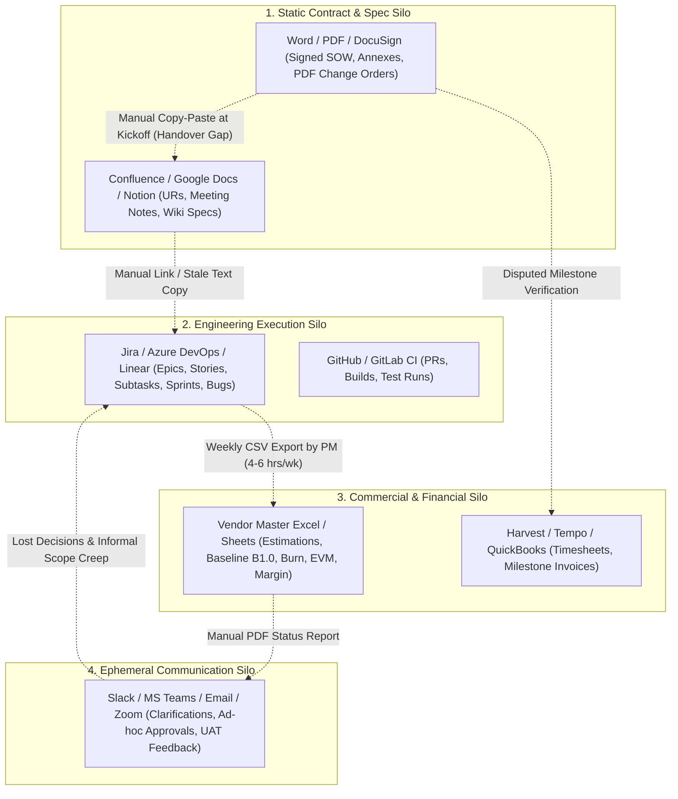

# 04 — Current Workarounds, Tools, and Opportunities

[Analysis Index](README.md) · Previous: [03 — Pain Points and Information Gaps](03-pain-points-and-information-gaps.md) · Next: [05 — Product SDLC Definition and Flows](05-product-sdlc-definition-and-flows.md)

**Provenance Summary:** Toolchain breakdown analysis combines [`docs/research/07-offshore-communication.md`](../07-offshore-communication.md) and [`docs/product.md`](../../product.md) `[Evidence: Existing Research]` with practitioner evidence from `r/projectmanagement`, `r/ProductManagement`, WorldCC, and GitLab/Atlassian guidance `[Evidence: External Source]`. The *"How Might We..."* (`HMW-01` to `HMW-12`) statements and candidate product capabilities are synthesized UX/product discovery outputs `[PM/UX Inference]`.

---

## 1. The Fragmented Multi-Tool Reality in Outsourcing Agencies

Because no mainstream tool natively connects **fixed-price commercial baselines** with **Agile Scrum execution** and **client-safe governance**, software outsourcing agencies and their clients stitch together 5 to 7 disconnected tools (`[Evidence: Existing Research]` — [`docs/product.md`](../../product.md); `[Evidence: External Source]` — [`r/projectmanagement`](https://www.reddit.com/r/projectmanagement/)).

---

## 2. Where Each Current Tool & Workaround Breaks Down and Why

| Tool / Workaround | What Teams Use It For Today | Where and Why It Breaks Down in Fixed-Price Scrum | Pain Points & Info Gaps Triggered |
|---|---|---|---|
| **1. Jira / Azure DevOps / Linear** | Managing Product Backlog, Sprint boards, story points, developer subtasks, and bug tickets (`[Evidence: External Source]` — [Atlassian](https://confluence.atlassian.com/jirasoftwarecloud/burnupchart-945124716.html)). | • **No native concept of a Frozen Contractual Baseline (`B1.0`):** Anyone with backlog edit rights can edit a story description, split a story and inflate points, or add a ticket without triggering a commercial baseline diff (`[Evidence: Existing Research]` — [`05-scope-and-change-management.md`](../05-scope-and-change-management.md)). • **All-or-Nothing Client Permissions:** Giving a Client PO direct Jira access exposes raw developer subtasks, internal bug debates, and unvetted estimates; withholding Jira access leaves the client blind (`[Evidence: External Source]` — [`r/projectmanagement`](https://www.reddit.com/r/projectmanagement/)). • **`Done` Column Conflation:** Moving a card to `Done` in Jira does not distinguish `Dev Complete`, `DoD Passed`, `Client Accepted`, or `Milestone Paid` (`[Evidence: Existing Research]` — [`04-scrum-operating-model.md`](../04-scrum-operating-model.md)). | `PP-01`, `PP-04`, `PP-07`, `PP-08`, `IG-01`, `IG-02` |
| **2. Excel / Google Sheets ("The PM's Shadow Ledger")** | Pre-sales WBS estimation, story-point-to-hour reconciliation, tracking original baseline `B1.0` vs. current backlog, calculating EVM (`PV/EV/AC/EAC`), and tracking UAT test scripts (`[Evidence: External Source]` — [`r/projectmanagement`](https://www.reddit.com/r/projectmanagement/)). | • **Immediately Stale & Error-Prone:** The Vendor PM spends 4–6 hours every Friday exporting Jira CSVs and timesheets into Excel formulas (`[Evidence: External Source]` — [`r/projectmanagement`](https://www.reddit.com/r/projectmanagement/)). • **Zero Live Traceability:** When a developer splits Story `ATLAS-41` in Jira or a BA updates AC in Confluence, the Excel baseline row silently drifts out of sync. • **Version Chaos in UAT:** Emailing `Atlas_UAT_Tracker_v7_FINAL_client.xlsx` back and forth loses build hashes, screenshots, and immutable sign-off timestamps. | `PP-01`, `PP-04`, `PP-06`, `PP-08`, `IG-01`, `IG-03` |
| **3. Confluence / Notion / Google Docs / Word** | Writing the SOW, User Requirements (`UR`), Functional Specs (`FR`), Architecture notes, Change Request forms, and Sprint Reports (`[Evidence: Existing Research]` — [`08-templates-and-checklists.md`](../08-templates-and-checklists.md)). | • **Dead Text vs. Living Execution:** Updating a Confluence page does not automatically flag dependent Jira stories as "Specification Changed — Re-estimate Required." • **Page-Level, Not Revision-Bound Approvals:** A comment saying *"LGTM"* on a 20-page Confluence doc does not prove which exact requirement version was approved, by which authorized signatory, under which commercial baseline (`[Evidence: Existing Research]` — [`docs/product.md`](../../product.md)). • **Heavy Bureaucracy for CRs:** Writing a 4-page Word Change Request for a simple 8-point Scope Swap takes longer than building the feature, tempting teams to skip the process (`[Evidence: External Source]` — [`r/scrum`](https://www.reddit.com/r/scrum/)). | `PP-02`, `PP-03`, `PP-10`, `IG-03`, `IG-08` |
| **4. Email / Slack / MS Teams / Zoom** | Daily offshore Q&A, clarifying edge cases, sharing demo recordings, chasing UAT sign-offs, and escalating blockers (`[Evidence: Existing Research]` — [`07-offshore-communication.md`](../07-offshore-communication.md)). | • **Ephemeral Decisions & "Shadow Commitments":** A client stakeholder writes *"Can we also send an SMS here?"* in Slack; a developer replies *"Sure, easy"*—creating an unpriced scope addition with no baseline check (`[Evidence: Existing Research]` — [`09-lessons-learned-and-pitfalls.md`](../09-lessons-learned-and-pitfalls.md)). • **No SLA Timer or Blocker Impact:** Questions buried in a busy Slack channel have no `Required-By` countdown or link to the affected Sprint/Milestone, so delays go unrecorded until the sprint fails (`[Evidence: Existing Research]` — [`07-offshore-communication.md`](../07-offshore-communication.md)). • **Disputed Sign-Offs:** Email approvals lack structured bindings to a specific build artifact, test result set, and conditional defect list. | `PP-01`, `PP-05`, `PP-07`, `PP-09`, `IG-05`, `IG-07` |
| **5. Time-Tracking & Invoicing / PSA Tools (Harvest, Tempo, ERP)** | Logging developer hours against cost centers and issuing PDF milestone invoices (`M1–M5`) to Client Accounts Payable (`[Evidence: External Source]` — [`r/ProductManagement`](https://www.reddit.com/r/ProductManagement/)). | • **Hours Logged $\neq$ Value Earned:** A developer logging 40 hours in Tempo shows cost incurred (`AC`), not whether the deliverable package actually passed `DoD` (`EV`) (`[Evidence: Existing Research]` — [`05-scope-and-change-management.md`](../05-scope-and-change-management.md); `[Evidence: External Source]` — [Lukas, PMI 2012](https://www.pmi.org/learning/library/make-earned-value-work-project-6001)). • **Disconnected from Acceptance Evidence:** Finance generates an invoice based on a calendar date (`Week 5`) rather than an immutable `Milestone Accepted` certificate—leading to rejected invoices and cash-flow delays (`[Evidence: Existing Research]` — [`02-pre-sales-and-contracting.md`](../02-pre-sales-and-contracting.md)). | `PP-04`, `PP-07`, `IG-01`, `IG-08` |

---

## 3. Opportunities: From Pain Points & Gaps to "How Might We..." (`HMW`) & Product Capabilities

Every top pain point (`PP-01` to `PP-12`) and information gap (`IG-01` to `IG-08`) translates directly into a **"How Might We..." (HMW)** design challenge and a concrete **Candidate Product Capability** `[PM/UX Inference]`:

| Opportunity ID | Linked Pain Points & Gaps | "How Might We..." (HMW) Statement | Candidate Product Capability | Target Personas Served |
|---|---|---|---|---|
| **`HMW-01`** | `PP-01`, `PP-02`, `IG-03` | **How might we** allow the backlog to evolve iteratively during Scrum refinements while keeping the signed contractual baseline (`B1.0`) immutable and visibly distinct? | **Versioned Scope Baseline & Live Diff Engine:** Snapshot agreed URs, Features, Stories, and AC into numbered Baselines (`B1.0`, `B1.1`). Any new or modified backlog item automatically displays its baseline status badge (`Baselined B1.0`, `Refined within Envelope`, `Candidate Swap`, `Pending CR`, `Out of Scope`). | Vendor PM, Vendor BA, Client PO, Client Sponsor |
| **`HMW-02`** | `PP-03`, `IG-03`, `IG-05`, `IG-06` | **How might we** make trading an unstarted baseline feature for a newly discovered higher-value feature take 5 minutes instead of a 5-page legal battle—without hiding technical risk? | **Guided Scope-Swap Calculator & 1-Click Trade-Off Workflow:** Side-by-side swap workbench where the Client PO selects an *Unstarted Baseline Item* to drop and a *Candidate Item* to add. The system requires the Vendor Team to check 5 equivalence dimensions (*Effort/Points, Sunk Design Cost, DB/API Impact, QA Regression, Mandatory SOW Obligation*) before both sides sign off a $0 price-neutral baseline update. | Client PO, Vendor PM, Vendor BA, Delivery Team |
| **`HMW-03`** | `PP-01`, `PP-02`, `PP-06`, `IG-03` | **How might we** eliminate arguments over whether a client request or UAT finding is a "clarification," a "bug," or a "paid change request"? | **Structured Request Classification & Triage Gate:** Every client question, refinement edit, or UAT finding passes through an explicit classification gate (*Clarification / Defect / Enhancement / Scope Swap / Disputed*) linked directly to the exact `B1.0` UR/AC version. Disputed items can proceed or pause under an explicit escalation timer without blocking unrelated sprint work. | Vendor BA, Client PO, Client QA/UAT, Vendor PM |
| **`HMW-04`** | `PP-04`, `PP-08`, `IG-01` | **How might we** give the Client PO and Sponsor honest, real-time visibility into release progress and scope movement without exposing the vendor's internal hourly cost rates, contingency, or profit margin? | **Dual-Ledger Financial & Burn-Up Intelligence:** A single underlying delivery engine that renders two role-scoped views: 1. **Client Portal View:** Release burn-up chart (`Baseline` vs. `Authorized Scope` vs. `Done`), milestone readiness confidence, and commercial contract ledger (`$180k` contract, approved CRs, accepted/invoiced milestones). 2. **Vendor Internal View:** Live `PV / EV / AC`, `CPI / SPI`, bottom-up vs. trend `EAC` (`$132k` vs. `$161k`), `$18k` contingency drawdown, and projected margin (`$48k`). | Vendor PM, Client PO, Client Sponsor |
| **`HMW-05`** | `PP-05`, `PP-09`, `IG-07` | **How might we** prevent offshore time-zone gaps, unavailable Client POs, and late client IT dependencies from silently burning vendor sprint capacity? | **SLA-Backed Decision Queue & Client Dependency Tracker:** Dedicated **Decision Request** cards (`Context, Options A/B, Vendor Recommendation, Impacted Stories/Milestone, Required-By Timestamp in both time zones, Deputy Auto-Escalation`). Paired with gated **Client Dependency** items (e.g., *API Sandbox due T-5d before Sprint 2*) that log automatic schedule-impact evidence if missed. | Vendor BA, Client PO, Vendor PM, Delivery Team |
| **`HMW-06`** | `PP-07`, `PP-11`, `IG-02`, `IG-08` | **How might we** clearly separate engineering completion (`DoD`), Sprint Review feedback, formal Milestone/UAT acceptance, Production Release, and Invoice eligibility? | **Multi-Stage Evidence & Sign-Off State Machine:** Distinct, non-collapsible state tracks on every deliverable slice: `DoD Verified (Internal)` → `Demonstrated in Sprint Review` → `Submitted for Milestone/UAT Acceptance (5-day review timer)` → `Accepted / Conditionally Accepted (by authorized signatory)` → `Invoice Eligible`. | All 6 Personas |
| **`HMW-07`** | `PP-06`, `PP-11`, `IG-02` | **How might we** turn Stabilization & UAT from a chaotic Week 14 surprise into a structured, scenario-driven verification of already-tested increments? | **Traceable UAT Workspace & Conditional Acceptance Ledger:** Auto-generate the UAT test suite from baselined `UR`/`AC` scenarios; link every test run to a locked Release Candidate build; enforce a live **5-business-day review clock**; and support **Conditional Acceptance** where minor defects are bound to explicit fix dates and owners without blocking milestone sign-off. | Client QA/UAT, Delivery Team, Vendor PM, Client Sponsor |
| **`HMW-08`** | `PP-04`, `PP-10` | **How might we** stop presales teams from quoting fixed prices on untested assumptions and ensure zero context is lost when handing the deal over to delivery? | **Presales Discovery-to-Baseline Continuity:** Capture presales range estimates, technical spike findings, priced assumptions, exclusions, and risk allowances directly inside the project workspace so the signed proposal converts 1:1 into **Baseline `B1.0`**, the **Risk Register**, and the **Kickoff Checklist**. | Vendor PM, Vendor BA, Delivery Team, Client Sponsor |
| **`HMW-09`** | `PP-05`, `IG-05` | **How might we** empower the Vendor Proxy BA to keep developers unblocked daily without overstepping into unauthorized commercial commitments? | **Configurable Proxy Delegation Guardrails:** Define explicit project-level rules for what the Proxy BA can accept autonomously (e.g., UI copy, field validation rules with `0 pt` net delta) vs. what automatically triggers a Client PO approval or Commercial CR gate. | Vendor BA, Client PO, Vendor PM |
| **`HMW-10`** | `PP-12`, `IG-04` | **How might we** protect both sides at project closure—ensuring the client gets operable systems and warranty fixes, while the vendor isn't trapped in unpaid infinite maintenance? | **Gated Handover Checklist & 30-Day Warranty Triage Desk:** Tie final Milestone `M5` (`10%`) to verified handover exercises (live backup restore, credential transfer, runbook sign-off). Start an automated **30-calendar-day Warranty Clock** at production release that separates covered baseline defects (free repair) from new enhancements (routed to a Phase 2 / Maintenance quote). | Vendor PM, Client QA/Ops, Client Sponsor, Delivery Team |
| **`HMW-11`** | `PP-08`, `IG-01`, `IG-05` | **How might we** surface early warnings of schedule slip, scope creep, or bottlenecked reviewers before they become Steering Committee crises? | **Explainable Delivery Risk & Blocker Intelligence:** Rule-based detectors (with optional AI narrative synthesis per [`docs/product.md`](../../product.md)) that flag objective conditions—such as *Throughput < Required Baseline Burn Rate*, *Decision Queue SLA Breached > 48h*, *Untested UAT Dependency*, or *Repeated Story Splits Increasing Scope*—and propose concrete recovery options. | Vendor PM, Client PO, Delivery Team |
| **`HMW-12`** | `PP-07`, `IG-08` | **How might we** eliminate invoice rejections and shorten payment cycles (`DSO`) after a milestone is delivered? | **Evidence-Backed Milestone Invoice Packet Generator:** When an authorized Client Acceptor signs off a Milestone (`M1–M5`), automatically compile an immutable **Audit Packet** (Signed Acceptance Certificate + Baseline Version + Passed Test Evidence + Approved CR adjustments) attached directly to the Invoice record for Client Finance. |Client Sponsor/Finance, Vendor PM |

---

## Sources for Chapter 04

1. Atlassian, [*Burnup Chart*](https://confluence.atlassian.com/jirasoftwarecloud/burnupchart-945124716.html) — capabilities and boundaries of standard issue-tracker burnup charts. Accessed 2026-11-07.
2. GitLab, [*GitLab Communication*](https://handbook.gitlab.com/handbook/communication/) and [*All-Remote Meetings*](https://handbook.gitlab.com/handbook/company/culture/all-remote/meetings/) — why ephemeral chat/calls must be anchored back into durable system records. Accessed 2026-11-07.
3. Joseph A. Lukas, [*How to make earned value work on your project*](https://www.pmi.org/learning/library/make-earned-value-work-project-6001), PMI Global Congress, 2012 — why time-sheet cost collection (`AC`) must be paired with objective package completion (`EV`) and controlled baselines. Accessed 2026-11-07.
4. Practitioner Community Evidence: [`r/projectmanagement`](https://www.reddit.com/r/projectmanagement/) and [`r/ProductManagement`](https://www.reddit.com/r/ProductManagement/) — field reports on the "Jira vs. Finance disconnect," weekly Excel reconciliation overhead, and multi-tool fragmentation. Accessed 2026-11-07.
5. Repository Research: [`04-scrum-operating-model.md`](../04-scrum-operating-model.md), [`05-scope-and-change-management.md`](../05-scope-and-change-management.md), [`07-offshore-communication.md`](../07-offshore-communication.md), [`08-templates-and-checklists.md`](../08-templates-and-checklists.md), and [`docs/product.md`](../../product.md).
