# 05 — Product SDLC Definition and End-to-End Flows

[Analysis Index](README.md) · Previous: [04 — Workarounds, Tools, and Opportunities](04-workarounds-tools-and-opportunities.md) · Next: [06 — Core Objects, Lifecycles, and Fixed-Price Rules](06-core-objects-lifecycles-and-fixed-price-rules.md)

**Provenance Summary:** This chapter defines the canonical end-to-end SDLC that the product must support (`[PM/UX Inference]`), grounded in the 7 phases from [`docs/research/02-pre-sales-and-contracting.md`](../02-pre-sales-and-contracting.md) and [`03-sdlc-phases.md`](../03-sdlc-phases.md) `[Evidence: Existing Research]`, reconciled with the confirmed workflow stages in [`docs/deliverypilot-workflow-discovery.md`](../../deliverypilot-workflow-discovery.md) `[Evidence: Existing Research]`, and tailored to fixed-price Agile outsourcing `[User Assumption]`.

> [!IMPORTANT]
> **Agile Iterations Inside Commercial Phase Gates:** As established in [`docs/product.md`](../../product.md) and [`docs/research/03-sdlc-phases.md`](../03-sdlc-phases.md), these seven phases represent **commercial decision gates and governance envelopes, not rigid Waterfall queues**. Discovery, requirement refinement, QA verification, and risk management run continuously across sprints.

---

## 1. End-to-End Product SDLC Architecture (Dual-Party Flow)

The diagram below shows how work moves from **Presales & Estimation** through **Warranty & Handover**, highlighting where **Vendor actions**, **Client actions**, and **Joint Commercial Gates (`G1–G7`)** intersect:

```mermaid
flowchart TD
    subgraph P1["Phase 1: Presales & Estimation"]
        V1["Vendor: Capture Brief, Run Feasibility Spikes, Build Range Estimate & Cost/Risk Model"]
        C1["Client: Supply Objectives, Constraints, Target Budget & Access for Spikes"]
        G1{"Gate G1: Commercial Model & Quote Viable?"}
        V1 --> G1
        C1 --> G1
    end

    subgraph P2["Phase 2: Contracting & Baseline (B1.0)"]
        V2["Vendor: Draft SOW Annexes, Candidate Baseline B1.0, Assumptions & Milestone Schedule (M1-M5)"]
        C2["Client: Review Scope, Exclusions, Authority Matrix & Commercial Terms"]
        G2{"Gate G2: Dual Sign-Off on SOW & Scope Baseline B1.0"}
        V2 --> G2
        C2 --> G2
    end

    subgraph P3["Phase 3: Discovery / Sprint 0 (Inception - M1)"]
        V3["Vendor: Setup Repos/CI, Refine Sprint 1-2 to DoR, Lock Delivery-Plan Baseline & Risk Register"]
        C3["Client: Provision API Sandboxes/Data, Confirm Deputies, Book UAT Users & Accept M1"]
        G3{"Gate G3: Inception M1 Accepted & Sprint 1 Ready?"}
        V3 --> G3
        C3 --> G3
    end

    subgraph P4["Phase 4: Development Sprints (Sprints 1-N & Interim Milestones M2, M3)"]
        S_PLAN["Sprint Planning (Pull DoR-Ready Baseline/Approved Items)"]
        S_EXEC["Daily Execution, Continuous QA & Async Decision Queue (48h SLA)"]
        S_CHANGE["Scope Control Loop: Classify Clarification vs. Swap vs. Paid CR"]
        S_REV["Sprint Review (Demo & Feedback) + Sprint Report & Burn-Up Update"]
        G4{"Gate G4: Interim Slice Acceptance (M2, M3) or Release Candidate Ready?"}
        S_PLAN --> S_EXEC
        S_EXEC <--> S_CHANGE
        S_EXEC --> S_REV
        S_REV --> G4
        G4 -->|"Next Sprint"| S_PLAN
    end

    subgraph P5["Phase 5: Stabilization & UAT (Milestone M4)"]
        V5["Vendor: Lock RC Build, Publish QA Evidence, Triage UAT Findings (Defect vs. CR), Hotfix"]
        C5["Client: Execute End-to-End UAT Scenarios within 5-Business-Day Window"]
        G5{"Gate G5: UAT Sign-Off (Accepted / Conditional M4)?"}
        V5 --> G5
        C5 --> G5
    end

    subgraph P6["Phase 6: Release & Go-Live"]
        V6["Vendor: Execute Deployment Runbook, Data Migration, Smoke Tests & Rollback Watch"]
        C6["Client: Authorize Go/No-Go Window, Verify Live Business Workflows"]
        G6{"Gate G6: Live Service Verified & Warranty Clock Started?"}
        V6 --> G6
        C6 --> G6
    end

    subgraph P7["Phase 7: Warranty & Handover (Milestone M5)"]
        V7["Vendor: Transfer Code/Keys/Runbooks, Observe Client Ops Rehearsal, Fix Covered Warranty Bugs"]
        C7["Client: Verify Operational Rehearsal, Accept Handover (M5) & Route Enhancements to Maintenance"]
        G7{"Gate G7: Handover Accepted (M5 Paid) & 30-Day Warranty Closed?"}
        V7 --> G7
        C7 --> G7
    end

    G1 -->|"Proceed to Build Contract"| P2
    G1 -->|"High Uncertainty: Run Paid Discovery First"| V1
    G2 --> P3
    G3 --> P4
    G4 -->|"All Baseline Slices Done & Integrated"| P5
    G5 -->|"Rejected: Fix Contractual Defects"| V5
    G5 -->|"Accepted / Conditional"| P6
    G6 --> P7
```



---

## 2. Master Phase Gate, Artifact & Dual-Side Approval Matrix

Every phase inside the product is governed by explicit **Entry Gates**, **Key Product Artifacts**, **Exit Gates**, **Vendor Actors**, and **Client Approvers** (`[Evidence: Existing Research]` — [`02-pre-sales-and-contracting.md`](../02-pre-sales-and-contracting.md), [`03-sdlc-phases.md`](../03-sdlc-phases.md), [`08-templates-and-checklists.md`](../08-templates-and-checklists.md); `[PM/UX Inference]`):

| Phase | Entry Criteria (System Gate) | Key Product Artifacts Created / Updated | Exit Criteria & Evidence Required | Vendor Action / Owner | Client Action / Approver |
|---|---|---|---|---|---|
| **1. Presales & Estimation** | • Opportunity / Draft Project created.<br>• Named Client Sponsor/PO and Vendor Engagement Lead.<br>• Problem statement & research questions logged. | • **Project Brief & Outcome Map**<br>• **Feasibility Spike Records**<br>• **Candidate Feature / UR List**<br>• **Dual Estimate Model:** Team Point/Sprint Range + Internal Cost/Risk Model (`$120k base + $18k contingency`)<br>• **Assumptions & Exclusions Ledger** | **Gate `G1`:**<br>• High-risk unknowns either spike-tested or priced as explicit assumptions.<br>• Role capacity reconciled with calendar.<br>• Proceed / Paid-Discovery / Reshape / Stop decision recorded. | **Acts:** Vendor BA (outcomes), Tech Lead (spikes/sizing), Vendor PM (cost model, risk reserve, quote).<br>**Approves Quote:** Vendor Commercial Lead. | **Acts:** Client PO & SMEs (workflows, API docs).<br>**Approves Next Step:** Client Sponsor (funds Discovery or moves to SOW). |
| **2. Contracting & Baseline** | • Gate `G1` passed.<br>• Commercial model selected (e.g., Fixed Price with Scope Swap).<br>• Draft baseline items mapped. | • **Digital SOW Summary & Commercial Envelope** (`$180,000`, 16 wks)<br>• **Locked Scope Baseline `B1.0`** (Versioned URs, Features, initial AC)<br>• **Milestone Schedule (`M1–M5`)** with evidence rules<br>• **Authority & Proxy Delegation Matrix** | **Gate `G2`:**<br>• Every baseline UR/Feature has a stable ID and version.<br>• Every Milestone (`M1–M5`) links to verifiable deliverables.<br>• Review SLA (`5 business days`) and payment terms (`15 days`) configured.<br>• Both parties sign `B1.0`. | **Acts:** Vendor PM & BA.<br>**Approves Contract:** Vendor Commercial Signatory. | **Acts:** Client PO (reviews scope/AC) & Client QA (reviews UAT rules).<br>**Approves Contract:** Client Sponsor / Procurement. |
| **3. Discovery / Sprint 0 (Inception)** | • Gate `G2` passed (`B1.0` locked).<br>• Project workspace provisioned and team assigned. | • **Kickoff Checklist** (15-item tracker)<br>• **Delivery-Plan Baseline** (Sprint 1–6 roadmap)<br>• **Refined Sprint 1–2 Backlog** (`DoR` passed)<br>• **DoD & Quality Plan**<br>• **Risk Register (`R-01`..`R-05`)**<br>• **Client Dependency Tracker** | **Gate `G3` (Milestone `M1: $36k`):**<br>• Walking-skeleton CI/CD & test environment verified.<br>• Sprint 1–2 stories pass `DoR` with Given/When/Then `AC`.<br>• Critical client dependencies verified or mitigated.<br>• `M1` Inception Acceptance signed. | **Acts:** Vendor PM (kickoff, risks, plan), Vendor BA (refinement), Devs/QA/DevOps (env/CI/DoD).<br>**Submits `M1`:** Vendor PM. | **Acts:** Client IT (access/sandboxes), Client QA (books UAT users).<br>**Approves `M1`:** Client PO (product detail) + Client Sponsor (`$36k` milestone). |
| **4. Development Sprints** | • Gate `G3` passed.<br>• At least 1 sprint of `DoR`-compliant, baseline/CR-linked stories ready.<br>• Active Sprint capacity declared. | • **Sprint Backlog & Sprint Goal**<br>• **Working Increment & Build Artifact**<br>• **Automated / QA Test Evidence**<br>• **Decision Queue Records**<br>• **Change Requests (`CR`) & Scope Swaps**<br>• **Sprint Report & Release Burn-up**<br>• **Interim Milestone Packages (`M2`, `M3`)** | **Gate `G4` (Per Sprint & Interim Milestones):**<br>• Stories only count as `Done` when all `DoD` & QA checks pass.<br>• Unfinished work returns to backlog and triggers re-forecast.<br>• Interim Milestones (`M2: $36k`, `M3: $45k`) require separate 5-day client acceptance.<br>• Exit to UAT requires all release-candidate slices integrated and passing `DoD`. | **Acts:** Developers & QA (build/test), Scrum Master (events/impediments), Vendor BA (refinement/triage), Vendor PM (burn-up, EVM, CRs, `M2`/`M3` submission). | **Acts:** Client PO (answers Decision Queue within 48h, orders backlog, attends Sprint Review, proposes swaps).<br>**Approves:** Client Acceptor (`M2`/`M3` slices); Client Sponsor (paid CRs). |
| **5. Stabilization & UAT** | • Gate `G4` exit criteria met.<br>• Release Candidate (`RC`) build deployed to UAT env.<br>• Realistic UAT data loaded & client testers available. | • **Locked RC Build & Coverage Matrix**<br>• **UAT Test Execution Log** (e.g., 40 scenarios)<br>• **UAT Finding & Triage Ledger** (*Defect vs. CR*)<br>• **Conditional Defect Remediation List**<br>• **UAT Sign-Off Certificate (`M4`)** | **Gate `G5` (Milestone `M4: $45k`):**<br>• All agreed UAT scenarios executed within 5-business-day review window.<br>• `0 Critical` and `0 Major` open contractual defects.<br>• Any permitted Minor defects logged with owner, workaround, and fix date.<br>• Formal UAT decision (`Accepted` or `Conditionally Accepted`) signed. | **Acts:** Vendor QA & Devs (reproduce/fix contractual bugs, run regression), Vendor BA/PM (triage disputed findings against `B1.0`).<br>**Submits `M4`:** Vendor PM. | **Acts:** Client QA/UAT Lead & business testers (run scenarios, log findings, verify retests).<br>**Approves `M4`:** Authorized Client UAT Acceptor + Client Sponsor (`$45k` milestone). |
| **6. Release & Go-Live** | • Gate `G5` (`UAT Sign-Off`) recorded.<br>• Production cutover window approved.<br>• Rollback & recovery rehearsed. | • **Go / No-Go Readiness Record**<br>• **Production Deployment & Migration Log**<br>• **Live Smoke-Test Verification**<br>• **Release Notes & Known-Issue Notice**<br>• **Warranty Start Timestamp** | **Gate `G6`:**<br>• Production deployment and data migration reconciled.<br>• Post-cutover smoke tests pass.<br>• Monitoring/alerting routes active.<br>• Production release timestamp recorded (starting the 30-day warranty clock). | **Acts:** DevOps / Release Lead (deploy, migrate, monitor), Vendor PM (Go/No-Go coordination).<br>**Recommends Release:** Vendor PM & Tech Lead. | **Acts:** Client Ops & QA (verify live smoke tests, activate support routing).<br>**Authorizes Go-Live:** Client Service / Release Authority. |
| **7. Warranty & Handover** | • Gate `G6` passed (Live in Production).<br>• Handover inventory and recipient staff nominated.<br>• Warranty intake rules active. | • **Operational Handover Package** (code, runbooks, licenses, secrets)<br>• **Recorded Training & Live Rehearsal Proof**<br>• **Access Revocation Log**<br>• **Warranty Claim Ledger** (30 calendar days)<br>• **Project Closure & Lessons Learned** | **Gate `G7` (Milestone `M5: $18k` & Closure):**<br>• Client Ops demonstrates live build/deploy/restore capability.<br>• Handover accepted (`M5: $18,000` invoice unlocked).<br>• 30-day warranty period elapsed AND all timely covered defects closed.<br>• Temporary vendor credentials revoked. | **Acts:** Support/Dev Lead (fix covered warranty defects, run rehearsal), Vendor PM (track `M5` & warranty closure, lessons learned). | **Acts:** Client Ops (rehearse restore/deploy, verify access transfer).<br>**Approves `M5` & Closure:** Client Ops Owner + Client Sponsor (`$18k` final payment). |

---

## 3. Core Cross-Party Interaction Workflows (Sequence Diagrams)

### 3.1 Workflow A: Mid-Sprint Clarification vs. Scope Swap vs. Paid Change Request

This sequence shows how the product resolves the #1 and #3 pain points (`PP-01`, `PP-03`) without slowing down the team:

```mermaid
sequenceDiagram
    autonumber
    actor CPO as Client PO
    actor CS as Client Sponsor
    participant PORTAL as Product Platform (Dual-View)
    actor VBA as Vendor Proxy BA
    actor VPM as Vendor PM
    actor TEAM as Delivery Team (Devs/QA)

    CPO->>PORTAL: Submits request / feedback on Requirement or Story
    PORTAL->>VBA: Routes to Triage Queue (linked to Baseline B1.0)
    VBA->>PORTAL: Evaluates against B1.0 & Proxy Authority Matrix

    alt Case 1: Routine Clarification within B1.0 (0 effort delta)
        VBA->>PORTAL: Logs Clarification Decision & updates Story AC revision
        PORTAL-->>CPO: Visible in Decision Log (2-day audit trail)
        PORTAL-->>TEAM: Story updated; Sprint execution continues
    else Case 2: Equal-Impact Scope Swap Candidate
        VBA->>TEAM: Requests 5-Point Swap Equivalence Check (Drop Story X, Add Story Y)
        TEAM->>PORTAL: Confirms Effort, DB/API, QA & Sunk-Cost Equivalence (Net $0 / 0 wks)
        VPM->>PORTAL: Validates Swap Proposal & sends to Client PO
        PORTAL->>CPO: Presents 1-Click Scope Swap Approval (Drop X <-> Add Y)
        CPO->>PORTAL: Approves Scope Swap (or escalates to Sponsor if SOW-mandatory)
        PORTAL-->>PORTAL: Creates Baseline Revision B1.1 (X marked Swapped-Out, Y marked Baselined)
    else Case 3: Net-New Enhancement (Paid CR, e.g., CR-02 SMS Notifications)
        VBA->>PORTAL: Marks item as "Candidate CR (Excluded from Active Baseline)"
        TEAM->>PORTAL: Enters Impact Assessment (+12 pts, QA/Security impact)
        VPM->>PORTAL: Prices Commercial CR (+$12,000, +1 Sprint) & publishes Options
        PORTAL->>CPO: Shows Options: (A) Keep B1.0, (B) Swap 12 pts, (C) Paid CR-02, (D) Defer
        CPO->>CS: Recommends Option C (Paid CR-02)
        CS->>PORTAL: Signs CR-02 Amendment (+$12k, +2 wks)
        PORTAL-->>PORTAL: Updates Contract Ledger ($192k), Milestones & Baseline B1.2
    end
```

---

### 3.2 Workflow B: Milestone & UAT Submission to Invoice Release (Preventing Sign-Off Delays)

This sequence shows how the product prevents **Milestone/Invoice Disputes (`PP-07`)** and **UAT Sign-Off Delays (`PP-06`)**:

```mermaid
sequenceDiagram
    autonumber
    actor TEAM as Vendor QA / Devs
    actor VPM as Vendor PM
    participant SYS as Product Platform
    actor CUAT as Client QA / UAT Lead
    actor CS as Client Sponsor / Finance

    TEAM->>SYS: Marks Milestone Slice Stories "DoD Passed" + attaches Build & Test Evidence
    VPM->>SYS: Compiles Milestone Acceptance Package (e.g., M2 or M4 UAT) & clicks "Submit"
    SYS->>CUAT: Notifies Client Acceptor & starts 5-Business-Day Review Clock

    alt Client Reviews Within 5 Business Days
        CUAT->>SYS: Executes scenarios & logs findings
        alt All Criteria Met (0 Critical/Major Bugs)
            CUAT->>SYS: Records "Accepted" (or "Conditionally Accepted" with bound Minor fix dates)
            SYS->>CS: Unlocks Milestone Certificate & generates Invoice Eligibility Packet
            VPM->>SYS: Issues Milestone Invoice ($36k / $45k) with immutable Evidence Packet
            CS->>SYS: Approves Invoice (15-Calendar-Day Payment Clock starts)
        else Material Baseline Criterion Failed
            CUAT->>SYS: Records "Rejected" (must link to specific failed B1.0 AC + reproduction evidence)
            SYS->>TEAM: Pauses Milestone Invoice; routes Contractual Defects for remediation & retest
        end
    else Silence Exceeds 5 Business Days (SLA Breach)
        SYS->>CS: Auto-Escalates Overdue Acceptance to Client Sponsor & Steering Committee
        SYS->>VPM: Logs Contractual Delay Event & calculates schedule/cost impact
    end
```

---

## Sources for Chapter 05

1. Ken Schwaber & Jeff Sutherland, [*The Scrum Guide*](https://scrumguides.org/scrum-guide.html), November 2020 — Sprint events and Increment accountability. Accessed 2026-11-07.
2. George Lowden & John Thornton, [*The special challenges of project management under fixed-price contracts*](https://www.pmi.org/learning/library/challenges-fixed-price-contracts-9640), PMI Global Congress, 2015 — formal change control and milestone acceptance gates. Accessed 2026-11-07.
3. Government Digital Service (GOV.UK), [*How the discovery phase works*](https://www.gov.uk/service-manual/agile-delivery/how-the-discovery-phase-works) and [*How the live phase works*](https://www.gov.uk/service-manual/agile-delivery/how-the-live-phase-works) — phase entry/exit discipline. Accessed 2026-11-07.
4. Repository Research: [`02-pre-sales-and-contracting.md`](../02-pre-sales-and-contracting.md), [`03-sdlc-phases.md`](../03-sdlc-phases.md), [`04-scrum-operating-model.md`](../04-scrum-operating-model.md), [`05-scope-and-change-management.md`](../05-scope-and-change-management.md), [`08-templates-and-checklists.md`](../08-templates-and-checklists.md), and [`docs/deliverypilot-workflow-discovery.md`](../../deliverypilot-workflow-discovery.md).
