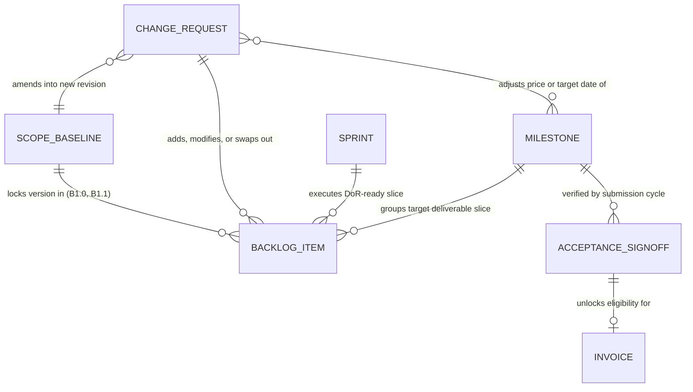
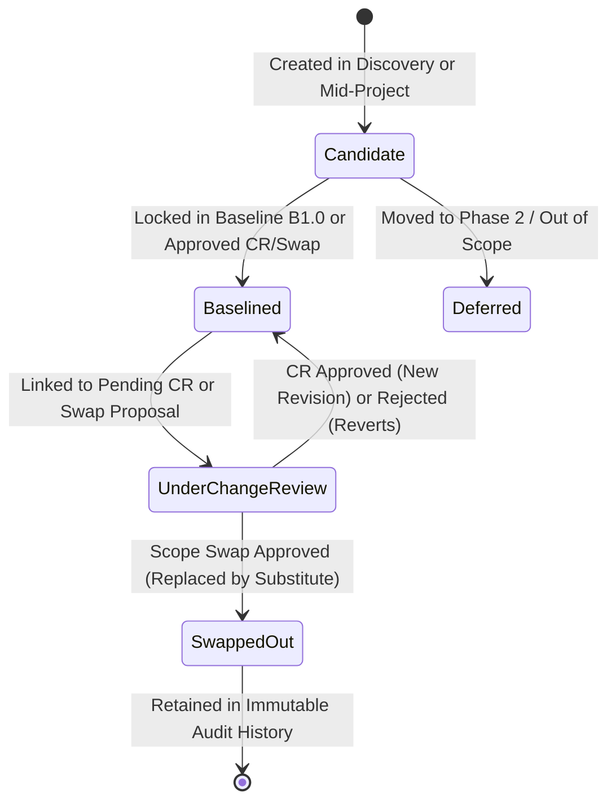
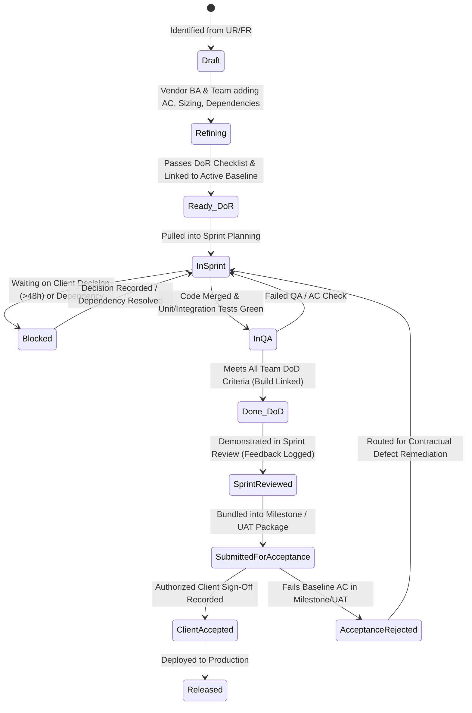
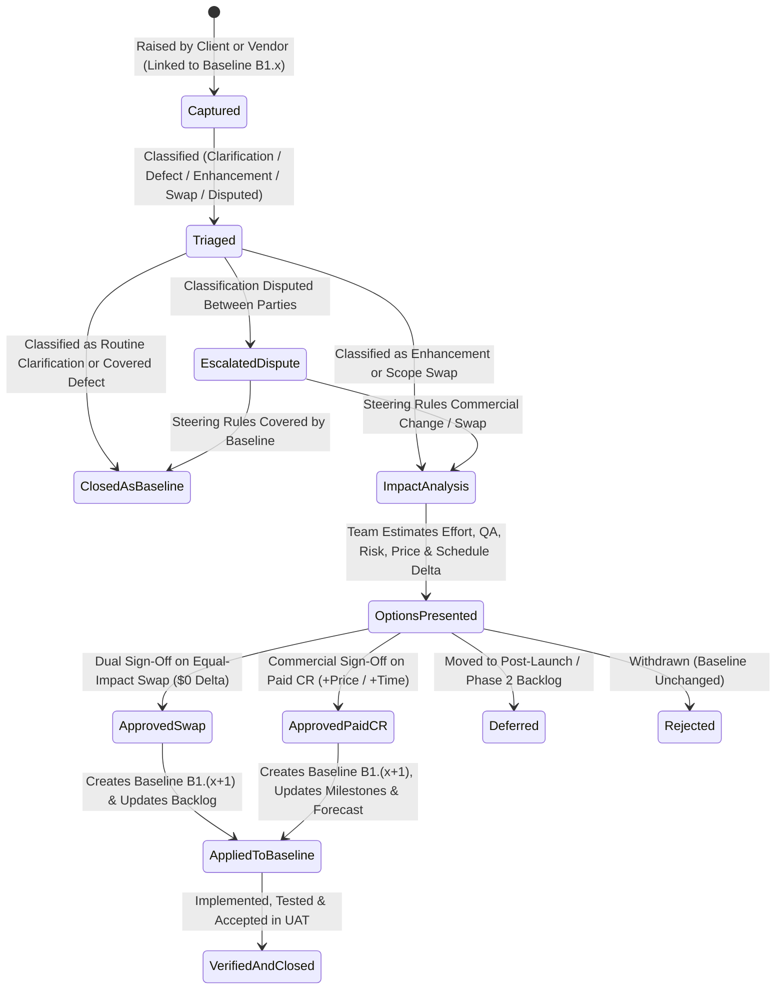
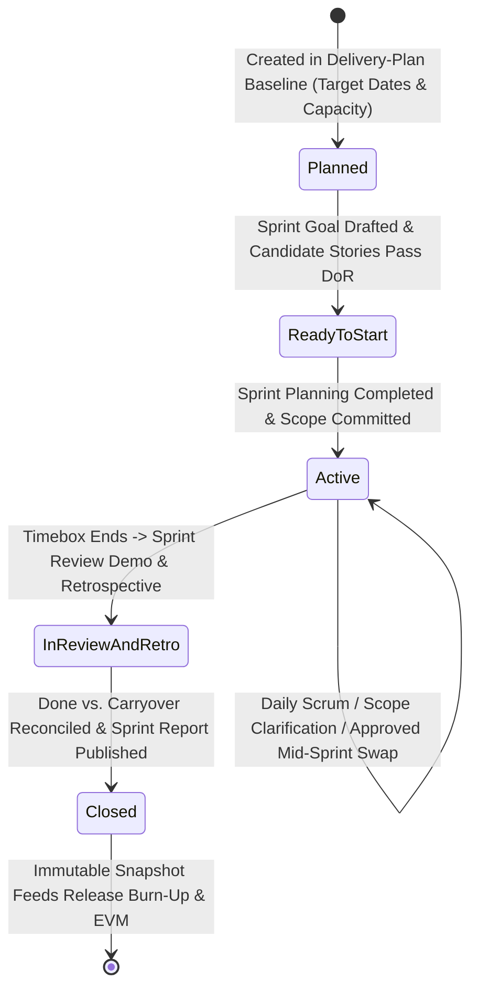
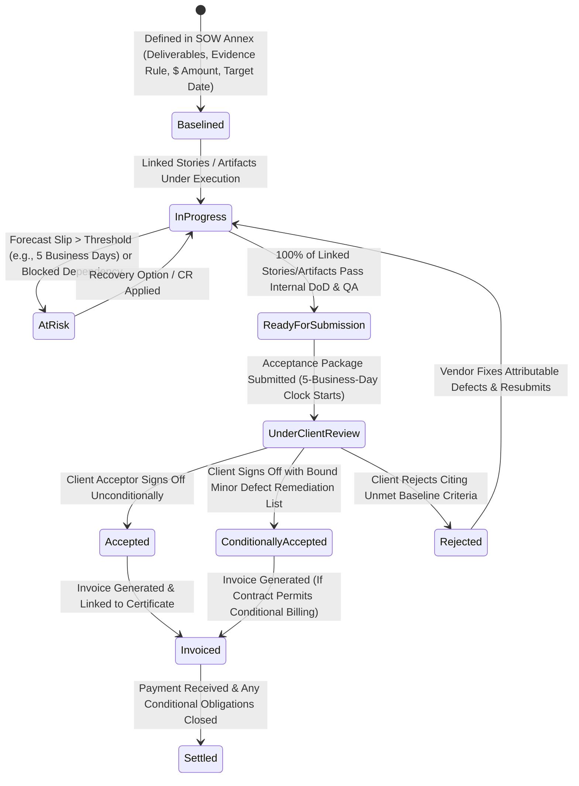
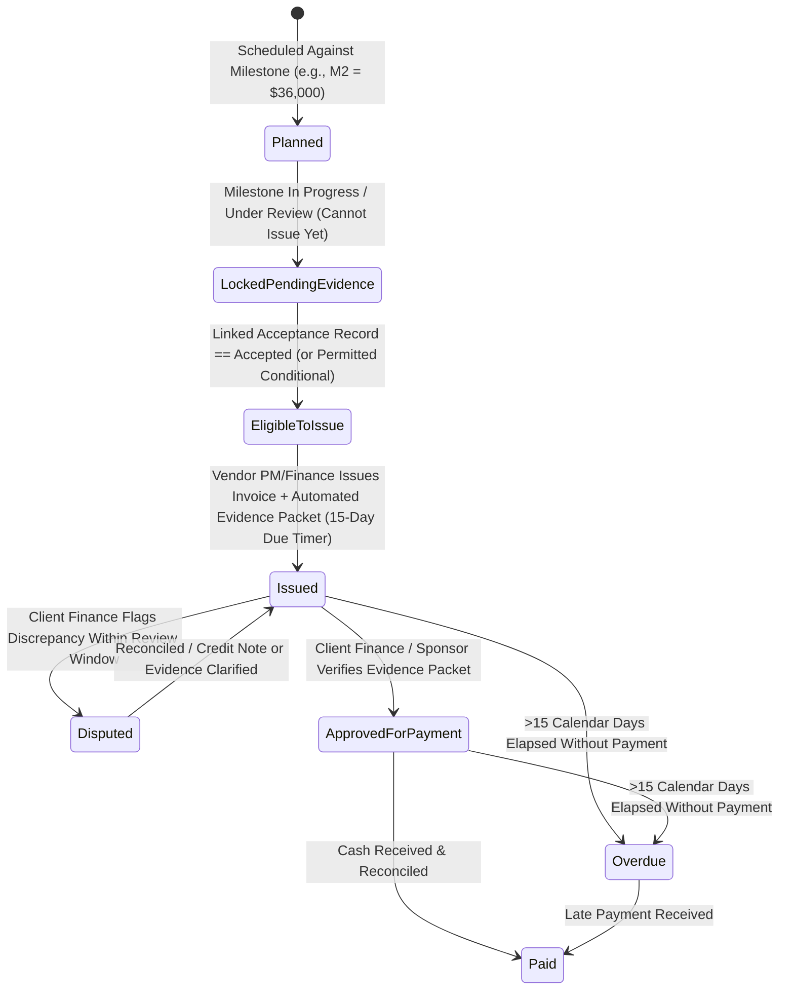

# 06 — Core Objects, Lifecycles, and Fixed-Price Rules

[Analysis Index](README.md) · Previous: [05 — Product SDLC Definition and Flows](05-product-sdlc-definition-and-flows.md) · Next: [07 — MoSCoW Prioritization and Validation Guide](07-moscow-prioritization-and-validation-guide.md)

**Provenance Summary:** Object state machines and fixed-price business rules synthesize the evidence-state table in [`docs/research/04-scrum-operating-model.md`](../04-scrum-operating-model.md), the 4-record control model in [`05-scope-and-change-management.md`](../05-scope-and-change-management.md), the SOW/CR/UAT templates in [`08-templates-and-checklists.md`](../08-templates-and-checklists.md), and the domain boundaries in [`docs/product.md`](../../product.md) `[Evidence: Existing Research]`, combined with PMI reserve/EVM literature (`[Evidence: External Source]` — [Shrivastava, 2014](https://www.pmi.org/learning/library/model-risk-contingency-reserve-9310); [Lukas, 2012](https://www.pmi.org/learning/library/make-earned-value-work-project-6001)) into formal product domain specifications `[PM/UX Inference]`.

---

## 1. Core Domain Object Relationship Map

Before examining each object's state machine, the diagram below shows how the six required objects (**Backlog Item**, **Change Request**, **Sprint**, **Milestone**, **Acceptance / Sign-off**, and **Invoice**) connect to the **Scope Baseline**:

---

## 2. Core Objects: States, Lifecycles & Transition Rules

### 2.1 Object 1: Backlog Item (Epic / Feature / User Story / Defect)

> [!IMPORTANT]
> **Critical Design Principle (`[Evidence: Existing Research]` — [`04-scrum-operating-model.md`](../04-scrum-operating-model.md), [`docs/product.md`](../../product.md)):** A Backlog Item in fixed-price outsourcing cannot use a single linear status column because **Commercial Scope State** (`Candidate` vs. `Baselined` vs. `Swapped Out`) is orthogonal to **Engineering Delivery State** (`Refining` → `Ready (DoR)` → `In Sprint` → `DoD Done` → `Client Accepted`).

#### A. Commercial Scope State Machine (`ScopeState`)

#### B. Engineering & Acceptance Lifecycle (`DeliveryState`)

| Key Transition | Guard Condition (System Rule) | Who Triggers | Who Approves |
|---|---|---|---|
| `Refining` → `Ready_DoR` | Must have Given/When/Then `AC`, team estimate, dependency owners, and `ScopeState == Baselined` (or explicitly funded spike) (`[Evidence: Existing Research]` — [`04-scrum-operating-model.md`](../04-scrum-operating-model.md)). | Vendor BA / Scrum Master | Delivery Team + Client PO (or Proxy within bounds) |
| `InQA` → `Done_DoD` | Linked PR/build, automated/manual QA checks passed, zero open Critical/Major defects against Story `AC`. | Vendor QA / Developers | Delivery Team (Internal) |
| `SubmittedForAcceptance` → `ClientAccepted` | Parent `Acceptance/Sign-off` package is marked `Accepted` or `Conditionally Accepted`. | System (via Sign-Off record) | Authorized Client Acceptor |

---

### 2.2 Object 2: Change Request (`CR` & Scope Swap)

Covers any post-baseline request that adds, removes, or substitutes contractual scope, alters acceptance criteria beyond proxy clarification bounds, or impacts price/schedule (`[Evidence: Existing Research]` — [`05-scope-and-change-management.md`](../05-scope-and-change-management.md), [`08-templates-and-checklists.md`](../08-templates-and-checklists.md)).

| State | Commercial & Execution Rule (`[PM/UX Inference]`) | Actor / Authority |
|---|---|---|
| `Captured` / `Triaged` | Candidate items linked to the CR are locked from entering an active Sprint until approved (`[Evidence: Existing Research]` — [`05-scope-and-change-management.md`](../05-scope-and-change-management.md)). | Vendor BA + Client PO |
| `OptionsPresented` | Must include a `Decision Needed By` timestamp tied to the sprint/integration schedule (e.g., *"Before Sprint 4 Planning"*) and a quote validity date (`[Evidence: Existing Research]` — [`08-templates-and-checklists.md`](../08-templates-and-checklists.md)). | Vendor PM (with Dev/QA input) |
| `ApprovedSwap` vs. `ApprovedPaidCR` | **Client PO** may approve a price-neutral swap *only* if delegated in the SOW and no mandatory SOW deliverable is dropped; otherwise **Client Sponsor + Vendor Commercial Owner** must sign (`[Evidence: Existing Research]` — [`05-scope-and-change-management.md`](../05-scope-and-change-management.md)). | Client PO / Client Sponsor + Vendor Commercial Owner |

---

### 2.3 Object 3: Sprint

Represents a fixed timebox (e.g., 2 weeks in *Atlas*) that executes a coherent Sprint Goal (`[Evidence: Existing Research]` — [`04-scrum-operating-model.md`](../04-scrum-operating-model.md); `[Evidence: External Source]` — [Scrum Guide, 2020](https://scrumguides.org/scrum-guide.html)).

| Rule | Fixed-Price Scrum Enforcement (`[PM/UX Inference]`) |
|---|---|
| **No Unbaselined Pull** | A Story with `ScopeState == Candidate` or `UnderChangeReview` cannot be pulled into an `Active` Sprint unless flagged as an explicitly funded Discovery Spike. |
| **Mid-Sprint Injection Guard** | Adding a story to an `Active` Sprint requires Scrum Master + PO confirmation that the Sprint Goal is protected, or an explicit emergency CR/swap swap-out (`[Evidence: Existing Research]` — [`04-scrum-operating-model.md`](../04-scrum-operating-model.md)). |
| **Honest Carryover Rule** | At `InReviewAndRetro` → `Closed`, any story that has not passed all `DoD` checks (`Done_DoD`) receives **0% velocity/earned-value credit** for the closing sprint, returns to the backlog, and automatically recalculates the remaining sprint forecast (`[Evidence: Existing Research]` — [`04-scrum-operating-model.md`](../04-scrum-operating-model.md), [`05-scope-and-change-management.md`](../05-scope-and-change-management.md)). |

---

### 2.4 Object 4: Milestone

Represents a contractual value-delivery checkpoint tied to a specific payment share (`M1–M5` totaling `$180,000` in *Atlas*) (`[Evidence: Existing Research]` — [`02-pre-sales-and-contracting.md`](../02-pre-sales-and-contracting.md), [`08-templates-and-checklists.md`](../08-templates-and-checklists.md)).

---

### 2.5 Object 5: Acceptance / Sign-Off Record

Represents a specific, version-bound submission and decision cycle for a Milestone slice (`M1–M3`), UAT cycle (`M4`), or Handover package (`M5`) (`[Evidence: Existing Research]` — [`03-sdlc-phases.md`](../03-sdlc-phases.md), [`08-templates-and-checklists.md`](../08-templates-and-checklists.md)).

```mermaid
stateDiagram-v2
    [*] --> DraftPackage : Vendor PM/QA Assembles Build Version, Test Results & Coverage Matrix
    DraftPackage --> Submitted : Sent to Named Client Acceptor (Starts 5-Business-Day Review Timer)
    Submitted --> UnderClientTesting : Client QA / UAT Executing Scenarios
    Submitted --> ReviewTimerExpired : 5 Business Days Elapse Without Response
    UnderClientTesting --> ReviewTimerExpired : 5 Business Days Elapse Without Decision
    ReviewTimerExpired --> EscalatedToSteering : Auto-Notifies Client Sponsor & Logs Delay Impact
    EscalatedToSteering --> UnderClientTesting : Sponsor Grants Extension or Assigns Deputy
    UnderClientTesting --> Accepted : All Criteria Passed (Immutable Sign-Off Recorded)
    UnderClientTesting --> ConditionallyAccepted : Passed with Permitted Minor Exceptions (Owners & Fix Dates Bound)
    UnderClientTesting --> Rejected : Material Failure Linked to Specific Baseline Criterion & Evidence
    ConditionallyAccepted --> ConditionsClosed : All Bound Minor Defects Verified Fixed
    Rejected --> [*] : Cycle Closed; Vendor Opens Resubmission Cycle v(n+1)
```

| Mandatory Fields on Every `Acceptance / Sign-Off` Record (`[Evidence: Existing Research]` — [`08-templates-and-checklists.md`](../08-templates-and-checklists.md)) | Why Required |
|---|---|
| `BaselineVersion` (`B1.0`) + `BuildArtifactId` + `EnvironmentUrl` | Prevents disputes over *which* version of the software was tested (`PP-06`, `PP-07`). |
| `ScenarioSummary` (`Passed / Failed / Blocked / Not Run / Total`) | Proves completeness of UAT execution (`38/40 passed` in *Atlas*). |
| `ConditionalObligations[]` (`DefectId, Severity, Workaround, Owner, DueDate`) | Allows milestone progress without waiving the client's right to have minor bugs fixed (`[Evidence: Existing Research]` — [`03-sdlc-phases.md`](../03-sdlc-phases.md)). |
| `RejectionEvidence[]` (`BaselineCriterionId, FailureDescription, ReproductionLink`) | Prevents arbitrary "I don't like the UI" rejections that aren't grounded in the signed baseline (`PP-02`, `PP-06`). |

---

### 2.6 Object 6: Invoice

Represents the commercial billing record linked to a Milestone or approved Change Request (`[Evidence: Existing Research]` — [`02-pre-sales-and-contracting.md`](../02-pre-sales-and-contracting.md), [`05-scope-and-change-management.md`](../05-scope-and-change-management.md)).

---

## 3. Rules Specific to Fixed-Price Agile Outsourcing

To prevent the failure modes documented in [Chapter 03](03-pain-points-and-information-gaps.md), the product's business logic must enforce four sets of fixed-price rules (`[Evidence: Existing Research]` — [`01-overview.md`](../01-overview.md), [`02-pre-sales-and-contracting.md`](../02-pre-sales-and-contracting.md), [`05-scope-and-change-management.md`](../05-scope-and-change-management.md); `[PM/UX Inference]`):

### 3.1 Rule Set 1: Scope Baseline Rules

1. **Immutable Versioned Snapshots (`B1.0`, `B1.1`, ...):**
   * Once signed at Gate `G2`, Baseline `B1.0` is cryptographically/audit-locked. Neither party can overwrite `B1.0` text in place (`[Evidence: Existing Research]` — [`docs/authoring.md`](../../authoring.md), [`05-scope-and-change-management.md`](../05-scope-and-change-management.md)).
   * Every subsequent approved Scope Swap or Paid CR produces a new numbered baseline revision (`B1.1`, `B1.2`) with a full diff (`Added`, `Removed/Swapped-Out`, `Modified`) and approver attribution.
2. **Two-Tier Baseline Envelope (Preventing Refinement Paralysis):**
   * **Tier 1 (Contractual Obligations — Hard Lock):** User Requirements (`UR`), Functional Boundaries (`FR`), NFR targets, SOW Deliverables, and Milestone Acceptance Criteria. Changing Tier 1 requires a **Scope Swap** or **Paid CR**.
   * **Tier 2 (Iterative Story Decomposition — Soft Envelope):** Breaking a baselined Feature into User Stories or clarifying UI labels/validation copy during refinement is permitted within the Proxy BA / Client PO workflow **provided** the net story-point/effort envelope does not expand and no Tier 1 constraint is violated (`[Evidence: Existing Research]` — [`04-scrum-operating-model.md`](../04-scrum-operating-model.md), [`05-scope-and-change-management.md`](../05-scope-and-change-management.md)).
3. **Story-Splitting Conservation Rule:**
   * When a team splits a baselined 8-point story (`ATLAS-12`) into two child stories (`ATLAS-12A` and `ATLAS-12B`), the system checks whether $\text{Points}(A) + \text{Points}(B) \le 8$. If the split increases total points (e.g., to 13 points), the system flags the +5 point delta as **Scope Expansion / Re-estimation Variance** requiring PM review rather than silently inflating the baseline line (`[Evidence: Existing Research]` — [`05-scope-and-change-management.md`](../05-scope-and-change-management.md)).

---

### 3.2 Rule Set 2: Change Budget vs. Vendor Contingency Rules

A major source of fixed-price confusion is conflating the **Vendor's Internal Risk Contingency** with a **Client's Commercial Change Budget** (`[Evidence: Existing Research]` — [`02-pre-sales-and-contracting.md`](../02-pre-sales-and-contracting.md), [`09-lessons-learned-and-pitfalls.md`](../09-lessons-learned-and-pitfalls.md); `[Evidence: External Source]` — [Shrivastava, PMI 2014](https://www.pmi.org/learning/library/model-risk-contingency-reserve-9310)). The product must keep them strictly separate:

| Reserve Type | Who Owns & Sees It | Purpose & *Atlas* Example | Product Governance Rule |
|---|---|---|---|
| **1. Vendor Internal Contingency Reserve** | **Vendor Only** (Vendor PM / Delivery Lead; hidden from Client Portal) | Covers **estimation uncertainty, technical rework, and identified delivery risks** within the existing baseline (`$18,000` inside the `$138,000` vendor cost budget) (`[Evidence: Existing Research]` — [`02-pre-sales-and-contracting.md`](../02-pre-sales-and-contracting.md)). | • Drawn down against logged Risk/Issue IDs (`R-01`..`R-05`) with Vendor PM approval. • **Never displayed to the client as "free scope buffer."** • Unspent vendor contingency remains vendor contribution (`[Evidence: Existing Research]` — [`05-scope-and-change-management.md`](../05-scope-and-change-management.md)). |
| **2. Client Pre-Authorized Change Budget (Optional Pool)** | **Both Sides** (Configured per SOW if agreed; visible to Client Sponsor/PO & Vendor PM) | Optional contractual allowance (e.g., *"$15,000 or 20 story points of pre-funded change tokens"*) that the Client PO can spend on small enhancements without needing a fresh procurement signature for every minor CR (`[Evidence: External Source]` — [Leybourn, PMI 2016](https://www.pmi.org/learning/library/measuring-value-10209)). | • If `ChangePool > 0`, approved small enhancements deduct from the pool until exhausted; once `0`, standard Paid CR or Scope Swap rules apply. • In *Atlas*'s default baseline, `ChangePool = $0` (all net-new enhancements like `CR-02: $12,000` require either a Scope Swap or a signed Paid CR). |

---

### 3.3 Rule Set 3: Scope Swap Equivalence Rules

As emphasized in [`docs/research/01-overview.md`](../01-overview.md) and [`05-scope-and-change-management.md`](../05-scope-and-change-management.md) (`[Evidence: Existing Research]`), **equal story points alone do not make a scope swap commercially equivalent**. When a Client PO proposes swapping out `Item X` (e.g., 8-pt CSV Export) for `Item Y` (e.g., 8-pt Saved Search), the product enforces a **5-Gate Equivalence Check**:

| Gate # | Equivalence Check | System / Workflow Rule | Outcome if Gate Fails |
|---|---|---|---|
| **Check 1** | **Unstarted Status & Sunk Cost** | `Item X` must have `DeliveryState` in `{Draft, Refining, Ready_DoR}` with `0` engineering hours spent. If design/code work was already spent on `Item X`, the sunk cost is deducted from the swap credit (`[Evidence: Existing Research]` — [`05-scope-and-change-management.md`](../05-scope-and-change-management.md)). | Swap requires partial fee adjustment or a larger item dropped to cover sunk effort. |
| **Check 2** | **Planning Size & Effort Delta** | $\text{Effort/Points}(Y) - \text{Remaining Effort/Points}(X) \le 0$ (or within the agreed tolerance band). | Excess effort converts into a hybrid **Partial Swap + Paid CR delta**. |
| **Check 3** | **Technical, Integration & Security Impact** | Tech Lead confirms `Item Y` does not introduce an unpriced third-party license, a new external API dependency, or a higher security/performance risk tier than `Item X` (`[Evidence: Existing Research]` — [`01-overview.md`](../01-overview.md)). | Tech Lead flags added non-point cost; converts to Priced Swap. |
| **Check 4** | **QA, Regression & Milestone Sequencing** | Vendor QA confirms `Item Y` does not invalidate already-passed tests or break an imminent Milestone acceptance package (`M2`/`M3`). | Swap is scheduled for a later sprint or milestone criteria are formally amended. |
| **Check 5** | **Contractual Obligation Authority** | If `Item X` is listed as a named mandatory deliverable in the SOW, dropping it requires **Client Sponsor + Vendor Commercial Signatory** approval (not just Client PO backlog ordering) (`[Evidence: Existing Research]` — [`02-pre-sales-and-contracting.md`](../02-pre-sales-and-contracting.md)). | System routes the swap to Commercial Signatories before updating Baseline `B1.x`. |

---

### 3.4 Rule Set 4: Milestone-to-Payment Linkage Rules

1. **Evidence Gate, Never Calendar Gate:**
   * Reaching `Week 5` on the calendar or holding the `Sprint 2 Review` meeting **never** transitions Milestone `M2` (`$36,000`) to `Invoice Eligible` (`[Evidence: Existing Research]` — [`02-pre-sales-and-contracting.md`](../02-pre-sales-and-contracting.md), [`04-scrum-operating-model.md`](../04-scrum-operating-model.md)).
   * An Invoice can only move from `LockedPendingEvidence` → `EligibleToIssue` when its linked `Acceptance / Sign-Off` record reaches `Accepted` (or `ConditionallyAccepted` where the SOW permits conditional milestone billing).
2. **Bounded Review Window & Silence Escalation (`5 Business Days`):**
   * Once the Vendor PM submits a complete Milestone Acceptance Package, a visible **5-business-day countdown timer** (respecting the project's configured business calendar/holidays) starts (`[Evidence: Existing Research]` — [`02-pre-sales-and-contracting.md`](../02-pre-sales-and-contracting.md), [`07-offshore-communication.md`](../07-offshore-communication.md)).
   * Unless the contract explicitly states "deemed acceptance on silence," silence at Day 5 triggers **Automatic Escalation** to the Client Sponsor and logs a **Client Delay Event** that protects the vendor against downstream schedule penalties (`[Evidence: Existing Research]` — [`02-pre-sales-and-contracting.md`](../02-pre-sales-and-contracting.md)).
3. **Structured Rejection Requirement:**
   * A Client Acceptor cannot click `Reject` with a blank comment. The system requires linking at least one **Baselined Acceptance Criterion ID (`AC1.0`)** and attaching reproduction evidence (`[Evidence: Existing Research]` — [`08-templates-and-checklists.md`](../08-templates-and-checklists.md)).
4. **Survival of Conditional & Warranty Obligations:**
   * Paying Milestone `M4` (`UAT Approval: $45,000`) or `M5` (`Release & Handover: $18,000`) does **not** close open `ConditionalObligations` or terminate the **30-calendar-day Warranty Clock** (`[Evidence: Existing Research]` — [`02-pre-sales-and-contracting.md`](../02-pre-sales-and-contracting.md), [`03-sdlc-phases.md`](../03-sdlc-phases.md)). Furthermore, any covered warranty defect logged before Day 30 remains a binding vendor obligation until verified fixed, even if verification finishes after Day 30 (`[Evidence: Existing Research]` — [`03-sdlc-phases.md`](../03-sdlc-phases.md)).

---

## Sources for Chapter 06

1. Narendra K. Shrivastava, [*A model to develop and use risk contingency reserve*](https://www.pmi.org/learning/library/model-risk-contingency-reserve-9310), PMI Global Congress, 2014 — separating cost-baseline contingency from external scope changes and management reserve. Accessed 2026-11-07.
2. Joseph A. Lukas, [*How to make earned value work on your project*](https://www.pmi.org/learning/library/make-earned-value-work-project-6001), PMI Global Congress, 2012 — objective completion rules and baseline integrity. Accessed 2026-11-07.
3. Jeff Sutherland, [*Agile Contracts: Money for Nothing and Your Change for Free*](https://jeffsutherland.com/scrum/2008/10/agile-contracts-money-for-nothing-and.html), 2008; and Marcin Niebudek, [*Agile Team Meets a Fixed Price Contract*](https://www.infoq.com/articles/agile-fixed-price-contract/), InfoQ — conditions and limits of scope swapping. Accessed 2026-11-07.
4. Repository Research: [`01-overview.md`](../01-overview.md), [`02-pre-sales-and-contracting.md`](../02-pre-sales-and-contracting.md), [`03-sdlc-phases.md`](../03-sdlc-phases.md), [`04-scrum-operating-model.md`](../04-scrum-operating-model.md), [`05-scope-and-change-management.md`](../05-scope-and-change-management.md), [`08-templates-and-checklists.md`](../08-templates-and-checklists.md), and [`docs/product.md`](../../product.md).
