# Product Discovery & UX Analysis: Digitalizing Fixed-Price Agile Scrum Outsourcing

> **Preserved analysis:** This is the original seven-part discovery set from local main. Its seven-phase product framing predates the current D1–D6 decision. Use the [current eight-stage analysis](../analysis/README.md) and [SDLC workflow](../../sdlc-workflow.md) for product direction; use this set for historical research and examples. No approval or customer validation is implied.

[Parent Research Index](../README.md) · [Product Blueprint](../../product.md) · [Workflow Discovery](../../deliverypilot-workflow-discovery.md)

**Analysis Date:** 2026-11-07
**Role Perspective:** Senior Outsourcing PM/PO & Product Discovery / UX Researcher
**Governance Status:** Discovery analysis and product SDLC definition proposal. Per [repository authoring policy](../../authoring.md), these files synthesize existing research in [`docs/research/`](../README.md), external practitioner/industry evidence, and UX/domain modeling to inform product design. Adopting specific rules or features into canonical requirements (`UR`/`FR`/`US`) remains an explicit Product Owner decision.

---

## 1. Executive Summary

Running Agile Scrum under a fixed-price outsourcing contract creates a structural tension between **iterative product learning** and **commercial obligation control** `[Evidence: Existing Research; External Source]`. While procurement teams demand upfront price certainty, engineering and product teams discover edge cases, integration constraints, and better user workflows mid-flight. Today, vendors and clients bridge this divide with a fragile patchwork of **Jira** (execution), **Excel** (financial burn and scope baselines), **Confluence/Word** (SOWs and Change Requests), and **Email/Slack** (ad-hoc decisions and sign-offs) `[Evidence: External Source]`.

This 7-part analysis synthesizes the operational guidance in [`docs/research/01–09`](../README.md) with empirical contract-management research (WorldCC/IACCM, PMI), Agile practitioner literature (Martin Fowler, InfoQ, Scrum.org, Mountain Goat Software), and real-world PM/PO community patterns (`r/projectmanagement`, `r/scrum`, `r/ProductManagement`) to define **how the end-to-end SDLC must work inside the product**.

```mermaid
flowchart LR
    subgraph INPUTS["1. Research Inputs"]
        R1["Existing SDLC Research (docs/research/01-09)"]
        R2["Industry Benchmarks (WorldCC, PMI Pulse)"]
        R3["Practitioner & Community Evidence (InfoQ, Fowler, Reddit)"]
    end

    subgraph DISCOVERY["2. UX & Domain Analysis (Files 01-04)"]
        A1["01: 6 Personas & Incentive Tensions"]
        A2["02: Needs Across 7 SDLC Phases"]
        A3["03: Ranked Pains & Info Asymmetry"]
        A4["04: Tool Breakdowns & HMW Opportunities"]
    end

    subgraph DEFINITION["3. Product SDLC Definition (Files 05-07)"]
        D1["05: End-to-End SDLC Flow & Dual Gates"]
        D2["06: 6 Core Objects & Fixed-Price Rules"]
        D3["07: MoSCoW Features & Validation Guide"]
    end

    INPUTS --> DISCOVERY --> DEFINITION
```

---

## 2. Reading Order & Document Index

| Order | Document | Primary Questions Answered | Key Outputs |
|---|---|---|---|
| **Index** | [README.md](README.md) | How is this analysis structured, and how are evidence, assumptions, and inferences labeled? | Reading order, provenance taxonomy, shared baseline reference |
| **01** | [01 — Stakeholders and Personas](01-stakeholders-and-personas.md) | Who uses the product on the vendor and client sides? What are their goals, responsibilities, KPIs, and hidden incentive conflicts? | 6 deep persona profiles (Vendor PM, Vendor PO/BA, Delivery Team, Client PO, Client Sponsor/Finance, Client QA/UAT) + Incentive Tension Matrix |
| **02** | [02 — User Needs by SDLC Phase](02-user-needs-by-sdlc-phase.md) | What does each persona need to **do**, **decide**, and **know** from Presales to Warranty? | 7-phase × 6-persona matrices covering Presales/Estimation, Contracting, Discovery/Sprint 0, Sprints, UAT/Acceptance, Release, and Warranty/Handover |
| **03** | [03 — Pain Points and Information Gaps](03-pain-points-and-information-gaps.md) | Which failure modes hurt most and happen most often? What does one side know that the other lacks, when, and at what cost? | 12 pain points ranked by Severity × Frequency (`1–25` score) + Bi-directional Information Asymmetry Map |
| **04** | [04 — Workarounds, Tools, and Opportunities](04-workarounds-tools-and-opportunities.md) | How do teams stitch together Jira, Excel, Confluence, and Email today? Where do those tools break down, and what product opportunities follow? | Tool-stack breakdown analysis + 12 *"How Might We..."* (HMW) statements mapped to candidate capabilities |
| **05** | [05 — Product SDLC Definition and Flows](05-product-sdlc-definition-and-flows.md) | What is the canonical end-to-end SDLC inside our product? What are the entry/exit gates, artifacts, and Client vs. Vendor approval workflows? | 7-phase product SDLC blueprint, Entry/Exit Gate & Artifact RACI table, dual-party swimlane & sequence diagrams |
| **06** | [06 — Core Objects, Lifecycles, and Fixed-Price Rules](06-core-objects-lifecycles-and-fixed-price-rules.md) | What are the state machines for the 6 core domain objects, and how do fixed-price rules govern baselines, change budgets, swaps, and billing? | State machines (`stateDiagram-v2`) & ERD for Backlog Item, Change Request, Sprint, Milestone, Acceptance/Sign-off, and Invoice + Fixed-Price Rule Engine specs |
| **07** | [07 — MoSCoW Prioritization and Validation Guide](07-moscow-prioritization-and-validation-guide.md) | Which features are Must/Should/Could/Won't for the product, traced to pain points? What assumptions must we validate next, and how? | MoSCoW feature matrix traced to Pain/HMW IDs, Riskiest Assumptions Register, and 45-minute interview guides for Vendor PM/POs and Client POs |

---

## 3. Evidence & Provenance Taxonomy

Throughout all seven files, every substantive claim, pain point, or design rule is tagged with one of four provenance markers:

| Tag | Meaning | Verification Standard |
|---|---|---|
| `[Evidence: Existing Research]` | Drawn from the repository's existing SDLC research in [`docs/research/01–09`](../README.md) or confirmed product context in [`docs/product.md`](../../product.md). | Linked directly to the specific chapter in `docs/research/` (including the shared *Atlas* numerical baseline where illustrative). |
| `[Evidence: External Source]` | Drawn from external industry benchmarks (WorldCC/IACCM, PMI), practitioner publications (Martin Fowler, InfoQ, Scrum.org, Mountain Goat Software, GOV.UK, GitLab), or PM/PO community discussions (`r/projectmanagement`, `r/scrum`, `r/ProductManagement`). | Linked to the canonical external URL with author/organization, publication context, and access date (`2026-11-07`). |
| `[User Assumption]` | Framed directly by the user's product brief in this conversation (e.g., dual-party platform used by both vendor and client under a fixed-price Agile Scrum contract). | Explicitly marked as a foundational framing assumption to be validated in discovery interviews where commercial sensitivity exists. |
| `[PM/UX Inference]` | Synthesized product capability, state-machine transition rule, UX boundary, or prioritization judgment derived by combining the evidence above. | Clearly separated from empirical facts; linked to validation questions in [Chapter 07](07-moscow-prioritization-and-validation-guide.md). |

---

## 4. Shared Numerical Reference (*Atlas* Engagement)

Where concrete numerical examples clarify a workflow or rule (e.g., burn-up divergence, scope-swap equivalence, contingency vs. change budget, or milestone-to-invoice linkage), this analysis reuses the fictional **Atlas Service Portal** parameters from [`docs/research/README.md`](../README.md) so arithmetic stays 100% consistent across the repository:

* **Discovery Contract:** $15,000 fixed fee (2 weeks, contracted separately prior to build) `[Evidence: Existing Research]`.
* **Delivery Contract:** $180,000 fixed price across 16 weeks (Week 1 Inception/Sprint 0; Weeks 2–13 across 6 two-week Sprints; Weeks 14–15 Stabilization/UAT; Week 16 Release & Handover) + 30-calendar-day post-release warranty `[Evidence: Existing Research]`.
* **Planning Baseline (`B1.0`):** 120 story points (used for team capacity planning, not as a contractual currency) `[Evidence: Existing Research]`.
* **Vendor Internal Cost Budget (`BAC`):** $138,000 ($120,000 base loaded labor/nonlabor cost + $18,000 identified-risk contingency), leaving $42,000 planned contribution if contingency is fully used `[Evidence: Existing Research]`.
* **Milestone Payment Schedule:** M1 Inception ($36,000 / 20%), M2 Slice 1 after Sprint 2 ($36,000 / 20%), M3 Slice 2 after Sprint 4 ($45,000 / 25%), M4 UAT Approval ($45,000 / 25%), M5 Production Release & Handover ($18,000 / 10%) `[Evidence: Existing Research]`.

---

## 5. Master Source List Across This Analysis

All external sources were verified and accessed on **2026-11-07**:

1. **Scrum Guide:** Ken Schwaber & Jeff Sutherland, [*The Scrum Guide*](https://scrumguides.org/scrum-guide.html), November 2020.
2. **PMI Fixed-Price Challenges:** George Lowden & John Thornton, [*The special challenges of project management under fixed-price contracts*](https://www.pmi.org/learning/library/challenges-fixed-price-contracts-9640), PMI Global Congress, 11 May 2015.
3. **PMI Value & Capped Constraints:** Evan Leybourn, [*How much does this cost?*](https://www.pmi.org/learning/library/measuring-value-10209), PMI Global Congress, 13 May 2016.
4. **PMI Contingency Reserves:** Narendra K. Shrivastava, [*A model to develop and use risk contingency reserve*](https://www.pmi.org/learning/library/model-risk-contingency-reserve-9310), PMI Global Congress, 26 October 2014.
5. **PMI Earned Value Management:** Joseph A. Lukas, [*How to make earned value work on your project*](https://www.pmi.org/learning/library/make-earned-value-work-project-6001), PMI Global Congress, 23 October 2012; and PMI, [*Earned Value Management: A Guide to Reading the Numbers*](https://www.pmi.org/blog/earned-value-management), 31 August 2026.
6. **PMI Requirements & Scope Creep Benchmarks:** PMI, [*Pulse of the Profession®*](https://www.pmi.org/learning/thought-leadership/pulse) and [*Requirements Management: Core Competency for Project and Program Success*](https://www.pmi.org/learning/thought-leadership/pulse/core-competency-project-program-success), August 2014.
7. **WorldCC / IACCM Value Erosion Studies:** World Commerce & Contracting (formerly IACCM), [*Poor Contract Management Costs Companies 9% — Bottom Line*](https://www.worldcc.com), benchmark research on post-signature value leakage, unclear scope disputes, and pre-award to delivery handover gaps.
8. **Martin Fowler on Fixed-Price Agile & Offshore Delivery:** Martin Fowler, [*Fixed Price*](https://martinfowler.com/bliki/FixedPrice.html), [*Fixed Scope Mirage*](https://martinfowler.com/bliki/FixedScopeMirage.html), and [*Using an Agile Software Process with Offshore Development*](https://martinfowler.com/articles/agileOffshore.html).
9. **InfoQ Agile Contracting Case Studies:** Allan Kelly, [*Agile Contracts*](https://www.infoq.com/articles/agile-contracts/), 8 February 2011; Marcin Niebudek, [*Agile Team Meets a Fixed Price Contract*](https://www.infoq.com/articles/agile-fixed-price-contract/); Gilles Mantel, [*How to Remain Agile When You Have to Sign a Contract?*](https://www.infoq.com/articles/Remain-Agile-Sign-Contract).
10. **Jeff Sutherland Early Termination & Scope Swap Clauses:** Jeff Sutherland, [*Agile Contracts: Money for Nothing and Your Change for Free*](https://jeffsutherland.com/scrum/2008/10/agile-contracts-money-for-nothing-and.html), 25 October 2008.
11. **Scrum.org on Sprint 0 & Proxy PO Anti-Patterns:** Derek Davidson, [*The Truth About Sprint Zero (and why Ken hates it)*](https://www.scrum.org/resources/blog/truth-about-sprint-zero-and-why-ken-hates-it), 20 September 2021; Barry Overeem, [*The Product Owner Proxy*](https://www.scrum.org/resources/blog/product-owner-proxy).
12. **Mountain Goat Software Estimation:** Mike Cohn, [*Don't Equate Story Points to Hours*](https://www.mountaingoatsoftware.com/agile/dont-equate-story-points-to-hours), updated 6 December 2024.
13. **Practitioner Community Evidence:** Aggregated practitioner patterns from [`r/projectmanagement`](https://www.reddit.com/r/projectmanagement/), [`r/scrum`](https://www.reddit.com/r/scrum/), and [`r/ProductManagement`](https://www.reddit.com/r/ProductManagement/) regarding UAT scope creep, Jira-to-Excel budget reconciliation, and fixed-price agency workflows.
