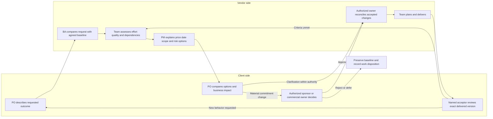

# 03 — User needs by phase and client/vendor journeys

[Analysis index](README.md) · [Previous: Personas](02-stakeholders-and-personas.md) · [Next: Pains and gaps](04-pains-gaps-and-workarounds.md)

**AI-inference:** This is a proposed needs map synthesized from the original research, the six requested personas, and the external accounts listed below. The 42 rows are hypotheses to test, not observed behaviors from 42 interviews. “Decide” means decide within an explicit assignment or route the decision to its authorized owner. A person who can view or comment does not automatically gain approval rights.

The seven phase labels follow the user's requested product analysis. Paid discovery can precede a binding delivery quote, and inception can follow contracting; PH03 is not a prohibition on earlier learning. Revisit discovery and criteria during sprints. Quality, documentation, risks, client feedback, and handover preparation span the lifecycle. “Sprint 0” is a preparation label discussed in the [original lifecycle research](../03-sdlc-phases.md), not a mandatory Scrum phase.

Personas: **P01** vendor PM; **P02** vendor PO/BA; **P03** delivery team; **P04** client PO; **P05** sponsor/finance, with separate authorities; **P06** client QA/UAT. The proposed system actions and gate mechanics are developed in [Chapter 05](05-product-sdlc-flow.md) and [Chapter 06](06-objects-lifecycles-and-rules.md).

> **Scope reconciliation — 2026-11-07:** D1–D6 establish post-contract delivery across eight governance stages. Presales/contracting remain upstream context; native invoicing remains external. See the [current lifecycle](../../sdlc-workflow.md) and [analysis index](README.md). Detailed policies here remain proposals.

## Current eight-stage mapping

The PH codes retain the original engagement-research grouping and stable N01–N42 need references. They are not the current product phase list. LC codes are the canonical product lifecycle. All added needs below are AI-inference derived from owner direction; they are not observed interview findings.

| Product stage | Existing needs reused | Additional emphasis |
|---|---|---|
| LC01 Initialization | N13–N18; signed outputs from N01–N12 | Charter, stakeholders, delegated authority, kickoff and client dependencies |
| LC02 Requirements analysis/validation | N14/N16/N18/N20/N22/N24 | Criteria, versioned optional dual-side review and baseline selection |
| LC03 Solution design/planning | N13/N15/N19/N21/N23 | Architecture/API evidence, units, capacity, release roadmap and scenario assumptions |
| LC04 Scrum delivery | N19–N24 | Fixed timebox, original-versus-actual view and carry-over |
| LC05 System testing/UAT | N25–N30 | Candidate/build/environment, not-run versus failed, authorized acceptance |
| LC06 Release/deployment | N31–N36 | Go-live authority, live verification and operational recipient |
| LC07 Hypercare/warranty | N37–N42 | Coverage trigger, triage, unresolved claims and support transition |
| LC08 Closure/handover | N37–N42 and additions below | Final acceptance, asset/document transfer, lessons and financial evidence |

### Added needs for refinement, design and closure

| Persona | LC02: do / decide / know | LC03: do / decide / know | LC08: do / decide / know |
|---|---|---|---|
| P01 Vendor PM | Track scope delta; route CR; know authorized baseline | Assemble options; recommend feasible roadmap; know constraints and contingency | Reconcile obligations; recommend closure; know remaining owners and finance evidence |
| P02 Vendor PO/BA | Write criteria/revisions; classify clarification; know review policy | Link behavior to design; prioritize within delegation; know interfaces/dependencies | Reconcile accepted scope; route residual needs; know handed-over versions |
| P03 Delivery team | Refine/test examples; judge technical readiness; know NFRs | Design/estimate; select feasible approach/work; know capacity and API revisions | Supply assets/runbooks; verify transfer; know residual technical/support obligations |
| P04 Client PO | Clarify priorities/review; accept assigned revision; know effect of decision | Order outcomes; choose scope trade-offs within authority; know delivery assumptions | Review outcome; make assigned final acceptance; know residual scope and ownership |
| P05 Sponsor/finance | Resolve commercial ambiguity; authorize relevant changes; know price impact | Fund or resolve constraints; decide commercial commitment changes; know risk and payment gates | Verify separate business/finance obligations; authorize their own closure decisions; know disputes and payment state |
| P06 Client QA/UAT | Develop scenarios; assess testability; know expected behavior | Plan test data/environments; judge readiness; know build/API dependencies | Confirm test/defect evidence transfer; acknowledge assigned obligations; know covered unresolved defects |

## PH01 — Presales and estimation (upstream context)

| Need ID / persona | Needs to do | Needs to decide | Needs to know |
|---|---|---|---|
| N01 / P01 | Record assumptions, dependency owners, estimate basis, and commercial exposure; involve delivery before quoting. | Whether evidence supports a quote, a conditional proposal, or paid discovery; obtain bid authority. | Mandatory date/outcome, vendor capacity, cost range, procurement route, and who can answer unresolved questions. |
| N02 / P02 | Map users/workflows; capture representative examples and exclusions; expose ambiguous terms. | Which unknowns need client clarification or a spike before sizing. | Business priorities, existing processes, stakeholder disagreement, and the proposed purchase boundary. |
| N03 / P03 | Assess integrations, quality scope, data, environments, effort range, and technical risks. | Feasible approaches and which uncertainty needs investigation. | Available documentation/access, capacity assumptions, required service levels, and estimate confidence. |
| N04 / P04 | Explain business outcomes; identify users and mandatory constraints; provide examples and access contacts. | Essential versus optional launch outcomes; recommend discovery priorities. | What the quote assumes, alternative scopes, client effort required, and what remains uncertain. |
| N05 / P05 | Sponsor establishes the investment case; finance/procurement explains funding and purchase controls. | Sponsor funds investigation or bid progression; financial authority confirms available purchasing route. | Options, expected value, retained risks, spending ceiling, taxes/pass-through treatment, and approval limits. |
| N06 / P06 | Supply sample business scenarios, test-data constraints, and availability estimates. | Which scenarios are essential to acceptance; advise on test feasibility. | Proposed users, operational impacts, environments, data ownership, and likely UAT effort. |

**Product implication:** Keep a proposal and estimate version distinct from an agreed baseline. Track unresolved assumptions without manufacturing commitments. Relevant pains: PP03 and PP07. The [original contracting chapter](../02-pre-sales-and-contracting.md) provides the reasoning; the digital representation is proposed.

## PH02 — Contracting (upstream context)

| Need ID / persona | Needs to do | Needs to decide | Needs to know |
|---|---|---|---|
| N07 / P01 | Link deliverables, exclusions, client obligations, milestones, acceptance, changes, and warranty terms to the negotiated version. | Whether the delivery plan supports the offer; route signature to vendor commercial authority. | Final wording, precedence of annexes, dependencies, cost exposure, and notice/escalation procedures. |
| N08 / P02 | Reconcile backlog wording with contractual scope and criteria; record terminology and open details. | Which edits clarify versus change the agreed outcome; request explicit interpretation. | Exact proposed version, exclusions, acceptance evidence, and who can clarify after signature. |
| N09 / P03 | Review technical feasibility and testability of obligations; flag unfunded quality or operational work. | Technical feasibility of candidate commitments; recommend alternatives. | What will be purchased, required evidence, constraints, and unresolved estimate assumptions. |
| N10 / P04 | Validate outcomes and business examples with stakeholders; confirm review availability and delegates. | Product scope recommendation and assigned baseline decisions; route spending/signature separately. | Included/excluded behavior, consequences of changes, acceptance windows, and responsibilities. |
| N11 / P05 | Sponsor confirms business commitment; finance/procurement checks commercial and payment arrangements. | Authorized signatories approve the contract; financial owner approves purchase authorization. | Price, payment triggers, disputed-amount handling, change authority, and applicable remedies. |
| N12 / P06 | Check that scenarios, test access, participants, defect treatment, and evidence are achievable. | Recommend acceptance-test conditions; accept tester responsibilities where assigned. | Agreed criteria, scope versions, time needed for test/retest, and who makes the acceptance decision. |

**Product implication:** Record who signed which version, and distinguish that from later baseline establishment or payment authorization. EX-B05 shows why actual authority and interests need investigation even when documents are strong. Relevant pains: PP01, PP03, PP05.

## PH03 — Discovery and inception / Sprint 0

| Need ID / persona | Needs to do | Needs to decide | Needs to know |
|---|---|---|---|
| N13 / P01 | Confirm staffing, calendars, access, communication, governance, dependencies, and initial risk responses. | Whether prerequisites are adequate for planned work; propose mitigation or escalation for gaps. | Which prerequisites are evidenced, missing, or accepted with conditions; who owns each due date. |
| N14 / P02 | Refine first slices; connect business examples to requirements/work; confirm proxy delegation. | Which questions need a client decision now; how to split uncertain work. | Current agreed version, user context, unresolved criteria, and the client's decision route. |
| N15 / P03 | Prove development/test/deployment access; run targeted spikes; establish quality evidence and initial capacity. | How to implement the first useful slice and address dependency risk. | Available environments, technical constraints, expected DoD, and client data/access readiness. |
| N16 / P04 | Supply domain access, rank early outcomes, resolve stakeholder conflicts, and nominate a deputy. | Within authority, clarify product behavior and make explicit scope-baseline selections. | First demonstrations, decision calendar, proposed baseline contents, and outstanding assumptions. |
| N17 / P05 | Sponsor removes organizational barriers; finance/procurement confirms purchase references and milestone evidence requirements. | Material exceptions, funding decisions, or escalation remedies within authority. | Start prerequisites, accountable people, first milestone obligations, and risks needing executive help. |
| N18 / P06 | Prepare scenarios/data/access; book tester time; inspect early designs or slices; agree result recording. | Whether UAT preparation is feasible and which missing prerequisites need action. | Candidate test scope, business examples, test accounts/data, and future acceptance dates. |

**Product implication:** A dependency should have an evidence state, an owner, and a needed-by date. Sending an access request is not evidence that access works. EX-B01 and EX-B03 motivate testing early availability and readiness checks. Relevant pains: PP03, PP04, PP07, PP08.

## PH04 — Development sprints

| Need ID / persona | Needs to do | Needs to decide | Needs to know |
|---|---|---|---|
| N19 / P01 | Reconcile progress, remaining work, scope movement, cost forecast, risks, and client decisions; prepare shared updates. | Mitigation within authority; when and to whom to escalate; recommend commercial options. | Sprint Goal risk, aged blockers, current versus original selection, evidence freshness, and affected milestones. |
| N20 / P02 | Refine examples, route questions, record decisions, and assess proposed changes with the team. | Within delegation, clarify details; recommend swaps or paid changes; route disputed classifications. | Which version applies, whether a request is authorized, dependencies, and the next useful decision time. |
| N21 / P03 | Plan, implement, integrate, test, document, and expose blockers; link evidence to work and builds. | Feasible Sprint work and daily adaptations with the PO; technical response to issues. | Goal, capacity, criteria, change authority, decision owners, and unfinished verification. |
| N22 / P04 | Inspect working outcomes; answer questions; reconcile stakeholder feedback; order future work. | Product trade-offs within authority; accept or reject assigned packages; escalate altered commitments. | What is Done versus accepted, options and impacts, pending decisions, and current launch risks. |
| N23 / P05 | Sponsor resolves material trade-offs; finance/procurement tracks authorized commercial changes and milestone evidence. | Funding/date changes and financial actions under their respective authority. | Business impact, credible alternatives, revised exposure, and whether payment conditions are evidenced. |
| N24 / P06 | Review scenarios early; test accessible slices; report findings and prepare fuller UAT coverage. | Test result and business-impact assessment; recommend clarification or retest. | Tested version, scope, expected behavior, known defects, and available environments/data. |

**Product implication:** Provide different views of the same attributable records: team execution, PM exceptions, and a focused client decision/evidence view. EX-B02 supports investigating shared working-software access; EX-B04 demonstrates that approvals already occur through several channels. Relevant pains: PP01–PP07.

## PH05 — UAT and acceptance

| Need ID / persona | Needs to do | Needs to decide | Needs to know |
|---|---|---|---|
| N25 / P01 | Submit complete evidence packages; coordinate triage/retest; track acceptance aging and milestone implications. | Escalation and recovery options; route disputed defects or scope to accountable authorities. | Applicable criteria/version, completeness of submission, reasons for rejection, and pending obligations. |
| N26 / P02 | Compare findings with agreed examples; clarify context; trace a requested new behavior to its impact. | Recommend defect, clarification, or change classification; preserve disagreements for resolution. | Original and current criteria, stakeholder rationale, evidence, and authorized change status. |
| N27 / P03 | Reproduce findings; correct covered defects; retest and produce identifiable candidates. | Technical correction and regression scope; identify risks in proposed exceptions. | Reproduction steps, affected build/data, impact, acceptance conditions, and dependencies. |
| N28 / P04 | Reconcile business findings; review the release outcome; act as acceptor if assigned. | Accept/reject a named package or permitted conditions; route contract changes to commercial authority. | Passed/failed/unrun scenarios, unresolved risks, remaining obligations, and decision consequences. |
| N29 / P05 | Sponsor resolves disputed business trade-offs; finance/procurement receives the milestone evidence package. | Authorized business exceptions or commercial settlement; financial validation separately. | Acceptance decision and authority, covered deliverables, open conditions, and billing implications. |
| N30 / P06 | Execute scenarios; record pass/fail/blocked/not-run; link defects; retest; compile a recommendation. | Test outcomes and evidence sufficiency; acceptance only if separately assigned. | Exact candidate/environment, agreed criteria, available time/data, defect dispositions, and retest scope. |

**Product implication:** An acceptance request needs a stable subject and submission version, accountable decision-maker, evidence, and a visible question/rejection route. A blocked test should not look like a failed criterion or a completed test. Relevant pains: PP03, PP04, PP05, PP06. EX-B03 motivates examining client preparation; no universal UAT duration follows from it.

## PH06 — Release

| Need ID / persona | Needs to do | Needs to decide | Needs to know |
|---|---|---|---|
| N31 / P01 | Assemble release readiness, owners, communications, support coverage, and remaining conditions. | Recommend go/no-go and coordinate escalation; release authority may belong to the client. | Accepted version, unresolved obligations, deployment window, operational ownership, and milestone implications. |
| N32 / P02 | Confirm release scope and user-facing changes; reconcile training and support documentation. | Whether scope/documentation inconsistencies need correction or explicit decision. | Final feature behavior, deferred items, known limitations, and affected user groups. |
| N33 / P03 | Deploy the authorized artifact; migrate and verify; monitor; execute agreed rollback if needed. | Operational actions under release/incident authority; report actual outcome. | Approved candidate, runbook, access, rollback triggers, monitoring, and support contacts. |
| N34 / P04 | Confirm business readiness, user communications, and priority workflows. | Business release recommendation or authorization if assigned; route unresolved conditions. | What changes now, user readiness, accepted exceptions, support route, and recovery options. |
| N35 / P05 | Sponsor supports business go-live; finance/procurement checks triggered contractual evidence. | Business risk or release exception within authority; invoice/payment checks separately. | Service impact, accountable release owner, conditions, and actual contractual trigger dates. |
| N36 / P06 | Verify key live workflows or witness validation; record issues and evidence. | Validation outcomes and whether findings require incident or defect escalation. | Deployed version, verification steps, production-data constraints, and who can halt or roll back. |

**Product implication:** UAT approval, deployment execution, release authorization, and successful live verification are separate evidence. A failed release needs a recorded recovery path. Relevant pains: PP05, PP06, PP08. The [original lifecycle](../03-sdlc-phases.md) and [templates](../08-templates-and-checklists.md) are the local research inputs for this proposed representation.

## PH07 — Warranty and handover

| Need ID / persona | Needs to do | Needs to decide | Needs to know |
|---|---|---|---|
| N37 / P01 | Track handover evidence, warranty claims, outstanding obligations, access changes, and closure. | Escalate disputed coverage; recommend closure or transition with explicit open obligations. | Warranty trigger/window, acceptance history, claim deadlines, support ownership, and remaining milestones. |
| N38 / P02 | Explain agreed behavior; update handover material; classify proposed improvements with client context. | Recommend defect versus enhancement classification and obtain missing decisions. | Accepted criteria/version, changes since release, client usage context, and support boundaries. |
| N39 / P03 | Transfer runbooks/assets; demonstrate operations; repair covered defects and preserve test/release evidence. | Technical remediation, verification, and safe transfer actions within authority. | Reproduction context, service impact, access owner, response expectations, and continuing obligations. |
| N40 / P04 | Validate fit in real use; prioritize feedback; confirm that ownership transfer supports business operation. | Product acceptance of agreed handover aspects if assigned; propose a next improvement investment. | Known issues, warranty versus maintenance route, documentation, and remaining commitments. |
| N41 / P05 | Sponsor confirms ongoing ownership/funding; finance/procurement reconciles final entitlement, disputes, and balances. | Authorized closure, maintenance purchase, or settlement; financial actions remain distinct. | Unresolved claims, transfer evidence, commercial closeout, and retained obligations. |
| N42 / P06 | Retest remedies; preserve business evidence; transfer scenario knowledge to ongoing operations. | Verification outcomes and recommendations on unresolved acceptance conditions. | Which fixes are released, claim status, affected scenarios, and future defect/support channels. |

**Product implication:** Warranty expiry and handover completion are separate facts. Timely claims can remain open after the date passes, depending on the agreement. Ongoing maintenance is a separately funded continuation that may overlap warranty; it should not silently inherit the delivery fee or all closure obligations. Relevant pains: PP03, PP05, PP08.

## A joint journey through a disputed change

This Mermaid map is an **AI-inference** example for design and interview walkthroughs. It shows the handoffs a product could make visible. It is not a reported case or an approved runtime workflow.

“Approved path” authorizes the change process; it does not itself establish a new baseline or apply a plan. Reconciliation checks the exact revisions, current dependencies, authorized scope, and feasibility. Baseline establishment and plan application remain distinct actions under BR-013, BR-021, and BR-038 in [requirements](../../requirements.md).

| Moment | Vendor currently needs from client | Client currently needs from vendor | Proposed product assistance | Pain links |
|---|---|---|---|---|
| Request arrives | Actual business problem and priority, not only a feature label | Confirmation that the request is understood | Shared request with examples and a named clarification owner | PP02, PP03 |
| Impact assessment | Which outcome or deadline can move | Credible alternatives, affected obligations, and estimate assumptions | Side-by-side options and affected baseline references | PP01, PP02, PP07 |
| Decision waits | Authorized response before a dependency deadline | Time to consult internal stakeholders and understand consequences | Explicit required-by date, deputy, question route, and escalation evidence | PP04 |
| Delivery is shown | Feedback and a decision where required | Working outcome and criteria/version context | Evidence package that distinguishes feedback from acceptance | PP03, PP06 |
| Milestone is claimed | A decision from the named acceptor and the payment-process contact | An explainable link from accepted obligation to amount claimed | Milestone evidence export/reference for the external financial process | PP05 |
| Support takes over | Named recipients and confirmation that they can operate the system | Usable access, knowledge, and an owned support route | Handover checklist with demonstrated evidence and open actions | PP08 |

## Validate the journey before choosing screens

For each phase, walk through a recent real project with both sides separately. Ask the participant to show the artifact they received, the decision they made, where they recorded it, and what happened if nobody responded. Then compare their accounts with permission: disagreement about the same moment is evidence of an information gap, not proof that one participant is wrong.

Test at least two participation patterns: a dedicated client PO who regularly inspects working software, and a part-time representative who must consult sponsor, operations, or finance. EX-B01 and EX-B02 make this distinction plausible. Test whether a shared portal improves the task relative to the current email/Jira process described in EX-B04, including the cost of an extra login and repeated data entry. The task is useful only if the participant can identify the exact decision, affected version, and next owner.

Presales, contracting and native financial processing are outside the initial product under D4–D5. Warranty/handover and closure are in product scope, with implementation depth proposed in V1; their presence here does not claim MVP implementation. Use [opportunities and priorities](07-opportunities-and-priorities.md) and [validation questions](08-assumptions-and-interviews.md) to select a coherent pilot.

## Sources

All external sources accessed 2026-11-07. The 42 needs, diagram, interaction proposals, and measures are original AI-inference informed by these sources. No observed frequencies or project results are assigned to this journey.

- **EX-B01:** Hoda, Noble, Marshall, [The impact of inadequate customer collaboration on self-organizing Agile teams](https://rashina.com/wp-content/uploads/2011/06/hoda-ist2011-impactcustinvol.pdf), 2011; qualitative collaboration study. Detailed source limits are in [personas](02-stakeholders-and-personas.md).
- **EX-B02:** Dave West, [Working with a web development company using Scrum](https://www.scrum.org/resources/blog/working-web-development-company-using-scrum), 19 February 2016; client participation example under rolling sprint commitments.
- **EX-B03:** r/projectmanagement, [When in the project lifecycle would you aim to do UAT?](https://www.reddit.com/r/projectmanagement/comments/16zg8o5/when_in_the_project_lifecycle_would_you_aim_to_do/), retrieved timestamp “3y ago”; unverified client-side account.
- **EX-B04:** r/projectmanagement, [Getting client approvals](https://www.reddit.com/r/projectmanagement/comments/1lg5afj/getting_client_approvals/), retrieved timestamp “1y ago”; unverified vendor/practitioner accounts of approval channels.
- **EX-B05:** Shawn D. Belling, [When agendas override objectives](https://www.pmi.org/learning/library/case-project-history-statement-work-6871), 24 February 2010; client/vendor authority case.
- **Repository inputs:** Original [overview](../01-overview.md), [contracting](../02-pre-sales-and-contracting.md), [SDLC phases](../03-sdlc-phases.md), [Scrum operating model](../04-scrum-operating-model.md), [offshore communication](../07-offshore-communication.md), [templates](../08-templates-and-checklists.md), [pitfalls](../09-lessons-learned-and-pitfalls.md), [research index](../README.md), [product blueprint](../../product.md), and [cross-feature requirements](../../requirements.md). Their authority and proposed/research status remain unchanged.
