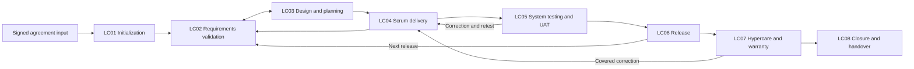

# 05 — Proposed SDLC flow inside the product

[Analysis index](README.md) · [Previous: Pains, gaps, and workarounds](04-pains-gaps-and-workarounds.md) · [Next: Objects and rules](06-objects-lifecycles-and-rules.md)

This is a proposed product operating model (**AI-inference**), informed by the existing research and the evidence below. It describes a complete engagement journey; release allocation is a separate decision in [opportunities and priorities](07-opportunities-and-priorities.md). The current product direction already selects a vendor-owned workspace, restricted client participation, version-bound decisions, and Scrum delivery. Those are **repository-verified direction**, not claims about running software. [Sources: product blueprint](../../product.md), [requirements](../../requirements.md).

## 1. Current product lifecycle and evidence boundary

**User-provided direction:** D1–D6 define eight overlapping lifecycle/governance stages after contract signing. The [canonical SDLC workflow](../../sdlc-workflow.md) owns detailed activities, gates, responsibilities, exception paths and the original-versus-actual Sprint example. This chapter explains the product interaction model and summarizes those gates without introducing a competing phase list.

**AI-inference:** The engagement home should show the agreed scope/version, current delivery evidence with freshness, and the next decisions assigned to the signed-in person. Stage labels provide context rather than forcing every release into one project status. A project may be developing one release, accepting another and supporting a third under warranty.

Persona codes: P01 vendor PM; P02 vendor PO/BA; P03 delivery team; P04 client PO; P05 sponsor/finance (separate authorities); P06 client QA/UAT. Name the actual commercial, acceptance, release and operations authorities; job titles alone do not grant decisions.

Presales and contracting (PH01/PH02 in the earlier research) are upstream context. Record their signed outputs: agreed deliverables, exclusions, assumptions, price/payment terms, acceptance conditions, dependencies and authorities. The product does not manage opportunities, write proposals or replace contract execution. Discovery may occur within the signed engagement; “Sprint 0” is an informal preparation label, not a new Scrum event.

## 2. Stage decisions and product interactions

All operating details are **AI-inference/proposed design** under the owner's stage direction. Entry/exit decisions apply to identified scope, baseline or release, not every item in the project at once.

| Stage | Entry and key artifacts | Vendor acts | Client acts / approves | Exit and exception route |
|---|---|---|---|---|
| LC01 Initialization | Signed inputs; charter, stakeholder/authority map, communications, risks, kickoff | P01 coordinates; P03 checks access/dependencies; P02 clarifies inputs | Sponsor names authority; P04 confirms participation; client IT owns access | Project owner records readiness/holds; missing prerequisites get owner/date, not fabricated completion |
| LC02 Requirements analysis/validation | Need or scope area; versioned requirements/stories, criteria, review decisions, baseline | P02 refines; P03/QA assess feasibility/testability; P01 checks boundary | P04 clarifies/orders value; assigned reviewers/acceptor decide per policy | Applicable review complete; baseline established explicitly; changed agreement routes to CR |
| LC03 Solution design/planning | Understood scope/constraints; design/API evidence, estimates, capacity, roadmap, plan options | P03 designs/estimates; P01 assembles options; team checks feasibility | P04 selects value trade-offs; dependency owners confirm inputs; commercial authorities decide altered commitments | Authorized plan application; baseline separate; infeasible options return to scope/date/dependency choices |
| LC04 Scrum delivery | Team, Goal, timebox and selected work; execution, tests, blockers, review/retro, reports | P03 organizes delivery; P02 clarifies; P01 coordinates; SM supports Scrum | P04 collaborates/reviews; named acceptor records any required decision | Close on time with Done/unfinished/changes visible; blocked work carries attributable history, not an extended Sprint |
| LC05 System testing/UAT | Identified candidate, criteria, environment/data and testers; runs, defects, acceptance package | QA supplies evidence; P03 corrects; P02 classifies against agreement | P06 tests; P04 or other assigned acceptor decides | Candidate-specific decision; failed behavior → correction, new expectations → change; not-run is not pass |
| LC06 Release/deployment | Required acceptance/readiness; go/no-go, deployment and live checks | Engineering/DevOps executes or links external deployment; P01 coordinates | Release/service authority authorizes; operations accepts responsibility | Verified release outcome; failure records recovery/rollback; authorization alone does not mean success |
| LC07 Hypercare/warranty | Release coverage terms/trigger; claims, fixes, stabilization and obligations | Support/P03 triage and remedy; P01 handles disputes | Client reports impact/reproduction and validates remedy | Hypercare transfer and warranty disposition separate; expiry alone does not resolve covered claims |
| LC08 Closure/handover | Agreed scope and residual obligations understood; assets/runbooks, acknowledgments, lessons, finance references | P01 reconciles obligations; P03 transfers knowledge/assets | Named recipient acknowledges transfer; acceptor and commercial owners make their separate decisions | Explicit closure/remaining obligation disposition; maintenance handled under separate authority, not silently included |

A decision card identifies purpose, subject revision/build, evidence, requested action, assigned authority, due calendar and effect. A read/comment grant does not imply approval permission. Show “required decision overdue” separately from “optional feedback not received”; silence never becomes product approval.

### Original plan versus real execution

The original Sprint timebox and initial selection remain visible. Actual start, blocked intervals, work completion and client acceptance are separate dated facts. Current forecasts and recovery scenarios are labelled and timestamped. The system may show an item continuing beyond the original end date without suggesting that the Sprint itself continues.

**Illustrative interaction:** PM opens a Sprint timeline showing its fixed end on Friday. An unfinished item has a recorded client dependency and a forecast completion next Tuesday. At Sprint close the item remains unfinished in that Sprint. A future selection and Tuesday's actual completion are separate events. The forecast is not retroactively treated as an observed fact; velocity does not count the same completion twice. See BR-060–BR-062 and the worked dates in the canonical workflow.

Daily Scrum supports Developers' inspection/adaptation; PM reporting can reuse the timeline, capacity and burndown without making it a required status presentation to the PM. Contractual acceptance is recorded when applicable, distinct from the Sprint Review's inspection purpose and the team's DoD.

## 3. Shared exceptions and visibility

These are proposed interactions derived from PP01–PP08 in [Chapter 04](04-pains-gaps-and-workarounds.md), with authority constraints from the repository.

| Situation | Vendor sees/does | Client sees/does | Product consequence |
|---|---|---|---|
| Required sign-off is late | P01 sees affected commitment, elapsed business time, requested decision and escalation owner. | Assigned acceptor sees the exact submission and decision deadline; deputy sees it only when authorized. | Pending/overdue display; no automatic approval. Optional feedback does not become a hidden gate. |
| Client requests a change in chat | P02 records the request and classification; P03 assesses impact. | P04 confirms intent; P05 decides a commercial amendment if required. | Candidate remains outside agreed scope until the applicable approvals and explicit reconciliation complete. |
| Vendor cost forecast worsens | Authorized vendor people see actual cost, assumptions and reserve exposure. | Client sees deliberately shared milestone/scope risk and the required decision, not undisclosed salaries or margin. | Visibility is evaluated for each field, attachment and notification; a link does not grant permission. |
| Old approval is presented after a revision | P01/P02 compare the approved revision with the candidate and determine affected gates. | Acceptor sees “You approved version 2; version 3 requires a new decision” where applicable. | Historical decision preserved; latest content does not inherit it. |
| Acceptance is disputed after invoicing | Vendor sees accepted scope, invoice reference, dispute reason and unresolved obligation. | Authorized client business/finance users see their respective evidence and dispute actions. | Separate acceptance, dispute and payment records; resolution may require a credit or correction in the finance system. |
| Client withdraws or contract ends early | Commercial owners record the agreed settlement and work disposition. | Client selects authorized handover/termination decisions. | Close or suspend affected delivery work explicitly; preserve records and access/retention obligations. |

Every phase screen should distinguish a verified fact, a forecast, and a requested decision. Notifications should link to an authorized next action and be sent only to people who can see its underlying evidence. This is a design hypothesis to validate, especially where clients prefer email over a new portal.

## 4. Boundaries requiring a product decision

The product boundary is now settled by D4–D6: post-contract delivery is in scope; CRM/presales, native financial processing, source hosting and a proprietary load-testing engine are outside the initial implementation. The first increment is a subset of the complete lifecycle; detailed QA/UAT, API collaboration and warranty/closure remain proposed subsequent increments. [Product sequence](../../product.md#8-product-scope-and-proposed-delivery-sequence).

Choose the depth of integration in interviews: an engagement hub that links authoritative delivery/finance tools, or a deeper system that owns more workflows. Test the cost of duplicate entry against the value of integrated decision evidence. Do not interpret the comprehensive model as a decision to build a CRM, test-management suite, deployment engine, or accounting ledger.

## Sources

All external pages checked 2026-11-07. The screen designs, phase gates, role assignments and exception handling above are **AI-inference/proposed design**, not reproduced standards or customer-validated requirements.

- **EX-C01 — Ken Schwaber and Jeff Sutherland, [The Scrum Guide](https://scrumguides.org/scrum-guide.html), November 2020.** Framework boundaries for Sprint duration, quality/goal protection and PO cancellation; does not define contract or invoice approval.
- **EX-C02 — Government Digital Service, [How the discovery phase works](https://www.gov.uk/service-manual/agile-delivery/how-the-discovery-phase-works), living Service Manual guidance.** Supports discovery before commitment and proceed/stop decisions; government-service context limits direct transfer to vendor contracts.
- **Repository-verified direction:** [Product blueprint](../../product.md), [requirements](../../requirements.md) BR-003–005, BR-011–023, BR-027–030, BR-038, BR-047–055, and [current workflow decisions](../../deliverypilot-workflow-discovery.md#197-lifecycle-and-execution-visibility-decisions) D1–D6. These establish recorded intent and proposed constraints, not implementation proof.
- **Existing research synthesis:** [SDLC phases](../03-sdlc-phases.md), [Scrum operating model](../04-scrum-operating-model.md), [scope/change management](../05-scope-and-change-management.md), [risk/governance](../06-risk-quality-and-governance.md), and [templates](../08-templates-and-checklists.md). Their Atlas figures and operating gates are illustrative rather than empirical customer evidence.
