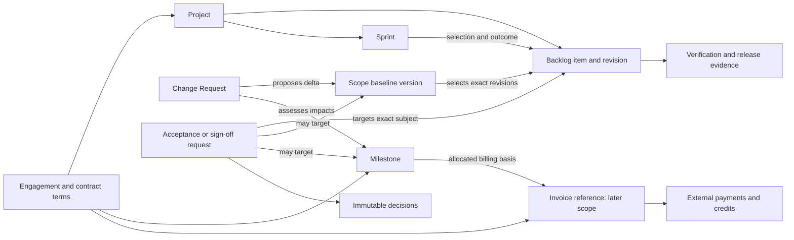
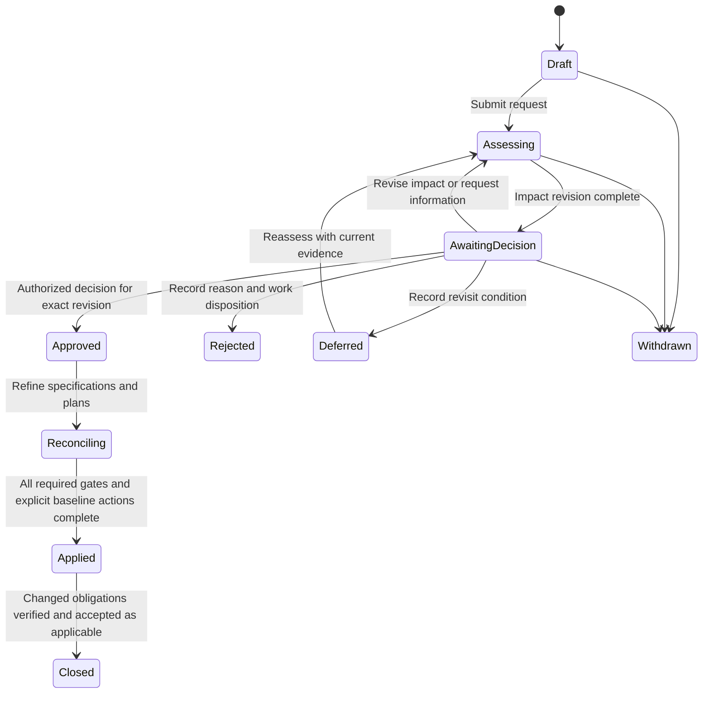
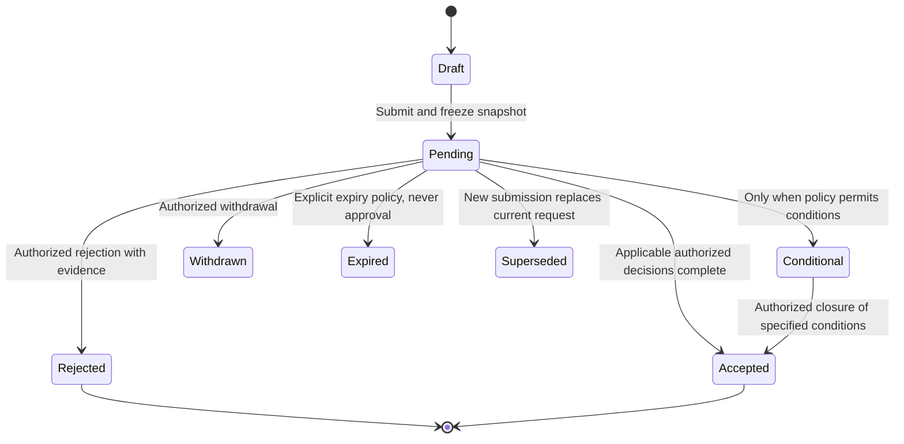

# 06 — Core objects, lifecycles, and fixed-price rules

[Analysis index](README.md) · [Previous: Product SDLC flow](05-product-sdlc-flow.md) · [Next: Opportunities and priorities](07-opportunities-and-priorities.md)

**Proposed product model / AI-inference.** The objects and state names below are design candidates, not accepted schemas, APIs, or implemented features. Existing product decisions require exact-version evidence, explicit baseline changes, distinct delivery/acceptance/release facts, one active Sprint per MVP project, and restricted client visibility. The model preserves those constraints. [Repository requirements](../../requirements.md), [product blueprint](../../product.md).

> **Scope reconciliation — 2026-11-07:** D1–D6 establish post-contract delivery across eight governance stages. Presales/contracting remain upstream context; native invoicing remains external. See the [current lifecycle](../../sdlc-workflow.md) and [analysis index](README.md). Detailed policies here remain proposals.

## 1. Model the relationship before choosing a status field

Use a vendor-owned **Engagement** to hold client and contract context and link the project. A **Scope Baseline** selects exact requirement/work-item criterion revisions. A **Delivery-plan Baseline** records a separate reference schedule; current forecasts can differ without replacing either baseline. Supporting evidence, decision assignments, and artifact revisions need durable identifiers.

Edges do not imply automatic approval or a rigid hierarchy. A milestone may depend on several deliverables spanning Sprints; one release may satisfy part of several milestones. Finance allocation must prevent double billing when evidence is reused.

**Minimum common record:** owner/workspace and authorized audience; engagement/project association where applicable; stable ID; revision; responsible person; timestamps/history; source and evidence links. A person’s role title does not grant a decision capability. P01–P06 references use [the persona definitions](02-stakeholders-and-personas.md).

## 2. Backlog item

**Purpose:** Describe deliverable work and its agreed behavior without making every item a contractual promise. P02/PO manages meaning and priority; P03 owns implementation evidence; P01 coordinates commitment impact. The client sees deliberately shared scope and evidence and decides only where assigned.

**Proposed fields:** type, title/outcome, criteria revision, requirement links, scope-baseline entries, proposed/authorized change link, estimate/unit/history, priority, dependencies, responsible team, Sprint memberships/outcomes, DoD version/evidence, QA evidence, acceptance references and release references. Types include Story, Bug, Spike and technical work; a technical item need not invent a user story.

| Dimension | Proposed values | Transition guard / consequence |
|---|---|---|
| Execution | Draft → Ready → In progress → Verification → Done; Archived or Cancelled where appropriate | Readiness exposes missing decisions/dependencies; P03 records work and verification. Done requires the agreed DoD evidence. Failed checks return to correction. Cancellation records reason and scope consequences. |
| Agreement coverage | Candidate / Within agreed baseline / Proposed amendment / Removed by authorized amendment | Computed from exact baseline/revision links and explicit changes; moving a card does not change contractual scope. |
| Client acceptance | Not required / Not requested / Pending / Accepted / Rejected / Conditional if policy permits | Derived from the applicable acceptance request for a specific subject revision; no default client approval before every story. |
| Release | No release / Included in candidate / Released / Rolled back or superseded in a later release | Linked deployment evidence records what actually shipped; does not alter prior acceptance or Sprint evidence. |

**Reopening:** A defect can reopen execution with a reason or create linked corrective work, depending on team policy. Preserve the previous Done/acceptance evidence and the build it described. If expected behavior changes, create a proposed criterion revision and assess scope impact; do not overwrite the accepted criterion. “Client rejected” alone does not prove a technical defect: triage failed agreed behavior versus a new request. [Repository BR-012, BR-017, BR-021, BR-030](../../requirements.md).

## 3. Change Request

**Purpose:** Obtain a decision about a material change to an agreement or commitment and track the work needed to apply it. P01 coordinates, P02 clarifies, P03 estimates technical/quality effects, P04 supplies value, and assigned commercial authorities approve price/scope/date amendments.

**Proposed fields:** requester and reason; affected baseline/version; classification and disputed interpretations; added/removed/modified items; criteria; estimate confidence; price/currency, schedule, client obligations, quality, acceptance and warranty effects; alternatives; decision deadline; decision policy/actors; current revision; authorized amount; reconciliation actions and resulting baseline references.

`Approved` authorizes the described change path. It does not itself accept new specifications, create a new baseline, apply a schedule, or prove feasibility. `Applied` means the necessary approved changes are incorporated into the applicable records; delivery may still be outstanding. Approval revised after decision needs new evidence and authority; after application, use an attributable corrective/reversing change rather than deleting history. Rejected/deferred requests retain current baselines and an explicit continue/pause decision for affected work. [Repository BR-021/BR-038 and change governance](../../requirements.md#5-approval-and-change-governance).

## 4. Sprint

**Purpose:** Hold the timebox, goal, original selection, subsequent changes and actual outcome. The Scrum Team plans; Developers select feasible work with the PO. P01 tracks commercial consequences without replacing team planning.

**Proposed fields:** goal; start/end; team/calendar; capacity and assumptions; original selected item revisions and estimates; material additions/removals with reasons and decision evidence; outcome per item; review record; retrospective actions; closing snapshot.

| Transition | Authority and guard | Evidence/visible effect |
|---|---|---|
| Planned → Active | Authorized team action after planning; no other active Sprint for the MVP project; required goal/capacity/selection recorded | Freeze the original selection snapshot, while execution and documented changes remain possible. |
| Active → Closed | Authorized team closing action at the timebox boundary | Record Done, carried-over, removed and other relevant outcomes, goal result and review/retro references. Outstanding client signatures remain pending separately. |
| Active → Cancelled | Assigned Product Owner when the goal is obsolete | Reason, current usable work, and disposition of remaining work recorded; no inference that a cancelled Sprint has earned a payment. |
| Planned → Cancelled | Authorized planning owner under local policy | Preserve the fact that a future plan was withdrawn; distinguish this from cancelling an active Scrum Sprint. |

Closed Sprint snapshots are not silently rewritten. A correction appends history and explains any reporting revision. Product policy must define how reworked items affect velocity without counting the same completed scope twice. No “Paused Sprint” extends the timebox indefinitely. The active-Sprint cancellation rule follows the Scrum Guide; other state names are proposed product design. [EX-C01](https://scrumguides.org/scrum-guide.html).

## 5. Milestone

**Purpose:** Represent a delivery or commercial checkpoint with its own evidence and target date. P01 maintains it; the client accepts it only through the assigned authority and criteria. A milestone may be nonfinancial.

**Proposed fields:** contract/SOW clause and version; target and current forecast; deliverables/criteria; evidence requirements; dependencies; acceptor; payment linkage if any; amount/currency and allocation rule; holdback/partial-acceptance terms; current submission and decision references.

| Dimension | Values and rules |
|---|---|
| Delivery | Planned → In progress → Ready for acceptance → Achieved; correction can return Ready to In progress. Cancelled requires authority and linked contract effect. |
| Acceptance | Pending / Accepted / Rejected / Conditional, taken from its exact acceptance request rather than entered twice. |
| Payment eligibility | Not evaluated / Prerequisites missing / Eligible / Disputed, based on explicit terms and a responsible person's evidence review. |
| Billing and settlement | Linked invoice allocations and external payment status; “Achieved” does not mean invoiced or paid. |

`Achieved` requires the defined milestone criterion, not merely a date or Sprint ending. Partial acceptance records accepted and outstanding components. It creates a billable portion only where contract terms and authorized decisions permit that allocation. Rescheduling changes the forecast first; a contractual date changes only through the appropriate amendment and explicit plan/baseline action.

## 6. Acceptance / sign-off

**Purpose:** Ask an authorized person for a specific decision about an exact subject and retain the response. Separate the **request**, its **submitted snapshot**, each **decision**, and the **application action** that uses it. Scope agreement, increment acceptance, UAT acceptance, milestone acceptance, release authorization and handover acknowledgment have different purposes and policies.

**Proposed fields:** purpose; subject IDs/versions or build; frozen submitted evidence/criteria; requester; required versus optional participants; delegated authority and policy; client feedback-only versus approval-required mode; submitted/due timestamps and calendar; decisions with reasons/conditions; supersession/withdrawal history; follow-up owners; resulting acceptance/baseline/release references.

An accepted or rejected **submission** is historical; the underlying deliverable can be revised and submitted under a new request. Past decisions remain readable. Do not reopen the old record and silently change its evidence. `Superseded` on a pending request means a new decision is needed; it never erases a previously accepted historical version. Overdue is a derived flag, not an approval outcome.

For a scope/specification review policy requiring reviewer decisions followed by an authorized final-acceptance action, completing reviews makes that action available; it does not execute it. Baseline establishment remains another explicit action. MVP scope sign-off is not a requirement to implement the deferred per-UR review suite. [Repository BR-013, BR-018–023, BR-049–050](../../requirements.md).

**UX proposal:** Show the purpose in the button (“Accept this increment version”) and explain what it authorizes. A comment is not a rejection; a rejected decision identifies unmet criteria or its reason. An unauthorized stakeholder can provide feedback without gaining the ability to sign. In-app decisions do not claim legal electronic-signature status.

## 7. Invoice

**Scope boundary:** Invoice is modeled because the user explicitly requested it. Native billing/accounting is outside the initial implementation under D5. The near-term candidate is an authorized reference to a finance-system invoice with provenance and linked milestone evidence; richer lifecycle actions belong to a separately validated commercial extension. Even a reference view needs a deliberate release decision. [Repository V3 and product scope](../../product.md#8-product-scope-and-proposed-delivery-sequence).

**Proposed fields for that future/reference model:** finance-system ID/link; supplier and customer entity; issue/due dates; currency; line and milestone allocations; tax/credit references; total, paid and outstanding amounts; source status; last synchronized/verified time; commercial dispute record; evidence of collection or authorized reconciliation. P01 supplies milestone evidence, vendor finance issues/adjusts documents, and client finance validates payable records and settlement; P04/P06 business acceptance remains separate.

| Dimension | Proposed interpretation and guard |
|---|---|
| Document | Draft → Issued; Voided/corrected only through the authoritative finance process. A finalized historical document is not silently edited in the delivery product. |
| Settlement | Unpaid / Partially paid / Settled, based on payment allocations and adjustments from the source. A payment reversal can reopen an outstanding balance with its history preserved. |
| Collection | Current / Overdue / Uncollectible if the authoritative source uses it. Overdue derives from due date and outstanding amount under agreed terms; it does not replace document or dispute status. |
| Dispute | None / Raised / Under review / Resolved, with disputed amount, reason, parties, evidence and resolution. A partial dispute need not conceal an undisputed balance. |
| Data confidence | Verified as of timestamp / Update pending / Reconciliation needed. Unknown collection status is not zero or paid. |

**Externally-sourced example:** Stripe documents draft, open, paid, void and uncollectible invoice states, with unpaid or incompletely paid invoices remaining open. This supports separating a document from its collection progress; the product design above is not a copy of Stripe's state machine or a universal accounting rule. [EX-C03](https://docs.stripe.com/invoicing/overview).

**Proposed link rule:** A milestone allocation identifies exactly which accepted obligation and amount an invoice line represents. One milestone can have several invoice lines/documents when permitted; one invoice can cover several milestones. Show eligible, invoiced, credited, collected and outstanding amounts separately. Enforce amount reconciliation against authorized terms, including any deposit, holdback, credit or change allocation. Never send an invoice, collect money, or mark it paid merely because a Sprint closes.

## 8. Fixed-price rules and decision boundaries

Rules are **proposed operational interpretations**, except where a repository constraint is explicitly cited. FP IDs are local analysis references, not approved BR IDs.

| ID | Proposed rule and example | Pain addressed / decision owner |
|---|---|---|
| FP01 | The scope baseline selects exact agreed outcomes/criteria versions. Linking an item, accepting a requirement, or moving a card does not establish a baseline. | PP01, PP03; authorized baseline owner with required client decisions. Repository BR-013/020. |
| FP02 | Keep original price, approved amendment totals and pending proposals visible. Proposed change value never contributes to committed price or authorized scope. | PP01, PP02, PP05; commercial authorities. |
| FP03 | A client change allowance, vendor contingency, and vendor margin are different amounts with different owners. An unspent vendor contingency does not authorize extra client scope. | PP01, PP07; client commercial owner and vendor finance/delivery authority. |
| FP04 | If a client authorizes a change-budget ceiling, record its currency, period, permitted categories and approval limits. Each CR still needs the applicable decision; reserve funds only at the defined authorization point, release them on authorized cancellation, and show applied commitments separately from pending requests. | PP02, PP05; delegated commercial authority. Exact reservation semantics need validation. |
| FP05 | A swap records both removal and addition with criteria, sunk work, testing, dependency and warranty effects. Equal points alone do not establish cost neutrality; mandatory obligations cannot disappear through reprioritization. | PP01, PP02, PP03; PO/team assess, commercial authority decides. |
| FP06 | Impact review covers all affected agreements and evidence. CR approval precedes required specification acceptance; scope baseline, plan application and delivery-plan baseline changes remain explicit. | PP01, PP02, PP07; P01/P02 coordinate authorized actions. Repository BR-021/038. |
| FP07 | Price is a commercial amount; cost/effort is a delivery measure. Track vendor actual/forecast internally and share selected delivery consequences under access policy. Point estimates are never a universal money/hour tariff. | PP06, PP07; vendor PM/finance, client PO for shared consequences. Repository BR-034/055. |
| FP08 | A milestone's payment prerequisite is defined by contract terms. An approved test, UAT decision, release, or elapsed sprint satisfies only the condition it actually evidences. Required sign-off remains pending until an authorized decision occurs. | PP04, PP05; client acceptor and finance approver. |
| FP09 | Partial acceptance retains the remaining obligations and only releases a stated billable amount when agreed. Defect concessions and payment effects require explicit evidence, not a guessed percentage complete. | PP03, PP05; authorized business and commercial decision-makers. |
| FP10 | Defect, clarification and enhancement classification compares observed behavior against the relevant agreement. Disputed classification remains visible; a new feature cannot be hidden in warranty and a covered defect cannot be charged as a change by default. | PP03, PP05, PP08; PO/BA/team with escalation to commercial authority. |
| FP11 | Required client decisions use assigned authority, exact revisions and an agreed calendar. Silence/expiry is never product approval; optional feedback nonresponse does not create a blocking gate. | PP04; project decision-policy owner. Repository Q11/BR-019. |
| FP12 | Preserve execution, acceptance, release and finance histories. New evidence may change the current assessment but must not rewrite what was reviewed, delivered, billed or known previously. | PP05, PP06, PP08; record owners and authorized correctors. |

### Two financial examples to test the rules

**Existing fictional Atlas scenario:** The baseline price is $180,000. Proposed CR-02 adds $12,000; until authorized and applied through the required actions, the original price/scope remain the reference. After a valid amendment, show original $180,000 + approved amendment $12,000 = current $192,000, alongside the baseline version and any separate forecast delay. The original $18,000 vendor contingency remains an internal cost provision. [Atlas source assumptions](../README.md).

**Additional hypothetical allowance:** A client separately authorizes a $20,000 ceiling for defined changes. A $12,000 authorized reservation leaves $8,000 unreserved. Pending $5,000 requests are shown separately and do not reduce the authorized amount until the defined decision occurs. Whether the ceiling increases the signed contract price upfront or only when individual amendments are executed is a contract option to capture, not a default inferred from the word “budget.” This is a new example, not an Atlas fact.

## 9. Review cases before specifying implementation

| Case | Expected proposed behavior |
|---|---|
| Client approves item revision 2; vendor changes criteria in revision 3 | Preserve revision-2 decision; revision 3 has its own impact/review path. |
| CR is approved while an affected required specification review is pending | Show Approved/Reconciling; current baselines remain until prerequisites and explicit actions finish. |
| Done item is rejected because the client wants new behavior | Record rejection and triage; do not silently turn new scope into a free defect or erase prior quality evidence. |
| Sprint ends with unfinished work and a pending client decision | Close actual Sprint outcomes; carry remaining work through team planning; keep the separate decision pending. |
| One milestone is partially accepted and partially disputed | Show accepted/outstanding components and contract-based eligible amount; no universal “half complete means half payable.” |
| Invoice is partially paid and overdue | Show both facts and the amount still due; avoid one status hiding the other. |
| Client guest receives a link to an internal cost attachment | Deny access unless explicitly authorized; retain the shared decision context without exposing internal data. |
| Warranty date passes with an unresolved timely claim | Show expiry and the unresolved obligation separately; follow the agreed claim terms. |

## 10. Execution and engineering evidence additions

These are proposed supporting concepts for D2/D6 and the owner's API collaboration idea, not new database/schema decisions.

| Concept | States / lifecycle | Links and invariants |
|---|---|---|
| Original Sprint snapshot | Established at start; preserved as history | Timebox and selected versions; later changes have their own records |
| Work execution event | Recorded → corrected by attributable correction, never hidden rewrite | Actual start/blocked/unblocked/completion; source and as-of time; missing does not mean zero |
| Forecast / scenario | Draft → reviewed → applied or discarded/superseded | Based on specified current inputs; application is authorized; cannot extend original Sprint timebox or itself amend a contract |
| API specification revision | Draft → reviewed/published → superseded or deprecated | Request/response/error/security description; optional story/task links; curl input creates an incomplete draft, never invented response schemas |
| API deployment availability | Unknown → reported available → verified; later unavailable or superseded | Exact revision + build + environment; multiple environments coexist; latest published spec is not proof of availability |
| Consumer integration | Pending → integrating → verified; blocked or needs revalidation | Consumer + API revision + deployed build/environment + evidence; new revision does not erase prior verified history |
| Performance run | Planned → running → completed, failed or aborted; outcome pass/fail/inconclusive separate | External tool, script/workload/data/config, API revision, build, environment, timestamps, metrics and thresholds; provenance included in export |
| Warranty obligation | Pending trigger → active → expired with claims assessed → fulfilled or disputed | Applicable release, dates and agreed coverage; expiry does not erase unresolved covered claims |
| Handover / closure decision | Preparing → submitted → accepted or changes requested; closure separately recorded | Recipients, assets/runbooks/access, residual owners and final/commercial evidence; release alone is insufficient |

Scope approval, published API revision, successful deployment, consumer integration and performance compliance are different assertions. Notifications can tell an authorized FE owner that a revision is available, but only consumer evidence can show successful integration. A performance result for staging build B17 cannot prove production B18 meets its thresholds.

The [canonical execution example](../../sdlc-workflow.md) specifies the original/actual comparison and carry-over edge cases. BR-058–BR-067 in [requirements](../../requirements.md) consolidate shared constraints. Search and AI must filter all linked metadata, including snippets and hidden counts, by current access.

## Sources

External sources checked 2026-11-07. State names, fields, FP rules, financial examples and review cases are **AI-inference/proposed design**. They require product-owner and user validation; no source establishes this exact model as mandatory.

- **EX-C01 — Ken Schwaber and Jeff Sutherland, [The Scrum Guide](https://scrumguides.org/scrum-guide.html), November 2020.** Supports active-Sprint cancellation authority; the proposed stored Sprint states are a product design.
- **EX-C03 — Stripe, [How invoicing works](https://docs.stripe.com/invoicing/overview), living documentation.** Supports the distinction between invoice document and collection states. Vendor-specific example, not jurisdiction-independent invoice policy. The page contains differing statements about whether a paid state can reopen; this model leaves reconciliation to authoritative finance events rather than claiming universal terminality.
- **Repository-verified direction:** [Cross-feature requirements](../../requirements.md), especially BR-011–023, BR-027–030, BR-034, BR-038, BR-047–050 and BR-055; [workflow decisions](../../deliverypilot-workflow-discovery.md#191-original-discovery-decisions), especially Q11/Q13/Q18/Q21/Q22/Q24/Q28/Q30/Q39/Q41 and V1–V4; [product scope](../../product.md#8-product-scope-and-proposed-delivery-sequence). These record intended behavior and release boundaries; they do not demonstrate implementation.
- **Prior research:** [Scope/change management](../05-scope-and-change-management.md), [risk/governance](../06-risk-quality-and-governance.md), [templates](../08-templates-and-checklists.md), and [Atlas assumptions](../README.md). These supply worked examples and practitioner synthesis, not observed customer data.
