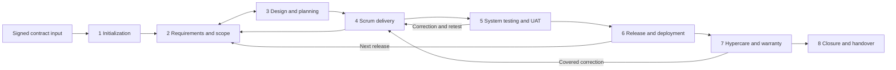

# DeliveryPilot — SDLC workflow

> Status: Current product-direction reference; detailed operating rules and examples are proposed unless explicitly attributed.
> Updated: 2026-11-07.
> Direction: [D1–D6](deliverypilot-workflow-discovery.md#197-lifecycle-and-execution-visibility-decisions).
> Owners: Product Owner and delivery lead. Shared rules: [Requirements](requirements.md). Implementation sequence: [Roadmap](roadmap.md).

## 1. Scope and how to read the lifecycle

DeliveryPilot starts with a signed delivery agreement and manages the project's delivery through warranty and closure. Record or reference the contract's scope, assumptions, exclusions, price, milestones, acceptance conditions and authorized representatives. Presales and procurement history can be linked as input; CRM and proposal management are outside the initial implementation.

The eight stages organize lifecycle visibility and governance. They are not a compulsory sequence of department handoffs. Requirements refinement, design, implementation and testing overlap. UAT, deployment and warranty coverage can occur for multiple releases while other scope is still being developed. Each gate identifies its subject: project, release, baseline revision, or selected work.

A project can therefore have development active, a release awaiting UAT, and another release in warranty. Show those facts separately. Stage summaries may be pending, active, waiting, completed or not applicable with a reason; these are proposed presentation states, not a single state machine that blocks all parallel work.

Arrows show common routes, not automatic approvals. Continuous testing, risk management, reporting, traceability and collaboration apply throughout.

## 2. Actors and authority

| Participant | Responsibility | Authority boundary |
|---|---|---|
| Vendor PM | Coordinate commitments, resources, risks, dependencies and reports | Can propose recovery; contract amendments require the assigned commercial decision-makers. |
| Client PO and vendor BA/proxy | Client priorities, examples, refinement and feedback | Identify one accountable PO; proxy authority is explicit and bounded. |
| Delivery team, QA, technical lead and DevOps | Estimate, implement, test, integrate and prepare releases | Provide feasibility and evidence; a board move does not grant client acceptance. |
| Scrum Master | Support Scrum effectiveness and removal of impediments | Facilitation does not imply commercial authority. |
| Client sponsor and commercial representative | Resolve business trade-offs, funding and commitments | May differ from the client PO or finance contact. |
| Client UAT and operations | Validate business outcomes and operational readiness | Test execution, acceptance authority and release authorization are separate assignments. |
| Client/vendor finance | Verify contractual entitlement and reconcile financial records | Financial activity occurs in the external accounting process initially. |

One person can perform several responsibilities. Membership, project participation, visibility and decision permission remain distinct. Clients receive explicitly shared context; vendor internal costs and another organization's work do not become visible through a role name.

## 3. Eight lifecycle stages

### LC01 — Project initialization

**Entry:** Signed agreement or reference is available; an authorized vendor owner establishes the project and client engagement.

**Work and artifacts:** Project charter and Product Goal; stakeholder map; responsibility and decision matrix; team participation; communication calendar; initial risks; access/dependency checklist; kickoff record. Capture contract obligations and unknowns as attributable inputs.

**Vendor:** PM organizes kickoff, registers obligations and proposes the working arrangements; team identifies access and technical dependencies.

**Client:** Sponsor confirms business outcome and authorities; PO and dependency owners confirm participation and required inputs.

**Exit:** Named owners acknowledge their obligations; required starting access is verified or affected work has an explicit workaround/hold decision. The authorized project owner records readiness, not an automatic acceptance of all future requirements.

**Exceptions:** Missing contract details, unavailable PO or access become owned actions and visible risks. Independent preparation may proceed under its authority.

### LC02 — Requirements analysis and validation

**Entry:** A product need or agreed scope area requires definition or refinement.

**Work and artifacts:** User/functional/nonfunctional requirements, epics/features, stories and acceptance examples; versioned discussions; review decisions; traceable scope baseline. Drafting and estimation can precede final agreement.

**Vendor:** BA facilitates refinement; team and QA assess ambiguity, feasibility and testability; PM checks contractual boundaries.

**Client:** PO clarifies priorities and behavior; assigned reviewers provide feedback or approval according to the applicable policy.

**Exit:** Selected work has sufficiently clear criteria and applicable review evidence; an authorized action establishes the exact scope baseline. Story approval is optional by policy; acceptance of content does not automatically baseline every linked item.

**Exceptions:** Changes requested remain revision-bound. A material change to agreed obligations follows CR assessment and decision before applicable acceptance and baseline replacement. Other agreed work can continue.

### LC03 — Solution design and delivery planning

**Entry:** Selected scope and constraints are sufficiently understood for a planning decision; unknowns are visible.

**Work and artifacts:** Architecture decisions and API specifications; estimates with units; capacity and calendars; dependencies; release roadmap; milestone targets; current plan, reference baseline and alternative scenarios.

**Vendor:** Technical contributors design and estimate; team checks capacity and dependencies; PM assembles options.

**Client:** PO orders value; client dependency owners confirm dates; commercial authorities decide changes to contractual scope, price or commitments.

**Exit:** The team considers the selected plan feasible under stated assumptions; an authorized person applies it. Establishing a plan baseline is a separate action. Sprint selection occurs through Sprint Planning.

**Exceptions:** Missing history produces a conditional estimate rather than invented velocity. Infeasible options return to scope, sequence, dependency or date decisions. Updating a forecast does not approve a new deadline.

### LC04 — Iterative Scrum delivery

**Entry:** Team, Sprint Goal, timebox, capacity and selected work are recorded through planning.

**Work and artifacts:** Current execution, design/refinement, development, continuous testing and integration; evidence links; blockers; Daily Scrum adaptation; Sprint Review and Retrospective; reports and actions.

**Vendor:** Team organizes work and supplies completion evidence; Scrum Master supports the events; PM coordinates external decisions and commitment impacts.

**Client:** PO answers questions and participates in review; named acceptor records any applicable version-specific acceptance.

**Exit:** Sprint closes at its timebox with original selection, changes, Done work, unfinished work and goal outcome visible. Carry-over is explicitly reconsidered for a future Sprint. Closing the Sprint does not imply milestone acceptance or release.

**Exceptions:** Blocked work retains owner, blocked interval and dependency. Unexpected scope is assessed; urgent changes record authority and impact. Cancellation and corrections to mistaken data retain attributable history.

### LC05 — System testing and UAT

**Entry:** Identified candidate, agreed criteria, environment, data, client participants and required prerequisite evidence are available.

**Work and artifacts:** End-to-end scenarios, applicable performance/security evidence, UAT runs, defect classification, retest results and acceptance package. This repeats per candidate/release.

**Vendor:** QA coordinates evidence; team corrects defects and identifies regression scope; PM tracks decision deadlines.

**Client:** UAT participants execute or witness scenarios; the assigned acceptor decides acceptance against the agreed criteria.

**Exit:** Required evidence and a recorded acceptance decision exist for the candidate. Permitted conditions identify outstanding obligations, owners and dates. Required quality failures remain visible.

**Exceptions:** Failed tests route to correction; changed expectations route to clarification/change control. Blocked/not-run tests do not become passed tests. A revised candidate requires a documented assessment of affected prior evidence.

### LC06 — Release and deployment

**Entry:** Applicable acceptance, release readiness, operations ownership, deployment window and recovery provisions are recorded.

**Work and artifacts:** Go/no-go decision; deployment/build/environment reference; migration verification; smoke tests; monitoring; release notes and known issues.

**Vendor:** Engineering/DevOps performs or records external deployment and verification, with actual outcome evidence.

**Client:** Authorized release/service owner decides go-live and confirms business/operations readiness.

**Exit:** Deployment and live verification outcomes are recorded; operational responsibility is acknowledged. Record the contractual warranty trigger where applicable.

**Exceptions:** Failure records rollback/recovery and impact; a release authorization is not proof that deployment succeeded. Subsequent releases have their own evidence.

### LC07 — Hypercare and warranty

**Entry:** Release-specific coverage, trigger, dates, contacts and eligible work are known.

**Work and artifacts:** Stabilization issues, support coverage, warranty claims, defect remedies, retest/release evidence and outstanding-obligation register.

**Vendor:** Named support/engineering owners triage and remedy covered problems; PM coordinates disputed classification.

**Client:** Reports business impact and reproduction details, validates remedies and owns client-controlled dependencies.

**Exit:** Hypercare transfer and warranty disposition are recorded separately. Expiry alone does not close unresolved claims that remain obligations under the agreement.

**Exceptions:** Enhancements, incidents, covered defects and maintenance requests have explicit routing. A new release does not silently restart every warranty period; project terms determine coverage.

### LC08 — Project closure and handover

**Entry:** A defined project/release scope is ready for closure assessment; remaining obligations are identified.

**Work and artifacts:** Final acceptance where required, source/documentation references, access and operational transfer, training, lessons, financial-reconciliation reference and continuing obligations.

**Vendor:** PM assembles closure evidence; team demonstrates operating knowledge and assets; finance supplies external reconciliation status.

**Client:** Business acceptor and operations recipient acknowledge their respective outcomes; commercial/finance authorities resolve outstanding financial matters.

**Exit:** Authorized closure identifies what is closed and what continues, with owners and dates. Handover preparation begins earlier; payment, warranty expiry and project closure can occur independently.

**Exceptions:** Missing recipients, unresolved claims or disputes create an owned follow-up/conditional closure path where policy permits. Closing a project must not erase its audit history or active contractual obligations.

## 4. Execution timeline and forecasting

D2 confirms a separate visualization of real execution while preserving the original Sprint. The following interaction and calculation design is proposed for feature refinement.

| Layer | Display and rule |
|---|---|
| Original timebox | Recorded Sprint start/end dates, visible as a fixed reference band. Blockers do not stretch it. |
| Original selection | Versioned selection and estimates at Sprint start; later additions/removals are explicit deltas. |
| Actual execution | Observed work starts, state changes, blocked intervals, verification and completion events. A work span may cross Sprint boundaries. |
| Current plan | Current intended work and future allocation with actor/reason history. |
| Forecast | Estimated completion and milestone effect, with as-of time, inputs and uncertainty. Visually distinct from actual events. |
| Scenario | Proposed alternatives; preview their effects before authorized application. A scenario does not overwrite a baseline. |

### Worked carry-over example

The dates and points below are fictional.

| Event | Original reference | Recorded execution and consequence |
|---|---|---|
| Sprint 3 starts, 2–13 November | Story S-42 selected, eight points | Original selection/timebox captured. |
| Work starts 4 November | Original dates unchanged | Actual start recorded. |
| Dependency blocks work 6–11 November | Original dates unchanged | Dependency owner, reason and blocked interval visible. |
| Sprint 3 closes 13 November | Original end remains 13 November | S-42 is unfinished and earns no Done credit for Sprint 3. |
| Sprint 4 planning, 16 November | Sprint 3 history retained | Team selects remaining work, with carry-over link and current effort estimate. |
| S-42 meets DoD 18 November | Original eight-point estimate remains inspectable | Completion credited once under the team's documented estimation policy, to Sprint 4. |
| Client accepts 19 November | DoD event remains 18 November | Separate acceptance evidence; release may be later. |

The chart can show S-42's actual span continuing beyond Sprint 3's reference band, with Sprint 4 selection and completion annotated. It must not label Sprint 3 itself as continuing. A task's completion does not automatically complete its parent story.

| Edge case | Proposed behavior |
|---|---|
| Estimate changes | Retain original and revised values, unit, actor/time/reason. Remaining effort and point sizing are distinct. No duplicate parent/child totals. |
| Story splits | Preserve lineage and already-recorded history; explicitly allocate remaining scope and prevent double credit. |
| Missing actual event | Display unknown/unreported; do not substitute planned dates as actuals. |
| Reopened work | Preserve the earlier completion evidence; record correction/reopening and apply the defined credit policy without counting the same outcome twice. |
| Capacity changes | Recompute current forecast from authorized availability; preserve the earlier baseline and forecasts. |
| Stale or insufficient inputs | Show last update and missing assumptions; allow qualitative risk rather than fabricated precision. |
| Concurrent edits | Detect stale input before applying a scenario; require reconciliation with current facts. |
| Visibility | Filter work, labels, counts, capacity and AI context by access. Private cross-organization commitments remain private. |

Timeline defaults, estimate treatment after splits/reopening and forecast confidence presentation are open feature decisions. Initial manual actuals and evidence links can support the view before automated connectors.

## 5. Engineering evidence and API collaboration

An API contract revision describes request/response behavior; an implementation build in an environment demonstrates availability; each frontend or other consumer records integration with a particular revision. These are separate records, linked to requirements/work optionally and to a responsible owner.

OpenAPI import and cURL-assisted drafting are proposed authoring inputs. A request example cannot supply all response schemas, error cases or performance expectations. Mark inferred/missing fields and remove credentials from imported examples. Published revisions retain change history; notify affected consumers of relevant changes through their authorized subscriptions. Prior integration evidence stays associated with the prior revision.

A performance run identifies contract revision, build, environment/configuration, script version, dataset, workload, run time, throughput, latency/error measures, thresholds and result evidence. Imported results retain provenance and freshness. Excel exports report those records. External test engines and source/deployment systems remain evidence providers.

## 6. Continuous management and validation

| Concern | Product behavior to refine |
|---|---|
| Fixed-price control | Reference the signed obligations; compare scope deltas, change-budget authorization and delivery impact; keep vendor contingency separate. |
| Reporting | Weekly and Sprint reports identify baseline, actuals, forecast, scope changes, quality, decisions needed and evidence freshness. |
| Health | Separate lifecycle position, progress, contractual acceptance, quality and risk; explain each health indication. |
| Search | Search authorized records by relationships such as assignee, author, reviewer and blocker owner; links/snippets/exports follow the same access policy. |
| AI | Explain observed evidence, draft reports and offer options; humans review feasibility and authorize consequential actions. |
| Integration | Record external IDs, versions, environment, collection time and unavailable/stale evidence; imports do not fabricate approval. |

Review examples: a blocked Sprint closes on time; a revised story needs the selected review policy; a client cannot retrieve private vendor cost through search; two releases can have different UAT/warranty states; a successful deployment does not imply paid invoices.

## Sources and provenance

- [D1–D6 user decisions](deliverypilot-workflow-discovery.md#197-lifecycle-and-execution-visibility-decisions), recorded 2026-11-07. They establish product direction; the detailed design above remains proposed.
- [Cross-feature requirements](requirements.md), especially BR-013, BR-018–021, BR-027–038 and BR-058–065.
- [Original SDLC research](research/README.md) and [analysis](research/analysis/README.md): evidence and hypotheses, including the distinction between framework rules and commercial arrangements.
- [Scrum Guide](https://scrumguides.org/scrum-guide.html), November 2020, checked 2026-11-07: timeboxed Scrum and its accountabilities.
- [OpenAPI Specification](https://spec.openapis.org/oas/latest.html), checked 2026-11-07: structured API descriptions; proposed import, notifications and evidence UX are product design.
