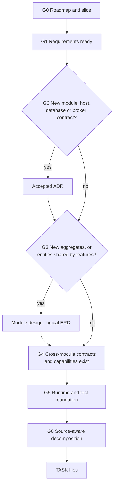

# Pre-task workflow: what must be true before a TASK is created

> Status: Current engineering procedure. Recorded 2026-11-09.
> Owner: Technical lead. Applies to every `TASK-DP-XXX-NNN` planned with `dp-task-planner`.
> Authority: This file owns the **order and exit criteria** of the steps that come before task planning. Artifact formats, statuses and approval rules stay in the [authoring policy](authoring.md); task-file quality stays in `.agents/skills/dp-task-planner/references/task-quality.md`. This file links to them and does not repeat them.

## Why this exists

A task is the last planning step before code. When the steps above it are skipped, the task file absorbs decisions it should only consume: which module owns the data, what the aggregates and invariants are, which Identity capability exists, how the code is deployed and tested. Different tasks then decide the same thing differently, and the first one to land sets the schema for the rest.

The rule: **a task may only consume decisions; it must not make product, architecture or data-model decisions.** Each gate below makes one class of decision before any task is written. A gate either passes, is skipped for a stated reason, or produces a prerequisite artifact (requirement, ADR, design note or technical task).

## Flow

Gates run in order for each feature or vertical slice. A slice that covers several features (for example VS-02 = FEAT-DP-025 + FEAT-DP-004) passes G2–G5 **once for the whole slice**, before any of its tasks are planned.

## Gates

### G0 — Roadmap and slice

| | |
|---|---|
| Question | Is the feature registered, and which slice and dependent features are planned together? |
| Exit | Roadmap row exists; the slice (VS-xx) and its features are named; `depends_on` between features is recorded in each `feature.md`. |
| Owner / tool | Product owner; [roadmap](roadmap.md). |
| Output if missing | A roadmap entry or proposal. No requirements work yet. |

### G1 — Requirements ready

| | |
|---|---|
| Question | Is the intended behavior complete and testable? |
| Exit | `feature.md` and its UR/FR/US are `ready`; the decision record has no open question that blocks planning; cross-feature story dependencies are written down (e.g. "US-DP-004-001 needs US-DP-025-001"); global BR/NFRs that apply are referenced. `python tools/docs.py coverage --feature FEAT-DP-XXX` shows no orphans. |
| Owner / tool | `$dp-feature-engineer`; gates UR→FR→US in the [authoring policy](authoring.md#change-impact-and-review-gates). |
| Output if missing | Requirement drafts and review questions. Tasks may only be explored as `blocked`. |

`ready` is not client approval; see the authoring policy.

### G2 — Architecture placement

| | |
|---|---|
| Question | Which module, host and database own this behavior? |
| Run when | The feature introduces a new module, host, database, broker contract, authentication path, or crosses an existing boundary. **Skip** when it adds behavior inside an existing module and changes no boundary; say so in the task's "Scope and dependencies". |
| Exit | An **accepted** ADR under `docs/architecture/` (or the existing placement in [ARCHITECTURE.md](../ARCHITECTURE.md)) names the owning module, data ownership, auth model and integration style. The target proposal in [architecture.md](architecture.md) does not count. |
| Owner / tool | Technical lead; ADR. |
| Output if missing | An ADR. Tasks stay `blocked`. |

### G3 — Module design (logical data model)

| | |
|---|---|
| Question | What are the aggregates and how are the invariants enforced? |
| Run when | The feature introduces new aggregates, or two or more features (or slices) will read or write the same entities. **Skip** when the work only adds behavior on already-mapped entities; then the EF configuration and migrations are the model. |
| Exit | `docs/architecture/modules/<module>/` contains, per bounded context:  • entities and aggregate roots, with ownership (`OrganizationId`, `ProjectId`) and cross-module references as scalar IDs;  • relationships and local FKs;  • each business invariant mapped to its enforcement: unique or partial-unique constraint, check constraint, row lock / guard, or optimistic version;  • status lifecycles and allowed transitions;  • events the context publishes or consumes, if any;  • modelling decisions with their provenance. |
| Keep it lean | A logical ERD, not a column dictionary. Column types, lengths and index names belong to the first persistence task; after that the EF configuration and migrations are the source of truth (lesson from the Identity [current schema](architecture/modules/identity/current-schema.md) versus the historical dictionary). |
| Owner / tool | Technical lead with the feature owner; `domain-modeling` / `codebase-design` skills where useful. |
| Output if missing | The module design note. Tasks that would create tables stay `blocked`. |

### G4 — Cross-module contracts and capabilities

| | |
|---|---|
| Question | Does every capability the feature needs from another module already exist? |
| Exit | Each prerequisite is either implemented (a `done` task, verified in source) or is its **own** planned task listed in `depends_on`. Typical items: Identity permission/entry codes, internal authority or session checks, message contracts in `src/Contracts/`, Notification email kinds. |
| Owner / tool | Owning module of the capability; `$dp-task-planner plan-technical`. |
| Output if missing | A prerequisite task in the owning module. Never fold another module's change into a feature task. |

### G5 — Runtime and verification foundation

| | |
|---|---|
| Question | Can a task in this module be built, deployed and tested end to end? |
| Exit | The module's hosts exist and are registered in `DeliveryPilot.slnx` and `scripts/Test-Architecture.ps1`; deployment wiring exists if any task's acceptance needs Gateway or deployment checks (compose, Gateway cluster and allowlist, CORS, secrets); the module test project exists and its PostgreSQL-backed tests can run: `scripts/Verify-Module.ps1 -Module <Module> -RequireDb` passes with the module's database variable (table in [README](../README.md#implementing-a-task)). |
| Owner / tool | Technical lead; `$dp-task-planner plan-technical`. |
| Output if missing | One technical task for the missing foundation, placed first in `depends_on`. Feature tasks must not each carry a slice of scaffolding or deployment work. |

### G6 — Source-aware decomposition

| | |
|---|---|
| Question | How is the slice cut into independently verifiable tasks? |
| Exit | `$dp-task-planner` has read the current source and tests (not the design note alone) and proposes tasks in this default order, adjusted to real dependencies:  1. persistence foundations for the context (entities, configuration, migration, isolation tests);  2. create and read paths with authorization and tenant filters;  3. mutations and lifecycle transitions with their concurrency rules;  4. cross-feature and cross-module flows (invitations, links, events);  5. publication (Gateway routes, CORS) and end-to-end journey checks.  Each task follows the [task template](templates/task.md) and the task-quality gates; `depends_on` names real prerequisite tasks from G4/G5. |
| Owner / tool | `$dp-task-planner plan-story` / `plan-feature`. |
| Output | TASK files, `status: pending` only when G1–G5 passed; otherwise `blocked` with the failing gate named. |

## Definition of Ready for a task

A task can be `pending` (implementable) only when all of these hold. Record any skipped gate and its reason in the task.

- [ ] G0: slice and feature dependencies recorded.
- [ ] G1: source UR/FR/US are `ready` and no blocking question is open.
- [ ] G2: owning module is fixed by an accepted ADR or by existing placement.
- [ ] G3: the entities the task touches are described in the module design, or are already mapped in source.
- [ ] G4: every capability from another module exists or is a `depends_on` task.
- [ ] G5: hosts, deployment wiring (if acceptance needs it) and runnable tests exist or are a `depends_on` task.
- [ ] G6: codebase inspected; `codebase_verified` set honestly; `python tools/docs.py check-task --id TASK-DP-XXX-NNN` passes when available.

## When the workflow is too heavy

- **Bug fix or small change in an existing module:** G0, G2 and G3 do not apply. Check G1 (the behavior is specified or the bug is evident), G4 and G6.
- **Technical or NFR task:** no user story is required (see the authoring policy). G1 means the source NFR or FR is identified; G2–G6 apply as written.
- **Spike:** create no TASK. Record the question, time box and finding in the feature's decision record, then return to the gate it unblocks.

## Related documents

- [Authoring policy](authoring.md): IDs, statuses, approvals, review gates.
- [Context map](context-map.md): what to load for each step.
- [ADR-001](architecture/adr-001-delivery-module-placement.md): example of a G2 output and its follow-up order.
- `.agents/skills/dp-feature-engineer/SKILL.md`, `.agents/skills/dp-task-planner/SKILL.md`: procedures for G1 and G6.
